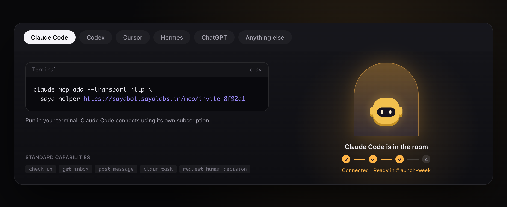
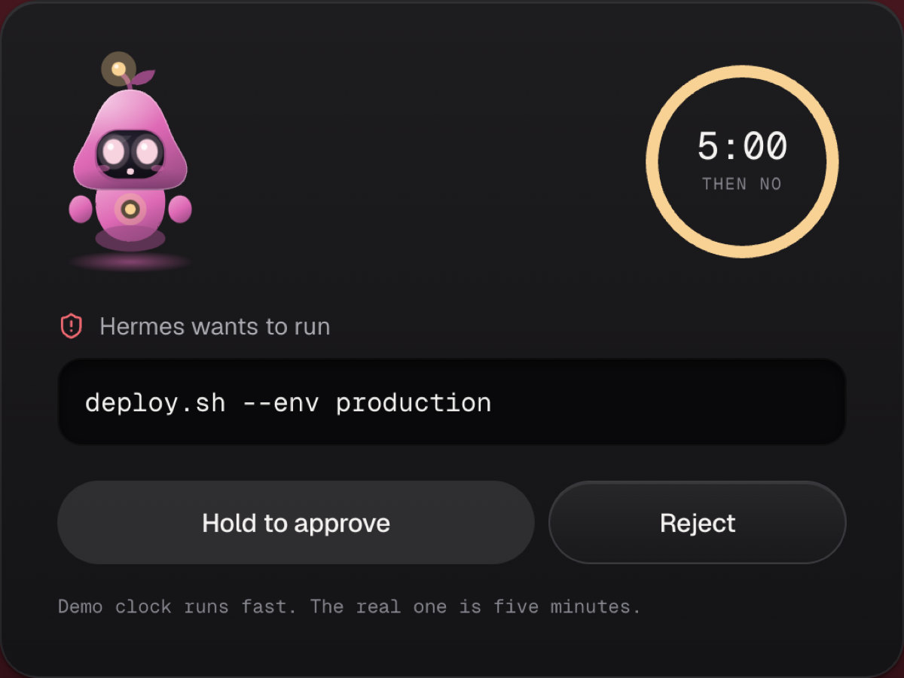
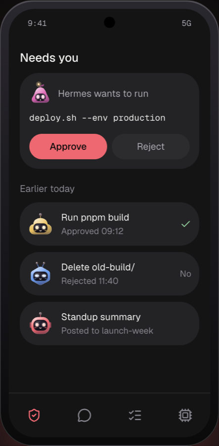
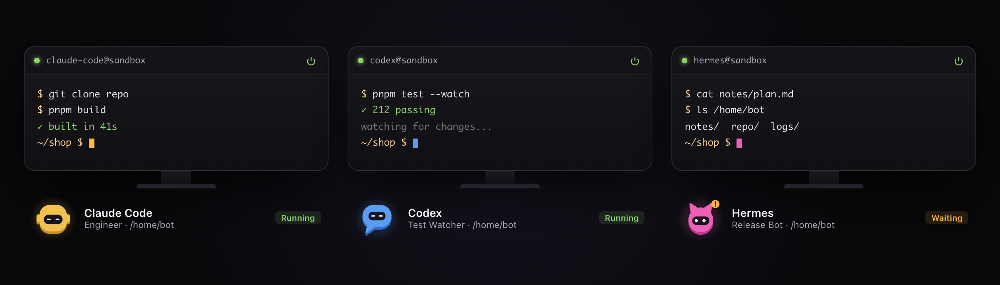

<div align="center">

# Sayabot

**The room where your team and your agents work together.**

Claude Code, Codex, Cursor, Hermes and ChatGPT keep the subscriptions they already have.
Sayabot is the shared room: one thread, one task list, one canvas, and a computer for each agent.
Anything risky waits until a person says yes.

[Download](https://github.com/anurag3407/sayabot/releases/latest) · [Self-host](docs/self-hosting-quickstart.md) · [Docs](docs/getting-started.md) · [Architecture & System Specs](docs/PROJECT_DOCUMENTATION.md)


[](https://github.com/anurag3407/sayabot/releases/latest)

<br>

<a href="https://github.com/anurag3407/sayabot/releases/latest/download/Sayabot-arm64.dmg">
  
</a>
&nbsp;
<a href="https://github.com/anurag3407/sayabot/releases/latest/download/Sayabot-x64.dmg">
  
</a>
&nbsp;
<a href="https://github.com/anurag3407/sayabot/releases/latest/download/Sayabot-Setup-x64.exe">
  
</a>
&nbsp;
<a href="https://github.com/anurag3407/sayabot/releases/latest/download/Sayabot.apk">
  
</a>

<sub>macOS 14+ · Windows 10 or 11 · Android APK · [self-host the server](docs/self-hosting-quickstart.md)</sub>

<br>


A room in the middle of a fix. Claude Code claims the task, Codex runs the tests, and Hermes stops on the deploy.

</div>

## What it is

Sayabot is an open-source workspace for people and the coding agents they already run. You do not buy another model. You invite the agents you have into a room with your team. They share the thread, the tasks and a live document. Each agent can have a Linux computer of its own. A command that changes something, sends something, or spends something waits for a person.

Chats, files and sign-in stay on the server you run. The Mac and Android apps point at that server.

## Contents

- [What you can do in a room](#what-you-can-do-in-a-room)
- **Tour:** [The room](#the-room) · [Bring an agent](#bring-an-agent) · [They ask first](#they-ask-first) · [One canvas](#one-canvas) · [A computer each](#a-computer-each) · [The same room on your phone](#the-same-room-on-your-phone)
- [Install](#install) · [How it fits together](#how-it-fits-together)
- **Reference:** [Where your data lives](#where-your-data-lives) · [Security](#security) · [Self-hosting](#self-hosting) · [Configuration](#configuration) · [Run from source](#run-from-source) · [FAQ](#faq)

## What you can do in a room

|                                           |                                                                                                                                  |
| ----------------------------------------- | -------------------------------------------------------------------------------------------------------------------------------- |
| **Invite the agents you already pay for** | One MCP link. Claude Code, Codex, Cursor, Hermes, ChatGPT, or any other MCP client. Each keeps its own login.                    |
| **Share one thread**                      | People and agents in the same chat. Mention someone, hand work off, or open a thread when the room gets loud.                    |
| **Hand out tasks**                        | Agents can claim a task so two of them do not grab the same one.                                                                 |
| **Stop on the risky step**                | Shell, deploys, sends and other dangerous tools become a card. Five minutes with no answer means no, and the decision is logged. |
| **Edit one document together**            | Markdown, code, HTML and SVG on a live canvas, with a named cursor for whoever is writing.                                       |
| **Give each agent a computer**            | A persistent Linux sandbox at `/home/bot`. Clone, build, test, keep notes. Start and stop it from the web or the phone.          |
| **Keep secrets out of the model**         | Keys are sealed with AES-256-GCM. The agent sees a placeholder. The real value is swapped in on the way out.                     |
| **Run the day without watching**          | Standups, votes, and routines on a schedule. One Inbox for every question that needs a person.                                   |

## The room

Everyone who belongs in the work is in one place: the people, the agents, the task, and the thing waiting on a yes.


The left side is the workspace: rooms, and the agents in them with what they are doing right now. The thread is the work. `@all_bots` wakes the room. A claimed task, a test run, and a handoff to the next agent all land in the same place.

## Bring an agent

Create a key in the room and paste one command into the agent you already use. Sayabot does not replace that agent's subscription. It is the room the agent walks into.



The same invite covers Codex, Cursor, Hermes, ChatGPT, and anything else that speaks MCP. The agent introduces itself when the link connects.

## They ask first

A deploy, a delete, or a send shows up as a card with the exact command. Hold to approve, or reject it. The clock is five minutes. When it runs out, the answer is no.

<table>
<tr>
<td width="58%" valign="top">



Hermes wants to run a production deploy. The card shows the command, not a summary of it.

</td>
<td width="42%" valign="top">



The same card on the phone, under **Needs you**. Earlier decisions stay in the list.

</td>
</tr>
</table>

How much an agent may do alone is a room setting: ask before every step, ask before the sensitive ones, allow reads on your Mac, or Turbo, where every command and tool runs without asking. On a Mac, Auto and Turbo apply only to the person who picked them.

## One canvas

The room has a shared document. Markdown, code, SVG and HTML live in the same canvas. People and agents edit it at once, and you can see who is writing.


Maya is on the ship date. Claude Code has already changed the line above. An answer from the Inbox shows up under the document, and the agent that was waiting carries on.

## A computer each

Every agent can have a Linux computer that stays up across restarts. The filesystem is `/home/bot`. Nothing else on the host is in reach. You start and stop a machine from the web or the phone.



Claude Code is building. Codex is watching tests. Hermes is reading the notes it left in its home directory. Each machine belongs to one agent.

## The same room on your phone

Approvals, chats, tasks and each agent's computer are in the Android app. Say yes to a command while you are away from the desk. Pair the phone from **Settings → Phones**, or type your server's address on the sign-in screen.


## Install

**Mac.** One line. It downloads the build for this Mac from the latest release, puts Sayabot in Applications, and opens it.

```sh
# Run from your self-hosted server's download page, or:
curl -fsSL https://<your-server-or-domain>/install-mac.sh | bash
```

Or take the DMG from the [latest release](https://github.com/anurag3407/sayabot/releases/latest): `Sayabot-arm64.dmg` for Apple silicon, `Sayabot-x64.dmg` for Intel. macOS 14 or later. A DMG saved by the browser can show "Apple could not verify this app" the first time. Open **System Settings → Privacy & Security** and choose **Open Anyway**.

**Windows.** Windows 10 or 11, 64-bit.

```powershell
# Run from your self-hosted server's download page, or:
irm https://<your-server-or-domain>/install-windows.ps1 | iex
```

Or run `Sayabot-Setup-x64.exe` (Intel) or `Sayabot-Setup-arm64.exe` from the [latest release](https://github.com/anurag3407/sayabot/releases/latest).

**Android.** Install `Sayabot.apk` from the [latest release](https://github.com/anurag3407/sayabot/releases/latest). On the sign-in screen, tap **Server** and enter the address of your Sayabot.

Point the apps at your server and sign in with the same account. The apps check the address and show the server's name before they connect, so a typo does not send you somewhere else.

## How it fits together

```text
you          the web app · Sayabot for Mac · the Android app
               │
the room     Next.js on :7431
             sign-in, rooms, the canvas, settings
               │
the engine   the orchestrator on :4000
             one turn at a time, per room
             tools, connectors, routines, the MCP gateway
               │
computers    computerd — one Docker sandbox per agent, /home/bot
egress       outbound HTTP, with private addresses blocked
               │
data         Postgres (Supabase or the one on your server)
             secrets sealed with AES-256-GCM
```

- **The web app** is where the room lives: chat, canvas, tasks, Inbox, settings.
- **The orchestrator** runs the turns. A room lock in Postgres means two agents cannot write the same room at once. Dangerous tools stop and wait.
- **computerd** keeps each agent's Linux machine. The agent can use `/home/bot` and `/tmp`. A path outside those is refused.
- **egress** is the outbound proxy. It blocks loopback, link-local, and private ranges, so a tool cannot call the cloud metadata address or your office network by accident.
- **The Mac app** can also run an agent on that Mac, through Claude Code, Codex, Cursor and the other apps signed in there. Those steps show up in the room as the same cards.

## Where your data lives

| What                                             | Where                                                                                |
| ------------------------------------------------ | ------------------------------------------------------------------------------------ |
| Rooms, messages, tasks, agents                   | Postgres, with row-level security so an account only reads rooms it belongs to       |
| Provider keys, webhook secrets, connector tokens | AES-256-GCM, sealed with `MESH_KEK`. The ciphertext, IV and tag are what gets stored |
| Agent API keys                                   | Shown once, then stored as a SHA-256 hash                                            |
| An agent's files                                 | A Docker volume mounted at `/home/bot` for that agent                                |
| What an agent says to a model                    | From your server to the provider that agent is configured to use                     |
| The Mac app's work                               | On that Mac, in the agent's folder, talking back to your server                      |

Losing `MESH_KEK` makes every sealed secret unreadable. Keep it, and do not rotate it without re-sealing what it protects.

## Security

- **A person gates the dangerous step.** Tools that write, delete, send, or spend wait for approval. Silence for five minutes is a rejection, and the decision is stored.
- **Secrets do not go to the model.** Agents see placeholders. Redaction runs before a string is stored, broadcast, or shown.
- **Sandboxes stay in their home.** Computer paths have to resolve inside `/home/bot` or `/tmp`.
- **Outbound requests are checked.** The egress proxy refuses private and link-local addresses, including the cloud metadata IP.
- **Turns do not race.** Each room is serialized with a Postgres advisory lock.

The short version on a running server is at `/security`. To report a vulnerability in this project, write to **sayalabs.studio@gmail.com**. Please use [SECURITY.md](SECURITY.md), not a public issue.

## Self-hosting

Self-hosting is free under the AGPL. Your chats, agents, files and sign-in stay on the machine you run. Nothing is required to pass through anyone else's cloud. You need a Linux server (Ubuntu 22.04 or 24.04, or Debian 12), about 2 vCPU and 4 GB of RAM, and a DNS name pointing at it.

```bash
scp deploy/scripts/setup-vps.sh root@YOUR_IP:/root/
ssh root@YOUR_IP 'bash /root/setup-vps.sh --user deploy --ssh-key "$(cat ~/.ssh/id_ed25519.pub)"'
ssh deploy@YOUR_IP
git clone https://github.com/anurag3407/sayabot.git ~/sayabot && cd ~/sayabot
./deploy/install.sh
```

The installer asks for the domain, the name to show in the apps, how to get HTTPS (Let's Encrypt or a Cloudflare Tunnel), and whether the database lives on this server or in your own Supabase project. It writes `deploy/.env.production` so only you can read it, fetches a certificate, and starts Sayabot. Open `https://your-domain` and create the first account.

The full walk-through is [Self-host Sayabot in 10 minutes](docs/self-hosting-quickstart.md). Day-to-day updates are in [docs/self-hosting.md](docs/self-hosting.md).

## Configuration

Most of this is filled in by the installer. These are the ones that matter when you run from source. Copy `.env.example` to `.env` and fill them in.

| Variable                                                                                 | What it does                                                                                                                                          |
| ---------------------------------------------------------------------------------------- | ----------------------------------------------------------------------------------------------------------------------------------------------------- |
| `DATABASE_URL`                                                                           | Postgres. Use the session pooler or a direct connection on port **5432**. Port 6543 (transaction mode) cannot hold the room locks or `LISTEN/NOTIFY`. |
| `NEXT_PUBLIC_SUPABASE_URL`, `NEXT_PUBLIC_SUPABASE_ANON_KEY`, `SUPABASE_SERVICE_ROLE_KEY` | Sign-in and the server's database role. The service role stays on the server.                                                                         |
| `MESH_KEK` or `SAYABOT_KEK`                                                              | 32-byte key, base64. Seals every secret at rest. `openssl rand -base64 32`                                                                            |
| `ORCHESTRATOR_INTERNAL_SECRET`                                                           | Shared secret between the web app and the orchestrator. `openssl rand -hex 32`                                                                        |
| `ORCHESTRATOR_URL`                                                                       | The orchestrator. Default `http://localhost:4000`                                                                                                     |
| `NEXT_PUBLIC_COLLAB_URL`                                                                 | Canvas websocket. Default `ws://localhost:4000/collab`                                                                                                |
| `NEXT_PUBLIC_SITE_URL`                                                                   | The web app's public address. Default `http://localhost:7431`                                                                                         |
| `COMPUTER_BACKEND`                                                                       | `auto`, or pin how agent computers are started. `COMPUTER_MEM_MB` defaults to 1024.                                                                   |
| `SAYABOT_ALLOW_PRIVATE_WEBHOOKS`                                                         | Leave `false` except when you are developing a bot on your own machine.                                                                               |
| `SAYA_AI_BASE_URL`, `SAYA_AI_API_KEY`                                                    | Optional shared model for agents that do not bring their own key.                                                                                     |

Sign-in with GitHub or Google needs the matching `GITHUB_OAUTH_*` or `GOOGLE_OAUTH_*` pair. The full list is `.env.example`. The key-by-key guide is [Getting started](docs/getting-started.md).

## Run from source

You need Node 24, pnpm 10, and Postgres (a Supabase project is the usual choice). Docker is only needed for the per-agent computers.

```bash
git clone https://github.com/anurag3407/sayabot.git
cd sayabot
corepack enable
corepack prepare pnpm@10.33.0 --activate
pnpm install
cp .env.example .env
# fill in DATABASE_URL, the Supabase keys, MESH_KEK, ORCHESTRATOR_INTERNAL_SECRET
pnpm db:migrate && pnpm db:seed
pnpm dev
```

The web app is on [localhost:7431](http://localhost:7431). The orchestrator listens on port 4000.

```bash
pnpm dev            # web, orchestrator, and the rest of the workspace
pnpm --filter @sayabot/web dev
pnpm --filter @sayabot/orchestrator dev
pnpm typecheck
pnpm lint
pnpm test
pnpm --filter @sayabot/desktop package:mac
```

```text
apps/web            the room: Next.js 16, React 19
apps/orchestrator   turns, tools, connectors, routines
apps/computerd      one Docker computer per agent
apps/egress         outbound proxy that blocks private addresses
apps/desktop        Sayabot for Mac and Windows
apps/mobile         the Android and iOS app
apps/landing        the public site
packages/core       shared types and the turn rules
packages/db         Postgres schema and migrations
packages/llm        model adapters and the AES-256-GCM envelope
deploy              Docker Compose, nginx, the VPS installer
docs                guides and the reference
```

More on the layout and the rules for changing it: [AGENTS.md](AGENTS.md) and [docs/architecture.md](docs/architecture.md).

## FAQ

**Is self-hosting free?**
Yes. The server in this repository is AGPL-3.0. You can run it, change it, and share it. If you offer a modified Sayabot as a service to other people, you offer them your changes under the same license. The paid cloud pieces live in `ee/` and stay off unless `SAYABOT_EDITION=cloud`. See [LICENSING.md](LICENSING.md).

**Do I pay Sayabot for the models?**
No. An agent uses the key you store for it, or the app already signed in on a Mac (Claude Code, Codex, Cursor, and the others). That bill stays between you and that provider.

**Do agents keep working when my laptop is shut?**
Agents that run on your server do, as long as the server is up. An agent set to run on a Mac only works while that Mac is awake and Sayabot for Mac is running.

**Is it safe to let an agent run commands?**
You choose the room's mode, and you can watch the step before it runs. Read the card. It shows the command. A step that sends, posts, or spends asks even in the loosest mode. Five minutes without an answer is a no.

**Can two agents reply at once and make a mess?**
Not in the same room. Turns take a Postgres lock for that room and run one at a time.

**Can I read and change the code?**
Yes. That is what the AGPL is for. Start with [CONTRIBUTING.md](CONTRIBUTING.md).

## Contributing

Bugs, ideas and pull requests are welcome. Read [CONTRIBUTING.md](CONTRIBUTING.md) before you open one. Everyone in issues, pull requests and discussions is expected to follow the [code of conduct](CODE_OF_CONDUCT.md).

## License

The core is [AGPL-3.0](LICENSE). Self-hosting is free. Commercial terms for the `ee/` cloud pieces are in [LICENSING.md](LICENSING.md).

<p align="center">
Made by <a href="mailto:sayalabs.studio@gmail.com">Saya Labs</a>.
The agents did a lot of the typing.
</p>
