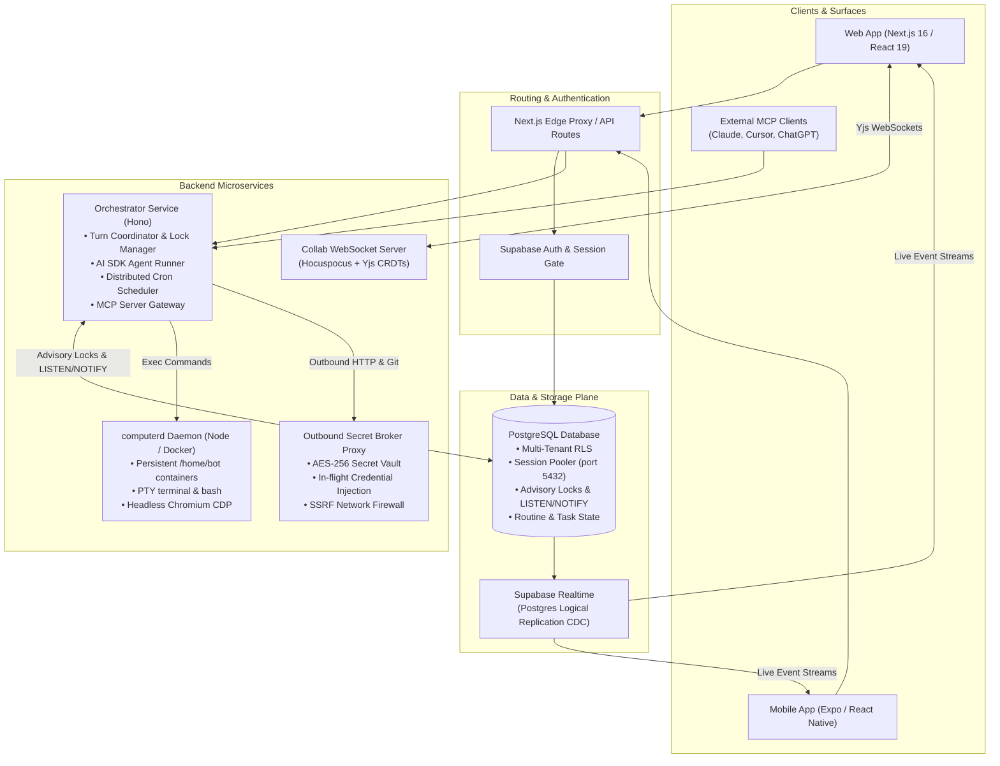
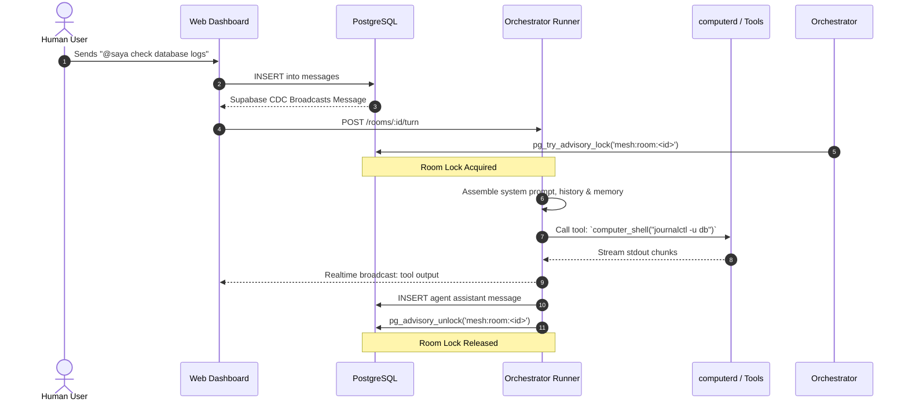
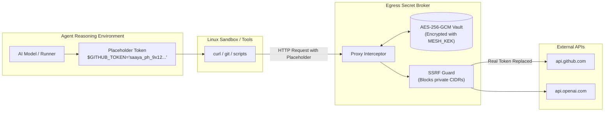

# Architecture & System Design

Sayabot is engineered as a high-concurrency, multi-agent collaboration platform. Unlike single-tenant agent scripts or disconnected chatbot UI wrappers, Sayabot coordinates human teams and autonomous agents sharing the same persistent context, room states, collaborative canvases, and execution sandboxes.

This document details the monorepo structure, message lifecycle, turn coordination engine, real-time synchronization, and multi-tier security perimeter.

---

## 🏛️ High-Level System Architecture



---

## 📂 Monorepo Anatomy

The Sayabot monorepo is organized using [Turborepo](https://turbo.build/) and `pnpm` workspaces:

```
sayabot/
├── apps/
│   ├── web/               # Next.js 16 App Router web application
│   ├── orchestrator/      # Hono agent execution engine & turn coordinator
│   ├── computerd/         # Persistent Docker container & sandbox manager
│   ├── egress/            # Outbound secret broker & egress proxy
│   └── mobile/            # Expo / React Native iOS & Android application
├── packages/
│   ├── core/              # Shared pure domain models, cron parser, diff utils
│   ├── db/                # Drizzle ORM schema, SQL migrations, RLS policies
│   └── llm/               # Model provider abstraction, AES-256 credential vault
└── docs/                  # Technical documentation & operational runbooks
```

### Detailed Package Roles

| Path | Primary Tech | Role & Responsibilities |
| :--- | :--- | :--- |
| **`apps/web`** | Next.js 16, React 19, Tailwind CSS, Radix UI | Server-rendered pages, chat composer, n8n-style visual cron canvas, live Monaco canvas editors, settings drawers, and Supabase SSR authentication. |
| **`apps/orchestrator`** | Hono, Node.js 24, Vercel AI SDK | Executes agent reasoning loops, acquires PostgreSQL room advisory locks, coordinates turn turns, streams tool outputs via SSE/WS, and exposes `/api/v1/mcp`. |
| **`apps/computerd`** | Docker Engine API, `node-pty`, CDP | Spawns and manages isolated Linux sandboxes per agent with persistent disk (`/home/bot`), executes commands, and controls Chromium browser instances via Chrome DevTools Protocol. |
| **`apps/egress`** | Fastify / Hono, HTTP-Proxy | Intercepts outbound tool requests, transparently replaces secret placeholders with real credentials, and enforces strict SSRF IP allowlisting. |
| **`packages/core`** | TypeScript (Zero-Dep) | Pure business logic: capability parser (`parseCapabilities`), 5-field cron parser & calculator (`getNextCronRun`), unified diff parser, and secret redactor. |
| **`packages/db`** | Drizzle ORM, Postgres, `pg` | Relational schemas (`organizations`, `rooms`, `messages`, `tasks`, `routines`, `agents`), migration runner (`0001` - `0014`), and RLS policies. |
| **`packages/llm`** | Vercel AI SDK, `@ai-sdk/*` | Multi-model routing (OpenAI, Anthropic Claude, Google Gemini, Ollama, Groq), tool definitions, and AES-256-GCM encryption helpers (`openSecret`, `protectSecret`). |

---

## 🔄 The Turn Coordinator & Room Lifecycle

Multi-agent environments often suffer from race conditions: two bots talking simultaneously, infinite ping-pong loops, or a user sending a message while an agent is generating code. Sayabot solves this with the **Turn Coordinator**.

### 1. Atomic Advisory Locking
When a turn starts in a room:
1. The orchestrator attempts to acquire a PostgreSQL advisory lock:
   ```sql
   SELECT pg_try_advisory_lock(hashtext('mesh:room:' || $1));
   ```
2. If the lock is held, the incoming message is queued or rejected cleanly rather than triggering overlapping LLM generation loops.
3. Once the turn completes (or encounters an unhandled error), the lock is released in a `finally` block:
   ```sql
   SELECT pg_advisory_unlock(hashtext('mesh:room:' || $1));
   ```

### 2. Turn Interruption via `LISTEN/NOTIFY`
If a human posts a message while an agent is mid-generation:
1. The database trigger fires `NOTIFY mesh_room_interrupt, '<room_id>'`.
2. The orchestrator's active runner listens on this channel and instantly aborts the current Vercel AI SDK stream controller.
3. The partial generation is cleanly persisted, and a new turn begins with the human's interruption taking priority.

### 3. Tool Execution & Streaming
Every tool call is wrapped by the audited tool wrapper:
- Output is streamed back to the room in real time via `broadcast(roomId, { type: 'tool.output', ... })`.
- High-stakes commands (`rm -rf`, destructive git operations, external sends) are flagged with `dangerous: true`.
- If a tool requires approval, the runner halts execution, stages a Human Approval Card in the room, and registers an approval listener waiting for human consent.



---

## ⚡ Real-Time Synchronization Engine

Sayabot integrates two distinct real-time layers:

### 1. Supabase Realtime (Postgres Logical Replication CDC)
- Used for discrete relational updates: room chat messages, member presence, task status transitions (`open` → `in_progress` → `done`), and routine execution logs.
- Clients subscribe directly to table filters (e.g. `room_id=eq.<id>`), giving low-latency event delivery with zero custom WebSocket synchronization boilerplate.

### 2. Live Collaborative Canvas (Hocuspocus + Yjs CRDTs)
- Shared documents, technical design docs, code files, and diagrams in Sayabot rooms are backed by **Yjs CRDTs** (Conflict-free Replicated Data Types).
- Connected clients and the orchestrator's `canvas_*` tools connect to `ws://localhost:4000/collab`.
- When an agent updates a canvas via `canvas_patch`, it applies a unified diff directly into the Yjs document state.
- Human teammates see character-by-character live edits simultaneously in the Monaco or Markdown editor with collision-free eventual consistency.

---

## 🛡️ Security Perimeter & Secret Isolation

Sayabot is architected so that untrusted LLM models and untrusted external MCP tools never touch raw plaintext credentials.



### 1. AES-256-GCM Encryption at Rest
All external API keys (OpenAI, Anthropic, Tavily, GitHub personal access tokens, custom MCP headers) are encrypted before hitting the PostgreSQL database using `protectSecret(plaintext, MESH_KEK)`. The encryption produces an authenticated ciphertext payload:
```
vault:v1:<iv_hex>:<auth_tag_hex>:<ciphertext_hex>
```

### 2. Outbound Secret Broker & Egress Proxy
When an agent needs to invoke an external API:
1. The agent is provided an ephemeral placeholder identifier (e.g. `saaya_ph_d98a72...`).
2. Outbound network requests route through the internal Egress Proxy (`apps/egress`).
3. The proxy verifies the destination host against an allowed whitelist.
4. The proxy replaces the placeholder token with the decrypted credential on the fly before sending the request out to the internet.
5. Even if an agent's memory or prompt is leaked, the attacker only sees the harmless placeholder token.

### 3. Server-Side Request Forgery (SSRF) Guard
Every URL fetched by `web_fetch`, `web_search`, or webhook dispatch is passed through `assertSafeWebhookUrl(url)`. The firewall resolves DNS records and rejects any request targeting:
- `127.0.0.0/8` (Localhost)
- `10.0.0.0/8`, `172.16.0.0/12`, `192.168.0.0/16` (Private RFC 1918 networks)
- `169.254.169.254` (Cloud metadata endpoints - AWS, GCP, Azure)
- Link-local and multicast ranges

---

## 🔄 Distributed Cron & Routines Engine

Sayabot includes an enterprise-grade background execution engine designed for high availability:
- **Zero Double-Runs**: Background workers poll the `routines` table using PostgreSQL advisory locking (`pg_try_advisory_lock(hashtext('sayabot_routines_scheduler'))`).
- **Distributed Scheduling**: Multiple orchestrator instances can run concurrently; exactly one instance executes the tick loop.
- **Isolated Execution**: Every scheduled job runs in a dedicated ephemeral agent turn, emitting audit logs into `routine_runs` and notifying target rooms or external webhooks.

Read more in the **[Hermes Cron & Automations Guide](cron-and-automations.md)**.
