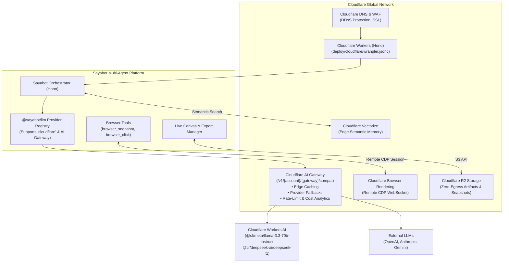

# Cloudflare Platform Integration & Architecture

Sayabot natively integrates with the **Cloudflare Developer Platform**, allowing teams to deploy agent orchestration, edge caching, serverless browser automation, and vector memory on Cloudflare's global network.

---

## 🌩️ Cloudflare Architectural Map



---

## 🛠️ Integrated Cloudflare Services

### 1. Cloudflare AI Gateway & Workers AI (`@sayabot/llm`)
Sayabot natively supports Cloudflare as an AI provider in `packages/core` and `packages/llm`.

#### Configuration in `.env`:
```env
CLOUDFLARE_ACCOUNT_ID="your-cloudflare-account-id"
CLOUDFLARE_API_TOKEN="your-cloudflare-api-token"
CLOUDFLARE_AI_GATEWAY_ID="sayabot-gateway"
```

#### Supported Workers AI Models:
- `@cf/meta/llama-3.3-70b-instruct` (Fast, high-quality turn coordination)
- `@cf/deepseek-ai/deepseek-r1-distill-qwen-32b` (Deep reasoning & code analysis)
- `@cf/mistral/mistral-7b-instruct-v0.2` (Lightweight low-latency triage)
- `@cf/qwen/qwen2.5-72b-instruct` (Multilingual and structured data parsing)

#### Universal Gateway Benefits:
When `CLOUDFLARE_AI_GATEWAY_ID` is set, all agent requests automatically benefit from:
- **Instant Edge Caching:** Repeated prompt templates or static agent directives hit Cloudflare's edge cache with sub-10ms response times.
- **Unified Observability:** Real-time token usage, cost analytics, and latency metrics across OpenAI, Anthropic, Gemini, and Workers AI in a single Cloudflare dashboard.
- **Provider Fallback:** Seamlessly failover to backup models if an upstream provider experiences an outage.

---

### 2. Cloudflare Browser Rendering (Serverless CDP)
Rather than requiring local Docker daemon instances (`apps/computerd`) to run Chromium, Sayabot can connect directly to Cloudflare Browser Rendering via the Chrome DevTools Protocol (CDP) WebSocket endpoint:

```
wss://api.cloudflare.com/client/v4/accounts/${CLOUDFLARE_ACCOUNT_ID}/browser-rendering/devtools/browser?keep_alive=600000
```

- **Headers:** `Authorization: Bearer ${CLOUDFLARE_API_TOKEN}`
- **Capabilities:** Runs `browser_open`, `browser_snapshot`, `browser_click`, and `browser_extract` on Cloudflare's serverless browser fleet with zero local compute overhead.

---

### 3. Cloudflare R2 Object Storage (Zero Egress Fees)
Sayabot stores generated code diffs, canvas HTML/SVG exports, browser screenshots, and execution logs in Cloudflare R2:
- S3-compatible API endpoint: `https://${CLOUDFLARE_ACCOUNT_ID}.r2.cloudflarestorage.com`
- Guarantees **zero data egress fees**, keeping storage and distribution costs predictable at scale.

---

### 4. Cloudflare Workers Edge Deployment (`deploy/cloudflare/wrangler.jsonc`)
Because Sayabot's orchestrator is built with **Hono**—the lightweight web framework designed natively for Cloudflare Workers—the API and MCP Gateway can be deployed directly to Cloudflare Workers with one command:

```bash
cd deploy/cloudflare
npx wrangler deploy
```

---

## 📋 Cloudflare for Startups & Workers Launchpad Application Answers

Use these exact answers when applying for the **Cloudflare for Startups** ($10k-$100k credits) and **Workers Launchpad** programs:

### Q: What is your product and how does it use Cloudflare?
> **Answer:** *“Sayabot is an open-source, multiplayer remote agent workspace and turn coordination engine where human teams and autonomous AI agents collaborate in shared rooms. We use Cloudflare as the backbone of our edge architecture:*
> 1. *Cloudflare AI Gateway manages universal LLM traffic, rate-limiting, and cost observability.*
> 2. *Workers AI powers low-latency agent turn reasoning on Llama 3.3 and DeepSeek R1.*
> 3. *Browser Rendering provides serverless Chrome DevTools Protocol (CDP) automation for web-scraping agents.*
> 4. *Cloudflare R2 provides zero-egress artifact and canvas document persistence.*
> 5. *Our Hono orchestrator edge routes deploy natively to Cloudflare Workers.”*

### Q: Why do you want to join the Cloudflare Startup Program / Workers Launchpad?
> **Answer:** *“We are scaling an AI agent workspace that performs high-frequency tool execution and model reasoning. Cloudflare's edge platform uniquely eliminates our infrastructure bottlenecks: AI Gateway reduces our latency and token costs through edge caching, Browser Rendering removes the operational overhead of running persistent Docker containers for headless Chromium, and R2 eliminates egress fees for agent artifacts. We want to scale on Cloudflare and serve as a flagship case study for the Workers Launchpad syndicate.”*
