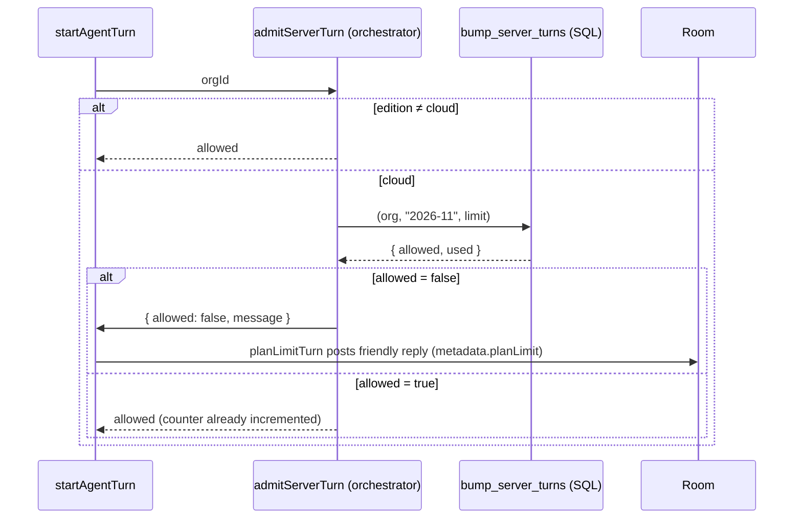

# Editions & Licensing

Sayabot is open core: everything except `ee/` folders is AGPL-3.0, and the paid cloud parts (billing and plan enforcement) live behind a `SAYABOT_EDITION=cloud` switch that a self-hosted server never sets. This page documents the two editions, the plan tables and limit checks in `@sayabot/core`, the Stripe integration under `apps/web/src/ee/`, and which licence covers which file.

Source files: `packages/core/src/edition.ts`, `apps/orchestrator/src/plans.ts`, `apps/web/src/lib/plan-limits.ts`, `apps/web/src/ee/billing/service.ts`, `LICENSING.md`, `apps/web/src/ee/LICENSE`

---

## 🎭 The two editions

`packages/core/src/edition.ts:9` defines the whole set:

```typescript
export type Edition = "self-hosted" | "cloud"
```

| Edition | Set by | Behaviour |
| :--- | :--- | :--- |
| `self-hosted` (default) | nothing, or any value other than `"cloud"` | No plans, no limits, no billing, nothing talks to Sayabot Cloud. `checkLimit` short-circuits to `{ allowed: true, limit: null }` (`edition.ts:120-129`) and `admitServerTurn` returns allowed without touching the database (`apps/orchestrator/src/plans.ts:36`) |
| `cloud` | `SAYABOT_EDITION=cloud` (server) | Plan limits apply per workspace, billing UI activates, the commercially licensed `ee/` code runs |

`readEdition(env)` trims and lowercases the value, so `"Cloud "` works and `"enterprise"` does **not** enable anything extra (`edition.ts:11-14`; pinned by `packages/core/src/edition.test.ts:12-16`). The browser needs the value at build time: `publicEdition()` reads `NEXT_PUBLIC_SAYABOT_EDITION`, which the Docker build sets from `SAYABOT_EDITION` (`deploy/docker-compose.yml` web build args). The web helper `edition()` (`apps/web/src/lib/env.ts:104-107`) delegates to `readEdition(process.env)`.

---

## 📜 Which licence covers which code

From `LICENSING.md`:

| Scope | Licence | Meaning |
| :--- | :--- | :--- |
| Everything in the repo **except** `ee/` folders | [AGPL-3.0](/Users/jarvis/saaya/LICENSE) | Free to use, self-host, modify and share; running a modified Sayabot as a service for others requires offering those changes under the same licence |
| `ee/` folders (e.g. `apps/web/src/ee/`) | [Sayabot Commercial License](/Users/jarvis/saaya/apps/web/src/ee/LICENSE) | The paid Sayabot Cloud parts (billing and plans). Source-available/readable, but running them in production needs a commercial agreement |

Notes from the same file:

- Self-hosting on your own server is free under the AGPL; `ee/` code is switched off unless `SAYABOT_EDITION=cloud`, so a self-hosted server never runs it and has no plans, limits or paywalls.
- Versions published before the licence change described MIT; copies obtained under that notice keep it.
- Contributions are accepted under `CLA.md`, which lets the project keep offering both licences.

In the tree, the commercial code is compact and confined to `apps/web/src/ee/`: `LICENSE`, `billing/stripe.ts` (Stripe API helper), `billing/service.ts` (checkout/portal/webhook application), `billing/actions.ts` (server actions) and `billing/billing-view.tsx` (UI).

---

## 💰 Plans (`PLANS` in `edition.ts:55-94`)

Plans are defined in plain code — the displayed price is a label, while the real price lives in the Stripe products:

| Plan | Price label | `serverTurnsPerMonth` | `agents` | `computers` | `members` |
| :--- | :--- | :--- | :--- | :--- | :--- |
| **free** | $0 | 300 | 3 | 0 | 3 |
| **pro** | $12 | 3 000 | 20 | 2 | 5 |
| **team** | $39 | 15 000 | `null` (unlimited) | 10 | 50 |

Semantics worth knowing:

- **`serverTurnsPerMonth` counts only replies that run on the server** (server models, agent computers). Replies executed on the owner's own Mac (local runners) cost the server almost nothing and stay unlimited on every plan (`apps/orchestrator/src/plans.ts:17-21`).
- `null` means "no limit" (`PlanLimits` doc comment, `edition.ts:28-39`).
- `PLAN_ORDER` is `["free", "pro", "team"]`; `upgradeFor()` walks upward to the smallest plan that fits the need and returns `null` when even `team` can't (e.g. a 51st member).

### Subscription standing

`effectivePlan(plan, status)` (`edition.ts:103-109`) maps Stripe state to a billable plan:

```typescript
if (!plan || plan === "free") return "free"
return status === "active" || status === "trialing" || status === "past_due" ? plan : "free"
```

So a `canceled` subscription silently downgrades the workspace to Free; `past_due` deliberately keeps paid limits while the invoice is being retried.

### Usage counters

`usageMonth(date)` returns the UTC calendar month (`"2026-11"`) that a counter belongs to; limits reset on the 1st (`edition.ts:141-143`).

---

## 🚦 Where limits are enforced

**1. Agent replies (orchestrator, per turn).** `admitServerTurn(orgId)` in `apps/orchestrator/src/plans.ts:35-59` runs inside `startAgentTurn()` before any provider call:

- Reads the workspace plan from `org_plans` (`workspacePlan`, applying `effectivePlan`).
- Calls the SQL function `bump_server_turns(org_id, month, limit)` atomically — defined in `packages/db/sql/0033_cloud_plans.sql:49-76`, a `security definer` plpgsql function that upserts the month row, then performs a conditional `UPDATE … WHERE server_turns < limit RETURNING`; when the update matches nothing it re-reads the count and returns `{ allowed: false, used }`. Because check-and-increment is a single statement, parallel turns cannot overshoot the limit.
- On refusal it composes a friendly message from `limitMessage` ("This workspace has used its N server replies for this month…"), adds the Mac-runners-are-unlimited note, and appends an upgrade link resolved by `upgradeFor()` (deep link to `/{org}/settings/billing` when `SAYABOT_DOMAIN` is set).
- `planLimitTurn()` posts that message as a **normal agent reply** (agentRuns row with `engine: "plan-limit"`, message metadata `planLimit: true`) rather than an error, so the room keeps a clean transcript (`plans.ts:62-105`).

Both tables involved are RLS-protected: `org_usage_member_read` lets members of the org select usage, writes are reserved for `service_role` (the `0033` migration revokes insert/update/delete from `anon, authenticated`), and `bump_server_turns` execute is granted only to `service_role` — matching the orchestrator's service-role connection.

**2. Workspace resources (web, on create).** `planGate(orgId, kind)` in `apps/web/src/lib/plan-limits.ts:88-99` gates creating agents, inviting members, or allocating computers:

- Self-hosted: `{ ok: true }` immediately, no database touch.
- Cloud: reads `org_usage_monthly.server_turns` (for the month) plus counts of `agents`, `org_members`, `agent_computers`, runs `checkLimit`, and builds a user-facing message: what the plan includes + "Upgrade to {Plan} in Settings → Plan & billing." (or "This is the largest plan; contact us for more." when `upgradeFor` is null).

The workspace layout and billing settings page call these helpers; on self-hosted servers the billing page simply has nothing to show.

---

## 🧾 Stripe integration (`apps/web/src/ee/billing/service.ts`)

Commercial-licensed, and inert unless four env vars exist — `billingConfigured()` requires `STRIPE_SECRET_KEY`, `STRIPE_WEBHOOK_SECRET`, `STRIPE_PRICE_PRO`, `STRIPE_PRICE_TEAM` (`service.ts:25-32`). The mapping is price-id → plan (`priceFor` / `planForPrice`).

| Function | What it does |
| :--- | :--- |
| `createCheckout({ orgId, orgSlug, plan, email, customerId, origin })` | creates a Stripe Checkout session for the plan's monthly price; `org_id` rides in metadata so the webhook can attribute the subscription |
| `createPortal(customerId, returnUrl)` | billing-portal session for plan/cancel management |
| `applyStripeEvent(event)` | handles exactly four event types: `checkout.session.completed` (resolves the subscription and saves the plan), `customer.subscription.created/updated/deleted` (resolves the org from subscription metadata or the Stripe customer, saves or clears the plan). Anything else is ignored with a reason string |

`savePlan` (internal) writes `org_plans.plan`, `status`, `current_period_end`, `cancel_at_period_end` and `customer_id` — the same row `workspacePlan()` reads in both web and orchestrator. The webhook endpoint `POST /api/billing/webhook` is on the web middleware public-path allow-list because it authenticates via Stripe's signature rather than a session (`apps/web/src/proxy.ts`).

---

## 🔎 Edition-dependent code paths (summary)

| Code path | Self-hosted | Cloud |
| :--- | :--- | :--- |
| `admitServerTurn()` (`apps/orchestrator/src/plans.ts:36`) | always allowed | `bump_server_turns()` per month + limit message |
| `planGate()` (`apps/web/src/lib/plan-limits.ts:89`) | always ok | per-kind checks + upgrade prompts |
| `apps/web/src/ee/billing/**` | never reached | checkout, portal, webhook plan sync |
| Billing UI (`ee/billing/billing-view.tsx`) | hidden | Plan & billing settings page. Every highlight is checked and labeled Coming soon; other plans show a disabled Coming soon button and do not open checkout. Mac agents and self-hosted servers are unaffected. |
| `NEXT_PUBLIC_SAYABOT_EDITION` build arg | `self-hosted` | `cloud` (baked into the browser bundle) |

### Enforcement timeline for one server reply



The user-facing wording is centralized in `limitMessage()` so orchestrator refusals and web gates sound identical; `upgradeFor()` supplies the "Upgrade to Pro/Team" tail, and the messages are pinned by `edition.test.ts` ("speaks plainly" block).

---

## 🧪 What the tests cover

`packages/core/src/edition.test.ts` pins the decision logic:

- Edition parsing: absent/`"enterprise"` → `self-hosted`; `"Cloud "` (case/space-insensitive) → `cloud`.
- Self-hosted never limits (`checkLimit("self-hosted", "free", "agents", 10_000)` → allowed, `limit: null`).
- Cloud limit arithmetic at exact boundaries (3 agents on Free: 2 allowed, 3 not; team unlimited).
- `effectivePlan` standing: `active`/`past_due` keep the paid plan, `canceled` and missing plans fall back to Free.
- `upgradeFor` picks the smallest sufficient plan and returns `null` past Team.
- `usageMonth` UTC formatting and the human wording of `limitMessage` (including the "Agent computers are part of the paid plans." special case for zero-computer plans).

Orchestrator-side admission (`bump_server_turns` composition, `planLimitTurn` transcript behaviour) is exercised through the engine tests (`apps/orchestrator/src/engine/`) and integration tests; `applyStripeEvent`'s four event types are covered by web billing tests.

---

## Related docs

- [Configuration](./configuration.md) — `SAYABOT_EDITION`, the `NEXT_PUBLIC_SAYABOT_EDITION` build arg and Stripe vars.
- [System Overview](./system-overview.md) — where plan admission sits in the turn path.
- [Monorepo & Build](./monorepo-and-build.md) — how `ee/` is packaged and what CI enforces.
- [Turn Lifecycle](./turn-lifecycle.md) — the `startAgentTurn` step that consults `admitServerTurn`.
