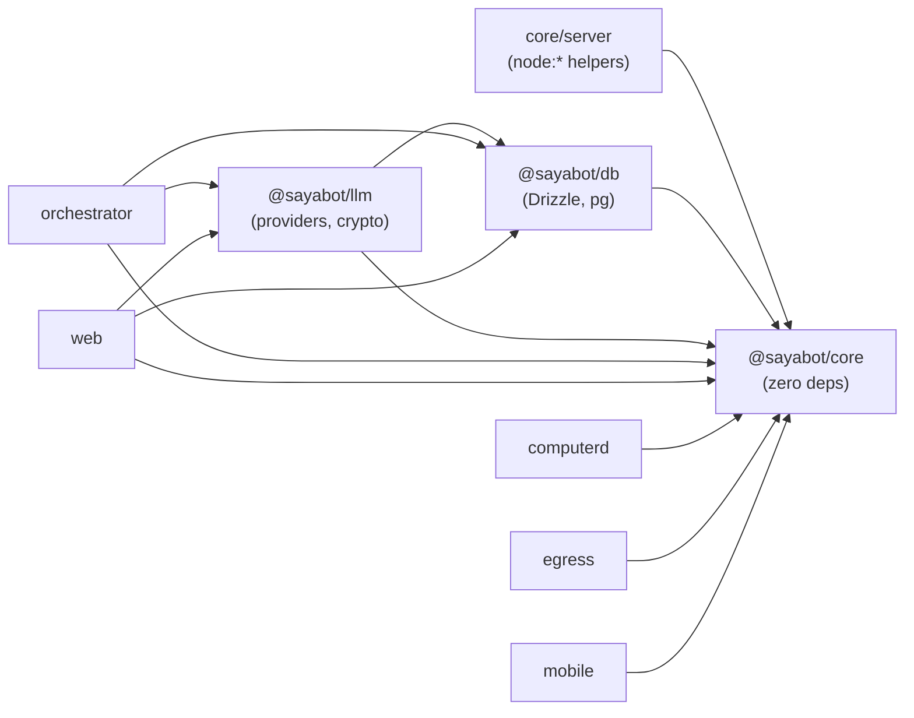

# Monorepo & Build

Sayabot is a Turborepo + pnpm workspace of six apps and three shared packages. This page documents the exact workspace layout, the turbo task pipeline, test lanes, Docker images and the deploy pipeline that turns the repo into running services.

Source files: `package.json`, `turbo.json`, `pnpm-workspace.yaml`, `tsconfig.base.json`, `deploy/docker-compose.yml`, `deploy/deploy.sh`, `.github/workflows/*.yml`

---

## 📁 Workspace layout

`pnpm-workspace.yaml` globs `apps/*` and `packages/*`. Members:

| Path                | Package name            | Kind                                                                          | Depends on                                     |
| :------------------ | :---------------------- | :---------------------------------------------------------------------------- | :--------------------------------------------- |
| `apps/web`          | `@sayabot/web`          | Next.js 16 (App Router), React 19                                             | `@sayabot/core`, `@sayabot/db`, `@sayabot/llm` |
| `apps/orchestrator` | `@sayabot/orchestrator` | Hono + pg-boss + Hocuspocus Node server                                       | `@sayabot/core`, `@sayabot/db`, `@sayabot/llm` |
| `apps/computerd`    | `@sayabot/computerd`    | sandbox daemon (smolvm / Docker / e2b)                                        | `@sayabot/core`                                |
| `apps/egress`       | `@sayabot/egress`       | SSRF proxy + secret broker                                                    | `@sayabot/core`                                |
| `apps/mobile`       | `@sayabot/mobile`       | Expo / React Native                                                           | `@sayabot/core`                                |
| `apps/desktop`      | `@sayabot/desktop`      | Electron companion (bundles `@sayabot/core` as a devDependency at build time) | `@sayabot/core` (dev)                          |
| `packages/core`     | `@sayabot/core`         | zero-dependency domain logic                                                  | —                                              |
| `packages/db`       | `@sayabot/db`           | Drizzle schema, migrations, seed                                              | `@sayabot/core`                                |
| `packages/llm`      | `@sayabot/llm`          | provider registry, crypto, MCP                                                | `@sayabot/core`, `@sayabot/db`                 |

Toolchain pins: `packageManager: pnpm@10.33.0`, Node 24 (CI uses `node-version: 24`), TypeScript `^5.9.0`, turbo `^2.11.10` (`package.json`). The repo root `package.json` carries `license: AGPL-3.0-only`; the `ee/` folders are separately licensed (see [Editions & Licensing](./editions-and-licensing.md)).

`pnpm-workspace.yaml` also declares build allow-listing and two `packageExtensions` patches that keep typecheck green:

- `expo-share-intent@3` gets a missing `@expo/plist` dependency.
- `next@16` and `streamdown@2` get an optional `@types/react` peer, so web's Next resolves web's own `@types/react@19` instead of the hoisted v18 from mobile (`pnpm-workspace.yaml:11-31`).

---

## ⚙️ Turbo pipeline

`turbo.json` is minimal — global env is `NODE_ENV`, `.env` is a global dependency (touching it invalidates all caches):

```json
{
  "globalEnv": ["NODE_ENV"],
  "globalDependencies": [".env"],
  "tasks": {
    "build": { "dependsOn": ["^build"], "outputs": [".next/**", "!.next/cache/**", "dist/**"] },
    "dev": { "cache": false, "persistent": true },
    "typecheck": { "dependsOn": ["^typecheck"] },
    "lint": {},
    "test": { "outputs": [] }
  }
}
```

`build` and `typecheck` depend on the same task in workspace dependencies (`^build`), so typechecking `@sayabot/orchestrator` first builds/checks `@sayabot/core`, `@sayabot/db`, `@sayabot/llm`. `.next/cache` is excluded from build outputs so Next's webpack cache never enters the turbo cache.

### Dependency directions



`@sayabot/core` is deliberately dependency-free so egress and computerd can import it without pulling the ORM. Anything needing `node:*` lives under the `core/server` export (`packages/core/src/server/index.ts`).

### TypeScript baseline

`tsconfig.base.json` sets strict mode and the paths the apps inherit; each package extends it and adds its own `dist`/`.next`-aware settings. `tsconfig.e2e.json` compiles the Playwright suites separately (`pnpm typecheck:e2e` runs it in CI), keeping e2e types out of app typechecks.

---

## 🧾 Root scripts (authoritative list)

From `package.json`:

| Script                                                                                                                                         | What it runs                                                                                                                 |
| :--------------------------------------------------------------------------------------------------------------------------------------------- | :--------------------------------------------------------------------------------------------------------------------------- |
| `pnpm dev`                                                                                                                                     | `turbo run dev` (persistent, uncached; all apps concurrently)                                                                |
| `pnpm build`                                                                                                                                   | `turbo run build`                                                                                                            |
| `pnpm typecheck`                                                                                                                               | `turbo run typecheck`                                                                                                        |
| `pnpm lint`                                                                                                                                    | `turbo run lint`                                                                                                             |
| `pnpm test`                                                                                                                                    | `turbo run test` (vitest per workspace)                                                                                      |
| `pnpm db:generate` / `db:migrate` / `db:seed`                                                                                                  | delegated to `pnpm --filter @sayabot/db generate                                                                             | migrate | seed` |
| `pnpm format`                                                                                                                                  | `prettier --write .`                                                                                                         |
| `pnpm mobile:dev` / `mobile:typecheck` / `mobile:update` / `mobile:build:apk`                                                                  | mobile helpers                                                                                                               |
| `pnpm desktop:build` / `desktop:dev` / `desktop:package:dmg` / `desktop:package:win` / `desktop:package:win:x64` / `desktop:package:win:arm64` | desktop helpers. Windows packaging (`nsis` + `zip`) runs on Windows; `deploy/desktop/package-windows.ps1` is the same build. |
| `pnpm e2e`                                                                                                                                     | `playwright test` (config in `playwright.config.ts`)                                                                         |
| `pnpm typecheck:e2e`                                                                                                                           | `tsc -p tsconfig.e2e.json`                                                                                                   |
| `pnpm test:unit`                                                                                                                               | `turbo run test` filtered to core, llm, orchestrator, web, egress, computerd, mobile                                         |
| `pnpm test:integration`                                                                                                                        | `node tests/integration/run.mjs` (needs live services)                                                                       |
| `pnpm test:e2e:api`                                                                                                                            | smoke lane: `E2E_SMOKE=1 playwright test api navigation.spec.ts api-guard.spec.ts`                                           |
| `pnpm test:coverage`                                                                                                                           | `turbo run test:coverage`                                                                                                    |

Convention notes for agents working in this repo: tests live adjacent to sources as `*.test.ts` (vitest), Prettier uses `semi: false`, double quotes, print width 100 (`.prettierrc`), and unused params must be underscore-prefixed.

---

## 🐳 Docker images

`deploy/docker/` holds one Dockerfile per service (`web.Dockerfile`, `orchestrator.Dockerfile`, plus computerd/egress). Images are named `${SAYABOT_IMAGE_PREFIX:-sayabot}/<service>:${SAYABOT_TAG:-latest}`; `deploy/deploy.sh` builds only the services listed in `SAYABOT_APP_SERVICES` (default `orchestrator web`, with computerd/egress optional) and falls back to the legacy `MESH_*` names.

`deploy/docker-compose.yml` defines the production stack with shared hardening anchors applied to every service:

```yaml
x-hardening: &hardening
  init: true
  restart: unless-stopped
  security_opt: ["no-new-privileges:true"]
  cap_drop: ["ALL"]
```

Key traits:

- **Only nginx publishes ports.** web (:7431) and orchestrator (:4000) are reachable via `deploy/nginx`; `NEXT_PUBLIC_SITE_URL`, `NEXT_PUBLIC_APP_URL` and `NEXT_PUBLIC_COLLAB_URL` are derived from `SAYABOT_DOMAIN` rather than set by hand.
- **Read-only containers.** `read_only: true` with tmpfs mounts for `/tmp` and web's `.next/cache`; memory limits via `SAYABOT_WEB_MEMORY` / `SAYABOT_ORCHESTRATOR_MEMORY` (1g default).
- **Graceful shutdown.** orchestrator gets `stop_grace_period: 30s` so pg-boss jobs finish and Hocuspocus flushes canvas state on SIGTERM.
- **`migrate` / `seed` are one-off tool profiles** (`profiles: ["tools"]`), run via `deploy.sh migrate` / `deploy.sh seed`, never by `up`.
- A Cloudflare Tunnel variant (`CLOUDFLARE_TUNNEL_TOKEN`) publishes no ports at all; `deploy/docker-compose.tunnel.yml` and `deploy/docker-compose.supabase.yml` (bundled Supabase on the same VPS) and `deploy/docker-compose.smolvm.yml` (gives computerd `/dev/kvm`) compose on top.

---

## 🚀 Deploy pipeline (`deploy/deploy.sh`)

`deploy/deploy.sh` (~436 lines) implements zero-downtime rolling updates:

1. **Preflight** — loads `deploy/.env.production` (created interactively by `deploy/install.sh` or copied from `deploy/.env.production.example`), validates required secrets (`SAYABOT_KEK`, `ORCHESTRATOR_INTERNAL_SECRET`, Supabase keys, `SAYABOT_DOMAIN`).
2. **Build** — `docker compose build` for `SAYABOT_APP_SERVICES` only; with `COMPUTER_BACKEND=smolvm` it also exports the computer image for smolvm and adds `docker-compose.smolvm.yml`.
3. **Migrate** — runs the `migrate` one-off container (Drizzle snapshots + `packages/db/sql/*.sql` in sorted order) before swapping app containers.
4. **Swap & prune** — `up -d` the new services, keep `SAYABOT_KEEP_RELEASES` (default 3) previous tags for rollback, and reset egress identity mappings when computers restart.
5. **Subcommands** — `deploy.sh migrate`, `deploy.sh seed`, `deploy.sh reload` (re-create containers with new env, no rebuild — required for `SAYA_AI_*` changes), `deploy.sh restart`.

`.dockerignore` keeps `.next`, `node_modules`, `.git` and local state out of build context.

---

## 🤖 CI (`/.github/workflows`)

| Workflow              | Trigger                                     | What it does                                                                                                                                                                                                                                                                                                                                                            |
| :-------------------- | :------------------------------------------ | :---------------------------------------------------------------------------------------------------------------------------------------------------------------------------------------------------------------------------------------------------------------------------------------------------------------------------------------------------------------------- |
| `test.yml`            | push to `main`, all PRs                     | **unit-integration** job: pnpm 10.33 / Node 24, `pnpm install --frozen-lockfile`, then `pnpm typecheck`, `pnpm lint`, `pnpm test`, `pnpm test:integration`, `pnpm typecheck:e2e`. **e2e-smoke** job (push only): builds web, starts it, waits for `/api/health`, runs the Playwright smoke lane with dummy env (`ci-test-kek`, `ci-test-internal-secret-0123456789`, …) |
| `deploy.yml`          | release tags                                | builds/pushes images and deploys per the repo's configured host                                                                                                                                                                                                                                                                                                         |
| `desktop-release.yml` | desktop paths on `main`, or manual dispatch | macOS DMG packaging (signing/notarization per `docs/macos-signing-and-notarization.md`), then a Windows job that attaches `Sayabot-Setup-<arch>.exe` and `Sayabot-win-<arch>.zip` to the same release                                                                                                                                                                   |
| `mobile-updates.yml`  | mobile release                              | Expo OTA update publishing; builds and attaches `Sayabot-<version>.apk` to the latest GitHub release when `app.json` version has no APK yet                                                                                                                                                                                                                             |

The smoke CI env is worth copying when debugging: it shows the minimal env set the orchestrator's Zod schema demands (`DATABASE_URL`, `SAYABOT_KEK`, `SUPABASE_URL`, `SUPABASE_SERVICE_ROLE_KEY`, `ORCHESTRATOR_INTERNAL_SECRET` ≥ 16 chars).

---

## 🧪 What the tests cover

- **Unit lanes** (`pnpm test:unit`): vitest suites co-located in `packages/core`, `packages/llm`, `apps/orchestrator` (engine, coordinator support, tools), `apps/web` (lib helpers), `apps/egress`, `apps/computerd`, `apps/mobile`.
- **Integration** (`tests/integration/`): live-process checks against a real orchestrator + database, driven by `tests/integration/run.mjs`.
- **E2E** (`e2e/`): Playwright against the built web app — `navigation.spec.ts`, `chat.spec.ts`, `turns.spec.ts`, `approval.spec.ts`, `api-guard.spec.ts` plus an `api/` folder; global setup in `e2e/global-setup.ts` uses `E2E_USER_A_EMAIL` / `E2E_USER_B_EMAIL` from `.env.example`.

---

## Related docs

- [System Overview](./system-overview.md) — what each service does at runtime.
- [Configuration](./configuration.md) — the environment variables referenced here.
- [Editions & Licensing](./editions-and-licensing.md) — how `SAYABOT_EDITION` changes the build.
- [Turn Lifecycle](./turn-lifecycle.md) — what the orchestrator actually executes once deployed.
