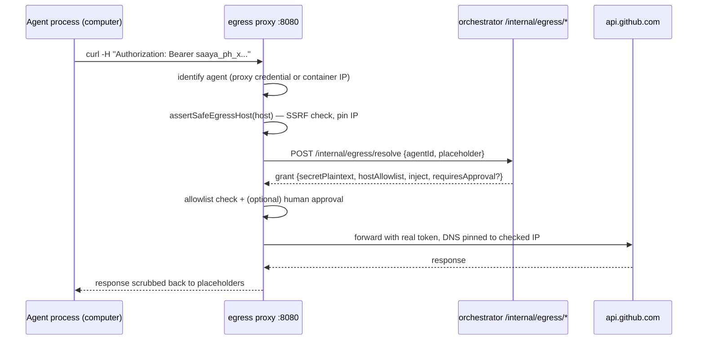

# Security Model

Sayabot's security posture is built on four walls: AES-256-GCM envelope encryption for every credential at rest, a placeholder-based secret broker so models never see plaintext, an SSRF firewall on every outbound path, and human approval gates for dangerous actions. This page documents each wall as implemented in code, plus the redaction layer that scrubs everything the model, the UI and the database ever see.

Source files: `packages/llm/src/crypto.ts`, `packages/core/src/redact.ts`, `apps/orchestrator/src/tools/audited.ts`, `apps/orchestrator/src/tools/approvals.ts`, `apps/egress/src/index.ts`, `apps/egress/src/swapper.ts`, `apps/egress/src/scrub.ts`, `packages/core/src/server/ssrf.ts`, `apps/orchestrator/src/ssrf.ts`, `apps/computerd/src/identity.ts`, `apps/computerd/src/egress-bridge.ts`, `packages/core/src/server/webhook.ts`

---

## 🔑 Wall 1 — Encryption at rest (`SAYABOT_KEK` / `MESH_KEK`)

Every credential (provider API keys, connector OAuth tokens, webhook secrets, MCP headers) is envelope-encrypted with a 32-byte KEK before it reaches PostgreSQL. `packages/llm/src/crypto.ts` is the whole implementation:

| Function | Purpose |
| :--- | :--- |
| `parseKek(kek)` | decodes base64 → exactly 32 bytes; anything else throws with the `openssl rand -base64 32` hint (`crypto.ts:10-16`) |
| `encryptSecret(plaintext, kek)` | AES-256-GCM, fresh 12-byte IV → `{ ciphertext, iv, tag }` (all base64) |
| `decryptSecret(secret, kek)` | verifies the auth tag; a wrong KEK or tampered tag fails the GCM check |
| `sealSecret` / `openSecret` | base64(JSON envelope) for single-text-column storage (e.g. `mcp_servers.headers_enc`) |
| `last4(value)` | display helper for key fingerprints |

Key resolution order is `SAYABOT_KEK` then legacy `MESH_KEK` — both the orchestrator env schema (`apps/orchestrator/src/env.ts:46-47`) and the web `getKek()` (`apps/web/src/lib/env.ts:29-33`) accept either, and both env files document the alias. The KEK is never logged and cannot be recovered: the deploy docs warn that losing it makes every stored credential unrecoverable (`deploy/.env.production.example:3-4`).

---

## 🎭 Wall 2 — The secret broker: placeholders, never plaintext

Agents see `saaya_ph_…` placeholders (the model-visible regex is `PLACEHOLDER_PATTERN`, `packages/core/src/redact.ts:18`). The swap happens **at the network boundary**, inside egress:



Details that matter (`apps/egress/src/index.ts:123-301`):

1. **Agent identity** comes from either a per-agent `Proxy-Authorization` credential (microVM computers — `resolveAgentIdentityBySecret`, verified against the orchestrator which stores only the SHA-256) or the source container IP (Docker `botnet`), cached 60 s / 30 s respectively (`apps/egress/src/swapper.ts:44-92`). A client-supplied `x-saaya-agent-id` header that contradicts the resolved identity is rejected with 403 (`index.ts:147-153`).
2. **Placeholder scan**: any `saaya_ph_[A-Za-z0-9_-]{32,}` found in headers or body is collected, then resolved one by one. Each resolution enforces the grant's `hostAllowlist` (pattern match via `matchesHostPattern`) — a secret scoped to `api.github.com` cannot be used against anywhere else, and violations are reported to the orchestrator (`reportViolation`).
3. **Approval-gated secrets**: grants with `requiresApproval` block the request until the orchestrator returns `approved` — anything else (including timeout) is a 403 (`swapper.ts:135-158`).
4. **DNS pinning**: `assertSafeEgressHost()` returns the checked IP list; the forwarded request passes a custom `lookup` that connects to the pinned IP, closing the TOCTOU rebinding window (`index.ts:244-258`).
5. **Response scrubbing**: on the way back, any occurrence of a resolved plaintext in response headers/body is replaced with the placeholder again (`scrubResponseText`; only text/json/xml bodies are rewritten, `index.ts:258-284`). So even an echo endpoint can't leak the secret into the agent's context.
6. **Cache invalidation**: egress streams `GET /internal/egress/stream` (SSE) and flushes its grant cache on `vault_changed`; `POST /admin/flush` and `POST /admin/identity/forget` (used when Docker IPs are reused) are also available (`index.ts:39-97`).

**CONNECT tunneling** (for HTTPS from inside computers) is restricted to port 443 and passes the same identity + SSRF checks before piping bytes (`index.ts:305-338`).

For smolvm computers the credential never enters the VM: computerd's `EgressBridge` exposes a per-agent Unix socket (mode 0600) into the VM and **rewrites the first request head** to insert its own `Proxy-Authorization`, dropping any the guest sent (`apps/computerd/src/egress-bridge.ts:12-23`). The credential is HMAC-derived (`saaya-egress:${agentId}` keyed by `COMPUTERD_PROXY_KEY`, default the internal secret) so it survives restarts and can't be forged inside the guest (`apps/computerd/src/identity.ts:8-28`).

### The orchestrator-side `use_secret` path

Inside a turn, the `use_secret` tool resolves a placeholder's metadata (not the plaintext) so agents can reference credentials; outbound traffic carrying the placeholder is the only way the real value is ever used, and that traffic must traverse egress.

---

## 🧯 Wall 3 — SSRF and webhook firewalls

Two independent implementations guard two different traffic classes:

**Outbound computer/proxy traffic** — `assertSafeEgressHost()` in `packages/core/src/server/ssrf.ts:158-195`:
- Host-suffix blocks without DNS: `localhost`, `.localhost`, `.local`, `.internal`, `.onion`.
- Literal IPs go through `isPrivateIp()`; hostnames resolve via `dns.lookup({ all: true })` and **every** returned address must be public.
- `isPrivateIp()` (`ssrf.ts:62-156`) blocks: loopback, RFC1918 (10/8, 172.16/12, 192.168/16), link-local + cloud metadata (169.254/16), CGNAT 100.64/10, 0/8, benchmarking 198.18/15, TEST-NET ranges, multicast/reserved ≥224, broadcast, and on IPv6: multicast, `::1`, IPv4-mapped/compatible/NAT64/6to4 embedded addresses (recursively re-checked), link-local `fe80::/10`, ULAs `fc00::/7`, discard `100::/64`, documentation `2001:db8::/32`. Unparseable IPv6 is treated as unsafe. `packages/core/src/server/ssrf.test.ts` pins these lists.

**Webhook delivery** — `assertSafeWebhookUrl()` in `apps/orchestrator/src/ssrf.ts:11-42`:
- Scheme must be http/https, no embedded `user:pass`.
- `.local`/`.internal`/`localhost` hostnames rejected; DNS re-checked on **every** delivery attempt.
- The `SAYABOT_ALLOW_PRIVATE_WEBHOOKS` (legacy `MESH_ALLOW_PRIVATE_WEBHOOKS`) flag skips private-IP checks — documented as a local-bot-development escape hatch only (`env.ts:20-27`, docker-compose comment "dev-only escape hatch").

**Inbound webhook verification** — external → Sayabot webhooks use Standard Webhooks signatures: `verifyWebhook()` (`packages/core/src/server/webhook.ts:41-63`) requires `id`, `timestamp` and a `v1,<base64 hmac>` header, enforces a ±300 s timestamp tolerance, compares with `timingSafeEqual`, and accepts any matching signature in a space-separated list. Outbound webhooks are signed with the mirrored `signWebhook()` using a 32-byte base64 secret.

---

## 🚦 Wall 4 — Dangerous-tool approval gates

`ToolSpec.dangerous` can be a boolean or a function of the args (`apps/orchestrator/src/tools/audited.ts:30-36`). The audited wrapper enforces the lifecycle:

```
insert tool_calls (pending_approval) → broadcast tool.approval_requested
  → push notification + inbound-chat "waiting for your OK" notice
  → waitForApproval():
        LISTEN tool_call_resolved (fast path) + 2s poll (fallback)
        timeout 5 min  → "rejected"  (silence means no)
        run aborted    → "rejected"
  → rejected: tool_calls.status=rejected, tool.finished(rejected),
              tool returns { ok:false, rejected:true, error }
  → approved: execute with abort signal → done/error, redacted storage
```

Key details:

- The decision endpoint is `POST /v1/tools/:toolCallId/approve { approved: boolean }`, internal-secret protected; it updates the row only when still `pending_approval` and notifies both the channel and in-process waiters (`apps/orchestrator/src/http.ts:331-360`).
- On orchestrator restart, approvals pending longer than 5 minutes are pre-rejected with error "Approval expired before the orchestrator restarted" (`approvals.ts:16-30`).
- Even after approval, an aborted run short-circuits before execution (`options.abortSignal?.throwIfAborted()`, `audited.ts:183`).

---

## 🧴 Redaction: the last line of defence

`redactSecrets()` (`packages/core/src/redact.ts:26-49`) runs on essentially every string that is stored or sent:

| Pattern | Matches |
| :--- | :--- |
| `aws_access_key` | `AKIA`/`ASIA` + 16 chars |
| `anthropic_key` / `openai_key` | `sk-ant-…`, `sk-…` incl. `sk-proj-` |
| `github_token` / `github_pat` | `ghp|gho|ghu|ghs|ghr_…`, `github_pat_…` |
| `slack_token` | `xox[abposr]-…` |
| `google_api_key` | `AIza…` |
| `groq_key` | `gsk_…` |
| agent keys & OAuth tokens | `mesh_ak_`/`saaya_ak_`/`sayabot_ak_`, `mesh_at_`/`sayabot_at_`, refresh `…_rt_` |
| `invite_code` | `sinv_…` |
| `jwt` | three-segment `eyJ…` tokens |
| `private_key` | PEM blocks |

Replacements are `[REDACTED:<kind>]`, and the report of counts is returned for observability. Two higher-level scrubbers build on it:

- `createRunScrubber(values)` — per-run **exact-value** scrubber for the run's live secrets (e.g. the resolved provider API key): targets the value plus its URL-encoded and base64 variants, longest-first, replacing with `[REDACTED:secret]` (`redact.ts:55-92`). The engine wraps every streamed delta and the final message through it (`apps/orchestrator/src/engine/run.ts:164-192, 223-225`).
- `redactValue(value, scrub)` — recursively redacts strings inside tool args/results before DB storage and broadcast, with a depth cap of 8 (`apps/orchestrator/src/tools/audited.ts:40-53`).

Where it is applied: agent messages and metadata, tool call args and results, tool errors, halt/system messages, agent-test endpoints, streaming bot content, webhook payloads — i.e. anything derived from model output or containing credentials.

---

## 🧱 Sandbox confinement (computers)

- Container sandboxes run as the non-privileged `bot` user with files bounded to `/home/bot` and `/tmp`; agentd validates paths (`apps/computerd/agentd` — `isSafePath` semantics documented in `docs/tools-and-sandboxes.md`).
- smolvm computers have **no direct network**: their only egress is the per-agent Unix socket bridged to the egress proxy with host-side credential injection (see Wall 2).
- Docker computers sit on the `botnet` network and are identified to egress by container IP; computerd calls `/admin/identity/forget` whenever a computer starts or stops so a **reused IP is never attributed to its previous owner** (`apps/egress/src/index.ts:44-52`).
- The egress proxy itself rejects identity spoofing (`x-saaya-agent-id` mismatch → 403) and only honors its credential on the first request of a connection, binding the identity to the socket via a `WeakMap` (`index.ts:101-119`).

---

## 🧪 What the tests cover

| Behaviour | Test file |
| :--- | :--- |
| Private-IP lists (IPv4 ranges, embedded IPv6, ULAs, NAT64, 6to4, link-local) | `packages/core/src/server/ssrf.test.ts` |
| Webhook signature verify (tolerance, multiple signatures, missing headers) | `packages/core/src/server/webhook.test.ts` |
| Envelope crypto round-trip, wrong KEK failure | `packages/llm/src/crypto.test.ts` |
| Redaction patterns, run scrubber variants | `packages/core/src/redact.test.ts` |
| Proxy head rewriting (credential injection, guest header drop, 431 on oversize) | covered by computerd bridge tests; end-to-end approval UX in `e2e/approval.spec.ts` |
| Approval expiry / waiter resolution | exercised in orchestrator tools tests and `e2e/approval.spec.ts` |

---

## Related docs

- [Auth & Authorization](./auth-and-authorization.md) — who may call what; the internal secret and agent keys.
- [Turn Lifecycle](./turn-lifecycle.md) — where the audited tool wrapper and approval waits sit inside a run.
- [Configuration](./configuration.md) — `SAYABOT_KEK`, `ORCHESTRATOR_INTERNAL_SECRET`, `COMPUTERD_PROXY_KEY`, allow-private-webhook flags.
- [System Overview](./system-overview.md) — the service map these walls sit between.
