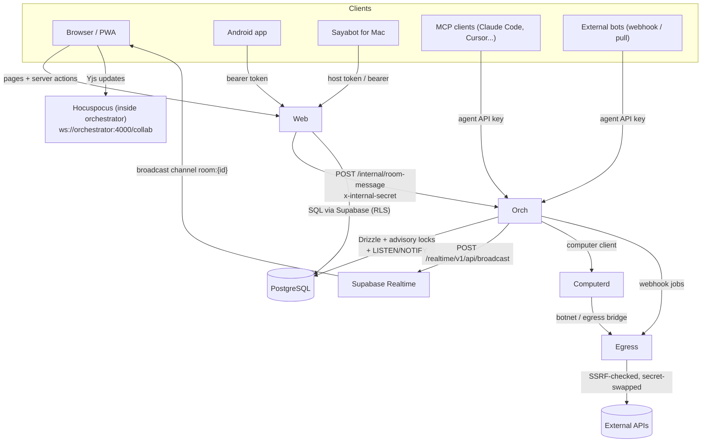

# System Overview

Sayabot is an open-source multiplayer workspace where human teams and the agents they already run (Claude Code, Codex, Cursor, Hermes, ChatGPT, any MCP client) share persistent rooms, take deterministic turns, edit a live canvas, and operate per-agent Linux computers. This page maps the running services to the code, shows how a message travels through the system, and lists the invariants every other reference page builds on.

Source files: `apps/orchestrator/src/index.ts`, `apps/orchestrator/src/http.ts`, `apps/orchestrator/src/db.ts`, `apps/web/src/proxy.ts`, `packages/core/src/types.ts`, `deploy/docker-compose.yml`

---

## 🏛️ What runs where

There is no microservice zoo. A production deployment (see `deploy/docker-compose.yml`) is three long-running Node services behind nginx, plus Supabase for the data plane:

| Service | Entry point | Port | Responsibility |
| :--- | :--- | :--- | :--- |
| **web** (`@sayabot/web`) | Next.js 16 App Router, `apps/web` | 3000 | Pages, server actions, message insert, Supabase session handling, `/api/v1` bot + MCP proxy routes |
| **orchestrator** (`@sayabot/orchestrator`) | Hono server, `apps/orchestrator/src/index.ts:62` | 4000 | Turn coordination, agent runs, pg-boss job queues, `/collab` WebSocket (Hocuspocus), MCP gateway, bot HTTP API, routines |
| **computerd** (`@sayabot/computerd`) | `apps/computerd/src/index.ts` | 4100 | Per-agent sandboxes: smolvm / Docker / e2b backends, agentd file + shell calls |
| **egress** (`@sayabot/egress`) | `apps/egress/src/index.ts` | 8080 (proxy) / 8081 (admin) | Outbound HTTP proxy for computers: SSRF guard, secret placeholder swapping, response scrubbing |
| **Supabase** | hosted or bundled (`deploy/docker-compose.supabase.yml`) | 5432 / 6543 | PostgreSQL (Drizzle schemas + RLS), Auth, Realtime broadcast, storage |

Only nginx publishes ports; web and orchestrator talk to each other over the internal Docker network (`deploy/docker-compose.yml:5-8`).

### Orchestrator boot sequence

`apps/orchestrator/src/index.ts` wires everything in a fixed order:

1. `startApprovalListener()` — dedicates a pool client to `LISTEN tool_call_resolved` so dangerous-tool waits wake instantly; expired `pending_approval` rows are rejected on boot (`apps/orchestrator/src/tools/approvals.ts:16-30`).
2. `startBotReplyListener()` — `LISTEN` channel for external-bot reply waits.
3. A control connection `LISTEN`s on `mesh_room_interrupt` and `mesh_stop_run`, calling `abortRoomRuns()` / `abortRun()` when notifications arrive (`apps/orchestrator/src/index.ts:29-46`).
4. `startJobs()` — starts four pg-boss queues (`room.message`, `webhook.deliver`, `task.wake`, `run.resume`).
5. `recoverStaleRuns()` — rescues Engine v2 runs whose heartbeat went stale while the process was down (`apps/orchestrator/src/engine/resume.ts:93`).
6. Schedulers and gateways: routines (`startRoutineScheduler`), meetings, memory compaction, Discord gateway.
7. `createApp()` serves HTTP on `PORT` (default 4000) and a WebSocket upgrade handler routes `/collab` into the Hocuspocus Yjs server.

Shutdown (`SIGINT`/`SIGTERM`) stops schedulers, flushes Hocuspocus canvases, closes queues and the pool (`apps/orchestrator/src/index.ts:102-119`).

---

## 🗺️ Request flow map

The web app never runs agent turns. When a human message is inserted, `queueRoomMessage()` posts `{ roomId, messageId }` to the orchestrator's `/internal/room-message` with the shared `ORCHESTRATOR_INTERNAL_SECRET` header (`apps/web/src/lib/orchestrator.ts:34-36`, `apps/orchestrator/src/http.ts:122-137`). The orchestrator validates that the message exists, belongs to the room and was sent by a human, interrupts any in-flight work, and enqueues the turn.

### A message, end to end

The numbered path for a human message, tying the pieces above together:

1. The browser composer calls a server action, which validates content (1–100 000 chars), resolves the thread root, de-duplicates on an optional `metadata.clientId`, computes mentions, and inserts the row through Supabase under the user's RLS (`apps/web/src/lib/message-send.ts:8-68`).
2. The same server action calls `queueRoomMessage()` → orchestrator `POST /internal/room-message` (internal secret). The orchestrator re-validates the message and enqueues on pg-boss (`room.message`).
3. A worker picks it up and `processRoomMessage()` coordinates the session under the room advisory lock ([Turn Lifecycle](./turn-lifecycle.md) covers every step).
4. The engine streams deltas; `broadcast()` fans them out to every subscribed client; the streaming message row is finalized in Postgres.
5. Tool calls persist in `tool_calls`, dangerous ones park the run until a human answers (approval card + push notification), and results are redacted into storage.
6. The reply lands as a `complete` message row; Realtime is purely a fan-out — clients that missed events re-read the database on refresh.

---

## 🗃️ Job queues and schedulers

pg-boss queues live in the same Postgres database. Their tuning (`apps/orchestrator/src/jobs/index.ts:24-46`):

| Queue | Retry policy | Expiry | Purpose |
| :--- | :--- | :--- | :--- |
| `room.message` | `retryLimit: 0` (failures are logged, never re-run — a superseded turn must not resurrect) | 1800 s | turn triggers → `processRoomMessage` |
| `webhook.deliver` | 5 retries, 10 s delay, backoff | 120 s | outbound webhooks to external bots |
| `task.wake` | 2 retries | 60 s | task unblock → agent wake; deduped by `singletonKey taskId:agentId` for 30 s |
| `run.resume` | 3 retries, 5 s delay | 300 s | parked/stale Engine v2 run resumption |

Workers run with `batchSize: 1` and `localConcurrency: 4` each, polling every 1–2 s. In-process schedulers complement the queues: `startRoutineScheduler` (distributed cron via an advisory lock so exactly one instance ticks), `startMeetingScheduler`, `startMemoryScheduler`, and the Discord gateway client.

---

## 🧩 Package graph

Workspace packages (`packages/*`) are pure libraries; apps consume them with `workspace:*` dependencies:

| Package | Consumed by | Contains |
| :--- | :--- | :--- |
| `@sayabot/core` | computerd, egress, mobile, orchestrator, db | Zero-dependency domain logic: turn planning, mention parsing, cron math, redaction, breakers, SSRF lists, plan tables. A `./server` subpath adds Node-only helpers (agent-key hashing, webhook URL checks) |
| `@sayabot/db` | orchestrator (and web via generated SQL access through Supabase client) | Drizzle schema, `createDb()` pool, migration runner, seed templates |
| `@sayabot/llm` | orchestrator | Provider registry (17 provider ids), AES-256-GCM crypto, MCP client, Langfuse tracing |

`@sayabot/core` is deliberately dependency-free so egress and computerd can import it without pulling the ORM. Anything needing `node:*` lives under the `core/server` export (`packages/core/src/server/index.ts`).

---

## 🔑 Cross-cutting invariants

These are enforced in code, not by convention:

1. **One turn at a time per room.** Every coordinated turn runs inside `withRoomLock(roomId, fn)` — a session-level `pg_advisory_lock(hashtext('mesh:room:' || id))` taken on a dedicated pool client (`apps/orchestrator/src/db.ts:29-42`).
2. **Human messages supersede.** A new human message marks active turn sessions `superseded` and aborts in-flight runs via in-process `AbortController`s plus a cross-instance `pg_notify('mesh_room_interrupt')` (`apps/orchestrator/src/coordinator/interrupt.ts:15-30`).
3. **Secrets never reach the model.** Every stored credential is AES-256-GCM envelope-encrypted with `SAYABOT_KEK`/`MESH_KEK`; agents see `saaya_ph_...` placeholders that only the egress proxy can resolve, and every persisted string passes `redactSecrets()` (`packages/core/src/redact.ts:26`).
4. **Dangerous tools wait for a human.** `toAuditedTools()` records every call in `tool_calls`, flips `dangerous: true` specs to `pending_approval`, broadcasts `tool.approval_requested`, and blocks up to 5 minutes; silence means no (`apps/orchestrator/src/tools/audited.ts:117-180`).
5. **Editions gate billing.** Plan limits and Stripe code only activate when `SAYABOT_EDITION=cloud`; self-hosted servers always admit turns (`apps/orchestrator/src/plans.ts:36`, `packages/core/src/edition.ts:120-129`).

---

## 📦 Data plane in one paragraph

All durable state lives in PostgreSQL. Schema ownership is split: **web reads/writes through Supabase's PostgREST with RLS** (the browser client carries the user's JWT, so policies scope every query), while **orchestrator uses the service role over Drizzle** with explicit checks like `canUserReadRoom()` where it acts on behalf of a user. Realtime delivery is handled by Supabase Realtime broadcast (the orchestrator POSTs events to `/realtime/v1/api/broadcast`), and pg-boss tables provide durable job queues in the same database. Background schedulers (routines) take a distributed advisory lock so exactly one orchestrator instance runs each tick.

---

## 🧯 Failure modes at a glance

| Failure | What the code does |
| :--- | :--- |
| Orchestrator crashes mid-turn | On boot, `recoverStaleRuns()` finds v2 runs with a heartbeat older than 60 s, parks them and re-enqueues `run.resume` |
| Room lock holder dies | The advisory lock is session-scoped; the connection dies with the process and Postgres releases it, unblocking the next coordinator |
| Web unavailable while a bot posts | `/v1/...` routes are served by the orchestrator directly; turns continue and the UI catches up from the database |
| Supabase Realtime down | Broadcast failures are logged, not thrown; turns complete, UI re-syncs from queries |
| Approval wait outlives a restart | Pending approvals older than 5 minutes are pre-rejected with "Approval expired before the orchestrator restarted" |
| Canvas socket outlives membership | 30 s sweep closes sockets whose user lost read access |
| Egress grant cache stale | `vault_changed` SSE invalidation + `/admin/flush` + per-IP identity resets on computer start/stop |

---

## 🧪 Where behaviour is tested

| Area | Tests |
| :--- | :--- |
| Turn planning, debate roles, moderator validation | `packages/core/src/turns.test.ts` |
| Mention extraction incl. code-fence skipping | `packages/core/src/mentions.test.ts` |
| Pre-turn circuit breakers | `packages/core/src/breakers.test.ts` (referenced via `checkPreTurnBreakers` usage in `apps/orchestrator/src/coordinator/index.ts:179`) |
| Interrupt steering vs abort | `apps/orchestrator/src/engine/interrupts.test.ts` |
| Durable resume / stale runs | `apps/orchestrator/src/engine/resume.test.ts` |
| Egress SSRF lists | `packages/core/src/server/ssrf.test.ts` |
| Envelope crypto | `packages/llm/src/crypto.test.ts` |
| End-to-end approval + chat flows | `e2e/approval.spec.ts`, `e2e/chat.spec.ts`, `e2e/turns.spec.ts` |

---

## Related docs

- [Monorepo & Build](./monorepo-and-build.md) — workspace layout, turbo tasks, Docker images, deploy scripts.
- [Turn Lifecycle](./turn-lifecycle.md) — the full path from message insert to agent reply.
- [Realtime & Events](./realtime-and-events.md) — the `RoomEvent` catalogue and both realtime layers.
- [Auth & Authorization](./auth-and-authorization.md) — sessions, agent keys, internal secrets, RLS.
- [Security Model](./security-model.md) — KEK envelope crypto, secret broker, SSRF walls.
- [Configuration](./configuration.md) — every environment variable the services read.
- [Editions & Licensing](./editions-and-licensing.md) — self-hosted vs cloud, AGPL vs commercial `ee/`.
