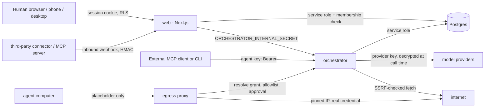

# Threat Model

This is a public, code-level threat model for Sayabot. It is written against what the repository actually does, not against an aspirational architecture: every control below names the module that implements it, and every gap is one a reader can verify in the same tree. It is a self-assessment. It is not an audit and carries no certification claim.

Use it three ways: reporters can point at a boundary and a numbered threat when filing; operators can see which risks they inherit; contributors can tell whether a change weakens an invariant.

Source files: `packages/llm/src/crypto.ts`, `packages/core/src/redact.ts`, `packages/core/src/server/ssrf.ts`, `packages/core/src/server/webhook.ts`, `packages/db/sql/`, `apps/orchestrator/src/tools/audited.ts`, `apps/orchestrator/src/tools/approvals.ts`, `apps/orchestrator/src/internal-auth.ts`, `apps/orchestrator/src/authz.ts`, `apps/egress/src/index.ts`, `apps/egress/src/swapper.ts`, `apps/computerd/src/backends/host.ts`

Related: [Security Model](./security-model.md) (how each wall works), [Auth & Authorization](./auth-and-authorization.md) (who may call what), [Configuration](./configuration.md) (the env vars and secrets named here).

---

## 1. Scope and deployment split

Two parties hold part of the risk, and it matters which is which.

| The code is responsible for                                        | The operator is responsible for                                                                |
| :----------------------------------------------------------------- | :--------------------------------------------------------------------------------------------- |
| Enforcing room and organization membership on every read and write | Postgres/Supabase reachability, credentials, backups, and network exposure                     |
| Sealing credentials at rest and never logging them                 | Holding `MESH_KEK`/`SAYABOT_KEK` (and therefore being able to decrypt everything)              |
| Gating dangerous tools behind human approval                       | Which model providers and connectors are enabled, and what their keys are allowed to do        |
| Blocking private-network egress and DNS rebinding                  | Host hardening, the Docker daemon, SSH keys, and the reverse proxy                             |
| Confining agent file access to `/home/bot` and `/tmp`              | Choosing a backend: container backends isolate, the zero-config host backend does not (§7, G4) |

A flaw in the left column is a Sayabot vulnerability. A misconfiguration in the right column is a deployment incident — report it to the operator, and to us only if the code made the mistake easy or silent.

---

## 2. What we are protecting

| #   | Asset                                                          | Where it lives                                                 | Worst outcome if lost                                                                     |
| :-- | :------------------------------------------------------------- | :------------------------------------------------------------- | :---------------------------------------------------------------------------------------- |
| A1  | Provider API keys (BYOK), one per provider per org             | `provider_keys`, AES-256-GCM ciphertext columns                | Attacker spends the org's model credits, or reaches the provider under the org's identity |
| A2  | Connector OAuth tokens and webhook signing secrets             | `workspace_connectors`, `webhooks`                             | Read/write on the org's Slack, Drive, GitHub, Jira under a human's grant                  |
| A3  | Vault secrets and their per-agent grants                       | `vault_secrets.sealed`, `agent_secret_grants`                  | Any granted host accepts requests as the org                                              |
| A4  | Room content: messages, canvas, memory, files, task board      | `messages`, `canvases`, `memories`, storage bucket             | Disclosure of private work and of the humans' facts (salary, links, documents)            |
| A5  | Tenant boundary between organizations                          | `org_id` on every tenant table + RLS policies                  | One customer reads another customer's rooms                                               |
| A6  | Human approval authority — the "yes" before a dangerous action | `tool_calls.status`, `POST /v1/tools/:id/approve`              | An agent spends money, deletes data, or posts externally with no human in the loop        |
| A7  | Agent computers and the host they run on                       | `computerd` containers / host sandbox, `/home/bot`             | Escape into the operator's machine or the cloud metadata endpoint                         |
| A8  | Agent identity: API keys and OAuth access tokens               | `agent_api_keys.key_hash` (SHA-256), `oauth_tokens.token_hash` | An attacker acts as a room member: posts, claims tasks, asks humans for approvals         |
| A9  | Audit trail                                                    | `audit_logs`, `tool_calls`, `run_steps`                        | An incident cannot be reconstructed, or a record is silently rewritten                    |
| A10 | Availability and spend                                         | orchestrator, worker queues, provider quotas                   | Room turns pile up; a loop drains credits                                                 |

---

## 3. Trust boundaries

| Boundary                        | Crossed by                                    | Primary control                                                                                               |
| :------------------------------ | :-------------------------------------------- | :------------------------------------------------------------------------------------------------------------ |
| Human → web                     | Browser session                               | Supabase Auth session; RLS on tenant tables; role checks in server actions                                    |
| MCP client / CLI → orchestrator | `saaya_ak_`/`sayabot_ak_` key or `_at_` token | `authenticateAgentKey` — hash compare, revocation, expiry, token `scopes` and `roomIds`                       |
| web → orchestrator              | Internal HTTP calls                           | `isInternalRequest` — shared secret compared with `timingSafeEqual`, rejects secrets shorter than 16 chars    |
| orchestrator → Postgres         | Service-role connection                       | Code-level `orgId` filtering on every query; see the RLS note in §6                                           |
| agent computer → egress         | `saaya_ph_` placeholder or CONNECT            | Per-agent credential (smolvm) or container IP (Docker), host allowlist, optional approval, response scrubbing |
| computerd → orchestrator        | `/internal/egress/*`                          | Internal secret; identity resolved from a stored hash, never from a client-supplied agent id                  |
| third party → web               | Inbound webhooks                              | `verifyWebhook` — HMAC over `id.timestamp.body`, ±300 s window, `timingSafeEqual`                             |
| operator → everything           | KEK, DB, host                                 | Out of the code's control; the code only refuses to weaken it silently                                        |

---

## 4. Adversaries considered

| ID  | Adversary                                   | Capability assumed                                                                                          |
| :-- | :------------------------------------------ | :---------------------------------------------------------------------------------------------------------- |
| T-A | Unauthenticated internet                    | Can reach the public web app and any exposed orchestrator route; cannot read the database                   |
| T-B | Authenticated user in a _different_ org     | Valid session, no membership in the target org                                                              |
| T-C | Low-privilege member of the _same_ room     | Can post messages and read the room, cannot approve tools or change org settings                            |
| T-D | Holder of a leaked agent key or OAuth token | Full agent identity within the token's `scopes` and `roomIds`                                               |
| T-E | A model under prompt injection              | Controls agent output and tool arguments; reads room text, web pages, connector documents, MCP tool results |
| T-F | Malicious third party                       | Runs a connector provider, an MCP server, or a webhook receiver the org has configured                      |
| T-G | Network attacker                            | Can spoof DNS answers or intercept plaintext                                                                |
| T-H | Code inside an agent sandbox                | Runs as `bot`, can write files, run commands, open sockets                                                  |
| T-I | Careless or rushed operator                 | Will copy an example config, expose a port, or reuse a secret                                               |

Explicitly out of scope: someone who already holds the KEK, the service-role key, or root on the host (they own the data by construction); physical access; coercion of maintainers; pure volumetric denial of service.

---

## 5. Threats and controls

### Identity, sessions, and tenancy

| ID  | Threat                                             | Control                                                                                                                                              | Residual risk                                                                    |
| :-- | :------------------------------------------------- | :--------------------------------------------------------------------------------------------------------------------------------------------------- | :------------------------------------------------------------------------------- |
| T1  | User in org A reads a room in org B                | RLS policies on tenant tables plus server-side membership checks (`canUserReadRoom` in `apps/orchestrator/src/authz.ts`)                             | A table added without RLS is only protected by code review; see G10              |
| T2  | Agent key is used outside its rooms                | Token `roomIds` narrows every collab call; `resolveAgentRoomId` refuses rooms outside the set                                                        | Keys with `roomIds: null` are org-wide by design                                 |
| T3  | Key replay after revocation                        | `revokedAt` and `expiresAt` are checked on every request; keys are stored as SHA-256 hashes with a lookup prefix, compared with a constant-time loop | A leaked key works until it is revoked — there is no automatic rotation          |
| T4  | Caller forges an agent identity to egress          | Client-supplied `x-saaya-agent-id` is compared with the resolved identity and rejected on mismatch (`apps/egress/src/index.ts`)                      | Docker identity is IP-derived; see G5                                            |
| T5  | Internal endpoints are reachable from the internet | `/internal/*` requires `ORCHESTRATOR_INTERNAL_SECRET`; nginx templates do not proxy it                                                               | If the orchestrator port is published directly, the secret is the only gate (G9) |

### Secrets at rest and in transit

| ID  | Threat                                               | Control                                                                                                                                | Residual risk                                                                    |
| :-- | :--------------------------------------------------- | :------------------------------------------------------------------------------------------------------------------------------------- | :------------------------------------------------------------------------------- |
| T6  | Database dump exposes credentials                    | AES-256-GCM with a fresh 12-byte IV per value and a GCM tag; KEK is 32 bytes, never stored (`packages/llm/src/crypto.ts`)              | The KEK has no rotation path (G2) and is shared by all orgs (G3)                 |
| T7  | Model sees a real token                              | Agents only ever hold `saaya_ph_…` placeholders; substitution happens in egress at the network boundary; `use_secret` returns metadata | A tool that echoes a plaintext it obtained outside the broker is not covered     |
| T8  | Credential appears in logs, SSE, or a stored message | `redactSecrets` (14 patterns) plus a per-run exact-value scrubber over streamed deltas and the final message                           | Unknown formats pass; prior-run values are not in the current scrubber set (G11) |
| T9  | Webhook replay                                       | `signWebhook`/`verifyWebhook` with a ±300 s timestamp tolerance and a signature list                                                   | A receiver that ignores the timestamp window accepts replays                     |

### Execution and containment

| ID  | Threat                                                | Control                                                                                                                                                                                             | Residual risk                                                                                    |
| :-- | :---------------------------------------------------- | :-------------------------------------------------------------------------------------------------------------------------------------------------------------------------------------------------- | :----------------------------------------------------------------------------------------------- |
| T10 | Agent writes outside its sandbox                      | `agentd` path checks resolve the target and require `/home/bot` or `/tmp`; container backends add a namespace boundary                                                                              | The zero-config **host** backend has no kernel boundary (G4)                                     |
| T11 | Agent reaches cloud metadata or an internal service   | Egress blocks loopback, RFC1918, link-local/metadata, CGNAT, benchmarking, TEST-NET, multicast and reserved ranges, including embedded IPv6 forms; DNS is resolved and every address must be public | A compromised egress host, or `SAYABOT_ALLOW_PRIVATE_WEBHOOKS`, widens this                      |
| T12 | DNS rebinding between check and connect               | The checked IP is pinned into the socket `lookup` for the forwarded request                                                                                                                         | Applies to proxy traffic; direct provider calls from the orchestrator rely on provider-side TLS  |
| T13 | Agent runs a destructive command without review       | `dangerous: true` (or a function of the args) forces the approval gate; silence for 5 minutes is a rejection; aborted runs short-circuit before execution                                           | Only tools marked dangerous are gated; marking is a review responsibility (G11-adjacent, see §6) |
| T14 | Approval is granted by someone who should not approve | The decision endpoint checks the internal secret; the web layer is where role authorization happens                                                                                                 | Anything holding the internal secret can approve any pending call (G10)                          |

### Availability and spend

| ID  | Threat                              | Control                                                                                   | Residual risk                                                           |
| :-- | :---------------------------------- | :---------------------------------------------------------------------------------------- | :---------------------------------------------------------------------- |
| T15 | Two turns in one room corrupt state | `withRoomLock` — a session advisory lock on a dedicated connection, released in `finally` | A hung turn holds the lock until its connection dies                    |
| T16 | Runaway loop drains credits         | Engine budget and compaction, repetition breakers, pre-turn quota breakers                | Budgets are per run; many cheap runs still cost money                   |
| T17 | Public endpoints are flooded        | Connector clients have per-provider rate limiters                                         | No shared per-IP or per-key limiter ships in the public HTTP layer (G9) |

---

## 6. Invariants a change must not weaken

These are the properties the model above depends on. A pull request that breaks one is a security regression even if every test passes.

1. **Every tenant query filters by `org_id`.** The service-role connection bypasses RLS, so the filter in code is the boundary.
2. **Every dangerous tool is gated.** If `dangerous` is dynamic, the false branch must be the safe one.
3. **Plaintext never crosses into a model context.** Secrets enter at the egress boundary only.
4. **`isInternalRequest` guards every `/internal/*` route and the approval decision route.**
5. **Turn execution for a room happens inside `withRoomLock`.**
6. **Path validation happens after resolution, and symlinks are followed before the check**, never before.
7. **New webhook receivers verify signatures with the timestamp window**, not just the HMAC.
8. **Redaction runs before storage and before broadcast**, not only before display.

---

## 7. Known gaps

Each gap is something the current code does **not** do. They are listed in the order an attacker would find them useful. Closing one is a welcome pull request; a report about one is not a vulnerability report, though we would still like to hear if the impact is worse than described.

| ID  | Gap                                                                                                                                                                                     | Impact                                                                                                                       | What would close it                                                                                                                |
| :-- | :-------------------------------------------------------------------------------------------------------------------------------------------------------------------------------------- | :--------------------------------------------------------------------------------------------------------------------------- | :--------------------------------------------------------------------------------------------------------------------------------- |
| G1  | No independent audit and no certification. The `/security` page and this document are self-assessment.                                                                                  | A buyer cannot outsource assurance to a third party.                                                                         | A published audit, or a scoped pen-test report with findings and fixes.                                                            |
| G2  | **No KEK rotation.** The envelope stores ciphertext, IV and tag with no key id or version, so replacing `MESH_KEK` makes every stored credential unreadable.                            | A suspected KEK compromise forces re-entering every credential; operators cannot rotate on a schedule.                       | Versioned envelopes (`v2:<keyId>:…`) plus a re-encrypt job that walks each sealed column.                                          |
| G3  | **One KEK per deployment, not per org.**                                                                                                                                                | A leaked KEK exposes every tenant's credentials at once, and operators cannot offer per-customer key custody.                | Per-org data keys wrapped by the master KEK (a two-level envelope).                                                                |
| G4  | **The zero-config `host` backend is not a container.** `COMPUTER_BACKEND=host` runs agent commands in the operator's own account with `agentd` path checks as the only confinement.     | A path-check bug (symlink race, hardlink) reaches the operator's home directory, SSH keys, and browser profile.              | Default to a container backend on developer machines (smolvm), or run the host backend inside a seatbelt/bubblewrap profile.       |
| G5  | **Docker computers are identified to egress by container IP**, cached 60 s (identity) and 30 s (grants), with `/admin/identity/forget` on start/stop.                                   | A reused IP inside that window can be attributed to the previous agent, so grants could be resolved for the wrong agent.     | Move Docker to per-agent proxy credentials, as smolvm already uses.                                                                |
| G6  | **Desktop builds are ad-hoc signed**; Windows installers are unsigned. `docs/macos-signing-and-notarization.md` describes the intended Developer ID flow.                               | Gatekeeper and SmartScreen warn or block; update integrity rests on HTTPS alone, not on an OS-verified signature.            | Developer ID signing plus notarization for macOS, Authenticode for Windows, verified in `desktop-release.yml`.                     |
| G7  | **No dependency vulnerability scanning or SBOM in CI.** There is no Dependabot configuration, no CodeQL, and no OSV/npm-audit job.                                                      | A known-vulnerable transitive dependency can ship in a release unnoticed.                                                    | Dependabot plus a CodeQL or `osv-scanner` job in `test.yml`, and an SBOM attached to each release.                                 |
| G8  | **No advisory channel.** Fixes ship in commits; there is no GitHub Security Advisory, CVE request, or Security section discipline.                                                      | Users cannot tell whether a release contains a security fix, so they delay upgrading.                                        | A `Security` section in `CHANGELOG.md` (now present) plus GHSA advisories for anything above low severity.                         |
| G9  | **No shared rate limiting.** Connector clients throttle their own provider calls; the public HTTP surface (login, MCP, webhooks) has no per-IP or per-key limiter.                      | Credential stuffing against a self-hosted login, or a cheap key that hammers MCP tools.                                      | A token bucket keyed by IP and by key in the web proxy and orchestrator, with the reverse proxy as the second layer.               |
| G10 | **Approval authorization lives in the web layer, not the orchestrator.** `POST /v1/tools/:id/approve` checks only the internal secret.                                                  | Any component or host holding `ORCHESTRATOR_INTERNAL_SECRET` can approve any pending call, including one it did not create.  | Sign the decision with the approving user's id and verify org membership and role in the orchestrator before resolving the waiter. |
| G11 | **Redaction is pattern-based.** A secret in an unrecognized format, or a value from an earlier run, is not in the current exact-value scrubber.                                         | A novel key format can reach the model context or a stored message.                                                          | Taint-tracking resolved secrets through the tool layer so every known plaintext is scrubbed for the whole room, not just the run.  |
| G12 | **Prompt injection is contained, not eliminated.** Read-only tools (web fetch, connector search, memory recall) can carry injected instructions, and content provenance is not tracked. | An injected page can steer later tool choices; the approval gate is the backstop, and it only covers tools marked dangerous. | Provenance labels on tool output and a policy that externally sourced text is never treated as instruction.                        |

---

## 8. Reporting

A gap that turns out to be exploitable in a way this document does not describe is a vulnerability — please report it privately per [`SECURITY.md`](../../../SECURITY.md) rather than opening an issue. Corrections to this document (a control that no longer exists, a gap that has been closed) are welcome as pull requests.

## Related docs

- [Security Model](./security-model.md) — the four walls in implementation detail
- [Auth & Authorization](./auth-and-authorization.md) — sessions, agent keys, roles, internal auth
- [Turn Lifecycle](./turn-lifecycle.md) — where the approval gate sits in a run
- [RLS & Realtime](../database/rls-and-realtime.md) — the policy inventory this model assumes
- [Egress](../egress/overview.md) and [SSRF & realtime](../orchestrator/platform/ssrf-and-realtime.md) — the outbound path
- [Computerd backends](../computerd/backends.md) — the containment difference G4 describes
