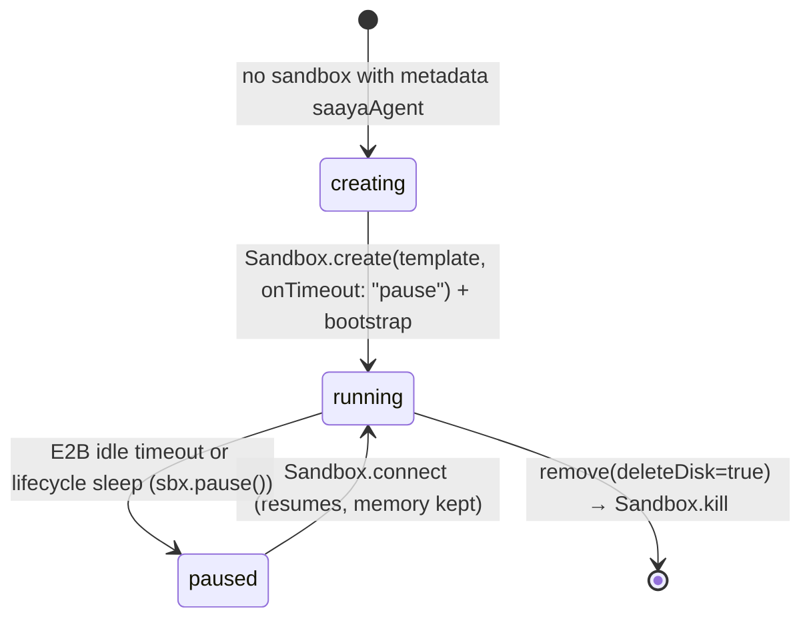
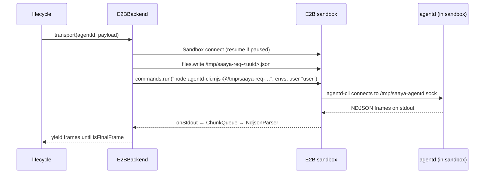

# computerd — E2B Cloud Backend

The E2B backend gives every agent a persistent sandbox in E2B's cloud (Firecracker microVMs) for hosts that cannot run computers themselves — no KVM, little RAM, or no Docker. Nothing runs locally: computerd only drives the `e2b` SDK. The tradeoff is egress: the sandbox reaches the internet **directly**, not through Saaya egress, so `$SECRET{...}` placeholders are never substituted inside it.

Source files: `apps/computerd/src/backends/e2b.ts`

---

## ⚙️ Configuration & Constants

`E2BBackendConfig` (`e2b.ts:15-22`), built by `buildE2B` in [select.ts](backends.md):

| Field        | Env var                                 | Default                                                                                     | Meaning                                                      |
| :----------- | :-------------------------------------- | :------------------------------------------------------------------------------------------ | :----------------------------------------------------------- |
| `apiKey`     | `E2B_API_KEY`                           | required — `buildE2B` throws `BackendUnavailableError("E2B_API_KEY is not set")` without it | E2B account key                                              |
| `template`   | `E2B_TEMPLATE`                          | `base`                                                                                      | sandbox image template                                       |
| `maxRunning` | `E2B_MAX_RUNNING`                       | `20`                                                                                        | concurrency cap (returned verbatim by `autoMaxRunning`)      |
| `idleMs`     | `COMPUTER_IDLE_MS` (fallback `600_000`) | —                                                                                           | E2B pauses the sandbox itself after this long without a call |
| `bundleDir`  | `AGENTD_BUNDLE_DIR`                     | `<package>/dist/agentd/` (`defaultBundleDir`, `e2b.ts:30-32`)                               | compiled agentd bundle pushed into new sandboxes             |

In-sandbox constants (`e2b.ts:26-28`):

| Constant      | Value                                    |
| :------------ | :--------------------------------------- |
| `AGENTD_DIR`  | `/opt/saaya-agentd`                      |
| `AGENTD_SOCK` | `/tmp/saaya-agentd.sock`                 |
| `ENV`         | `{ AGENTD_SOCK, BOT_HOME: "/home/bot" }` |

E2B metadata keys: `saayaApp: "computerd"` marks computers owned by this daemon, `saayaAgent` / `saayaOrg` record the owner. `ipIdentity = false` and `kind = "e2b"`.

---

## 🔄 Sandbox Lifecycle

- `find(agentId)` (`e2b.ts:78-85`) lists sandboxes with `metadata: { saayaAgent }` in states `running` **and** `paused`.
- `connect(agentId)` (`e2b.ts:115-127`) returns a cached `Sandbox` or connects to the found one — **`Sandbox.connect` resumes a paused sandbox, memory included** — with `timeoutMs` set to `idleMs`. The cache entry is dropped whenever a lifecycle transition may have invalidated it (start, sleep, remove).
- `start(agentId, orgId, _profile)` (`e2b.ts:129-147`): if a sandbox exists, drop the local cache entry and reconnect; otherwise `Sandbox.create(template, …)` with the metadata triple, `timeoutMs: idleMs`, and `lifecycle: { onTimeout: "pause" }` — E2B's own pause keeps memory + disk. New sandboxes then go through `bootstrap()`, and every start finishes with `ensureDaemon()`. The `profile` argument is ignored: there is no browser variant on E2B.
- `status` reports `running` vs `stopped` (paused/missing), `listRunning` pages through sandboxes labelled `saayaApp: "computerd"` in state `running` (`e2b.ts:91-102`): it walks the SDK pager (`while (pager.hasNext)`) and maps each item's `metadata.saayaAgent` back to an agent id, so the lifecycle's usage tracking and idle sweep see the same population computerd would manage locally.

### Metadata scheme

| Key          | Value         | Used by                                            |
| :----------- | :------------ | :------------------------------------------------- |
| `saayaApp`   | `"computerd"` | `listRunning` ownership filter                     |
| `saayaAgent` | agent id      | `find()` (per-agent lookup), `listRunning` mapping |
| `saayaOrg`   | org id        | bookkeeping only                                   |

Metadata-based discovery means computerd instances share one E2B account safely: a restarted computerd re-finds its computers by metadata instead of holding anything in memory.

### First-boot bootstrap (`bootstrap`, `e2b.ts:150-171`)

1. Uploads `agentd.mjs` and `agentd-cli.mjs` from `bundleDir` into the sandbox; a missing bundle is a hard error: `agentd bundle missing at <path>; run: pnpm --filter @sayabot/computerd build:agentd` (the esbuild bundle step, `package.json` script `build:agentd`).
2. Runs one root command (300 s timeout): `mkdir -p /opt/saaya-agentd /home/bot`, move both files into `AGENTD_DIR`, `chown -R user:user /home/bot`, and `npm install --prefix /opt/saaya-agentd --no-save --no-audit --no-fund typescript@5.9.3` — code intelligence loads the TypeScript compiler at runtime, and the version is pinned in step with `apps/computerd`.

### Daemon liveness (`ensureDaemon`, `e2b.ts:174-180`)

After a resume the daemon is usually still running (memory was kept); the guard `pgrep -f '/opt/saaya-agentd/agentd.mjs' || nohup node … &` restarts it if not, then waits up to 5 s (50 × 0.1 s) for `/tmp/saaya-agentd.sock` to exist.

---

## 📞 Transport (`transport`, `e2b.ts:182-231`)

There is no socket fast path (`describe()` reports `fastPath: false`); every call runs the CLI:

1. `connect(agentId)` — any failure is normalized to `ComputerGoneError` so the lifecycle can retry.
2. `keepAlive(agentId, sbx)` — at most once per minute, `sbx.setTimeout(idleMs)` pushes E2B's own idle timer back (`e2b.ts:234-239`). The throttle (`touchedAt` map) exists because every call would otherwise extend the timer, masking sandboxes that have genuinely gone idle.
3. **Large requests go through a file**: argv strings are capped at 128 KiB, so instead of chunking, the whole payload is written to `/tmp/saaya-req-<uuid>.json` and executed as `node /opt/saaya-agentd/agentd-cli.mjs @<path>` (the `@file` input mode of agentd-cli, with a command timeout of `payload.timeoutMs + 30 s`).
4. A `ChunkQueue` (`e2b.ts:35-55`) bridges E2B's `onStdout` callback into an async generator — the SDK reports output via callbacks while the transport consumes a stream. Frames are parsed by the shared `NdjsonParser` and yielded until `isFinalFrame`; when a final frame arrives early, the underlying `commands.run` promise is resolved early and its result recorded.
5. If the run fails and stderr matches `ENOENT|ECONNREFUSED`, `ensureDaemon` is re-run — the daemon died (e.g. a filesystem-only resume) — so the next retry succeeds. Otherwise the error is `agentd returned no complete response: <stderr>`.

---

## 😴 Sleep / Remove / Describe

| Operation                                        | Behaviour                                                                                                                                                      |
| :----------------------------------------------- | :------------------------------------------------------------------------------------------------------------------------------------------------------------- |
| `sleep(agentId)` (`e2b.ts:241-247`)              | Finds the sandbox, drops the cache entry, and (if running) `sbx.pause()` — E2B keeps memory + disk                                                             |
| `remove(agentId, deleteDisk)` (`e2b.ts:249-254`) | Without `deleteDisk` this is just a pause; with it, `Sandbox.kill` destroys the sandbox and its disk                                                           |
| `describe()` (`e2b.ts:256-263`)                  | `isolation: "E2B cloud microVM (Firecracker)"`, `fastPath: false`, `egress: "direct internet (Saaya egress and $SECRET placeholders unavailable)"`, `template` |

### Environment constraints to know

- **No egress proxy**: HTTP requests from the sandbox bypass SSRF filtering, IP pinning, secret swapping, and response scrubbing entirely.
- **No `$SECRET{...}` substitution**: the orchestrator-side secret broker never sees this traffic, so placeholders sent from an E2B computer go out verbatim.
- Idle behaviour is driven by **E2B's own timeout** (`onTimeout: "pause"` + periodic `setTimeout` refresh); the lifecycle's `sweepIdle` maps onto `sleep()` → pause.

### Failure modes and recovery

| Symptom                            | Cause                                          | Recovery                                                                                                                                               |
| :--------------------------------- | :--------------------------------------------- | :----------------------------------------------------------------------------------------------------------------------------------------------------- |
| `ComputerGoneError` from `connect` | sandbox killed externally (E2B console, quota) | lifecycle wakes-and-retries → `start()` finds nothing and **creates** a fresh sandbox (with bootstrap, so agentd + `/home/bot` layout are reinstalled) |
| `ENOENT`/`ECONNREFUSED` in stderr  | daemon not running after resume                | `ensureDaemon` re-runs automatically within the same transport call, fixing the _next_ retry                                                           |
| `agentd bundle missing at <path>`  | `dist/agentd/` not built                       | run `pnpm --filter @sayabot/computerd build:agentd`, then restart/start again                                                                          |
| Sandbox paused mid-turn            | E2B idle timeout expired despite keep-alive    | next transport call resumes through `Sandbox.connect` (memory kept), transparently                                                                     |

---

## 🧪 Tests

- `apps/computerd/tests/unit/e2b-backend.test.ts` — metadata queries, connect/resume caching, transport through a fake SDK, keep-alive throttling.

## 🧩 SDK Surface Used

The backend touches exactly these `e2b` SDK entry points (injected as a module so tests can fake it):

| SDK call                                       | Where                                    | Purpose                                          |
| :--------------------------------------------- | :--------------------------------------- | :----------------------------------------------- |
| `Sandbox.list({ query: { metadata, state } })` | `find`, `listRunning`                    | metadata-based sandbox discovery (paged)         |
| `Sandbox.create(template, opts)`               | `start`                                  | new sandbox with metadata + `onTimeout: "pause"` |
| `Sandbox.connect(sandboxId, opts)`             | `connect`, `sleep`                       | attach to (and resume) an existing sandbox       |
| `sbx.files.write(path, content)`               | `bootstrap`, `transport`                 | upload agentd bundle / request file              |
| `sbx.commands.run(cmd, opts)`                  | `bootstrap`, `ensureDaemon`, `transport` | shell execution inside the sandbox               |
| `sbx.setTimeout(ms)`                           | `keepAlive`                              | push E2B's idle timer                            |
| `sbx.pause()` / `Sandbox.kill(id)`             | `sleep`, `remove`                        | pause-with-disk / destroy                        |

All calls pass `{ apiKey }` from config; user-scoped commands run as `"user"` (the E2B default non-root user that owns `/home/bot` after `chown`), while bootstrap runs as `"root"`.

---

## Related docs

- [Backend abstraction & selection](backends.md)
- [agentd: the in-container daemon](agentd.md)
- [agentd-cli input modes](agentd.md)
- [Egress proxy (why E2B traffic is unfiltered)](../egress/overview.md)
- [Secret broker](../orchestrator/tools/secrets-broker.md)
