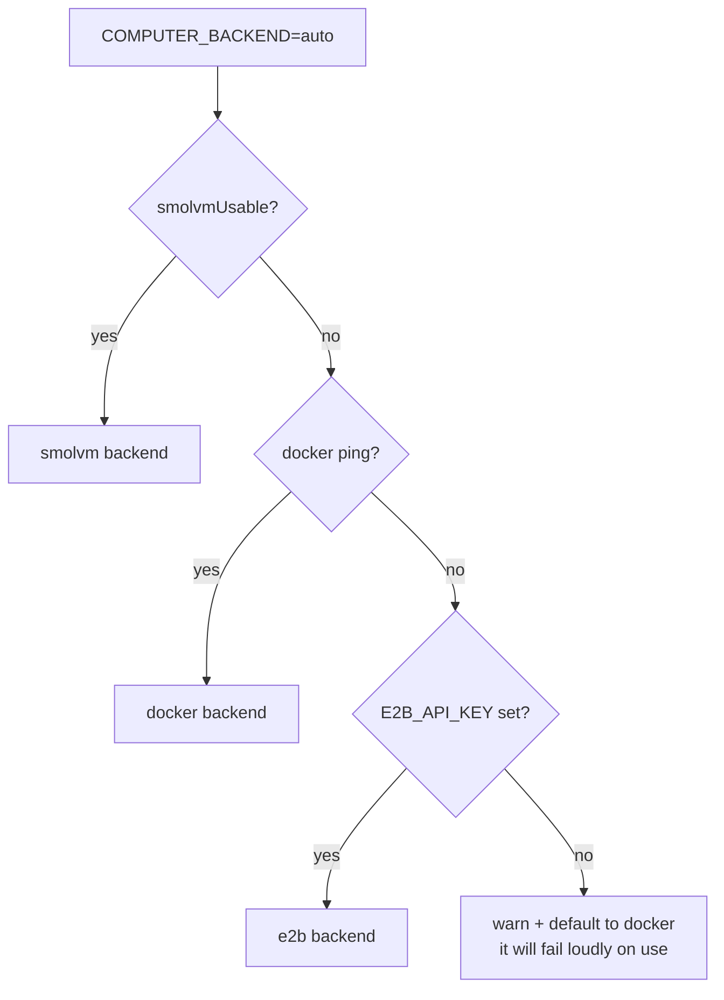

# computerd — Backend Abstraction & Selection

computerd can give each agent its computer on three different backends: a Docker container, a smolvm microVM, or an E2B cloud sandbox. The `ComputerBackend` interface isolates the lifecycle from _how_ a computer is created, reached, paused and deleted, and `selectBackend` implements the `COMPUTER_BACKEND=auto` ranking that picks the strongest backend the host can run. This page covers the interface, the selection logic, and the Docker backend implementation; smolvm and E2B have their own pages.

Source files: `apps/computerd/src/backends/types.ts`, `apps/computerd/src/backends/select.ts`, `apps/computerd/src/backends/docker.ts`

---

## 🧩 The Backend Contract (`backends/types.ts`)

```typescript
export interface ComputerBackend {
  readonly kind: BackendKind // "docker" | "smolvm" | "e2b"
  readonly ipIdentity: boolean // egress attributes traffic by container IP
  autoMaxRunning(memMb: number, fraction: number): Promise<number>
  listRunning(): Promise<string[]>
  status(agentId: string): Promise<ComputerStatus> // "running" | "stopped" | "missing"
  attach(agentId: string): Promise<Ready> // reconnect to an already-running computer
  start(agentId: string, orgId: string, profile: ComputerProfile): Promise<Ready>
  transport(agentId: string, ready: Ready, payload: AgentdFrame): AsyncGenerator<AgentdFrame>
  sleep(agentId: string, timeoutSec: number): Promise<void> // stop/pause, keep disk
  remove(agentId: string, deleteDisk: boolean): Promise<void>
  describe(): Record<string, unknown> // notes for GET /v1/capacity
}
```

(`types.ts:26-46`.) Supporting types:

- `ComputerProfile = "standard" | "browser"` — selects the `saaya/computer:<tag>-browser` image on Docker; ignored by smolvm/E2B.
- `Ready` (`types.ts:8-15`) is everything computerd needs to reach a running computer: `id` (container/machine/sandbox id reported to the orchestrator), `ip` (for IP-identity backends), and `ctlSocket` (host-side agentd socket — the ~1 ms fast path).
- Errors: `ComputerGoneError` ("the computer stopped or vanished under us; the lifecycle wakes it and retries once") and `BackendUnavailableError` ("the backend itself cannot be reached"), (`types.ts:18-20`).

### argv chunking (`argvChunks`, `types.ts:49-54)

CLI transports pass the request JSON through process arguments, and Linux caps a single argv string at 128 KiB. `argvChunks(payload, size = 100_000)` splits the JSON into ≤ 100 KB chunks that `agentd-cli` joins back together (see [agentd.md](agentd.md)); an empty payload becomes `["{}"]`.

---

## 🧭 Backend Selection (`backends/select.ts`)

### Builder functions

| Builder                                             | What it wires                                                                                                                                                                                                |
| :-------------------------------------------------- | :----------------------------------------------------------------------------------------------------------------------------------------------------------------------------------------------------------- |
| `buildDocker(config, docker?)` (`select.ts:26-37`)  | `DockerBackend` with image tag, network, mem/cpus, runtime, ctl root/volume, and a `orchestratorGrantsEnv` fetcher                                                                                           |
| `buildSmolvm(config, identity)` (`select.ts:39-51`) | `EgressBridge(parseEgressTarget(config.egressProxyUrl), identity.proxyAuthorization)` + `SmolvmBackend` with `SMOLVM_IMAGE` (default `saaya/computer:<tag>`), mem/cpus/storage, `runDir`, grants fetcher     |
| `buildE2B(config)` (`select.ts:53-63`)              | Throws `BackendUnavailableError("E2B_API_KEY is not set")` without a key; dynamically imports the `e2b` SDK and builds `E2BBackend` with template, `E2B_MAX_RUNNING`, idle window, and the agentd bundle dir |

All three share `grantsEnvFetcher` (`select.ts:10-24`): a `GET ${orchestratorUrl}/internal/computer/:agentId/grants-env` call (5 s timeout, `x-internal-secret`) whose `{ env }` object is injected into the computer as environment variables. Failures degrade to `{}`.

### `selectBackend` — the `auto` ranking

Explicit `COMPUTER_BACKEND` values bypass detection (`select.ts:75-77`). In `auto` mode (`select.ts:79-95`) the order is:



- `smolvmUsable` requires hardware virtualization (Apple silicon, or Linux with readable/writable `/dev/kvm`) and a successful `smolvm --version` (details in [backend-smolvm.md](backend-smolvm.md)).
- Every failed candidate's reason is collected and reported in the final warning: `[computerd] no computer backend available (smolvm: …; docker: …; e2b: E2B_API_KEY not set); defaulting to docker` — a deliberate choice so the error surfaces on the first real request rather than killing the daemon.

---

## 🐳 Docker Backend (`backends/docker.ts`)

### Naming and layout

| Constant                 | Value                  | Role                                                            |
| :----------------------- | :--------------------- | :-------------------------------------------------------------- |
| `containerName(agentId)` | `bot-${agentId}`       | one container per agent (`docker.ts:38`)                        |
| `volumeName(agentId)`    | `saaya-bot-${agentId}` | one named disk volume per agent (`docker.ts:39`)                |
| `AGENT_LABEL`            | `saaya.agent`          | label used to list running computers (`docker.ts:36`)           |
| `CTL_MOUNT`              | `/run/agentd-ctl`      | control-volume mountpoint inside the container (`docker.ts:35`) |

`ipIdentity = true`: egress identifies Docker computers by container IP, so the lifecycle must reset egress caches on start/stop (see [lifecycle.md](lifecycle.md)).

### Creating the container (`create`, `backends/docker.ts:205-247`)

```typescript
Image: profile === "browser" ? `saaya/computer:${tag}-browser` : `saaya/computer:${tag}`,
User: "10001:10001",                       // unprivileged; with CapDrop ALL a root agentd cannot setuid down
Env: [
  "NODE_ENV=production",
  "HTTP_PROXY=http://egress:8080", "HTTPS_PROXY=http://egress:8080",
  "http_proxy=http://egress:8080", "https_proxy=http://egress:8080",
  'NO_PROXY=""',
  ...(ctlMount ? [`AGENTD_CTL_SOCK=${CTL_MOUNT}/agentd.sock`] : []),
  ...Object.entries(grantsEnv).map(([k, v]) => `${k}=${v}`),
],
Labels: { "saaya.agent": agentId, "saaya.org": orgId, "saaya.profile": profile },
HostConfig: {
  Runtime: "runsc" | undefined,            // gVisor when resolved
  NetworkMode: "botnet",
  ReadonlyRootfs: true,
  Tmpfs: { "/tmp": "size=512m,mode=1777", "/run": "size=16m,mode=1777" },
  Binds: [`${volumeName(agentId)}:/home/bot:rw`,
          "saaya-egress-ca:/usr/local/share/ca-certificates/saaya:ro"],
  Mounts: [ctlVolume subpath mount],       // only when the fast path is enabled
  NanoCpus: cpus * 1e9, Memory: memBytes, MemorySwap: memBytes,   // no swap slack
  PidsLimit: 512,
  CapDrop: ["ALL"], SecurityOpt: ["no-new-privileges:true"],
  RestartPolicy: { Name: "no" },
},
```

All egress traffic is forced through the `egress:8080` proxy by env; the egress CA volume lets HTTPS interception-free proxying validate certificates. `start()` (`backends/docker.ts:122-137`) is idempotent: a running container is just re-`attach`ed; a missing one is created (after `ensureNetwork()` creates `botnet` as an internal bridge on first use, `backends/docker.ts:149-156`); an existing stopped one gets its control subdirectory re-created (a volume subpath must exist before `docker start`) and is started. After start, `waitForSocket` polls up to 5 s for the agentd socket to appear (`backends/docker.ts:54-62`).

### Socket fast path vs `docker exec`

`ctlEnabled()` (`backends/docker.ts:163-183`) gates the fast path; it is a one-time check requiring **all** of:

- `AGENTD_CTL_ROOT` configured, existing, and a directory;
- runtime resolved to `runc` (gVisor shares no host mounts — fast path is off under gVisor);
- Docker Engine API version ≥ 1.45 (volume subpath support).

When disabled, computerd logs `agentd socket fast path disabled; using docker exec transport`. `prepareCtlDir` (`backends/docker.ts:191-203`) creates `${ctlRoot}/${containerName}` and chmods it `0777` — agentd runs as uid 10001 and computerd has no `CAP_CHOWN`; only this one container mounts the subpath, so the wide mode is contained.

`transport()` (`backends/docker.ts:249-264`) tries `socketRequest(ready.ctlSocket, …)` first and falls back to `dockerExec()` on `TransportUnavailableError` (agentd still booting, socket unusable). `dockerExec` (`backends/docker.ts:266-309`) creates a Docker exec of `["/opt/agentd/agentd-cli", ...argvChunks(payload)]`, streams the multiplexed attach stream through `DockerStreamDemuxer` + `NdjsonParser`, and surfaces stderr in the final error ("agentd returned no complete response: …"). Exec create failures with status 409/404 (container not running) become `ComputerGoneError` so the lifecycle can wake-and-retry.

### Sleep / remove / describe

- `sleep` (`backends/docker.ts:311-317`) = `docker stop` with the given timeout; 304 ("already stopped") and 404 are tolerated.
- `remove` (`backends/docker.ts:319-331`) force-removes the container (errors swallowed), optionally deletes the `saaya-bot-${agentId}` volume (`deleteDisk`), and always removes the host-side control directory under `ctlRoot`.
- `describe()` reports `isolation: "container" | "container + gVisor"`, `fastPath` (null until probed), and `egress: "botnet → egress (identified by container IP)"`.

---

## 🧪 Tests

- `apps/computerd/tests/unit/docker.test.ts` — Docker endpoint discovery.
- `apps/computerd/tests/unit/docker-volume.test.ts` — container/volume naming and bind layout.
- `apps/computerd/tests/integration/computerd-app.test.ts` — HTTP surface against a fake lifecycle.
- Backend selection ranking is exercised in `apps/computerd/tests/unit/smolvm-backend.test.ts` (via `smolvmUsable`).

---

## Related docs

- [Docker runtime layer (the Engine API client)](docker-runtime.md)
- [smolvm backend](backend-smolvm.md)
- [E2B backend](backend-e2b.md)
- [Lifecycle: create, sleep, wake, evict](lifecycle.md)
- [Backend selection & deployment tradeoffs](../orchestrator/computers/vps-and-client.md)
