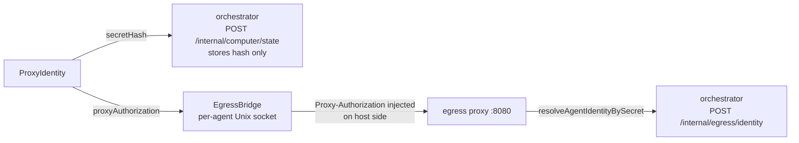

# computerd — Capacity Planning & Per-Agent Identity

Two small modules carry a disproportionate amount of computerd's behaviour: `capacity.ts` holds the pure policy functions that decide how many computers may run and which one to evict, and `identity.ts` derives the per-agent egress proxy credential that lets the egress proxy attribute every outbound request to the right agent — without the credential ever entering a computer.

Source files: `apps/computerd/src/capacity.ts`, `apps/computerd/src/identity.ts`

---

## 📊 Capacity Policy (`src/capacity.ts`)

The module's docstring states the model: every agent keeps its own container, disk and network identity; what is rationed is **how many run at the same time**. Idle computers sleep (container/VM stopped, disk kept), the least recently used idle one is evicted to admit a newcomer, and waking is a cheap `docker start` — no agent ever runs inside a container another agent used.

### Types and functions

| Export | Signature | Behaviour |
| :--- | :--- | :--- |
| `ComputerUsage` | `{ agentId, lastUsedAt, inflight }` | per-agent usage record maintained by the lifecycle's `touch()` |
| `autoMaxRunning` | `(memTotalBytes, memPerBotMb, fraction) => number` (`capacity.ts:19-27`) | `floor(memTotal * fraction / (memPerBotMb * 1 MiB))`, minimum 1; returns 4 for invalid input. Used when `COMPUTER_MAX_RUNNING=auto` |
| `idleComputers` | `(usage, now, idleMs) => ComputerUsage[]` (`capacity.ts:30-36`) | computers with `inflight === 0` and `now - lastUsedAt >= idleMs` — the idle-sleep candidate set |
| `pickEvictionVictim` | `(usage, now, graceMs) => ComputerUsage \| null` (`capacity.ts:43-51`) | among computers idle for at least `graceMs`, the one with the smallest `lastUsedAt`. A computer used within the grace window is **protected**: between tool calls the model may think for many seconds, and evicting then would kill background work |
| `Mutex` | `lock(): Promise<() => void>` (`capacity.ts:54-67`) | minimal promise-chain mutex so concurrent admissions cannot overshoot the cap |

### How the numbers combine

With `COMPUTER_MAX_RUNNING=auto`, the effective cap is computed per backend:

- **Docker**: `autoMaxRunning(docker.info().MemTotal, COMPUTER_MEM_MB, COMPUTER_MEM_FRACTION)` — on Docker Desktop `MemTotal` is the VM's memory, on a VPS the server's (`backends/docker.ts:90-93`).
- **smolvm**: `autoMaxRunning(totalmem() * 2, ...)` — guest memory is elastic (virtio balloon), so an idle VM commits far less than its cap and the cap is doubled (`backends/smolvm.ts:149-152`).
- **e2b**: no memory math; the fixed `E2B_MAX_RUNNING` (default 20) is returned (`backends/e2b.ts:87-89`).

The lifecycle applies these through `maxRunning()` (cached after first computation, fallback 4) and the admission loop described in [lifecycle.md](lifecycle.md).

### What is rationed — and what is not

The policy rations **running computers**, not existence:

| Resource | Policy |
| :--- | :--- |
| Containers / VMs running at once | capped by `maxRunning` (admission + eviction) |
| Disks (`/home/bot`) | one per agent, never shared, never rationed — they persist through sleep, eviction, and computerd restarts |
| Network identity | one per agent (container IP on Docker, proxy credential on smolvm) |
| In-flight calls | tracked per agent (`inflight`) only to protect busy computers from eviction/sleep |

The `Mutex` matters because admission is not atomic otherwise: two concurrent `ensure` calls could both count the same free slot and overshoot the cap. Every admission decision is made while holding the mutex, and booting computers are counted through the `reserved` set even though they do not yet appear in `backend.listRunning()`.

### Defaults recap

| Env var | Default | Feeds into |
| :--- | :--- | :--- |
| `COMPUTER_MAX_RUNNING` | `auto` | fixed cap or auto sizing |
| `COMPUTER_MEM_MB` | `1024` | memory per computer |
| `COMPUTER_MEM_FRACTION` | `0.6` (clamped 0.05–0.95) | share of host memory usable |
| `COMPUTER_IDLE_MS` | `600_000` | idle sleep threshold |
| `COMPUTER_EVICT_GRACE_MS` | `60_000` | LRU protection window |
| `COMPUTER_ADMIT_TIMEOUT_MS` | `60_000` | admission deadline before HTTP 503 |
| `E2B_MAX_RUNNING` | `20` | e2b cap |

`GET /v1/capacity` on computerd surfaces the result: backend, effective `maxRunning`, running count, idle window, and per-computer `inflight` / `idleForMs` / transport.

---

## 🪪 Per-Agent Egress Identity (`src/identity.ts`)

`ProxyIdentity` (`identity.ts:8-28`) derives — never stores — a proxy credential per agent. The whole module:

```typescript
export class ProxyIdentity {
  private key: Buffer

  constructor(key = process.env.COMPUTERD_PROXY_KEY || process.env.ORCHESTRATOR_INTERNAL_SECRET) {
    // Without a configured key, credentials still work for the life of this process.
    this.key = key ? Buffer.from(key) : randomBytes(32)
  }

  secret(agentId: string): string {
    return createHmac("sha256", this.key).update(`saaya-egress:${agentId}`).digest("hex")
  }

  /** Same hash the orchestrator applies (hashAgentApiKey in @sayabot/core). */
  secretHash(agentId: string): string {
    return createHash("sha256").update(this.secret(agentId)).digest("hex")
  }

  proxyAuthorization(agentId: string): string {
    return `Basic ${Buffer.from(`saaya:${this.secret(agentId)}`).toString("base64")}`
  }
}
```

| Method | Definition | Purpose |
| :--- | :--- | :--- |
| `secret(agentId)` | `HMAC-SHA256(key, "saaya-egress:" + agentId)` as hex (`identity.ts:16-18`) | the per-agent credential value |
| `secretHash(agentId)` | `SHA-256(secret)` hex (`identity.ts:21-23`) | the same hash the orchestrator computes (`hashAgentApiKey` in `@sayabot/core`); the orchestrator stores **only the hash** |
| `proxyAuthorization(agentId)` | `Basic base64("saaya:" + secret)` (`identity.ts:25-27`) | the literal header value computerd injects into proxied traffic |

Design properties (from the module docstring):

1. **Derived, not stored** — because the credential is a pure function of the key and `agentId`, it survives a computerd restart with no database or state.
2. **Never enters a computer** — for smolvm (and E2B, which has no egress integration at all) the credential is added on the **host side** of the egress bridge; the guest cannot read it, so it cannot forge another agent's identity. See [egress-bridge.md](egress-bridge.md).
3. **Restart-stable and unforgeable in-guest** when `COMPUTERD_PROXY_KEY` (or, by default, `ORCHESTRATOR_INTERNAL_SECRET`) is set. If neither is set, a random key is generated — credentials then work but change on every restart.

### Where each piece flows



The egress side of this exchange — `resolveAgentIdentityBySecret` verifying the credential against the orchestrator and caching the result for 60 s — is documented in [egress overview](../egress/overview.md) and [scrub-and-swapper](../egress/scrub-and-swapper.md). Docker computers skip this mechanism entirely: they are identified by container IP, which is why the lifecycle resets egress's IP → agent cache on every start/stop.

### Verification flow, end to end

1. computerd boots a computer and posts `proxySecretHash = identity.secretHash(agentId)` to `POST /internal/computer/state` (`lifecycle.ts:298-304`). The orchestrator stores the hash against the agent.
2. The guest's outbound traffic arrives at egress carrying `Proxy-Authorization: Basic base64("saaya:" + secret)` (injected by the `EgressBridge` for smolvm).
3. Egress calls `POST /internal/egress/identity` with the raw secret; the orchestrator hashes it with `hashAgentApiKey` and compares. The raw secret is never stored anywhere — only the hash is persisted, so a database dump cannot produce usable credentials.
4. Matching grants the request the agent's secret grants (subject to per-secret host allowlists); mismatching yields `407 Proxy Authentication Required`.

Note the two-key design: rotating `COMPUTERD_PROXY_KEY` invalidates every agent credential at once (egress will fail closed with 407s until computerd restarts and re-reports hashes), while rotating `ORCHESTRATOR_INTERNAL_SECRET` changes both the computerd↔orchestrator channel and the credential derivation key, because the latter falls back to it.

---

## 🧪 Tests

- `apps/computerd/tests/unit/capacity.test.ts` — auto-sizing math, idle filtering, victim selection (protection window), mutex serialization.
- `apps/computerd/tests/unit/lifecycle.test.ts` — the same policy exercised end-to-end through `ComputerLifecycle`.
- Identity derivation is exercised via `apps/computerd/tests/unit/egress-bridge.test.ts` (bridge injecting `proxyAuthorization`) and the egress suite (`apps/egress/tests/unit/swapper.test.ts`).

## 🧮 Worked Example

A 16 GB host with defaults (`COMPUTER_MEM_MB=1024`, `COMPUTER_MEM_FRACTION=0.6`):

1. `autoMaxRunning` gives `floor(16 GiB × 0.6 / 1 GiB) = 9` concurrent computers (Docker). On smolvm the same host yields `floor(32 GiB × 0.6 / 1 GiB) = 18`, because elastic guest memory lets more VMs fit.
2. Agents 1–9 boot and run. Agent 10's `ensure` finds all 9 slots taken.
3. `pickEvictionVictim` looks for a computer idle ≥ 60 s (`COMPUTER_EVICT_GRACE_MS`): agent 3's last call was 4 minutes ago → it is the victim (smallest `lastUsedAt` among candidates).
4. Agent 3 sleeps (`docker stop` / `machine stop`, disk kept), agent 10 boots into the freed slot.
5. Ten minutes of silence later, the 30-second sweep puts agent 1 (idle ≥ `COMPUTER_IDLE_MS`) to sleep as well.
6. Agent 3's next call goes through `ensure` → the computer is not in `ready` → `backend.start()` boots it again in about a second (Docker) or ~1 s VM boot (smolvm) — same disk, same identity, no admission wait because a slot is free.

Failure path: if all computers are *in flight* (nobody evictable) for the whole `COMPUTER_ADMIT_TIMEOUT_MS` (60 s), agent 10's request fails with `CapacityError` → HTTP 503 with the message naming `COMPUTER_MAX_RUNNING` as the knob.

---

## Related docs

- [Lifecycle: create, sleep, wake, evict](lifecycle.md)
- [computerd overview & HTTP surface](overview.md)
- [Egress bridge: credential injection on the host side](egress-bridge.md)
- [Egress proxy overview](../egress/overview.md)
- [Security model (platform-wide)](../architecture/security-model.md)
