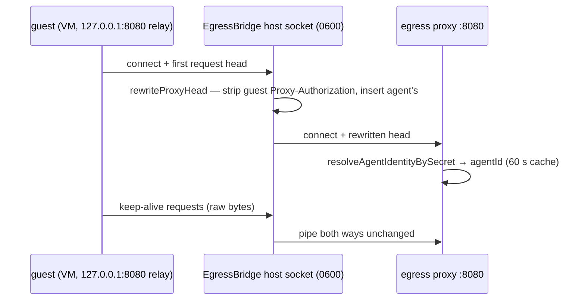

# computerd — Egress Bridge (Per-Agent Socket to the Egress Proxy)

A smolvm microVM has **no network**; its only way out is a single Unix socket mounted into the VM. The `EgressBridge` is the host side of that socket: for every guest connection it forwards the bytes to the Saaya egress proxy and **rewrites the first request head** to insert that agent's `Proxy-Authorization` credential — added on the host side, so the credential never enters the guest and cannot be read or forged by it.

Source files: `apps/computerd/src/egress-bridge.ts`, `apps/computerd/src/identity.ts` (credential source — see [capacity-and-identity.md](capacity-and-identity.md))

---

## 🧩 Why Rewriting Works

Egress binds identity to the **TCP connection**, not to individual requests: the first request on a connection carries `Proxy-Authorization`, and keep-alive requests that follow inherit the connection's identity (a `WeakMap<Socket, identity>` on the egress side, `apps/egress/src/index.ts:103`). So the bridge only needs to rewrite the *first* request head of each connection; everything after that is a blind byte pipe.

`rewriteProxyHead(buf, authorization)` (`egress-bridge.ts:12-23`) implements the rewrite:

```typescript
const MAX_HEAD = 64 * 1024

export function rewriteProxyHead(buf: Buffer, authorization: string): Buffer | null {
  const end = buf.indexOf("\r\n\r\n")
  if (end < 0) {
    if (buf.length > MAX_HEAD) throw new Error("proxy request head too large")
    return null                       // keep buffering until the head is complete
  }
  const head = buf.subarray(0, end).toString("latin1")
  const [requestLine = "", ...headers] = head.split("\r\n")
  const kept = headers.filter((h) => !/^proxy-authorization\s*:/i.test(h))
  const rebuilt = [requestLine, ...kept, `Proxy-Authorization: ${authorization}`].join("\r\n")
  return Buffer.concat([Buffer.from(rebuilt + "\r\n\r\n", "latin1"), buf.subarray(end + 4)])
}
```

Behaviour in detail:

1. Waits for the full head — it returns `null` until the `\r\n\r\n` blank line arrives, so the caller keeps accumulating guest bytes.
2. Guards against heads that never end: past `MAX_HEAD` (64 KB) it throws, which the bridge converts to `HTTP/1.1 431 Request Header Fields Too Large`.
3. Decodes the head as latin1 (byte-preserving), splits the request line from headers, **drops any `Proxy-Authorization` the guest sent** (case-insensitive regex — a guest can never claim another agent's identity, even by spoofing the header), and appends the host credential as the last header.
4. Rebuilds the head and re-attaches any body bytes already buffered after the blank line, so nothing is lost when the client pipelines.

`parseEgressTarget(url)` (`egress-bridge.ts:30-33`) turns `EGRESS_PROXY_URL` (default `http://egress:8080` in Docker, `http://127.0.0.1:8080` on a laptop) into `{ host, port }` (port defaults to 8080).

---

## 🔁 `EgressBridge`



### Listener management

`listen(agentId, socketPath)` (`egress-bridge.ts:50-65`):

- Creates the parent directory with mode `0700` and unlinks any stale socket file.
- Binds the per-agent credential **once**, when the listener starts (`authorizationFor(agentId)` — `ProxyIdentity.proxyAuthorization`, the HMAC-derived `saaya-egress:<agentId>` credential):

```typescript
const auth = this.authorizationFor(agentId)
const server = createServer((guest) => this.forward(guest, auth))
await new Promise<void>((resolve, reject) => {
  server.once("error", reject)
  server.listen(socketPath, () => { server.off("error", reject); resolve() })
})
chmodSync(socketPath, 0o600)
```

- `chmodSync(socketPath, 0o600)` — only the owner (computerd, and the VM via the mounted socket) may connect.

It is idempotent per path: an existing listener is reused, which is exactly what the smolvm backend's `attach()` relies on to restore the bridge after a computerd restart without touching a running VM. `close(socketPath)` and `closeAll()` shut listeners down and unlink their sockets (called on machine delete, `backend-smolvm` `remove()` with `deleteDisk: true`).

### Connection forwarding (`forward`, `egress-bridge.ts:81-113`)

Per guest connection, the bridge runs a tiny state machine:

```typescript
private forward(guest: Socket, auth: string) {
  let buf = Buffer.alloc(0)
  let upstream: Socket | null = null
  const fail = () => { guest.destroy(); upstream?.destroy() }
  guest.on("error", fail)
  const onData = (chunk: Buffer) => {
    buf = Buffer.concat([buf, chunk])
    let head: Buffer | null
    try { head = rewriteProxyHead(buf, auth) } catch { /* 431 */ }
    if (!head) return                     // head not complete yet
    guest.off("data", onData)
    guest.pause()
    upstream = connect(this.target.port, this.target.host, () => {
      upstream?.write(head)
      if (!upstream) return
      guest.pipe(upstream).pipe(guest)
      guest.resume()
    })
    upstream.on("error", () => {
      if (!guest.destroyed) guest.end("HTTP/1.1 502 Bad Gateway\r\n\r\nsaaya: egress unreachable\n")
    })
  }
  guest.on("data", onData)
}
```

1. Guest bytes accumulate in a buffer; each chunk goes through `rewriteProxyHead` until it returns a head.
2. On completion the guest data listener is removed (`guest.off("data", onData)`), the guest is paused, and the upstream TCP connection to egress is opened with `connect(this.target.port, this.target.host, …)`.
3. On connect: write the rewritten head, then `guest.pipe(upstream).pipe(guest)` and resume — a pure byte relay from here on, so CONNECT tunnels (HTTPS) work unmodified after the first head. Byte-level piping also means HTTP/2-over-CONNECT, WebSockets-in-tunnels, and any other opaque protocol are unaffected.
4. Error handling: upstream failure ends the guest with `HTTP/1.1 502 Bad Gateway` + `saaya: egress unreachable`; any socket error (`fail`) destroys both sides; oversized heads get `431`.

### Security properties

| Property | Mechanism |
| :--- | :--- |
| Credential never in the guest | The `Proxy-Authorization` value is injected on the host side of the socket; the VM only sees an outbound TCP proxy at `127.0.0.1:8080` |
| Guest cannot escalate | Guest-supplied `Proxy-Authorization` headers are stripped before the host credential is appended |
| One identity per socket | The credential is bound at `listen()` time per `agentId`; a socket path cannot serve two agents |
| Attribution survives keep-alive | Egress binds identity per TCP connection; every request on the rewritten connection belongs to the same agent |
| Guest-local only | Socket mode `0600` inside a `0700` directory under `~/.saaya/vm/<agentId>/` |

---

## 🧱 How the Pieces Fit Together

The full path for one smolvm `curl https://api.github.com` (see [backend-smolvm.md](backend-smolvm.md) and [agentd.md](agentd.md)):

1. **VM creation**: `smolvm machine create … --mount-socket <runDir>/<agentId>/egress.sock:/run/saaya/egress.sock` and guest env `HTTP_PROXY=http://127.0.0.1:8080`, `AGENTD_EGRESS_SOCK=/run/saaya/egress.sock`.
2. **Before boot**: `EgressBridge.listen(agentId, <runDir>/<agentId>/egress.sock)` — the mounted host socket must exist before the VM starts (`SmolvmBackend.start`, `backends/smolvm.ts:181`).
3. **In the VM**: agentd's `startEgressRelay` listens on `127.0.0.1:8080` and pipes to the mounted socket, so ordinary `HTTP_PROXY` clients just work.
4. **On the host**: the bridge rewrites the first head, injecting `Proxy-Authorization: Basic base64(saaya:<HMAC secret>)`.
5. **At egress**: `proxySecretFrom` extracts the secret, `resolveAgentIdentityBySecret` asks the orchestrator to map it to `{ agentId, orgId }` (the orchestrator checks the SHA-256 of the credential — it stores only the hash), and the request proceeds through the SSRF + placeholder pipeline.

For **Docker** computers this module is not used at all: containers sit on `botnet` and are identified by container IP (with cache resets on start/stop, see [lifecycle.md](lifecycle.md)). For **E2B** there is no egress integration whatsoever — which is precisely why `$SECRET{...}` placeholders do not resolve there.

### Operational notes

- `EGRESS_PROXY_URL` is resolved **once** at backend build time (`backends/select.ts:39-51`); changing it requires a computerd restart.
- A crashed egress proxy surfaces to the guest as `502 saaya: egress unreachable` on new connections and connection resets on established ones — agents see ordinary HTTP errors, not daemon crashes.
- Bridge sockets live and die with their agent's run directory: `SmolvmBackend.remove(…, deleteDisk: true)` calls `egress.close()` and deletes `<runDir>/<agentId>`, so no stale listeners accumulate.

---

## 🧪 Tests

- `apps/computerd/tests/unit/egress-bridge.test.ts` — `rewriteProxyHead` (head splitting, guest credential stripping, credential injection, 431 on oversized heads), listener lifecycle (idempotent listen, close/unlink), and end-to-end forwarding with a fake egress target.

---

## Related docs

- [smolvm backend](backend-smolvm.md)
- [Capacity & per-agent identity (the credential)](capacity-and-identity.md)
- [Egress proxy overview](../egress/overview.md)
- [Scrub & swapper (identity resolution, grants)](../egress/scrub-and-swapper.md)
- [Security model (platform-wide)](../architecture/security-model.md)
