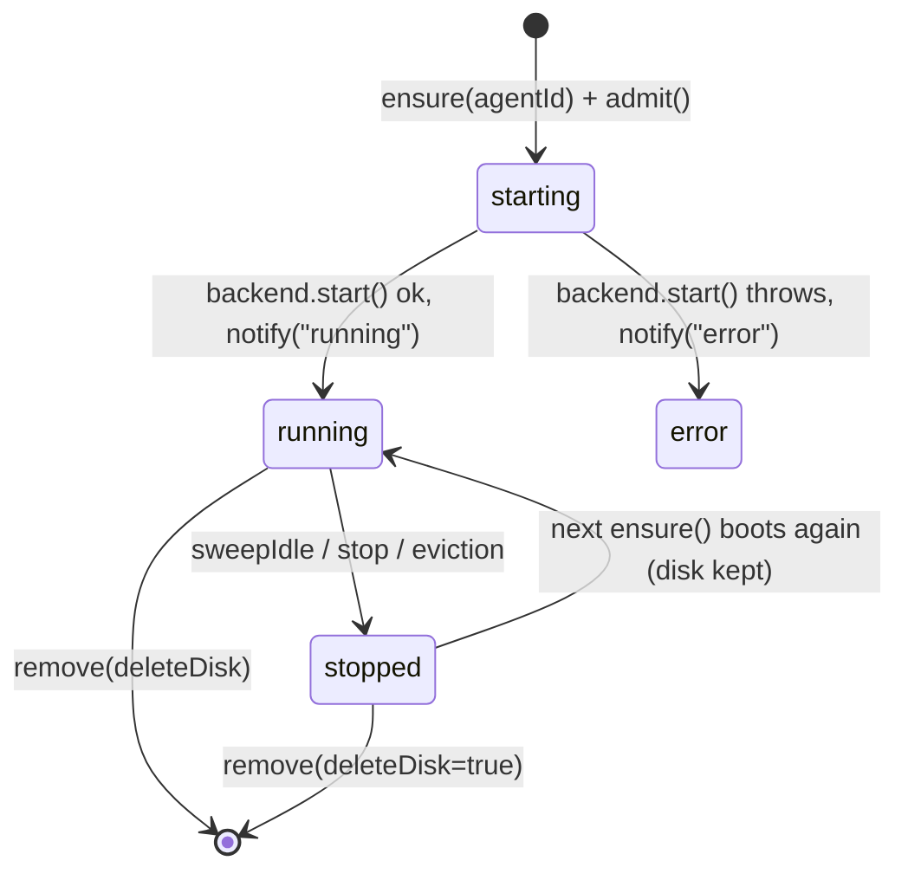

# computerd — Computer Lifecycle

The lifecycle is the brain of computerd: it decides **when** computers run (capacity cap, LRU eviction, idle sleep, lazy wake), while the selected backend decides **how** (Docker container, smolvm microVM, or E2B sandbox). One computer exists per agent; sleep always keeps the disk, so an agent's `/home/bot` survives idle periods, restarts, and evictions.

Source files: `apps/computerd/src/lifecycle.ts`, `apps/computerd/src/capacity.ts`

---

## ⚙️ Configuration (`loadConfig`)

`loadConfig(env)` (`lifecycle.ts:56-90`) builds a `ComputerdConfig`. Every value has a production-sane default:

| Config field | Env var | Default | Notes |
| :--- | :--- | :--- | :--- |
| `backend` | `COMPUTER_BACKEND` | `"auto"` | anything other than `docker` / `smolvm` / `e2b` falls back to `auto` |
| `orchestratorUrl` | `ORCHESTRATOR_URL` | `http://orchestrator:4000` | used for state notifications + grants-env |
| `internalSecret` | `ORCHESTRATOR_INTERNAL_SECRET` | `""` | shared secret both directions |
| `egressAdminUrl` | `EGRESS_ADMIN_URL` | `http://egress:8081` in Docker, else `http://127.0.0.1:8081` | identity resets |
| `egressProxyUrl` | `EGRESS_PROXY_URL` | `http://egress:8080` in Docker, else `http://127.0.0.1:8080` | smolvm egress bridge target |
| `imageTag` | `COMPUTE_IMAGE_TAG` | `latest` | `saaya/computer:<tag>` |
| `network` | `COMPUTER_NETWORK` | `botnet` | Docker network |
| `memMb` | `COMPUTER_MEM_MB` | `1024` | per-computer memory cap |
| `cpus` | `COMPUTER_CPUS` | `1` | per-computer CPU cap |
| `maxRunning` | `COMPUTER_MAX_RUNNING` | `"auto"` | fixed number or auto-sized from host memory |
| `memFraction` | `COMPUTER_MEM_FRACTION` | `0.6` | clamped to `[0.05, 0.95]` |
| `idleMs` | `COMPUTER_IDLE_MS` | `600_000` (10 min) | idle sleep threshold; `0` disables sweeping |
| `evictGraceMs` | `COMPUTER_EVICT_GRACE_MS` | `60_000` | LRU protection window |
| `admitTimeoutMs` | `COMPUTER_ADMIT_TIMEOUT_MS` | `60_000` | how long `ensure` waits for a free slot |
| `ctlRoot` | `AGENTD_CTL_ROOT` | unset | host view of the agentd control volume; unset = socket fast path off for Docker |
| `ctlVolume` | `AGENTD_CTL_VOLUME` | `saaya-agentd` | shared volume name |
| `dockerRuntime` | `COMPUTER_DOCKER_RUNTIME` (or `RUNSC_ENABLED=true`) | `runc` | `runsc` selects gVisor |
| `smolvmBin` | `SMOLVM_BIN` | `smolvm` | CLI binary |
| `smolvmImage` | `SMOLVM_IMAGE` | `saaya/computer:<tag>` | registry ref or `docker save` tarball |
| `smolvmRunDir` | `SMOLVM_RUN_DIR` | `~/.saaya/vm` | per-VM socket directory |
| `storageGb` | `COMPUTER_DISK_GB` | unset (backend default) | minimum 1 GB |
| `e2bApiKey` | `E2B_API_KEY` | unset | required for the e2b backend |
| `e2bTemplate` | `E2B_TEMPLATE` | `base` | E2B sandbox template |
| `e2bMaxRunning` | `E2B_MAX_RUNNING` | `20` | e2b concurrency cap |
| `agentdBundleDir` | `AGENTD_BUNDLE_DIR` | `dist/agentd/` | agentd bundle pushed into E2B sandboxes |

`inDocker()` detects the compose environment via `/.dockerenv` (`lifecycle.ts:52-54`) to pick service-name vs localhost egress URLs.

Error types exported here: `CapacityError` (thrown by admission, HTTP 503) and `DockerUnavailableError` — kept as a re-export alias of `BackendUnavailableError` from `backends/types.ts` for callers (`lifecycle.ts:93-95`).

---

## 🔁 State Machine

`ComputerState` is the status vocabulary reported to the orchestrator: `"none" | "starting" | "running" | "stopped" | "error"` (`lifecycle.ts:14`). Internally, `ComputerLifecycle` keeps:

| Field | Purpose |
| :--- | :--- |
| `ready: Map<agentId, Ready>` | computers believed to be running (id, ip, ctlSocket) |
| `usage: Map<agentId, ComputerUsage>` | `lastUsedAt` + `inflight` counters for capacity decisions |
| `booting: Map<agentId, Promise>` | coalesces concurrent `ensure` calls for the same agent into one boot |
| `reserved: Set<agentId>` | agents holding an admission slot while still booting |
| `admission: Mutex` | serializes slot accounting so the cap cannot be overshot |



---

## 🚦 `ensure` and `boot`

`ensure(agentId, orgId, profile)` (`lifecycle.ts:253-271`) is the single entry point (the `POST /ensure` route and every RPC path go through it):

1. If the computer is in `ready`, just `touch()` it (refresh `lastUsedAt`) and return `{ status: "running", ip }`.
2. If a boot is already in flight for this agent, return the **same promise** (deduplication).
3. Otherwise start `boot()` and register it in `booting`; the `.finally` clears `booting` and releases the reservation.

`boot()` (`lifecycle.ts:273-305`):

- Asks the backend for `status()`. If the computer is already running (e.g. computerd restarted while the container/VM survived), it calls `backend.attach()` to rebuild `Ready` — for smolvm this also re-opens the host side of the egress bridge — and returns without admission control.
- Otherwise: `admit(agentId)` (wait for a slot / evict an LRU victim) → `notify(agentId, "starting")` → `backend.start(agentId, orgId, profile)`. A start failure notifies `"error"` and rethrows.
- On success: `forgetEgressIdentity(ready.ip)` (Docker IP reuse safety, below), store `Ready`, `touch()`, and `notify(agentId, "running", { containerId, ip, proxySecretHash })`. The `proxySecretHash` is `identity.secretHash(agentId)` — it lets egress attribute this agent's traffic by proxy credential (smolvm's only egress path).

### Orchestrator notifications

`notify()` (`lifecycle.ts:121-151`) posts to `${orchestratorUrl}/internal/computer/state` with `x-internal-secret`, body `{ agentId, status, containerId, containerIp, error, proxySecretHash }`, and a 5 s `AbortSignal.timeout`. Failures are logged and swallowed — a flaky orchestrator never blocks computer operations.

### Egress identity invalidation

`forgetEgressIdentity(ip)` (`lifecycle.ts:159-179`) runs only for backends with `ipIdentity: true` (Docker). Because containers sleep and wake, Docker reuses IPs across **different agents**; egress caches IP → agent for 30 s, so a stale mapping would attribute traffic (and secret grants) to the previous owner. computerd therefore calls `POST ${egressAdminUrl}/identity/forget` with up to **3 attempts** and `200 ms * (attempt + 1)` backoff; if all fail it warns that the cache may be stale for up to 30 s.

---

## 🧮 Admission Control

`admit(agentId)` (`lifecycle.ts:216-249`) loops until a slot is free or the deadline (`admitTimeoutMs`) passes:

1. Acquire the admission `Mutex`.
2. Compute `maxRunning()` — a fixed config value, or (auto) `backend.autoMaxRunning(memMb, memFraction)`, cached after first success, falling back to `4` on error (`lifecycle.ts:190-202`).
3. Count running computers from `backend.listRunning()` (usage entries for unknown agents are initialized as *just used*, so computers discovered after a computerd restart are not immediately evicted, `lifecycle.ts:205-213`), excluding the caller and counting `reserved` booting agents.
4. If `others.length + reserved.size < max`, reserve and return.
5. Otherwise ask `pickEvictionVictim()` for the least recently used computer idle for at least `evictGraceMs`; if found, `sleepComputer(victim, 5)` and reserve.
6. No victim: release the lock, sleep 1 s, retry. Past the deadline throw:

```typescript
throw new CapacityError(
  `All ${await this.maxRunning()} computers are busy. Raise COMPUTER_MAX_RUNNING or try again shortly.`,
)
```

A computer used within the grace window is never evicted — between tool calls in a turn the model may think for many seconds, and evicting then would kill background work (`capacity.ts:38-51`).

---

## 📞 agentd RPC with Wake-and-Retry

`streamAgentd(agentId, payload)` (`lifecycle.ts:310-333`) is the hot path for every exec/file/code/browser call:

```mermaid
sequenceDiagram
    participant C as caller (HTTP route)
    participant L as ComputerLifecycle
    participant B as backend.transport
    C->>L: streamAgentd(agentId, payload)
    L->>L: ensure(agentId) — wakes if asleep
    L->>B: transport(agentId, ready, payload)
    alt ComputerGoneError before any frame
        B-->>L: ComputerGoneError (stopped behind our back)
        L->>L: ready.delete(agentId); retry loop (once)
        L->>B: transport(...) after re-ensure
    else ok
        B-->>C: yield frames (NDJSON)
    end
```

- `touch(agentId, +1)` / `touch(agentId, -1)` around the attempt maintain the `inflight` counter, which protects busy computers from eviction and idle sleep.
- A `ComputerGoneError` thrown **before any frame was yielded** and on the **first attempt** clears `ready` and retries the whole ensure+transport cycle once. This handles containers/VMs stopped behind computerd's back (OOM, host reboot, manual `docker stop`). Errors after streaming began, or on the second attempt, propagate.
- `execAgentd(agentId, payload)` (`lifecycle.ts:335-339`) buffers the whole stream into an array — the shape the single-frame HTTP routes expect.

---

## 😴 Sleep, Stop, Remove, Sweep

| Operation | Implementation |
| :--- | :--- |
| `sleepComputer(agentId, timeoutSec = 10)` (`lifecycle.ts:344-351`) | Drops `ready` + `usage`, `backend.sleep()` (container stop / VM stop / E2B pause — disk kept), `forgetEgressIdentity(ip)`, `notify("stopped")` |
| `stop(agentId)` (`lifecycle.ts:353-357`) | Public stop; errors logged, never thrown |
| `remove(agentId, deleteDisk = false)` (`lifecycle.ts:359-368`) | `backend.remove()` (with disk deletion when asked), identity forget, `notify("none")` |
| `sweepIdle()` (`lifecycle.ts:371-382`) | No-op when `idleMs <= 0`; otherwise sleeps every running computer whose `inflight === 0` and idle time ≥ `idleMs` (`idleComputers()`), returning the slept agent ids |

`capacity()` (`lifecycle.ts:384-399`) builds the `/v1/capacity` payload: backend kind + `describe()`, effective `maxRunning`, running count, `idleMs`, and per-computer `{ agentId, inflight, idleForMs, transport: "socket" | "exec" }` (socket when the backend exposed a ctl socket).

---

## 🧪 Tests

- `apps/computerd/tests/unit/lifecycle.test.ts` — admission, eviction, wake-and-retry, notify behaviour with fake backends and clock injection (`Date.now` is a constructor parameter).
- `apps/computerd/tests/unit/capacity.test.ts` — `autoMaxRunning`, `idleComputers`, `pickEvictionVictim`, `Mutex`.

---

## Related docs

- [computerd overview & HTTP surface](overview.md)
- [Capacity & per-agent identity](capacity-and-identity.md)
- [Backend abstraction & selection](backends.md)
- [Docker runtime layer](docker-runtime.md)
- [smolvm backend](backend-smolvm.md)
- [E2B backend](backend-e2b.md)
