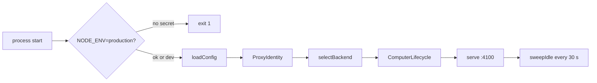

# computerd — Daemon Overview & HTTP Surface

`computerd` is the host-side daemon that gives every Sayabot agent its own persistent Linux computer. It exposes a small authenticated HTTP API that the orchestrator calls to boot, execute, and retire per-agent sandboxes, and it forwards every request to the in-container `agentd` daemon over the fastest available transport. This page documents the HTTP surface, request authentication, and the NDJSON transport layer that carries agentd frames.

Source files: `apps/computerd/src/index.ts`, `apps/computerd/src/transport.ts`

---

## 🚀 Daemon Boot Sequence

The binary entry point lives at the bottom of `src/index.ts:140-157`. When the module is run directly (`import.meta.url` matches `process.argv[1]`), boot proceeds in a fixed order:

1. **Port**: `PORT` env, default `4100` (`index.ts:141`).
2. **Production auth guard**: in `NODE_ENV=production`, a missing `ORCHESTRATOR_INTERNAL_SECRET` is a hard startup failure — the process logs an error and exits (`index.ts:142-145`). In development the API runs unauthenticated.
3. **Configuration**: `loadConfig()` reads all `COMPUTER_*` / `SMOLVM_*` / `E2B_*` env vars (see [lifecycle.md](lifecycle.md) for the full table).
4. **Identity**: a `ProxyIdentity` is constructed for per-agent egress credentials (see [capacity-and-identity.md](capacity-and-identity.md)).
5. **Backend selection**: `selectBackend(config, identity)` resolves `COMPUTER_BACKEND` to one of `smolvm`, `docker`, `e2b` (see [backends.md](backends.md)), and the selected backend is logged with its `describe()` output.
6. **Serve**: `serve({ fetch: createApp(lifecycle).fetch, port })` from `@hono/node-server`.
7. **Idle sweep**: a `setInterval` every 30 s calls `lifecycle.sweepIdle()`, which puts computers that have not been called for `COMPUTER_IDLE_MS` to sleep (disk kept) (`index.ts:154-156`).



---

## 🔐 Request Authentication

`createApp(lifecycle)` builds the Hono app. Middleware applies to every route:

- **Body limit**: `bodyLimit({ maxSize: 16 * 1024 * 1024 })` — requests over 16 MB are rejected (`index.ts:18`).
- **Auth check** (`checkAuth`, `index.ts:22-32`): if `ORCHESTRATOR_INTERNAL_SECRET` is unset (dev mode), everything is allowed. Otherwise the caller must present the shared secret either as `x-internal-secret` or as `Authorization: Bearer <secret>`. Comparison is length-checked first, then `timingSafeEqual` — a constant-time comparison that does not leak the secret through timing.
- **`/health` is always public** (`index.ts:35-36`).

Error mapping (`app.onError`, `index.ts:40-46`):

| Error                                                                                         | HTTP status                     |
| :-------------------------------------------------------------------------------------------- | :------------------------------ |
| `CapacityError` (all computers busy)                                                          | `503`                           |
| `DockerUnavailableError` (alias of `BackendUnavailableError` — Docker/smolvm/E2B unreachable) | `503`                           |
| anything else                                                                                 | `500` with `{ error: message }` |

---

## 🌐 HTTP Endpoints

All state-changing routes take `:agentId` — one computer per agent, keyed by the agent's id.

| Method & path                                                                                              | Body                                                   | Behaviour                                                                                                                                                                           |
| :--------------------------------------------------------------------------------------------------------- | :----------------------------------------------------- | :---------------------------------------------------------------------------------------------------------------------------------------------------------------------------------- |
| `GET /health`                                                                                              | —                                                      | `{ ok: true, service: "computerd", port: 4100 }` (`index.ts:48`)                                                                                                                    |
| `GET /v1/capacity`                                                                                         | —                                                      | Backend kind, `describe()` notes, `maxRunning`, running count, idle window, and per-computer `agentId` / `inflight` / `idleForMs` / `transport: "socket" \| "exec"` (`index.ts:50`) |
| `POST /v1/computers/:agentId/ensure`                                                                       | `{ orgId?, profile? }`                                 | Boot or attach the computer. `orgId` defaults to `"default"`; `profile` is coerced to `"browser"` or `"standard"` (`index.ts:52-58`)                                                |
| `POST /v1/computers/:agentId/exec`                                                                         | `{ cmd, cwd?, timeoutMs?, env?, stdin?, background? }` | **Streaming NDJSON response** (`application/x-ndjson`), one JSON frame per line (`index.ts:60-96`)                                                                                  |
| `POST /v1/computers/:agentId/files/read` \| `files/write` \| `files/edit` \| `files/patch` \| `files/list` | op payload                                             | Single-frame RPC; the `op` field (`read`/`write`/`edit`/`patch`/`list`) is injected server-side (`index.ts:98-124`)                                                                 |
| `POST /v1/computers/:agentId/code`                                                                         | `{ action, ... }`                                      | Code intelligence RPC (`op: "code"`)                                                                                                                                                |
| `POST /v1/computers/:agentId/browser`                                                                      | `{ action, ... }`                                      | Browser RPC (`op: "browser"`)                                                                                                                                                       |
| `POST /v1/computers/:agentId/stop`                                                                         | —                                                      | Sleep the computer (container/VM stopped, disk kept) (`index.ts:126-129`)                                                                                                           |
| `DELETE /v1/computers/:agentId`                                                                            | `{ deleteDisk? }`                                      | Remove the computer; `deleteDisk: true` also deletes the disk/volume (`index.ts:131-135`)                                                                                           |

Details worth knowing:

- The object-body guard on the single-frame routes rejects arrays and non-objects with `400` ("Expected an object") and maps a missing/invalid agentd answer to `502` ("Missing or invalid agentd response"). If agentd answers with an `error` frame, it is returned as **`422`** with the frame body (`index.ts:107-123`).
- `/exec` pulls the **first frame before answering**: wake-up failures (capacity, Docker down) surface as proper `503`/`500` HTTP statuses instead of a `200` with a broken stream (`index.ts:72-74`). Later errors are emitted as a final `{ error }` frame inside the stream. Client cancellation calls `frames.return(undefined)`, tearing the agentd request down.

---

## 📡 Transport Layer (`src/transport.ts`)

Every request to a running computer is an `AgentdFrame` — a plain `Record<string, unknown>` with an `op` field, sent as one line of JSON. Two transports exist: a Unix socket fast path and a CLI fallback (`docker exec` / `smolvm machine exec` / E2B commands), both consuming the same helpers.

### Frame protocol rules

`isFinalFrame(op, frame)` (`transport.ts:11-13`) defines completion: **`exec` streams frames until a frame with `t === "exit"` or an `error` frame arrives; every other op answers with exactly one frame.**

### `NdjsonParser` (`transport.ts:16-33`)

An incremental UTF-8 parser shared by the socket and docker-exec transports. `push(chunk)` accumulates bytes through a `StringDecoder` (so multibyte characters split across TCP chunks survive), splits on `\n`, and returns parsed frames, keeping the trailing partial line buffered. `end()` flushes the decoder and parses whatever remains. Lines that are blank are skipped; lines that do not parse to a JSON object throw `"Invalid agentd frame"`.

### Socket fast path

`openSocket(socketPath)` (`transport.ts:44-70`) enforces two safety properties before connecting:

- `lstatSync` must show a **real socket**: symlinks are refused outright, because the control directory is writable by the bot user and a planted symlink could point at another socket on the host.
- A **2-second connect timeout**; failures and timeouts reject with `TransportUnavailableError`, the signal callers use to fall back to the CLI transport.

`socketRequest(socketPath, payload, timeoutMs)` (`transport.ts:77-108`) is an async generator: it writes the payload as one JSON line, then yields response frames as they arrive, returning as soon as `isFinalFrame` matches. The socket carries a `setTimeout(timeoutMs)` guard ("agentd response timed out"), is always destroyed in a `finally`, and throws `"agentd closed without a complete response"` if the peer hangs up early.

`responseTimeoutMs(payload)` (`transport.ts:111-114`) computes the deadline the same way agentd-cli does: the command's own `timeoutMs` clamped to `[1_000, 300_000]` (default `60_000`) plus 15 s of slack.

---

## 🧾 Example Conversations

Boot a computer and run a command (auth header elided):

```bash
# 1. Ensure the computer exists and is running
curl -X POST http://computerd:4100/v1/computers/agent-42/ensure \
  -H 'content-type: application/json' \
  -d '{"orgId": "org-1", "profile": "standard"}'
# → {"status":"running","ip":"172.18.0.5"}

# 2. Execute a command — response is NDJSON, one frame per line
curl -N -X POST http://computerd:4100/v1/computers/agent-42/exec \
  -H 'content-type: application/json' \
  -d '{"cmd":"echo hi && ls","cwd":"/home/bot","timeoutMs":30}'
# → {"t":"out","d":"hi\n"}
# → {"t":"exit","code":0,"durationMs":12,"truncated":false}

# 3. Read a file page
curl -X POST http://computerd:4100/v1/computers/agent-42/files/read \
  -H 'content-type: application/json' \
  -d '{"path":"/home/bot/notes.md","startLine":1,"endLine":50}'
# → {"path":"…","content":"…","hash":"<sha-256>","totalLines":42,"hasMore":false,…}

# 4. Inspect capacity
curl http://computerd:4100/v1/capacity
# → {"backend":"smolvm","isolation":"microVM (own kernel)","fastPath":true,
#    "maxRunning":8,"running":2,"idleMs":600000,"computers":[…]}
```

Error shapes: capacity exhaustion returns `503 {"error":"All N computers are busy. …"}`; an agentd-level failure inside a single-frame op returns `422` carrying the agentd error frame; a missing/invalid agentd answer returns `502 {"error":"Missing or invalid agentd response"}`.

---

## 🤝 How the Orchestrator Talks to computerd

- The orchestrator's env schema defines `COMPUTERD_URL` with default `http://localhost:4100` (`apps/orchestrator/src/env.ts:11`); in compose it is `http://computerd:4100`.
- `apps/orchestrator/src/computer/client.ts` implements `ComputerClient`, which sends every request with the `x-internal-secret` header and wraps the endpoints above: `ensure`, the streaming `exec`, the five file ops, `code`, `browser`, `stop`, and `remove`.
- Orchestrator tools (`computer_shell`, `fs_*`, `code_*`, `browser_*`) call this client; the tool-facing behaviour is documented in [Tool: computer](../orchestrator/tools/tool-computer.md).
- computerd talks back to the orchestrator at `POST /internal/computer/state` (status notifications) and `GET /internal/computer/:agentId/grants-env` (per-agent env vars for the sandbox), both authenticated with the same internal secret.

---

## 🧪 Tests

| File                                                     | Covers                                                                                                                       |
| :------------------------------------------------------- | :--------------------------------------------------------------------------------------------------------------------------- |
| `apps/computerd/tests/integration/computerd-app.test.ts` | In-process Hono app with a fake lifecycle: public `/health`, auth rejection, exec streaming, single-frame ops, error mapping |
| `apps/computerd/tests/unit/transport.test.ts`            | `NdjsonParser` chunk splitting, `isFinalFrame`, socket refusal on symlinks/non-sockets, `responseTimeoutMs` clamping         |
| `apps/computerd/test/computerd.test.ts`                  | Legacy suite for the app surface                                                                                             |

---

## Related docs

- [Lifecycle: create, sleep, wake, evict](lifecycle.md)
- [Capacity & per-agent identity](capacity-and-identity.md)
- [Backend abstraction & selection](backends.md)
- [agentd: the in-container daemon](agentd.md)
- [Tool: computer (orchestrator side)](../orchestrator/tools/tool-computer.md)
- [VPS & client deployment](../orchestrator/computers/vps-and-client.md)
