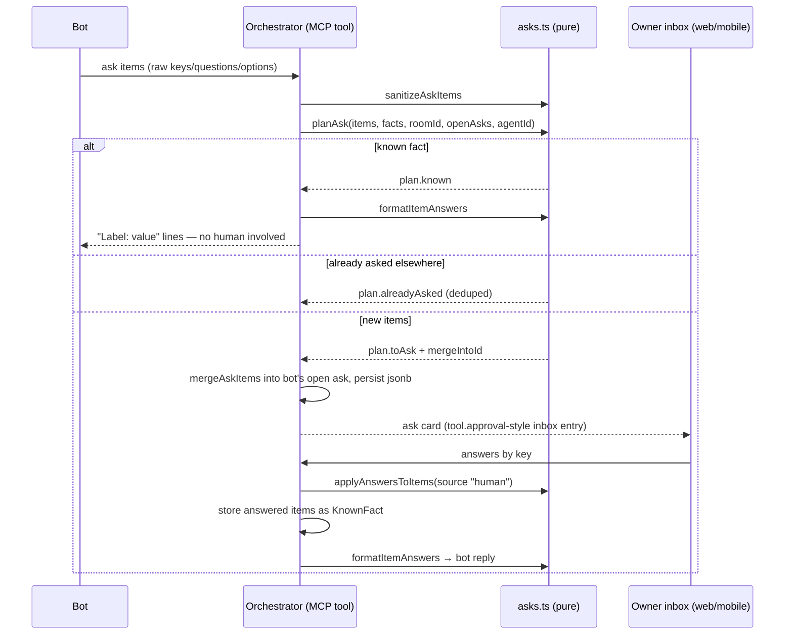

# The Ask/Response Protocol (`asks.ts`)

When a bot needs a detail only a human knows — a start date, a visa answer, a CGPA — it raises an **ask**: a structured request carrying items with stable keys. `asks.ts` is the entire lifecycle of that request as pure functions: key normalization and synonym folding, item sanitization, the decision of *what actually needs a person*, merging into open asks, applying answers, and formatting them back for the bot. The module header states the problem it solves (`asks.ts:1-13`): bots used to re-ask the same questions because free-text questions only folded when the wording matched; now every answer is also kept as an **owner fact** and consulted before a human is ever bothered. Everything here is shared verbatim by the orchestrator (collab service, memory service) and the web inbox (`apps/web/src/lib/answer-requests.ts`, `ask-card.tsx`).

Source files: `packages/core/src/asks.ts` (354 lines), `packages/core/src/asks.test.ts` (239 lines)

---

## 📐 Constants & core types

| Constant | Value | Meaning |
| :--- | :--- | :--- |
| `MAX_ASK_ITEMS` | `8` | Maximum items per ask (sanitize and merge both enforce it) |
| `MAX_FACT_VALUE` | `1_000` | Maximum characters of an answer value |
| `MAX_FACT_KEY` | `48` | Maximum characters of a normalized key |

```typescript
export type AskItemSource = "human" | "fact"

export interface AskItem {
  key: string                 // canonical fact key
  question: string            // human-facing question text
  hint?: string
  options?: string[]          // up to 6 choices, ≤ 60 chars each
  answer?: string | null
  answeredAt?: string | null
  source?: AskItemSource | null  // who answered: a person or a stored fact
}

export interface KnownFact {
  key: string
  label: string
  value: string
  /** null = every room in the workspace; otherwise only this room. */
  roomId: string | null
  source?: string | null
  updatedAt?: string | null
}

export interface OpenAskRef {
  id: string
  agentId: string | null
  items: AskItem[]
}
```

(`asks.ts:19-45`) `OpenAskRef` is how callers hand the currently open asks (per room, newest first) into the planner.

## 🔑 Key normalization & synonym folding

The heart of de-duplication is that different bots name the same fact differently — `"availability"`, `"join_date"`, `"expected CTC"`. Two functions fix that:

**`normalizeFactKey(raw)`** (`asks.ts:108-118`) lowercases, expands `&` to `" and "`, replaces every non-`[a-z0-9]` run with `_`, trims/collapses underscores, and caps at 48 chars (re-trimming any trailing `_` the cap introduces). `"  Start Date! "` → `start_date`, `"R&D focus"` → `r_and_d_focus`, empty input → `""`.

**`canonicalFactKey(raw)`** (`asks.ts:121-124`) normalizes then folds through `FACT_KEY_ALIASES` (`asks.ts:51-97`), a ~45-entry table grouped by target:

| Canonical key | Absorbed aliases (selection) |
| :--- | :--- |
| `start_date` | `availability`, `available_from`, `earliest_start`, `joining_date`, `join_date`, `start`, `start_month` |
| `work_authorization` | `work_authorisation` (British spelling), `work_auth`, `work_permit`, `right_to_work`, `eligible_to_work` |
| `visa_sponsorship` | `sponsorship`, `needs_sponsorship`, `visa` |
| `expected_salary` | `expected_ctc`, `expected_lpa`, `expected_pay`, `salary_expectation` |
| `current_salary` | `current_ctc`, `current_lpa`, `current_pay` |
| `notice_period` | `notice`, `notice_days` |
| `location` / `relocation` | `current_city`, `city`, `current_location` / `relocate`, `willing_to_relocate`, `open_to_relocation` |
| `linkedin_url` / `github_url` | `linkedin`, `linkedin_profile` / `github`, `github_profile`, `github_link` |
| `graduation_date` / `cgpa` | `graduation`, `graduation_year`, `grad_year`, `expected_graduation` / `gpa`, `grades` |
| `years_of_experience` | `experience`, `years_experience`, `yoe` |

**`humanizeFactKey(key)`** (`asks.ts:127-133`) canonicalizes then renders for display: underscores become spaces with a leading capital (`start_date` → `"Start date"`), except keys in `FACT_LABELS` (`cgpa` → `"CGPA"`, `linkedin_url` → `"LinkedIn URL"`, `github_url` → `"GitHub URL"`, `work_authorization` → `"Work authorisation"`, `visa_sponsorship` → `"Visa sponsorship"`). An empty key renders as `"Detail"`.

## 📖 Reading facts

**`lookupFact(facts, key, roomId)`** (`asks.ts:136-151`) canonicalizes the key, skips facts with blank values, and applies the scoping rule: a **room-scoped fact wins over a workspace-wide one** for the same key; if only a workspace-wide fact exists it is returned; a fact scoped to *another* room is invisible (`null`). Blank `value` (whitespace-only) makes a fact invisible.

**`factsVisibleInRoom(facts, roomId)`** (`asks.ts:154-164`) filters a fact list down to what a bot in `roomId` may read: drops other-room facts and blanks, keeps one fact per canonical key preferring room-scoped over workspace-wide, and returns them sorted by key. This is what powers the "facts the bot can already see" surfaces in the web app.

## 🧹 Sanitizing items in, reading items back

**`sanitizeAskItems(raw)`** (`asks.ts:183-207`) is the intake valve for whatever a model produced:

- Question trimmed and capped at 300 chars; hint at 300.
- Key = canonical key of the provided `key`, falling back to the canonical key of the **question text itself** — so two bots typing the identical question fold onto one key even with no explicit key.
- Items with no key *or* no question are dropped; duplicate keys are dropped.
- `options` are string-filtered, trimmed, 60-char-capped, de-duplicated, limited to 6, and dropped entirely if empty (`cleanOptions`, `asks.ts:166-177`).
- Fresh items always start with `answer: null`, `answeredAt: null`, `source: null`.
- Output capped at `MAX_ASK_ITEMS` (8).

**`askItemsFromMetadata(metadata)`** (`asks.ts:210-233`) is the read side for the `jsonb` metadata column where items are persisted: it accepts `{ items: [...] }`, drops non-object entries, requires both canonical key and question, and re-derives `answer`/`answeredAt`/`source` — a blank answer resets `answeredAt`/`source` to `null` (a stale pair from hand-edited metadata cannot survive the round-trip).

**`unansweredItems(items)`** (`asks.ts:235-237`) filters to items whose `answer` is blank.

## 🧭 `planAsk` — the routing decision

```typescript
export interface AskPlan {
  known: Array<{ key, question, label, value }>   // answered from facts right now
  alreadyAsked: Array<{ key, askId }>             // another open ask already waits on it
  toAsk: AskItem[]                                // genuinely new items needing a person
  mergeIntoId: string | null                      // the bot's own open ask new items join
}

export function planAsk(input: {
  items: readonly AskItem[]
  facts: readonly KnownFact[]
  roomId: string | null
  openAsks: readonly OpenAskRef[]   // room's open asks, newest first
  agentId: string | null
}): AskPlan
```

(`asks.ts:239-286`) Per item, in order:

1. **Fact?** `lookupFact` hits → goes to `known` (with the fact's label, falling back to `humanizeFactKey`), and *no person is asked*.
2. **Already waiting?** An entry in `openAsks` has an item with the same key and no answer → goes to `alreadyAsked`; not asked twice.
3. **Otherwise** it lands in `toAsk`.

Finally, if there is anything to ask and the caller is an agent, `mergeIntoId` is set to that agent's own existing open ask that has items — new items join the existing card instead of creating a second inbox entry (asks whose `items` array is empty are skipped). The "re-ask" case is the flip side of rule 2: an open item that *has* been answered does not block a fresh ask of the same key.

## ➕ Merging & ✍️ applying answers

**`mergeAskItems(existing, incoming)`** (`asks.ts:289-299`) appends incoming items whose keys are not already present, stopping at `MAX_ASK_ITEMS` — the test shows a 7-item ask absorbing `"new1"` but not `"new2"` once the cap hits.

**`applyAnswersToItems(items, answers, source, now?)`** (`asks.ts:309-330`) writes human (or fact) answers into items:

```typescript
export function applyAnswersToItems(
  items: readonly AskItem[],
  answers: Readonly<Record<string, string>>,
  source: AskItemSource,
  now: string = new Date().toISOString(),
): AppliedAnswers
```

Answer keys are canonicalized (`"availability"` answers the `start_date` item), values trimmed and capped at `MAX_FACT_VALUE`; blank answers are ignored. Already-answered items are **never overwritten**. Returns `{ items, answeredKeys, remaining }` where `remaining` counts open items after the write.

**`fillItemsFromFacts(items, facts, roomId, now?)`** (`asks.ts:333-345`) runs the same machinery with `source: "fact"`: every unanswered item whose key now has a known fact is filled in — e.g. the human answers "when can you start?" in another room and this ask auto-resolves from the stored fact.

**`formatItemAnswers(items, keys?)`** (`asks.ts:348-354`) is what the bot receives: one `"Label: value"` line per answered item (optionally restricted to the just-answered keys), e.g. `"Start date: June 2027\nCGPA: 6.9"`.

## 🔁 End-to-end flow



The fact store closes the loop: answered items become `KnownFact` rows, so the *next* bot to ask the same thing is served by `lookupFact` at step one without a card ever reaching a person.

## ✅ What `asks.test.ts` covers

| Suite | Verified behaviour |
| :--- | :--- |
| fact keys | snake_case normalization incl. `&` handling and 48-char cap without trailing `_`; alias folding (`availability` → `start_date`, `Work authorisation` → `work_authorization`, `GPA` → `cgpa`, unknown key unchanged); humanized labels with acronyms intact and `"Detail"` fallback |
| `lookupFact` / `factsVisibleInRoom` | room-scoped fact beats workspace-wide; a fact from another room is invisible; blank values are ignored; `factsVisibleInRoom` returns only the room's own facts, one per key |
| `sanitizeAskItems` | key-from-question folding, trimming, option cleaning (`["Yes","No","Yes",3,""]` → `["Yes","No"]`), dedupe, all `answer: null`; 20 inputs capped at `MAX_ASK_ITEMS` |
| `askItemsFromMetadata` | round-trips sanitized items while dropping junk (`null`, empty key, raw strings); a blank answer resets stale `answeredAt`/`source` |
| `planAsk` | facts answer without asking; a key already waiting in another open ask goes to `alreadyAsked`; an *answered* open item allows a re-ask; `mergeIntoId` points at the bot's own non-empty open ask |
| `mergeAskItems` | appends only new keys and respects the cap |
| answers | partial answers fill only matching keys and count `remaining`; answers are never overwritten; `fillItemsFromFacts` fills from facts with `source: "fact"`; `formatItemAnswers` renders label lines and honours the key filter |

Related docs: [./turns.md](./turns.md), [./patch-and-fold-key.md](./patch-and-fold-key.md), [./capabilities-and-mentions.md](./capabilities-and-mentions.md), [./platform-utilities.md](./platform-utilities.md), [./overview-and-types.md](./overview-and-types.md)
