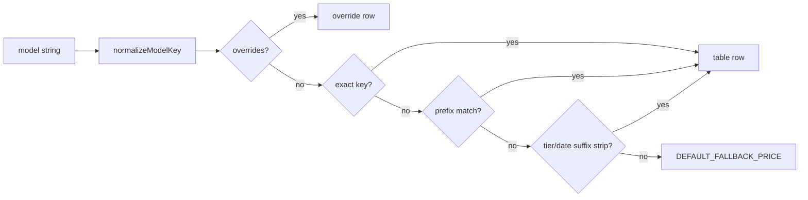

# Cost Math, Pricing Tables & Provider Plan Limits

Money and metering live in three places in `packages/core`. `cost.ts` is the general-purpose token/cost arithmetic used by the orchestrator's usage recorder and the web usage dashboard. `scanner/pricing.ts` is the scanner's own static rate table and cost calculator for locally-scanned CLI sessions. `scanner/plan-limits.ts` parses the _providers' own_ plan-usage answers (Claude Code `/usage`, Codex logged `rate_limits`, Google Code Assist quota) into window gauges. All three are pure: no network, no Keychain, no database.

Source files: `packages/core/src/cost.ts` (119 lines), `packages/core/src/scanner/pricing.ts` (217 lines), `packages/core/src/scanner/plan-limits.ts` (165 lines); tests: `cost.test.ts`, `scanner/plan-limits.test.ts` (pricing arithmetic is verified inside `scanner/scanner.test.ts`, see [./scanner.md](./scanner.md))

---

## 💰 Cost arithmetic (`cost.ts`)

### Inputs

```typescript
export interface TokenUsage {
  inputTokens?: number | null // provider's TOTAL prompt size (already includes cache reads + writes)
  outputTokens?: number | null
  cachedInputTokens?: number | null // subset of inputTokens served from cache
  cacheCreationTokens?: number | null // subset of inputTokens written to cache
  reasoningTokens?: number | null // informational; not priced here
}

export interface ModelPrice {
  inputPerMtok: number
  outputPerMtok: number
  cacheReadPerMtok?: number | null
  cacheWritePerMtok?: number | null
}

export const ZERO_PRICE: ModelPrice = { inputPerMtok: 0, outputPerMtok: 0 }
```

(`cost.ts:1-16`) The central accounting convention, stated in the `computeCostUsd` doc comment: `inputTokens` is the whole prompt as AI SDK / Claude / Codex logs report it, and **each slice is priced exactly once** — fresh input at the input rate, cache reads at the read rate, cache writes at the write rate.

### `computeCostUsd(usage, price)`

(`cost.ts:26-44`) Slices the prompt then prices each slice:

```typescript
const totalInput = Math.max(0, usage.inputTokens ?? 0)
const cached = Math.min(totalInput, Math.max(0, usage.cachedInputTokens ?? 0))
const written = Math.min(totalInput - cached, Math.max(0, usage.cacheCreationTokens ?? 0))
const fresh = totalInput - cached - written
```

The two `Math.min` clamps guarantee cache traffic can never be priced in excess of the prompt that held it (the test with a 100-token prompt and 500 "cache-write" tokens confirms only 20 remain after 80 reads). Missing rates default to market convention: `cacheReadPerMtok ?? inputPerMtok * 0.1` (the common 90% read discount) and `cacheWritePerMtok ?? inputPerMtok` (no write premium). The result is rounded to six decimals. `price` of `null`/`undefined` short-circuits to `0`.

Worked example from the tests: 1M prompt, 600K cached, 300K written, sonnet-style rates ($3 in / $0.30 read / $3.75 write) → `$0.30 fresh + $0.18 read + $1.125 written = $1.605`.

### `computeCacheSavingsUsd(usage, price)`

(`cost.ts:47-56`) Estimated dollars saved by prompt caching: `cachedTokens / 1e6 × max(0, inputPrice − readPrice)`, rounded to six decimals; zero when nothing was cached or no price exists.

### Formatting helpers

| Function                           | Behaviour                                                                                                                                                     | Examples                                                                                                           |
| :--------------------------------- | :------------------------------------------------------------------------------------------------------------------------------------------------------------ | :----------------------------------------------------------------------------------------------------------------- |
| `formatUsd(value)`                 | `$0.00` for zero; **six decimals below one cent**, two otherwise                                                                                              | `0.000123` → `"$0.000123"`, `1.5` → `"$1.50"`                                                                      |
| `formatTokens(value)`              | Compact suffixes K/M/B/T; digit count shrinks with magnitude (≥100 → 0 decimals, ≥10 → 1, else 2), trailing `.0` trimmed; below 1000 uses `Intl.NumberFormat` | `417_000_000` → `"417M"`, `14_900_000` → `"14.9M"`, `1_590_000` → `"1.59M"`, `781_000` → `"781K"`, `350` → `"350"` |
| `formatPercent(share, digits = 1)` | share × 100 with fixed digits; values smaller than the smallest representable step render as `"<0.1%"`-style floors instead of `0.0%`                         | `0.921` → `"92.1%"`, `0.074` → `"7.4%"`, `0.005` → `"0.5%"`                                                        |

The web app re-exports these from `apps/web/src/lib/format.ts` so dashboard and orchestrator agree on rendering.

### Price lookup for recorded calls

```typescript
export interface PriceRow extends ModelPrice {
  provider: string
  model: string
}

export function baseModelName(model: string): string
export function pickModelPrice(rows, provider, model): PriceRow | null
```

**`baseModelName`** (`cost.ts:93-101`) normalizes a model id: lowercase, strip everything up to the last `/` (`"anthropic/claude-x"` → `"claude-x"`), strip a trailing `:suffix` tag (`":beta"`), strip a trailing date (`-20250929` or `-2025-09-29` style), and strip `-latest`.

**`pickModelPrice(rows, provider, model)`** (`cost.ts:109-119`) resolves in three steps, documented as "unknown models return null (cost 0) rather than borrowing a guess, so the dashboard can show them as 'no price set'":

1. Exact `provider` + `model` match (case-insensitive).
2. Same provider whose `baseModelName` matches — OpenRouter's `"anthropic/claude-sonnet-4-5"` bills like Anthropic's row.
3. Any provider whose base model name matches (falls back across providers).

The orchestrator's `priceUsage` (`apps/orchestrator/src/usage.ts:70-79`) calls this against the workspace's `model_pricing` DB rows (cached 60 s) and, when it returns `null`, falls back to the model-manifest list price before handing the row to `computeCostUsd` — so a brand-new model is priced the day it ships rather than counting as free.

## 🏷️ Scanner pricing table (`scanner/pricing.ts`)

This is the rate table for **locally scanned** Claude Code / Codex / Antigravity sessions (the scanner pipeline in [./scanner.md](./scanner.md)); token totals come from the scanner's `UsageTokenTotals` type (`uncachedInputTokens`, `cachedInputTokens`, `cacheCreationTokens`, `outputTokens` — uncached is already net of cache traffic, unlike `TokenUsage` above).

**`DEFAULT_MODEL_PRICES`** (`pricing.ts:3-118`) is a static `Record<string, ModelPrice>` with ~38 entries at five rate tiers:

| Family                                                                                                                                        | Rate (input / output / cacheRead / cacheWrite per Mtok) |
| :-------------------------------------------------------------------------------------------------------------------------------------------- | :------------------------------------------------------ |
| Gemini flash tiers (`gemini-2.5/3/3.5/3.6/3.7/3.8-flash`, incl. `-high/-medium/-low/-tiered` service-tier variants)                           | `$0.15 / $0.60 / $0.0375 / —`                           |
| Gemini flash-lite (`2.5`, `3.1`)                                                                                                              | `$0.075 / $0.30 / $0.01875 / —`                         |
| Gemini pro (`gemini-2.5-pro`, `gemini-3.1-pro`)                                                                                               | `$1.25 / $5.00 / $0.3125 / —`                           |
| `gemini-4-argon`                                                                                                                              | `$2.00 / $8.00 / $0.50 / —`                             |
| Claude opus (`claude-opus-4`, `-4-6`, `-5-5`, `claude-3-opus`)                                                                                | `$15.00 / $75.00 / $1.50 / $18.75`                      |
| Claude sonnet (`claude-sonnet-4`, `-4-5`, `-4-6`, `claude-3-5/3-7-sonnet`)                                                                    | `$3.00 / $15.00 / $0.30 / $3.75`                        |
| Claude haiku (`claude-haiku-4-5`, `claude-3-5-haiku`)                                                                                         | `$0.80 / $4.00 / $0.08 / $1.00`                         |
| OpenAI (`gpt-4o` `$2.5/$10/1.25`, `gpt-4o-mini` `$0.15/$0.6/0.075`, `o1` `$15/$60/7.5`, `o1-mini`, `o3-mini`, `gpt-4-turbo`, `gpt-3.5-turbo`) | cacheRead only                                          |
| OpenRouter / OpenCode (`openrouter/stealth-crouton-alpha` and bare, `gpt-oss-120b-medium`)                                                    | cacheRead only                                          |

Note the table keys _include_ the service-tier suffixes (`gemini-3.8-flash-high` etc.) because Antigravity logs the reasoning-effort tier as part of the model name.

**`DEFAULT_FALLBACK_PRICE`** (`pricing.ts:121-125`): `$1.00 / $3.00 / $0.10` — unlike `pickModelPrice`'s `null`-on-unknown policy above, locally scanned unknown models are costed at this floor so the ledger never shows zero for real token spend.

**`normalizeModelKey(raw)`** (`pricing.ts:127-144`): lowercase; strip a known provider prefix (`anthropic/`, `google/`, `openai/`, `bedrock/`, `vertex/` — _not_ `openrouter/`, which is kept to distinguish OpenRouter-priced rows); strip bracketed context tags (`"[200k]"`).

**`getModelPrice(model, overrides?)`** (`pricing.ts:147-177`) resolution order:

1. Caller `overrides` on the normalized key.
2. Exact `DEFAULT_MODEL_PRICES` hit.
3. Bidirectional prefix match against the table (`claude-3-5-sonnet-20241022` → `claude-3-5-sonnet`).
4. Suffix strip (`-extra-low|-low|-medium|-high|-tiered|-control|-thinking|-agent`, `-YYYYMMDD`, `-latest`) then re-check.
5. `DEFAULT_FALLBACK_PRICE`.



**`computeUsageCost(totals, price, speed = "standard")`** (`pricing.ts:180-202`) is the scanner's counterpart of `computeCostUsd`: `uncached + cached·read + cacheCreation·write + output`, same missing-rate defaults (read = 0.1×input, write = input), six-decimal rounding, multiplied by the **service-tier speed multiplier** from `UsageSpeed` (`standard` 1.0, `fast` 1.5, `ultrafast` 2.0). **`computeUsageCacheSavings(totals, price)`** mirrors the savings formula from `cost.ts`. `scanner.test.ts` verifies the arithmetic exactly (e.g. a 100k/900k/50k/20k mix at sonnet prices = `$1.0575`).

## 📡 Provider-reported plan limits (`scanner/plan-limits.ts`)

> "Pure parsers only: the reading (Keychain, files, network) lives in the Mac app, so sign-in tokens never leave it. Every value here comes from the provider; when a reading is missing the window is left out rather than guessed." — `plan-limits.ts:1-6`

These are distinct from `scanner/limits.ts` (see [./scanner.md](./scanner.md)), which _estimates_ limits from scanned history; this module just parses what each provider service itself reports.

### Shared shapes

```typescript
export type PlanProvider =
  | "claude"
  | "codex"
  | "antigravity"
  | "opencode"
  | "pi"
  | "cursor"
  | "copilot"
  | "zcode"

export interface PlanWindow {
  label: string // "5-hour", "Weekly", "Weekly · Opus", "Gemini Pro · 5-hour"
  usedPercent: number // 0-100, clamped
  resetsAt: string | null // ISO reset instant, if known
  windowMinutes: number | null
}

export interface PlanLimits {
  provider: PlanProvider
  label: string
  plan: string | null // "max", "pro", "plus"… when the provider says
  windows: PlanWindow[]
  observedAt: string
  error: string | null // why there is no reading, in plain words
}
```

(`plan-limits.ts:8-30`)

Helpers: `clampPercent` (0–100), `isoOrNull` (accepts ISO strings or epoch numbers — values below `1e12` are seconds and get ×1000, above are milliseconds), and **`windowLabel(minutes)`** (`plan-limits.ts:34-42`): `300` → `"5-hour"`, `10_080` → `"Weekly"`, 40 000–45 000 → `"Monthly"`, whole days → `"N-day"`, whole hours → `"N-hour"`, otherwise `"N-minute"`; null/0 → `"Limit"`.

### `parseClaudeUsage(answer)`

(`plan-limits.ts:64-84`) Anthropic's plan-usage answer (what Claude Code's `/usage` displays): `{ five_hour, seven_day, seven_day_opus, seven_day_sonnet }` each `{ utilization: 0-100, resets_at }`. Fixed slots map to windows `"5-hour"` (300 min), `"Weekly"` (10 080), `"Weekly · Opus"`, `"Weekly · Sonnet"`; slots that are missing, non-numeric, or unrecognized shapes return nothing. `extra_usage` and other keys are ignored.

### `parseCodexRateLimits(rateLimits, now = Date.now())`

(`plan-limits.ts:91-112`) The `rate_limits` object Codex writes into its session logs with every token count: `{ primary: { used_percent, window_minutes, resets_at }, secondary, plan_type }`. Returns windows from `primary`/`secondary` (labels via `windowLabel`) plus the `plan_type` string. The subtle rule: **a window whose reset time has already passed since Codex logged it is reported fresh** — `usedPercent: 0`, `resetsAt: null` — rather than showing a stale 90%.

### `lastCodexRateLimits(logText)`

(`plan-limits.ts:115-134`) Scans a chunk of session-log JSONL lines **backwards** for the newest line containing `"rate_limits"` under `payload.rate_limits` with a `primary` or `secondary` record, returning `{ rateLimits, observedAt }` from that line's `timestamp`. Truncated or half-written lines fail `JSON.parse` and are simply skipped; `null` when nothing qualifies.

### `parseAntigravityQuota(answer)`

(`plan-limits.ts:140-165`) Google Code Assist's `retrieveUserQuotaSummary` answer: `{ groups: [{ displayName, buckets: [{ window, displayName, resetTime, remainingFraction }] }] }`. Each bucket becomes a window with `usedPercent = 100 − remainingFraction × 100`, label `"<Group> · <windowName>"`, and the window length inferred from the bucket text (`/week/i` → 10 080, `/5\s*-?\s*h|five/i` → 300, else `null` → falls back to the bucket's `displayName` or `"Limit"`).

### `parseOpenRouterQuota(keyData, creditsData?)`

Reads key rate limits and wallet credits for OpenRouter (used by Pi, OpenCode, and BYOK setups): extracts `usage` vs `limit` and `total_usage` vs `total_credits`, computing percentage used for credit caps.

### `parseOpenCodeQuota(answer)`

Parses OpenCode's free-tier token allowances, Zen rate limits, and credit balances into rolling session and weekly limit windows.

### `parseCursorUsage(answer)`

Parses Cursor's fast-request quota (`gpt4.numRequests` / `gpt4.maxRequestUsage`) and team spend thresholds into monthly progress rings.

### `parseCopilotLimits(answer, headers?)`

Parses GitHub Copilot session SKUs and rate-limit response headers (`x-ratelimit-remaining`, `x-ratelimit-limit`, `x-ratelimit-reset`) into hourly and subscription quota windows.

### `parseZCodeQuota(answer)`

Parses Z.ai / ZCode GLM Coding Plan quotas, mapping 5-hour rolling refresh cycles and 7-day weekly caps to structured plan limit windows.

## ✅ Test coverage summary

`plan-limits.test.ts`:

- `parseClaudeUsage` reads 5-hour + weekly windows with ISO-normalized reset times and ignores a `seven_day_opus: null` / unrecognized shapes (returns `[]` for `null` and for non-numeric utilization).
- `parseCodexRateLimits` maps `primary`/`secondary` to `"5-hour"`/`"Weekly"` and extracts `plan_type: "plus"`; an epoch-seconds `resets_at` in the past yields a fresh `{ usedPercent: 0, resetsAt: null }` window.
- `lastCodexRateLimits` returns the newest valid reading (second of three lines, observed `2026-11-12T02:00:00.000Z`), tolerates a truncated final line, and returns `null` for logs without usable limits.
- `parseAntigravityQuota` converts remaining fractions (`0.76` → 24% used) with labels `"Gemini Pro · 5-hour"` / `"Gemini Pro · Weekly"` and window minutes inferred from bucket text.
- `parseOpenRouterQuota` calculates credit limit percentages and total credit usages.
- `parseOpenCodeQuota` handles free tier quota and structured multi-window arrays.
- `parseCursorUsage` parses fast request quotas and team spend limits.
- `parseCopilotLimits` extracts rate-limit headers and active plan statuses.
- `parseZCodeQuota` parses Z.ai 5-hour and 7-day credit quota refresh windows.
- `windowLabel` names `300` → `"5-hour"`, `10080` → `"Weekly"`, `43200` → `"Monthly"`.

`cost.test.ts` (above) covers per-million pricing, six-decimal rounding, cache slicing/clamping, savings, all formatters, and `pickModelPrice`'s three-step fallback plus `null` for unpriced models.

Related docs: [./scanner.md](./scanner.md), [./overview-and-types.md](./overview-and-types.md), [./platform-utilities.md](./platform-utilities.md), [./engine-and-computers.md](./engine-and-computers.md), [./cron-and-schedule.md](./cron-and-schedule.md)
