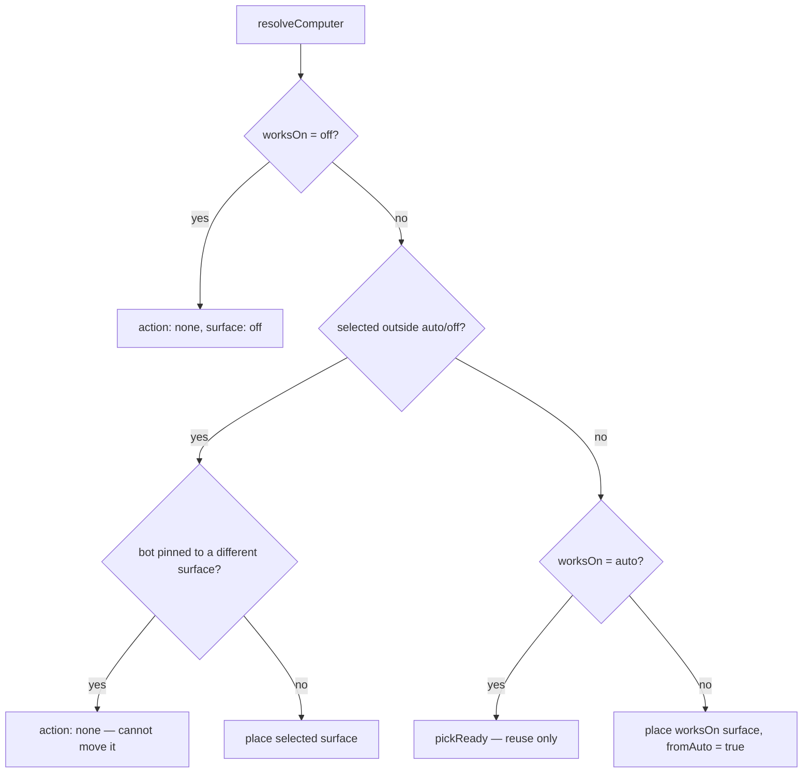

# Engine Budgets & Computer Placement

This reference covers the two modules that gate what a turn is allowed to do and where the agent's "hands" are. `engine.ts` holds the pure decision helpers behind Agent Loop V2 — step/wall-clock/dollar budgets, transcript compaction, and the structured plan (`update_plan`) reducer. `computers.ts` resolves which desktop surface (Mac screen, local VM, Boat, or VPS) a bot attaches to for a given turn, and when a Boat goes back to sleep.

Source files: `packages/core/src/engine.ts`, `packages/core/src/computers.ts` (tests: `engine.test.ts`, `computers.test.ts`)

---

## ⚙️ Engine Budgets & Plans (`engine.ts`)

The orchestrator's agent loop calls these helpers every step; they contain no I/O so tests can exercise every branch deterministically.

### `checkEngineBudget(limits, usage)` (`engine.ts:28`)

```typescript
export interface EngineBudgetLimits {
  maxSteps: number
  maxWallMinutes: number
  maxUsd?: number // absent = unbounded spend
  compactAtTokens?: number // overrides the compaction threshold
}

export interface EngineBudgetUsage {
  stepsTaken: number
  wallMs: number
  costUsd: number
  renderedTokens?: number
}

export interface BudgetCheckResult {
  allowed: boolean
  warningNearLimit?: boolean // any budget is ≥ 80% consumed
  haltReason?: "max_steps" | "max_wall_time" | "max_usd"
  message?: string
}
```

Checks, in order — the first exhausted budget wins:

1. **Steps**: `stepsTaken >= maxSteps` → halt `max_steps` with `"Step budget exhausted (N/M steps)."`
2. **Wall clock**: `wallMs >= maxWallMinutes * 60_000` → halt `max_wall_time` with rounded minutes in the message.
3. **Cost**: only when `maxUsd` is set — `costUsd >= maxUsd` → halt `max_usd` with four-decimal dollars.

If none trip, the result is `{ allowed: true, warningNearLimit }` where the warning is true when **any** of: steps ≥ 80% of `maxSteps`, wall time ≥ 80% of the limit, or cost ≥ 80% of `maxUsd`. The engine appends a wrap-up prompt to the model context when it sees the warning so the agent finishes gracefully instead of being cut off mid-sentence.

`engine.test.ts` covers the 80% warning boundary (48/60 steps warns), each halt reason, and the "within limits" path.

### `shouldCompact(tokens, contextWindow, compactAtTokens?)` (`engine.ts:70`)

Decides when the transcript must be compacted before the next model call. The threshold is:

```typescript
threshold = min(contextWindow * 0.6, compactAtTokens ?? contextWindow * 0.6)
```

i.e. 60% of the context window by default, and `compactAtTokens` can only pull the threshold _down_, never up. `shouldCompact(120_000, 200_000)` is true; `shouldCompact(50_000, 200_000, 40_000)` is also true because the explicit cap wins.

### Structured plan (`update_plan`)

The `update_plan` tool lets an agent publish and maintain a visible execution plan. Core owns the schema and the merge:

```typescript
export interface PlanItem {
  id: string
  title: string
  status: "pending" | "in_progress" | "done" | "blocked"
  note?: string
}

export const planItemSchema = z.object({ ... })   // mirrors PlanItem
export const updatePlanSchema = z.object({ items: z.array(planItemSchema) })
```

`reducePlan(currentPlan, updates)` (`engine.ts:100`) folds the tool call's items into the live plan with a `Map` keyed by `id`: existing items are updated in place, new items are appended, and **insertion order is preserved** (current plan order first, then brand-new ids). The tool executor parses args with `updatePlanSchema`, then persists `reducePlan(...)`'s output.

---

## 🖥️ Computer Placement (`computers.ts`)

> "Where a bot's hands are. The agent process stays on the Mac or on the Cloud home. These surfaces are desktops it can see and click, not a different model." — module header, `computers.ts:1`

### Surfaces and availability

```typescript
export const WORKS_ON = ["off", "auto", "this_computer", "local_vm", "boat", "vps", "e2b"] as const
export type WorksOn = (typeof WORKS_ON)[number]
export type BoatState = "running" | "sleeping" | "absent"
export const CLOUD_DESKTOPS = ["boat", "vps", "e2b"] as const // isCloudDesktop(value) guards it

export interface ComputerAvailability {
  thisComputer: boolean // Mac screen/apps allowed for this bot (off until a person enables it)
  localVmReady: boolean // a local container desktop exists, workspace intact
  boatConfigured: boolean // boat.dev key or Cloud relay token is set
  boatState: BoatState
  vpsReady: boolean // Docker-over-SSH desktop is up (Sayabot never stops a VPS)
  startVpsAutomatically: boolean // when false, Auto (and select_computer on an Auto bot) will not create the VPS container
  e2bConfigured: boolean // the workspace's own E2B key, or the server's E2B_API_KEY, is set
  e2bReady: boolean // this bot already has an E2B sandbox (params.computer.e2bId); connecting resumes it
}

export type ComputerAction = "use" | "wake" | "provision" | "none"

export interface ComputerDecision {
  surface: WorksOn // "off" = this turn has no computer
  action: ComputerAction
  reason: string // why Auto refused; empty when the choice is carried out
}
```

Helpers for reading bot params defensively: `worksOnFromParams(params)` returns `params.worksOn` if valid, else `"auto"`; `availabilityFromParams(params)` re-derives a `ComputerAvailability` from the loose `params.computer` record (unknown `boatState` falls back to `"absent"`, every flag defaults `false`; `e2bReady` also needs a string `e2bId`); `isWorksOn(value)` is the type guard.

### `resolveComputer(worksOn, available, selected?)` — the placement algorithm (`computers.ts:110`)

One decision per turn. `selected` is a `select_computer` call made by the agent _this turn_; without it, **Auto only attaches to a desktop that is already running** — it never creates or wakes anything.



- **`pickReady(available)`** — Auto's preference order when nothing was selected: `this_computer` → ready `local_vm` → `boat` running → ready `vps` → `off` with reason _"No desktop is ready. Call select_computer to choose one. Auto does not create or wake a Boat."_ Auto never picks `e2b` on its own: connecting would resume a paused sandbox.
- **`place(surface, available, fromAuto, pinned)`** — resolves one concrete surface. `pinned` is true when the bot's `worksOn` _is_ that surface (a person chose it):
  - `this_computer`: `use` only if `available.thisComputer`; otherwise off — _"This computer is off for this bot until it is turned on."_
  - `local_vm`: `use` when ready; `provision` when an explicit `select_computer` asked; `none` when Auto found nothing ready.
  - `boat`: `none` when not configured and state is `absent` (_"No Boat key is set in Settings → Computers."_); `use` when running; when explicitly asked — `wake` if sleeping, `provision` if absent; **Auto never wakes or creates a Boat**.
  - `vps`: `use` when ready; `provision` when the bot is pinned to `vps` (the person's choice is consent to start its container) or when an explicit `select_computer` asked _and_ `startVpsAutomatically` is true; otherwise _"The VPS desktop is not ready. Sayabot does not start your server."_
  - `e2b`: `use` when `e2bReady`; `none` without a key (_"No E2B key is set in Settings → AI providers."_); `provision` when pinned or explicitly asked; Auto never creates one.
- A pinned bot (e.g. `worksOn: "boat"`) cannot be moved by `select_computer` to another surface — the decision is refused with the bot's surface named in `reason`.

### Mac screen safety

`macScreenAllowed(params)` (`computers.ts:44`) is the gate for tools that touch the Mac's screen and apps: it is false for `boat`, `local_vm`, `vps`, `e2b`, and `off` regardless of flags, and otherwise defers to `availabilityFromParams(params).thisComputer`. Only `this_computer` (or `auto` with the flag on) can see the user's screen, and the flag only exists because a person turned it on for that bot.

### Agent-facing guidance and homes

- `desktopGuidance(worksOn)` (`computers.ts:51`) renders the system-prompt paragraph describing the desktop: Auto reuses but never creates/wakes, `select_computer` chooses `this_computer` / `local_vm` / `boat` / `vps` / `e2b`, a Boat sleeps after 10 idle minutes and keeps files in `/home/user` and `/tmp`, background `computer_shell` keeps it awake up to two hours, the VPS is one container per bot with files in `/home/bot` and the server is never turned off, and an E2B sandbox pauses when idle and resumes with its files in `/home/user`.
- `desktopHome(worksOn)` — `"/home/user"` for `boat` and `e2b`, `"/home/bot"` for everything else (local VM and VPS included).
- `rememberSelectedDesktop` also records an opened E2B sandbox (`applied.e2bId` → `e2bReady`, `params.computer.e2bId`) so the next tool in the same turn can use it.

### Boat credentials

`boatCredential(ownToken, includedToken)` (`computers.ts:91`) picks the Boat auth: a trimmed non-empty **own** key always wins (`source: "own"`); the Cloud plan's relay token is used only when the user has none (`source: "included"`); no tokens → `null`.

### Same-turn stickiness

`rememberSelectedDesktop(available, params, decision, applied)` (`computers.ts:188`) makes a successful `select_computer` visible to the **next tool call in the same turn** — waking a Boat does not wait for the next message:

- Returns early when `applied.ok === false` or the decision was `none`.
- `boat`: sets `boatState = "running"`, `boatConfigured = true` on the availability object, and copies `boatId`/state into `params.computer`.
- `local_vm`: marks `localVmReady` and copies `applied.volume` through when present.
- `vps`: marks `vpsReady`.

### Boat sleep policy

Three constants and one predicate govern when a Boat goes to sleep:

| Constant                    | Value                | Meaning                                                     |
| :-------------------------- | :------------------- | :---------------------------------------------------------- |
| `BOAT_IDLE_MS`              | `10 * 60 * 1000`     | Sleep after this much idle time                             |
| `BOAT_ROUTINE_LOOKAHEAD_MS` | `30 * 60 * 1000`     | Stay awake for a routine due within ±30 min                 |
| `BOAT_BACKGROUND_MAX_MS`    | `2 * 60 * 60 * 1000` | A background command keeps it awake at most 2 h after start |

`boatShouldSleep(input)` (`computers.ts:223`) stays awake (`false`) when: someone is `watching` the screen; a background command started less than 2 h ago; or the next routine that uses this Boat falls within ±30 minutes (so a run that just started keeps its desktop). Otherwise it sleeps once `now - lastUsedAt >= BOAT_IDLE_MS` — with `lastUsedAt === null` meaning immediately eligible.

`computers.test.ts` exercises the full decision matrix, including "Auto reuses a running Boat but refuses to wake a sleeping one", "pinned bots can't be moved", `boatCredential` precedence, and every sleep-policy branch.

## Reply style (`reply-style.ts`)

`replyStyleFromParams(params)` reads `params.replyStyle`. Only `"conversational"` is special; anything else, including a missing key, is `"default"`. `replyStyleInstruction(style)` returns null for the default, so a bot that never picked a style gets the same system prompt as before. Conversational asks for short plain replies and one follow-up question. Both the engine prompt (`apps/orchestrator/src/engine/context.ts`) and the runner prompt (`apps/orchestrator/src/runner/context.ts`) append that line after the bot's own instructions.

Related docs: [./turns.md](./turns.md), [./redact-and-breakers.md](./redact-and-breakers.md), [../../tools-and-sandboxes.md](../../tools-and-sandboxes.md)
