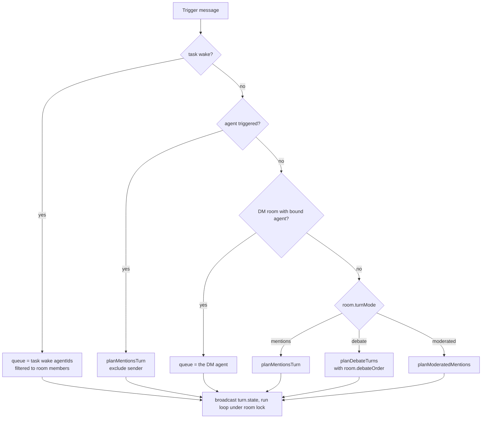

# Turn Planning & Modes (`turns.ts`)

When a message lands in a room, something has to decide *which agent speaks next, in what role, and in what order*. `turns.ts` is that decision logic as pure functions: given the trigger text and the room's agent roster it returns a `PlannedTurn[]` queue. It knows nothing about PostgreSQL, advisory locks, or LLM calls — the orchestrator's coordinator owns the session loop and simply asks this module to plan, then re-plans after every agent reply.

Source files: `packages/core/src/turns.ts` (113 lines), `packages/core/src/turns.test.ts` (113 lines)

---

## 🎭 Roles and the plan shape

A planned turn is an agent id plus the role it should play for that one reply:

```typescript
export type TurnRole = "responder" | "producer" | "critic" | "summarizer" | "moderator"

export interface PlannedTurn {
  agentId: string
  role: TurnRole
  reason?: string
}
```

(`turns.ts:4-10`)

The role feeds the context builder: `debateRoleInstruction(role)` (below) converts `producer`/`critic`/`summarizer` into a system-prompt instruction, and `apps/orchestrator/src/runner/context.ts` and `apps/orchestrator/src/engine/context.ts` splice it into the model prompt for that turn.

## 📣 Mentions mode — `planMentionsTurn`

```typescript
export function planMentionsTurn(input: MentionsPlanInput): PlannedTurn[]
```

Resolves the `@handle` mentions in the trigger text (via `resolveMentions` from `mentions.ts`, see [./capabilities-and-mentions.md](./capabilities-and-mentions.md)) and queues each tagged agent as a `responder`, **in mention order**. `excludeAgentIds` filters agents out — the coordinator passes the triggering agent's own id when an agent (rather than a human) fired the trigger, so a bot never gets queued by its own message.

The doc comment states the design intent clearly (`turns.ts:18-21`): *the hard turn cap is enforced by the pre-turn breaker, so an over-full queue produces a visible halt instead of silence*. Planning is therefore deliberately uncapped — `@all_bots` in a 20-agent room yields 20 queued turns — and [./redact-and-breakers.md](./redact-and-breakers.md) describes the breaker that halts runaway sessions.

## 🤖 Bot follow-ups — `planBotFollowUps`

After a *bot* replies in mentions mode, any peer the bot tagged in its reply is appended to the running queue:

```typescript
/** Bots mentioned by another bot are appended to the queue, never the sender itself. */
export function planBotFollowUps(input: FollowUpPlanInput): PlannedTurn[]
```

(`turns.ts:35-40`) — it filters out `senderAgentId`, so a bot mentioning itself cannot loop forever. The coordinator calls this after each mentions-mode reply (`apps/orchestrator/src/coordinator/index.ts:609`), pushes the result onto the live queue and re-broadcasts `turn.state`.

## 🗳️ Debate mode — `planDebateTurns` & `orderDebateAgents`

Debate rooms run a structured **producer → critic(s) → summarizer** pipeline:

```typescript
export function planDebateTurns(input: DebatePlanInput): PlannedTurn[]
```

The algorithm (`turns.ts:66-77`):

1. Order participants with `orderDebateAgents(roomAgents, debateOrder)` — agents named in the room's saved `debateOrder` come first in that order; unknown/stale order ids are dropped from the ordered prefix but the remaining room agents keep room order and are appended, so nobody is lost (`turns.ts:49-60`).
2. If the text explicitly mentions agents, the cast narrows to those mentions; otherwise everyone in the ordered roster participates.
3. Role assignment: first participant is `producer`, last is `summarizer`, everyone in between is `critic`.

Edge cases: an empty roster yields `[]`; a single participant yields exactly one `producer` turn with **no critic or summarizer stage** (the middle stage needs ≥ 3 participants).

```typescript
// agents a, b, c with debateOrder ["c", "a", "b"]
planDebateTurns({ roomAgents: agents, debateOrder: ["c", "a", "b"], text: "opening question" })
// → [{ c, producer }, { a, critic }, { b, summarizer }]
```

The `reason?: string` field exists on `PlannedTurn`, but the planners in this module never populate it — it is room for callers to annotate why an agent was queued (the moderator's `reason` string from its own output travels separately in the coordinator).

## 🎙️ Moderated mode — `planModeratedMentions` & `validateModeratorChoice`

Moderated rooms are model-driven: an LLM moderator turn picks who speaks next. Core provides two pieces of that flow:

- **`planModeratedMentions(input)`** (`turns.ts:80-84`) — identical to `planMentionsTurn` without exclusions: *explicit mentions win in moderated rooms*, i.e. if the human `@`-tagged an agent, that agent is queued directly and the moderator is bypassed for this trigger.
- **`validateModeratorChoice(choice, roomAgents)`** (`turns.ts:92-100`) — guards the moderator model's free-text choice:

```typescript
export const HUMAN_TURN = "human"

export function validateModeratorChoice(
  choice: string,
  roomAgents: AgentRef[],
): { next: string; valid: boolean }
```

Returns `{ next: choice, valid: true }` when the choice names a real room agent, `{ next: "human", valid: true }` when the moderator explicitly hands the floor to a human, and `{ next: "human", valid: false }` otherwise. The `valid: false` case is the important one: *a hallucinated agent id can never wedge the room* — the turn falls back to the human instead of stalling.

The coordinator's moderator step (`apps/orchestrator/src/coordinator/index.ts:276-300`) builds the full picture: it runs a `generateObject` call whose Zod schema is `{ next: z.string(), reason: z.string() }` at `temperature: 0` with a 60-second abort timeout, records the moderator turn as a usage event of kind `"moderator"`, and then passes `result.object.next` through `validateModeratorChoice` before resolving which agent row actually speaks.

## 🗣️ Debate role instructions

`debateRoleInstruction(role)` (`turns.ts:102-113`) maps debate roles to prompt text (and returns `null` for non-debate roles such as `responder`):

| Role | Instruction (abridged) |
| :--- | :--- |
| `producer` | "Put forward the strongest concrete proposal or answer. Be specific and brief." |
| `critic` | "Identify concrete flaws, omissions or risks in what previous participants said. Do not simply agree." |
| `summarizer` | "Reconcile the discussion into a decision with open questions and next actions. Do not introduce new arguments." |

## 🔄 How the coordinator drives a session

The pure planners above are stateless; the state machine lives in `apps/orchestrator/src/coordinator/index.ts`. The queue planning step reads as follows (coordinator `index.ts:394-419`):



Note the two triggers that bypass `room.turnMode` entirely: a **task wake** (agents named by a task-transition event, filtered to current room members) and a **DM room with a bound agent** (exactly one responder). Everything else consults the room's mode.

### Session state and the turn loop

The coordinator keeps per-session state (`state: "active" | "complete" | "halted" | "superseded"` plus a `botTurnsUsed` counter) and consumes the plan like this:

1. Persist the planned queue and broadcast it: `setSession(session.id, { botTurnsUsed, queue, state: "active" })`, then `broadcastTurn(...)` emits the `turn.state` realtime event.
2. Pop the next `PlannedTurn`, run that agent's reply under the room's PostgreSQL advisory lock, recording usage and tool calls as usual. Before and after every reply the persisted session state is re-read; if it is no longer `"active"` the loop exits immediately (`state = currentState ?? "superseded"` — `"superseded"` is the fallback when the stored state is `null`, i.e. the session row was cleared externally). This is how a human stop or a newer session interrupts a running loop between turns.
3. In **mentions** mode only, re-scan each bot reply with `planBotFollowUps`; any peers the reply tagged are pushed onto the live queue and the new queue is persisted and re-broadcast (coordinator `index.ts:608-619`). Debate and moderated queues are fixed at planning time.
4. Empty queue is not always the end: in **moderated** mode with no explicit mentions, an empty queue triggers a moderator turn (`needsModerator`) instead of completing (`coordinator/index.ts:435-439`); otherwise an exhausted queue sets `complete`.
5. Terminal conditions: queue exhausted → `complete`; the pre-turn breaker trips (turn cap) or the repetition detector fires, or generation is aborted → `halted` with a visible room notice. On every exit the queue is cleared and a final `turn.state` is broadcast.

Debate turns additionally get their role instruction from `debateRoleInstruction` spliced into the system prompt by the context builders (`apps/orchestrator/src/runner/context.ts:367`, `apps/orchestrator/src/engine/context.ts:208`), so a `critic` turn is explicitly told to look for flaws rather than agree.

Key behaviours of the surrounding loop that consume these plans:

- Every execution of the session loop is wrapped in the room's PostgreSQL advisory lock (`withRoomLock`), per the top-level architecture rules.
- The planned queue is persisted via `setSession(session.id, { botTurnsUsed, queue, state: "active" })` and broadcast as a `turn.state` event before the first reply.
- In **mentions** mode only, each bot reply is re-scanned with `planBotFollowUps` and appended to the live queue (coordinator `index.ts:608-619`).
- The pre-turn breaker (see [./redact-and-breakers.md](./redact-and-breakers.md)) caps total bot turns; the repetition detector can halt the session. A halt/complete sets `state` and clears the queue.

## ✅ What `turns.test.ts` covers

| Suite | Verified behaviour |
| :--- | :--- |
| `planMentionsTurn` | Queues tagged agents in mention order (`"@carol @alice @bob"` → `["c","a","b"]`); `@all_bots` expands to the full roster in room order; no mentions → empty queue; cap intentionally left to the breaker |
| `planBotFollowUps` | Appends mentioned peers but never the sender (`"@bob … @alice"` from agent `a` → `["b"]`); no peers → nothing |
| `planDebateTurns` | Producer/critic/summarizer assignment follows `debateOrder`; explicit mentions narrow the cast (two mentions → producer + summarizer, no critic); a one-agent debate is a single `producer` |
| `orderDebateAgents` | Unknown order ids land last, remaining agents preserve room order (`["c","missing"]` over `[a,b,c]` → `[c,a,b]`) |
| moderated mode | Explicit mentions are honoured; `validateModeratorChoice` accepts a real agent id and the literal `"human"`, and returns `{ next: "human", valid: false }` for a ghost id; `debateRoleInstruction` returns text for the three debate roles and `null` for `responder` |

Related docs: [./overview-and-types.md](./overview-and-types.md), [./capabilities-and-mentions.md](./capabilities-and-mentions.md), [./redact-and-breakers.md](./redact-and-breakers.md), [./engine-and-computers.md](./engine-and-computers.md), [./asks.md](./asks.md)
