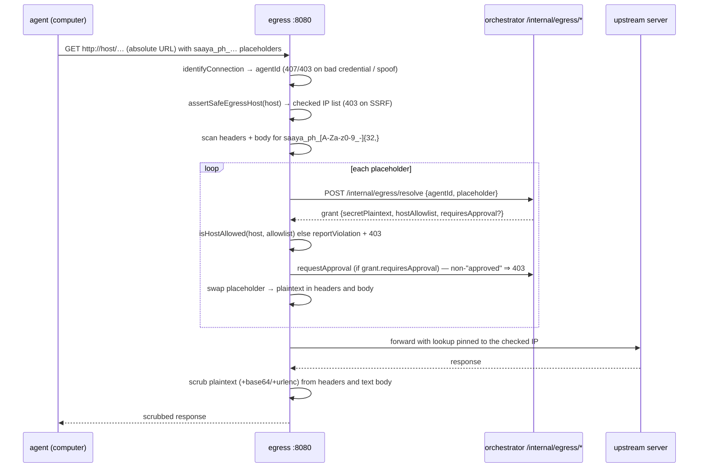

# egress — The Hardened Outbound HTTP Proxy

`egress` is the single choke point for every outbound HTTP(S) request an agent computer makes. It is a classic HTTP forward proxy with four jobs: identify which agent is behind each connection, block SSRF (private IPs, cloud metadata, DNS rebinding), swap `saaya_ph_…` secret placeholders for real credentials at the network boundary, and scrub the plaintext back out of responses. This page documents the proxy architecture, the request pipeline, and the IP filtering that powers it.

Source files: `apps/egress/src/index.ts`, `apps/egress/src/ssrf.ts` (re-export of `packages/core/src/server/ssrf.ts`)

---

## 🏗️ Two Listeners

The process starts two servers (`index.ts:12-15`, `54-56`, `340-342`):

| Listener                       | Port env (default)      | Purpose                                                            |
| :----------------------------- | :---------------------- | :----------------------------------------------------------------- |
| Proxy server (raw `node:http`) | `PROXY_PORT` / **8080** | agent traffic: absolute-form HTTP proxying + CONNECT tunnels       |
| Admin server (Hono)            | `ADMIN_PORT` / **8081** | cache flush, identity invalidation — computerd's management handle |

Both read `ORCHESTRATOR_URL` (default `http://orchestrator:4000`) and `ORCHESTRATOR_INTERNAL_SECRET` for orchestrator callbacks.

### Admin server endpoints (`index.ts:21-53`)

- **Auth is mandatory** (unlike computerd's dev mode): every route except `GET /health` requires the internal secret via `x-internal-secret` or `Authorization: Bearer`, compared with `timingSafeEqual`; when `ORCHESTRATOR_INTERNAL_SECRET` is unset, everything is `401`.
- `GET /health` → `{ ok: true, service: "egress", proxyPort }` (public).
- `POST /flush` → `flushGrantCache()`: drops the grant and identity caches (orchestrator-side vault changes also trigger this via SSE, below).
- `POST /identity/forget` with `{ containerIp }` → `forgetIdentity(containerIp)`: computerd calls this whenever a Docker computer starts or stops, because IPs are reused across agents and a stale IP → agent mapping would attribute traffic (and secret grants) to the previous owner.

### Background cache invalidation (`startInvalidationStream`, `index.ts:60-97`)

On boot (when `ORCHESTRATOR_URL` and the secret are configured) egress opens a long-lived GET to `GET ${ORCHESTRATOR_URL}/internal/egress/stream` (SSE) and flushes the caches on any `vault_changed` event; on stream failure it reconnects after 5 seconds.

---

## 🪪 Agent Identity on a Connection

`identifyConnection(req)` (`index.ts:105-119`) resolves the caller in priority order:

1. **`Proxy-Authorization: Basic …`** present → the secret after the colon is resolved via `resolveAgentIdentityBySecret` (orchestrator `POST /internal/egress/identity` with `{ proxySecret }`, result cached **60 s**). This is the microVM path — computerd's egress bridge injects the credential host-side; the guest never holds it.
2. No header but the **socket already has a bound identity** → reuse it (keep-alive connections; a `WeakMap<Socket, { agentId, orgId }>`).
3. Otherwise → **container IP**: `req.socket.remoteAddress` (stripped of `::ffff:`) is resolved via `resolveAgentIdentity` (same orchestrator endpoint with `{ containerIp }`, cached **30 s**).

Failure modes in the request handler (`index.ts:139-153`):

- A supplied credential that does not resolve → `407` with `Proxy-Authenticate: Basic realm="saaya"`.
- A client-supplied `x-saaya-agent-id` header that contradicts the resolved identity → `403` `saaya: agent identity mismatch` (spoof prevention).
- Unresolvable (no credential, no bound identity, no IP) → the request proceeds as `agentId: "anonymous"` with no grants.

The credential mechanics (HMAC derivation on the computerd side, hash-only storage in the orchestrator) are documented in [capacity-and-identity](../computerd/capacity-and-identity.md) and [scrub-and-swapper](scrub-and-swapper.md).

---

## 🔀 Proxy Request Pipeline (`index.ts:123-301`)



Step by step:

1. **URL parsing**: the request URL must parse as absolute (`new URL(rawUrl)`), else `400 Bad Request: Invalid URL`. The proxy also handles **CONNECT** (below).
2. **Identity** — see above.
3. **SSRF check & pinning**: `assertSafeEgressHost(host)` returns the DNS-resolved public IP list; failure answers `403` with `saaya: forbidden host (<reason>)`. The first address becomes the **pinned IP** for the outbound connection (`index.ts:158-166`).
4. **Body read**: the entire request body is buffered (`index.ts:169-174`).
5. **Placeholder scan**: every string header plus the UTF-8 body is scanned for `saaya_ph_[A-Za-z0-9_-]{32,}` (`PLACEHOLDER_RE`, `index.ts:17`); matches are deduplicated into a set. Hop-by-hop headers (`host`, `proxy-authorization`, `proxy-connection`) are stripped from the forwarded set.
6. **Resolution & swap** (`index.ts:195-237`): each placeholder is resolved through the orchestrator; the grant's `hostAllowlist` is enforced with `matchesHostPattern` (a secret scoped to `api.github.com` cannot be spent anywhere else, and violations are reported via `reportViolation`); approval-gated grants block until the orchestrator returns `approved` — anything else is `403 saaya: human approval rejected or timed out`. Plaintext replaces the placeholder in matching headers and in the body (body buffer rebuilt as UTF-8). Broker errors answer `502 saaya: secret broker error (…)`.
7. **Forward with DNS pinning**: `http.request`/`https.request` is issued with a custom `lookup` callback that ignores DNS and returns the pinned IP (family inferred from the address) while `servername` keeps the real hostname for TLS SNI (`index.ts:244-258`) — this closes the TOCTOU rebinding window between check and connect:

```typescript
lookup: (_hostname, opts, cb) => {
  const callback = typeof opts === "function" ? opts : cb
  callback(null, pinnedIp, isIpv6 ? 6 : 4)
},
servername: host,
```

The attacker's classic move — a DNS record that alternates between a public IP and `169.254.169.254` — fails twice: the pre-check rejects any resolution containing a private IP, and even a change _between_ check and connect is irrelevant because the connection dials the already-vetted address. 8. **Response scrubbing**: response headers are always scrubbed; the body is scrubbed only when `content-type` contains `text`, `json`, or `xml`, with `content-length` recomputed after rewriting (`index.ts:258-284`). See [scrub-and-swapper.md](scrub-and-swapper.md) for the replacement rules (raw + base64 + URL-encoded forms). 9. Upstream connection errors answer `502 saaya: upstream connection failed (…)`; unexpected handler exceptions answer `500 saaya: egress internal error (…)`.

### CONNECT tunnels (`index.ts:305-338`)

`CONNECT host:port` (how HTTP proxies carry HTTPS) is restricted to **port 443** — any other port is refused with `CONNECT tunnel restricted to port 443 (requested: N)`. The connection must identify itself (a bad credential gets `407`), the host passes `assertSafeEgressHost`, and the tunnel is opened **to the pinned IP** (`net.connect({ host: pinnedIp, port: 443 })`), then piped both ways. `HTTP/1.1 200 Connection Established` is sent on success; failures end with `403` carrying the error message. Because the tunnel is opaque TLS, placeholder swapping and scrubbing do not apply inside it — identity and destination checks still do.

### Known limits of the current implementation

- **Whole-body buffering**: request and response bodies are accumulated in memory (no streaming). Responses are scrubbed on `end`, so nothing reaches the client early — but memory scales with body size, and no size cap is enforced at the proxy layer.
- **`servername` is always the hostname**: for https, TLS SNI and certificate validation use the real hostname while the TCP connection targets the pinned IP — correct for normal DNS, and the pinned IP is validated to belong to that hostname's resolution at check time.
- **Header values are strings only**: array-valued headers (repeated headers) are not placeholder-scanned, though Node's IncomingMessage usually folds them into one string for the common cases.
- **HTTP only**: the proxy handles `http:` absolute-URL requests and `CONNECT`; there is no plain-HTTPS URL scheme handling in the forward path (`isHttps` selects the request client, but the standard flow is absolute-URI `http` requests from agents' `HTTP_PROXY` config, and CONNECT for TLS).

---

## 🛡️ SSRF Filter (`ssrf.ts` → `packages/core/src/server/ssrf.ts`)

`apps/egress/src/ssrf.ts` is a one-line re-export: `export { assertSafeEgressHost, isPrivateIp } from "@sayabot/core/server"`. The implementation lives in `packages/core/src/server/ssrf.ts` and is shared with the orchestrator/web `web_fetch` paths.

### `isPrivateIp(ip)` (`packages/core/src/server/ssrf.ts:62-156`)

The deny list is broader than the classic RFC 1918 set:

**IPv4**

| Range                                               | Meaning                                                         |
| :-------------------------------------------------- | :-------------------------------------------------------------- |
| `127.0.0.0/8`, `::1`, `localhost`, `::`             | loopback                                                        |
| `10.0.0.0/8`, `172.16.0.0/12`, `192.168.0.0/16`     | RFC 1918 private                                                |
| `169.254.0.0/16`                                    | link-local **and cloud metadata endpoints** (`169.254.169.254`) |
| `100.64.0.0/10`                                     | CGNAT (Tailscale-style overlays)                                |
| `0.0.0.0/8`                                         | "this network"                                                  |
| `198.18.0.0/15`                                     | RFC 2544 benchmarking                                           |
| `192.0.2.0/24`, `198.51.100.0/24`, `203.0.113.0/24` | TEST-NET documentation ranges                                   |
| `224.0.0.0/4` and up (`a >= 224`)                   | multicast + reserved; `255.255.255.255` broadcast               |

**IPv6** (`parseIpv6Words` handles `::` expansion and IPv4-embedded forms): multicast `ff00::/8`; unspecified/loopback; **IPv4-mapped** `::ffff:a.b.c.d`, **IPv4-compatible** `::a.b.c.d`, **NAT64** `64:ff9b::/96`, and **6to4** `2002::/16` (all recursed into the IPv4 check on the embedded address); link-local `fe80::/10`; unique-local `fc00::/7`; discard-only `100::/64`; documentation `2001:db8::/32`. Unparseable IPv6 is treated as private (fail closed), as is anything that is not a valid IP.

### `assertSafeEgressHost(hostname)` (`packages/core/src/server/ssrf.ts:158-195`)

1. Brackets/whitespace are stripped and the host lowercased; an empty host throws.
2. **Local-suffix block without DNS**: `localhost`, `*.localhost`, `*.local`, `*.internal`, `*.onion` throw immediately (`SSRF blocked: Host … is a local/internal domain`).
3. A literal IP is checked with `isPrivateIp` and, when public, returned as the pinned list directly.
4. Otherwise `dns.lookup(host, { all: true })` resolves **every** address; any single private address fails the whole host (`SSRF blocked: <host> resolved to restricted IP <ip>`), and the full public address list is returned for pinning. DNS failure and empty answers also throw.

---

## 🧪 Tests

- `apps/egress/test/egress.test.ts` — proxy behaviour end-to-end.
- `packages/core/src/server/ssrf.test.ts` — the full `isPrivateIp` / `assertSafeEgressHost` matrix (IPv4 ranges, IPv6 embedded forms, suffix blocks).
- `apps/egress/tests/unit/swapper.test.ts`, `tests/integration/swapper-resolve.test.ts` — identity/grant resolution (see [scrub-and-swapper.md](scrub-and-swapper.md)).

---

## Related docs

- [Response scrubbing & placeholder resolution](scrub-and-swapper.md)
- [computerd egress bridge (credential injection)](../computerd/egress-bridge.md)
- [Per-agent proxy identity](../computerd/capacity-and-identity.md)
- [Security model (platform-wide)](../architecture/security-model.md)
