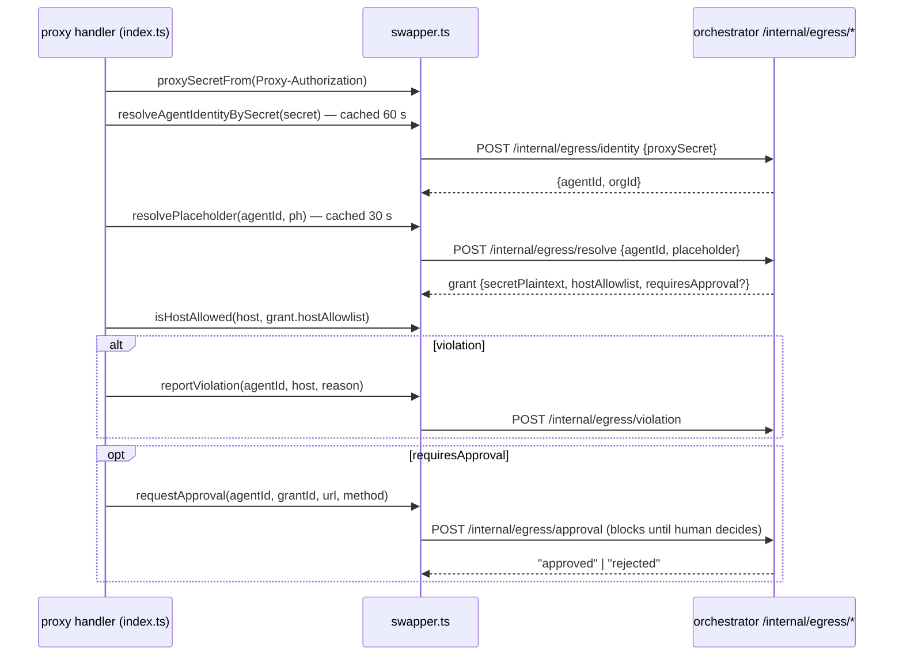

# egress — Response Scrubbing & Placeholder Swapper

Two modules implement egress's secret plumbing. `swapper.ts` is the client side of the secret broker: it resolves agent identities (by proxy credential or container IP), exchanges `saaya_ph_…` placeholders for grants from the orchestrator, enforces host allowlists and approvals, and keeps short-lived caches of everything. `scrub.ts` runs on the way back: any plaintext that was swapped in is replaced with its placeholder again before the response reaches the agent.

Source files: `apps/egress/src/scrub.ts`, `apps/egress/src/swapper.ts`

---

## 🔄 `swapper.ts` — Identity, Grants, Caches

Both modules are configured by the same pair of env vars read at module load (`swapper.ts:3-4`): `ORCHESTRATOR_URL` (default `http://orchestrator:4000`) and `ORCHESTRATOR_INTERNAL_SECRET`. Every orchestrator call is a POST with `x-internal-secret`.

### `ResolvedGrant` — what a placeholder becomes (`swapper.ts:6-17`)

```typescript
export interface ResolvedGrant {
  grantId: string
  secretPlaintext: string
  hostAllowlist: string[] // matched with matchesHostPattern (packages/core hosts.ts)
  inject: { mode: "header" | "basic" | "query" | "body"; template?: string; param?: string }
  methods?: string[]
  requiresApproval?: boolean
}
```

`inject`/`methods` describe how the secret is meant to be used; the proxy itself only enforces `hostAllowlist` and `requiresApproval` (`apps/egress/src/index.ts:199-215`).

### Identity resolution

| Function                                                    | Orchestrator endpoint                                   | Cache                                                                                                                          |
| :---------------------------------------------------------- | :------------------------------------------------------ | :----------------------------------------------------------------------------------------------------------------------------- |
| `proxySecretFrom(header)` (`swapper.ts:31-38`)              | —                                                       | parses `Proxy-Authorization: Basic base64(user:secret)` and returns the part after the first `:`; `null` when absent/malformed |
| `resolveAgentIdentityBySecret(secret)` (`swapper.ts:44-62`) | `POST /internal/egress/identity` with `{ proxySecret }` | `secretIdentityCache`: **60 s** per secret                                                                                     |
| `resolveAgentIdentity(containerIp)` (`swapper.ts:69-92`)    | `POST /internal/egress/identity` with `{ containerIp }` | `identityCache`: **30 s** per IP                                                                                               |

Both return `{ agentId, orgId }` or `null`. The orchestrator verifies a proxy credential by hashing it (`hashAgentApiKey` in `@sayabot/core`) against the hash computerd reported when the computer started — egress never learns how credentials are derived. `foridentityCache` invalidation: `forgetIdentity(containerIp)` (`swapper.ts:65-67`) deletes the IP entry; computerd calls `POST :8081/identity/forget` on every computer start/stop because Docker reuses IPs across agents.

### Placeholder resolution (`resolvePlaceholder`, `swapper.ts:94-118`)

```typescript
export async function resolvePlaceholder(
  agentId: string,
  placeholder: string,
): Promise<ResolvedGrant> {
  const cacheKey = `${agentId}:${placeholder}`
  const cached = grantCache.get(cacheKey)
  if (cached && cached.expiresAt > Date.now()) return cached.grant

  const res = await fetch(`${ORCHESTRATOR_URL}/internal/egress/resolve`, {
    method: "POST",
    headers: { "content-type": "application/json", "x-internal-secret": INTERNAL_SECRET },
    body: JSON.stringify({ agentId, placeholder }),
  })
  if (!res.ok) {
    const body = await res.text().catch(() => "")
    throw new Error(`Failed to resolve secret placeholder (${res.status}): ${body}`)
  }
  const grant = (await res.json()) as ResolvedGrant
  grantCache.set(cacheKey, { grant, expiresAt: Date.now() + 30_000 })
  return grant
}
```

`POST /internal/egress/resolve` with `{ agentId, placeholder }`. Non-OK responses throw `Failed to resolve secret placeholder (<status>): <body>`, which the proxy converts to `502 saaya: secret broker error (…)`. Successful grants are cached under key `` `${agentId}:${placeholder}` `` for **30 s** — so a burst of requests sharing one placeholder costs one orchestrator round-trip and, equally, a vault revocation takes effect within that window (plus the SSE `vault_changed` flush).

### Orchestration in one request



### Allowlist & approval helpers

- `isHostAllowed(host, allowlist)` (`swapper.ts:160-165`) — true when any pattern matches via `matchesHostPattern` (`packages/core/src/hosts.ts:62`). On failure the proxy reports and rejects: `reportViolation(agentId, host, reason)` posts to `POST /internal/egress/violation` (errors swallowed, `swapper.ts:120-133`), and the client gets `403 saaya: secret is not allowed for <host>`.
- `requestApproval(agentId, grantId, url, method)` (`swapper.ts:135-158`) — posts to `POST /internal/egress/approval`, which blocks orchestrator-side until a human decides, and returns `"approved"` only when the response body says so. **Any** other outcome — non-OK status, network error, malformed body — returns `"rejected"`, and the proxy answers `403 saaya: human approval rejected or timed out`. Approval decisions are not cached; each placeholder occurrence in a request goes through the gate.

### Cache flush

`flushGrantCache()` (`swapper.ts:22-26`) clears all three maps (`grantCache`, `identityCache`, `secretIdentityCache`). It runs on `POST :8081/flush`, on the `vault_changed` SSE event from the orchestrator (`index.ts:60-97`), and would also invalidate credentials cached by secret — deliberate, since re-verification is one cheap POST.

### Cache summary

| Cache                 | Key                               | Value                | TTL  | Invalidated by                               |
| :-------------------- | :-------------------------------- | :------------------- | :--- | :------------------------------------------- |
| `grantCache`          | `` `${agentId}:${placeholder}` `` | `ResolvedGrant`      | 30 s | TTL, `flushGrantCache`                       |
| `identityCache`       | container IP                      | `{ agentId, orgId }` | 30 s | TTL, `forgetIdentity(ip)`, `flushGrantCache` |
| `secretIdentityCache` | proxy secret                      | `{ agentId, orgId }` | 60 s | TTL, `flushGrantCache`                       |

The TTL asymmetry is intentional: container IPs are reused (and explicitly forgotten), so their cache is short; a proxy credential is cryptographically bound to one agent, so it can be trusted for a minute. Grant caching for 30 s bounds how long a revoked secret keeps working after a `vault_changed` flush window.

---

## 🧽 `scrub.ts` — Response Scrubbing

`scrubResponseText(text, secretsToPlaceholder)` (`scrub.ts:1-23`) maps each resolved **plaintext** back to its placeholder. The proxy builds the `Map<secretPlaintext, placeholder>` during the swap phase (`index.ts:218`), so scrubbing is symmetric by construction. The whole module:

```typescript
export function scrubResponseText(text: string, secretsToPlaceholder: Map<string, string>): string {
  if (secretsToPlaceholder.size === 0) return text
  let result = text
  for (const [secret, placeholder] of secretsToPlaceholder.entries()) {
    if (!secret || secret.length < 4) continue
    result = result.replaceAll(secret, placeholder)
    // Also scrub base64-encoded secret
    try {
      const b64 = Buffer.from(secret).toString("base64")
      if (b64.length >= 8) result = result.replaceAll(b64, placeholder)
    } catch {}
    // Also scrub URL-encoded secret
    try {
      const urlEnc = encodeURIComponent(secret)
      if (urlEnc !== secret) result = result.replaceAll(urlEnc, placeholder)
    } catch {}
  }
  return result
}
```

For every secret in the map, in insertion order, three textual forms are replaced (`String.prototype.replaceAll`):

| Form                                     | Guard                                                   | Why                                                                      |
| :--------------------------------------- | :------------------------------------------------------ | :----------------------------------------------------------------------- |
| raw secret                               | skipped when shorter than 4 chars (`secret.length < 4`) | the direct echo case: an API that repeats the `Authorization` value back |
| `Buffer.from(secret).toString("base64")` | only when the base64 string is ≥ 8 chars                | secrets echoed inside Basic auth headers or base64 envelopes             |
| `encodeURIComponent(secret)`             | only when encoding actually changed the string          | secrets echoed inside query strings / URLs                               |

Rules and edges:

- Secrets shorter than 4 characters are never scrubbed raw (collision risk with normal text outweighs the leak); their base64/URL-encoded forms can still be scrubbed if long enough.
- Replacements cascade: if one secret's placeholder text happens to contain another secret, order matters — in practice placeholders (`saaya_ph_…`) never contain plaintext, so each pass is independent.
- The proxy applies this to **all string response headers** unconditionally, and to the **body** only when `content-type` includes `text`, `json`, or `xml`, recomputing `content-length` after rewriting (`apps/egress/src/index.ts:258-284`). Binary bodies (images, archives) pass through unscrubbed — a plaintext leak inside a binary response is not caught.
- If the map is empty (no placeholders were swapped), scrubbing is a no-op fast path: `if (secretsToPlaceholder.size === 0) return text`.

The net effect: even an echo endpoint (an API that returns the submitted token, a debug page printing headers) cannot leak a brokered secret into the agent's context — the agent only ever sees `saaya_ph_…` again.

### Worked example

1. The agent sends `Authorization: Bearer saaya_ph_a1B2…X9z3` through the proxy.
2. The orchestrator's grant says the plaintext is `ghp_real_token…`; the proxy swaps it into the forwarded header and records `{ "ghp_real_token…" → "saaya_ph_a1B2…X9z3" }`.
3. The upstream API echoes the token in its JSON response: `{"token_used":"ghp_real_token…"}`.
4. On the way back, `scrubResponseText` rewrites the body to `{"token_used":"saaya_ph_a1B2…X9z3"}` — and if the upstream had base64- or URL-encoded the token, those forms are rewritten too.

---

## 🧪 Tests

| File                                                    | Covers                                                                      |
| :------------------------------------------------------ | :-------------------------------------------------------------------------- |
| `apps/egress/tests/unit/scrub.test.ts`                  | raw / base64 / URL-encoded replacement, short-secret guard, empty-map no-op |
| `apps/egress/tests/unit/swapper.test.ts`                | `proxySecretFrom` parsing, cache TTLs, `forgetIdentity`                     |
| `apps/egress/tests/integration/swapper-resolve.test.ts` | `resolvePlaceholder` against a stub orchestrator, error mapping             |
| `apps/egress/test/egress.test.ts`                       | end-to-end swap + scrub through the proxy                                   |

---

## Related docs

- [Egress proxy overview (request pipeline)](overview.md)
- [computerd egress bridge (where the proxy credential comes from)](../computerd/egress-bridge.md)
- [Per-agent proxy identity](../computerd/capacity-and-identity.md)
- [Secret broker (orchestrator side)](../orchestrator/tools/secrets-broker.md)
- [Security model (platform-wide)](../architecture/security-model.md)
