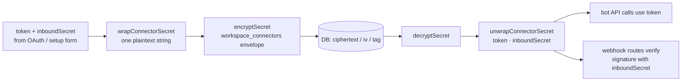

# Connector Secret Packing

`src/connector-secret.ts` solves a small storage problem: some messaging connectors (the inbound-webhook platforms) need **two** secrets — the bot's API token and the secret used to verify inbound webhook requests — but Sayabot's `workspace_connectors` table stores exactly one sealed credential blob per row. This module packs the two plaintexts into a single string before `encryptSecret` seals it, and unpacks them after `decryptSecret` opens it.

It works entirely on plaintext and knows nothing about encryption: the sealing itself is [crypto.md](./crypto.md)'s job. The packed form is JSON, so the pair travels through the three-column envelope (`ciphertext`/`iv`/`tag`) as one value.

Source files: `packages/llm/src/connector-secret.ts` (24 lines)

---

## 📦 The two functions

```typescript
/** A connector's stored secret is either the token itself, or a token plus a chat-webhook secret. */
export function unwrapConnectorSecret(plain: string): { token: string; inboundSecret: string | null } {
  const trimmed = plain.trim()
  if (trimmed.startsWith("{")) {
    try {
      const parsed = JSON.parse(trimmed) as { token?: unknown; inboundSecret?: unknown }
      if (typeof parsed.token === "string" && parsed.token.length > 0) {
        return {
          token: parsed.token,
          inboundSecret:
            typeof parsed.inboundSecret === "string" && parsed.inboundSecret.length > 0
              ? parsed.inboundSecret
              : null,
        }
      }
    } catch {
      // A token that happens to start with "{" is still just a token.
    }
  }
  return { token: plain, inboundSecret: null }
}

export function wrapConnectorSecret(token: string, inboundSecret: string | null): string {
  if (!inboundSecret) return token
  return JSON.stringify({ token, inboundSecret })
}
```

(`packages/llm/src/connector-secret.ts:2-23`.)

### `unwrapConnectorSecret(plain)`

Parses the decrypted plaintext and returns `{ token, inboundSecret }`:

- If the plaintext starts with `{` **and** parses as JSON **and** has a non-empty string `token` field, the `inboundSecret` field is extracted (or `null` when absent/empty/non-string).
- Every other case — a plain token, invalid JSON, JSON without a string `token` — returns the whole plaintext as `token` with `inboundSecret: null`. The fallback is deliberate: a Telegram or Slack token that happens to begin with `{` is still just a token (see the inline comment at `connector-secret.ts:14`).

Note the asymmetry: `unwrap` trims the input before testing, but returns the **original `plain`** (untrimmed) as the token in the fallback path, preserving whatever the connector stored.

### `wrapConnectorSecret(token, inboundSecret)`

- `inboundSecret == null` (or any falsy) → returns the bare token, so single-secret connectors never store JSON at all.
- Otherwise → `JSON.stringify({ token, inboundSecret })`.

---

## 🔁 Where it sits in the pipeline



Consumers (all via `@sayabot/llm`):

| Site | Direction | Use |
| :-- | :-- | :-- |
| `apps/web/src/lib/actions/connectors.ts:133-137, 597-599, 266` | wrap + unwrap | Saves a rotated token while preserving the existing `inboundSecret`; stores a new inbound secret by re-sealing `wrapConnectorSecret(current.token, inboundSecret)`; displays `last4` of the token |
| `apps/web/src/app/api/messaging/[platform]/[connectorId]/route.ts:27` | unwrap | Inbound webhook route verifies the request against `inboundSecret` (never the token) |
| `apps/orchestrator/src/connectors/inbound.ts:126` | unwrap | Orchestrator-side webhook verification |
| `apps/orchestrator/src/connectors/discord-gateway.ts:46` | unwrap | Gateway uses the bot token; the inbound secret stays available |

The orchestrator's `ConnectorService` (Tier-1 credential decryption in the [connectors guide](../../connectors.md)) decrypts and unwraps in the same two steps, keeping the token and the webhook secret on separate code paths so neither is logged or sent to the model.

---

## 🧪 Test coverage

There is no dedicated `connector-secret.test.ts`; the packing round trip is exercised through the web app's connector unit tests (`apps/web/tests/integration/connectors-api.test.ts` imports from `@sayabot/llm`) and indirectly by the seal/open round trips in `packages/llm/tests/integration/index.test.ts` (which verify the encryption layer this module feeds into). The module's own guarantees — JSON fallback for `{`-leading tokens, `null` for missing secrets — are enforced by the small surface area above.

---

## Related docs

- [crypto.md](./crypto.md) — `encryptSecret`/`decryptSecret` around this packing layer
- [overview.md](./overview.md) — package map
- [../../connectors.md](../../connectors.md) — the two-tier connector model these credentials belong to
