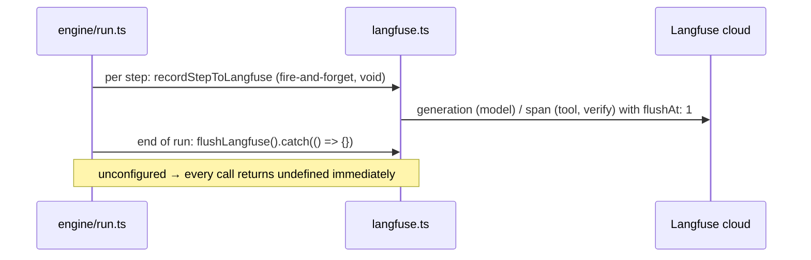

# Langfuse Observability Integration

`src/langfuse.ts` is a thin, optional wrapper around the [Langfuse](https://langfuse.com) SDK (`langfuse@3`) that gives every agent run a trace and every step a generation or span. It is entirely opt-in: without `LANGFUSE_PUBLIC_KEY` and `LANGFUSE_SECRET_KEY` in the environment every function becomes a no-op, and every recording call swallows its own errors so telemetry can never crash a turn.

The orchestrator's Agent Loop V2 (`apps/orchestrator/src/engine/run.ts`) is the only producer: it creates one trace per run (keyed by the `agent_runs` row id) and records one entry per executed step, then flushes at the end of the run.

Source files: `packages/llm/src/langfuse.ts` (141 lines), `packages/llm/src/langfuse.test.ts`

---

## ⚙️ Configuration and client lifecycle

| Export                          | Behaviour                                                                                                     |
| :------------------------------ | :------------------------------------------------------------------------------------------------------------ |
| `LangfuseConfig`                | `{ publicKey?, secretKey?, baseUrl? }` — explicit override used by tests                                      |
| `isLangfuseConfigured(config?)` | `true` when both a public and a secret key exist (config, else `LANGFUSE_PUBLIC_KEY` + `LANGFUSE_SECRET_KEY`) |
| `getLangfuseClient(config?)`    | The singleton `Langfuse` client, or `null` when unconfigured                                                  |
| `flushLangfuse()`               | Best-effort `client.flushAsync()`; never throws                                                               |

`getLangfuseClient` (`packages/llm/src/langfuse.ts:17-38`) resolves the base URL from `config?.baseUrl` → `LANGFUSE_BASEURL` → `LANGFUSE_HOST` → default **`https://cloud.langfuse.com`**, and constructs the client with `flushAt: 1` (send every event immediately rather than batching). The module-level singleton is only reused when no explicit `config` is passed — passing a `config` always builds a fresh instance, which is how the tests isolate themselves.

---

## 📈 What is recorded per run and step

### `TraceArgs` — the run-level shape

```typescript
export interface TraceArgs {
  id: string // the trace id (the orchestrator uses the agent_runs row id)
  name: string
  sessionId?: string
  userId?: string
  metadata?: Record<string, unknown>
  tags?: string[]
}
```

(`packages/llm/src/langfuse.ts:50-57`.) Note there is no `createTrace` helper in this module; the orchestrator passes `sessionId: args.sessionId` when it creates the run (`apps/orchestrator/src/engine/run.ts:104`) and uses `run.id` as the `traceId` for every step record (`apps/orchestrator/src/engine/run.ts:671-672, 840-841`).

### `recordStepToLangfuse` — one event per step

```typescript
export interface StepRecordArgs {
  traceId: string
  stepIdx: number
  kind: string // "model", "tool", "verify", …
  name?: string
  input?: unknown
  output?: unknown
  usage?: { inputTokens?: number; outputTokens?: number; totalTokens?: number }
  startedAt?: Date
  finishedAt?: Date
}
```

(`packages/llm/src/langfuse.ts:59-73`.) The dispatch (`langfuse.ts:75-119`):

```typescript
const isModel = args.kind === "model"
const spanName = args.name || `${args.kind}:${args.stepIdx}`
if (isModel) {
  lf.generation({
    traceId,
    name: spanName,
    startTime,
    endTime,
    input,
    output,
    usage: { promptTokens, completionTokens, totalTokens },
    metadata: { stepIdx, kind },
  })
} else {
  lf.span({
    traceId,
    name: spanName,
    startTime,
    endTime,
    input,
    output,
    metadata: { stepIdx, kind },
  })
}
```

- **`kind: "model"` steps become Langfuse _generations_** with token usage mapped to `promptTokens` / `completionTokens` / `totalTokens`.
- **Everything else becomes a _span_** — tool steps and the critic's verification step alike.
- `name` falls back to `"<kind>:<stepIdx>"`. In practice the orchestrator names model steps after the resolved model and tool steps after the primary tool (`name: primaryTool?.toolName ?? (kind === "model" ? resolved.modelName : kind)`, `run.ts:673`), and records a `kind: "verify"`, `name: "critic_verification"` span with `output: { pass, feedback, reasons }` after each critic cycle (`run.ts:839-849`).
- Inputs/outputs are the **scrubbed** step payloads — `run.ts` runs them through the secret redactor (`runScrubber`) before recording, consistent with Golden Rule 1 (never log secrets).
- The whole call is wrapped in `try { … } catch {}` — "Non-blocking telemetry".

### `recordScoreToLangfuse` — evaluation scores

```typescript
export async function recordScoreToLangfuse(args: {
  traceId: string
  name: string
  value: number
  comment?: string
}): Promise<void>
```

(`packages/llm/src/langfuse.ts:121-140`.) Emits `lf.score({ traceId, name, value, comment })`, also swallow-all-errors. It is currently exported and tested but has no call site in the orchestrator yet — it is ready for evaluation/scoring pipelines.

---

## 🏁 Run lifecycle in the engine



- Step records are issued fire-and-forget (`void recordStepToLangfuse(...)`), so the turn never waits on telemetry.
- `await flushLangfuse().catch(() => {})` at the end of the run (`run.ts:334`) drains the queue; the wrapper itself is already try/caught.

---

## 🧪 Test coverage (`langfuse.test.ts`)

The suite clears `LANGFUSE_PUBLIC_KEY` / `LANGFUSE_SECRET_KEY` from `process.env` around each case:

| Test                                                     | Pins                                                                                                                                                |
| :------------------------------------------------------- | :-------------------------------------------------------------------------------------------------------------------------------------------------- |
| `reports unconfigured when environment keys are missing` | `isLangfuseConfigured()` → `false`; `getLangfuseClient()` → `null`                                                                                  |
| `reports configured when keys are present`               | With `pk-lf-test` / `sk-lf-test`, `isLangfuseConfigured()` → `true` and a non-null client is returned                                               |
| `handles step records safely when unconfigured`          | `recordStepToLangfuse({ traceId: "test-trace", stepIdx: 1, kind: "tool", input: { cmd: "ls" }, output: { stdout: "files" } })` resolves `undefined` |
| `handles score records safely when unconfigured`         | `recordScoreToLangfuse({ traceId, name: "human_approval", value: 1 })` resolves `undefined`                                                         |

(The safe-no-op behaviour is the key contract: the orchestrator can call these unconditionally.)

---

## 🔧 Environment variables

| Variable              | Effect                                                      |
| :-------------------- | :---------------------------------------------------------- |
| `LANGFUSE_PUBLIC_KEY` | Public key (pk-lf-…); required, else everything is a no-op  |
| `LANGFUSE_SECRET_KEY` | Secret key (sk-lf-…); required                              |
| `LANGFUSE_BASEURL`    | Self-hosted endpoint; takes precedence over `LANGFUSE_HOST` |
| `LANGFUSE_HOST`       | Older alias for the endpoint                                |
| _(none)_              | Defaults to `https://cloud.langfuse.com`                    |

---

## Related docs

- [overview.md](./overview.md) — package map and how the orchestrator consumes this module
- [registry-and-models.md](./registry-and-models.md) — `buildProviderOptions`, the other per-step helper `engine/run.ts` uses
- [langfuse tracing docs](https://langfuse.com/docs) — upstream SDK reference
