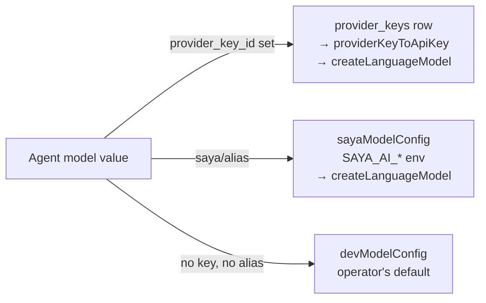

# `@sayabot/llm` Package Overview

`@sayabot/llm` (`packages/llm/`) is Sayabot's AI and security layer: the multi-provider LLM abstraction that turns a saved provider key into an AI SDK `LanguageModel`, the AES-256-GCM envelope crypto that seals every credential at rest, the MCP (Model Context Protocol) client gateway with OAuth sign-in, model-catalog discovery for the picker, plan-usage polling, and Langfuse tracing. Both server apps depend on it — the orchestrator uses it to run agent turns and bridge MCP tools, the web app uses it to store keys, build the model picker and drive MCP sign-in flows.

The package is deliberately thin and Node-only. It has no database access of its own: callers pass in decrypted material (a KEK, a key, a sealed blob) and persist whatever the functions hand back.

Source files: `packages/llm/src/index.ts`, `packages/llm/package.json`

---

## 📦 Export surface

`packages/llm/src/index.ts` is eight re-export lines, one per module:

```typescript
export * from "./crypto" // encryptSecret / decryptSecret / sealSecret / openSecret / parseKek / last4
export * from "./copilot" // copilotSessionToken / copilotFetch / isCopilotBaseUrl / COPILOT_API_BASE ...
export * from "./registry" // createLanguageModel / sayaModelConfig / devModelConfig / providerKeyToApiKey ...
export * from "./mcp" // connectMcpServers / mcpToolName / isDangerousMcpTool / McpToolError ...
export * from "./langfuse" // getLangfuseClient / recordStepToLangfuse / recordScoreToLangfuse / flushLangfuse
export * from "./mcp-oauth" // StoredMcpOAuthProvider / beginMcpOAuth / completeMcpOAuth / sealMcpOAuthState ...
export * from "./local-apps" // LOCAL_APPS / findLocalApp / localAppArgv
export * from "./connector-secret" // unwrapConnectorSecret / wrapConnectorSecret
```

`package.json` declares four entry points, so client bundles can never accidentally pull the Node-only model-catalog code:

| Export path                  | Module                               | Node-only?                                                  |
| :--------------------------- | :----------------------------------- | :---------------------------------------------------------- |
| `@sayabot/llm`               | `src/index.ts` (the 8 modules above) | Mostly (crypto helpers are pure)                            |
| `@sayabot/llm/models`        | `src/models/index.ts`                | Yes — reads files, spawns CLIs (`src/models/index.ts:1-13`) |
| `@sayabot/llm/models/effort` | `src/models/effort.ts`               | No — pure constants and helpers                             |
| `@sayabot/llm/local-apps`    | `src/local-apps.ts`                  | No — static catalog data                                    |

Dependencies (`packages/llm/package.json:18-30`): the Vercel AI SDK (`ai@7`) plus `@ai-sdk/anthropic`, `@ai-sdk/cerebras`, `@ai-sdk/google`, `@ai-sdk/groq`, `@ai-sdk/mcp`, `@ai-sdk/openai` and `@ai-sdk/openai-compatible`; `langfuse@3`; `zod@4`; and `@sayabot/core` for shared types (`Provider`, Saya AI config parsing, `assertSafeEgressHost`). Scripts: `pnpm --filter @sayabot/llm test` (Vitest), `catalog:snapshot` (rewrites the bundled models.dev snapshot), `typecheck`, `lint`.

---

## 🏗️ Module map

| Module                    | Responsibility                                                                                                                                                                          | Reference doc                                                                        |
| :------------------------ | :-------------------------------------------------------------------------------------------------------------------------------------------------------------------------------------- | :----------------------------------------------------------------------------------- |
| `src/crypto.ts`           | AES-256-GCM envelope encryption (`EncryptedSecret { ciphertext, iv, tag }`), single-column sealing, KEK parsing                                                                         | [crypto.md](./crypto.md)                                                             |
| `src/registry.ts`         | Provider → AI SDK model factory for all 17 providers, provider capability table, provider-options builder (thinking budgets, reasoning effort, cache breakpoints)                       | [registry-and-models.md](./registry-and-models.md)                                   |
| `src/models/*`            | Model-catalog discovery: models.dev feed, Sayabot's own engine manifest, CLI model lists (Claude Code / Codex), live provider `/models` lists, effort ladder, listing rules, plan usage | [registry-and-models.md](./registry-and-models.md), [plan-usage.md](./plan-usage.md) |
| `src/mcp.ts`              | MCP client gateway: connects servers over http/sse/stdio, discovers and renames tools, bounded timeouts, fail-closed semantics                                                          | [mcp.md](./mcp.md)                                                                   |
| `src/mcp-oauth.ts`        | OAuth 2.1 sign-in for MCP servers (discovery, dynamic registration, PKCE, refresh) with all state sealed on the `mcp_servers` row                                                       | [mcp-oauth.md](./mcp-oauth.md)                                                       |
| `src/langfuse.ts`         | Tracing: one Langfuse trace per run, generations for model steps, spans for tool steps, scores                                                                                          | [langfuse.md](./langfuse.md)                                                         |
| `src/copilot.ts`          | GitHub Copilot token broker: swaps a saved GitHub token for a short-lived Copilot token per call                                                                                        | [copilot-and-local-apps.md](./copilot-and-local-apps.md)                             |
| `src/local-apps.ts`       | Fixed catalog of 7 local MCP apps (Airtable, Brave Search, Resend, Firecrawl, Obsidian, Paper, Apple apps)                                                                              | [copilot-and-local-apps.md](./copilot-and-local-apps.md)                             |
| `src/connector-secret.ts` | Packing a connector token plus inbound-webhook secret into one plaintext string before sealing                                                                                          | [connector-secret.md](./connector-secret.md)                                         |

---

## 🔑 The multi-provider abstraction

The provider list lives in `@sayabot/core` (`packages/core/src/types.ts:15-33`) and has **17 entries**: `openai`, `anthropic`, `google`, `groq`, `cerebras`, `openrouter`, `copilot`, `opencode`, `command-code`, `deepseek`, `minimax`, `grok`, `kimi`, `qwen`, `cursor`, `cloudflare`, `openai-compatible`.

`createLanguageModel()` (`packages/llm/src/registry.ts:31`) maps one of those providers plus a key to an AI SDK `LanguageModel`:

- Five providers use their native SDK adapter (`openai`, `anthropic`, `google`, `groq`, `cerebras`) — `packages/llm/src/registry.ts:35-44`.
- The other twelve use `createTrackedOpenAICompatible` (`packages/llm/src/compatible-usage.ts`) with a per-provider default base URL (OpenRouter, Copilot, opencode, Cohere `command-code`, DeepSeek, MiniMax, Grok, Kimi, Qwen, Cursor, Cloudflare Workers AI, and generic `openai-compatible` which requires a base URL). That wrapper turns on `includeUsage` and normalizes third-party usage objects (`input_tokens`, DeepSeek cache hits, Ollama eval counts, numeric strings) into the same prompt/completion counts the OpenAI adapter reports, so those calls show up on Usage.
- Two providers inject a custom `fetch`: Copilot swaps the stored GitHub token for a short-lived Copilot token on every call, and OpenRouter gets `HTTP-Referer`/`X-Title` headers.

Per-provider capability flags (`ProviderCapabilities`, `packages/llm/src/registry.ts:189-198`) tell the engine what the wire protocol supports — prompt caching, context editing, effort levels, mid-conversation system messages, parallel tool calls, computer use, and a default context window. `buildProviderOptions()` (`packages/llm/src/registry.ts:399`) translates the neutral `EffortLevel` ladder into provider-specific options (`anthropicOptions.thinking.budgetTokens`, `openaiOptions.reasoningEffort`).

Models are chosen through three paths, all resolved server-side:



1. **BYOK (bring your own key)** — an agent references a `provider_keys` row; `providerKeyToApiKey()` decrypts it with the KEK and `createLanguageModel()` builds the model.
2. **Saya AI** — the operator's shared endpoint, configured with `SAYA_AI_BASE_URL` / `SAYA_AI_API_KEY` / `SAYA_AI_MODELS` env vars. Agents store only a stable alias like `saya/pro`; `sayaModelConfig()` resolves the alias against the current environment on every call (`packages/llm/src/registry.ts:150-167`), so editing `.env` re-points every agent without anyone re-picking a model.
3. **Dev fallback** — `devModelConfig()` returns the operator's default Saya AI model for agents with no key and no alias (`packages/llm/src/registry.ts:170-174`). Legacy `DEV_OPENAI_COMPAT_*` env vars still work through `readSayaAiConfig()` in `packages/core/src/saya-ai.ts:99-106`.

---

## 🌐 How the apps use `@sayabot/llm`

### Orchestrator (`apps/orchestrator`)

| File                                                                           | Imports                                                                                                                                                    | Use                                                                                           |
| :----------------------------------------------------------------------------- | :--------------------------------------------------------------------------------------------------------------------------------------------------------- | :-------------------------------------------------------------------------------------------- |
| `src/runner/llm.ts`                                                            | `createLanguageModel`, `devModelConfig`, `providerKeyToApiKey`, `sayaModelConfig`                                                                          | Resolves the agent's model config into an AI SDK model for the turn                           |
| `src/engine/run.ts`                                                            | `buildProviderOptions`, `flushLangfuse`, `recordStepToLangfuse`, `clampEffort`, `modelEffortLevels`                                                        | Applies effort/cache options per step and traces each step to Langfuse                        |
| `src/tools/index.ts`                                                           | `connectMcpServers`, `findLocalApp`, `isDangerousMcpTool`, `mcpToolName`, `openMcpOAuthState`, `sealMcpOAuthState`, `StoredMcpOAuthProvider`, `openSecret` | Builds the MCP tool surface for a room; marks tools dangerous; refreshes OAuth tokens mid-run |
| `src/connectors/service.ts`, `src/connectors/inbound.ts`, `discord-gateway.ts` | `decryptSecret`, `unwrapConnectorSecret`                                                                                                                   | Opens connector credentials and splits token / inbound webhook secret                         |
| `src/tools/builtins/use-secret.ts`, `src/tools/secrets.ts`                     | `openSecret`, `sealSecret`                                                                                                                                 | Secret broker: resolves `$SECRET{...}` placeholders without exposing plaintext to the model   |
| `src/usage.ts`                                                                 | `listPriceFor`                                                                                                                                             | Prices each run's token usage against list prices                                             |
| `src/runner/cli.ts`, `src/runner/cli-agent.ts`                                 | engine catalog helpers                                                                                                                                     | Runs Claude Code / Codex CLI agents with the models their account offers                      |

### Web (`apps/web`)

| File                            | Imports                                                                                   | Use                                                                                 |
| :------------------------------ | :---------------------------------------------------------------------------------------- | :---------------------------------------------------------------------------------- |
| `src/lib/provider-key-store.ts` | `encryptSecret`, `decryptSecret`, `last4`                                                 | Stores BYOK keys in `provider_keys` (three-column envelope) and shows `…1234` in UI |
| `src/lib/model-catalog.ts`      | `@sayabot/llm/models` (engine catalogs, listings, plan usage, provider model lists)       | Builds the agent-model-picker payload                                               |
| `src/lib/mcp-oauth.ts`          | `beginMcpOAuth`, `completeMcpOAuth`, `serverIdFromMcpOAuthState`                          | Runs the browser side of MCP sign-in; `/api/mcp/oauth/callback` completes it        |
| `src/app/api/connectors/*`      | `encryptSecret`, `decryptSecret`, `unwrapConnectorSecret`, `wrapConnectorSecret`, `last4` | Connector credential storage and display                                            |
| `src/lib/marketplace.ts`        | `LOCAL_APPS` (via `@sayabot/llm/local-apps`)                                              | The MCP app catalog on the marketplace page                                         |
| `src/components/agents/*`       | `EFFORT_LABELS`, `EFFORT_LEVELS`, `type EffortLevel`                                      | Renders the effort selector                                                         |

---

## 🧪 Testing

`pnpm --filter @sayabot/llm test` runs Vitest suites adjacent to each module (`crypto.test.ts`, `registry.test.ts`, `mcp.test.ts`, `mcp-oauth.test.ts`, `langfuse.test.ts`, `copilot.test.ts`, `local-apps.test.ts`, plus `src/models/models.test.ts` and `src/models/listing.test.ts`). An integration suite at `packages/llm/tests/integration/index.test.ts` imports the package through its public entry point and verifies the re-export surface, a `sealSecret`/`openSecret` round trip, and the dev-model env fallback. Tests use `vi.stubEnv` for keys and inject fake `fetch` implementations rather than touching the network.

---

## Related docs

- [crypto.md](./crypto.md) — envelope encryption, KEK handling and sealed blobs
- [registry-and-models.md](./registry-and-models.md) — provider registry and the model-catalog pipeline
- [plan-usage.md](./plan-usage.md) — subscription usage windows for Claude / ChatGPT plans
- [mcp.md](./mcp.md) — MCP client gateway
- [mcp-oauth.md](./mcp-oauth.md) — OAuth sign-in for MCP servers
- [langfuse.md](./langfuse.md) — tracing integration
- [copilot-and-local-apps.md](./copilot-and-local-apps.md) — Copilot token broker and the local app catalog
- [connector-secret.md](./connector-secret.md) — connector credential packing
- [../../models-and-pricing.md](../../models-and-pricing.md) — user-facing model picker and pricing overview
