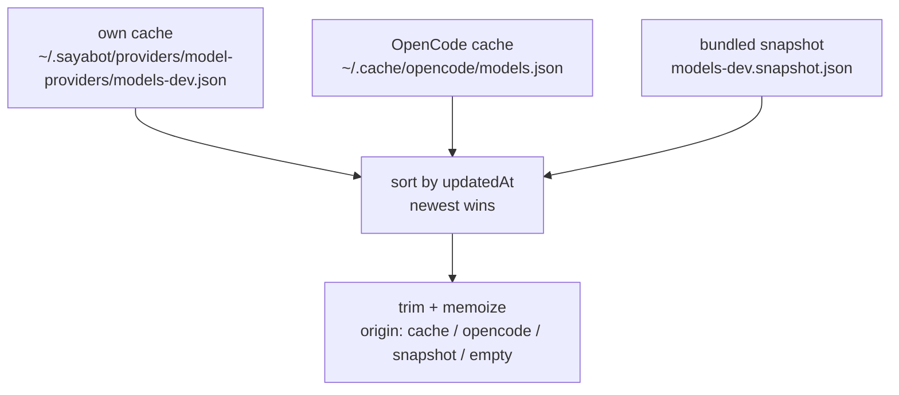

# Provider Registry & Model Catalog Pipeline

`src/registry.ts` turns a provider name plus an API key into an AI SDK `LanguageModel` for the 17 providers Sayabot supports. The `src/models/` directory is the model-discovery side: it answers "which models can this account use, what do they cost, which reasoning-effort levels do they take?" by merging four sources — the models.dev catalog, Sayabot's own engine manifest, live provider `/models` endpoints, and subscription CLIs installed on the host — and is consumed by the model picker in `apps/web/src/lib/model-catalog.ts` and by the run-time effort clamp in the orchestrator.

Everything in `src/models/` is Node-only (it reads files and spawns CLIs); import it via the `@sayabot/llm/models` subpath in server code only.

Source files: `packages/llm/src/registry.ts`, `packages/llm/src/models/index.ts`, `packages/llm/src/models/effort.ts`, `packages/llm/src/models/http.ts`, `packages/llm/src/models/models-dev.ts`, `packages/llm/src/models/manifest.ts`, `packages/llm/src/models/engine-models.ts`, `packages/llm/src/models/provider-models.ts`, `packages/llm/src/models/listing.ts`, `packages/llm/scripts/snapshot-models-dev.ts`

---

## 🏭 The registry (`src/registry.ts`)

### `createLanguageModel`

```typescript
export interface LanguageModelConfig {
  provider: Provider
  apiKey: string
  model: string
  baseUrl?: string | null
}
```

(`packages/llm/src/registry.ts:18-23`.) The factory is a thin switch — the doc comment says every adapter stays thin so a provider breaking change is contained to the switch:

| Provider                                            | Adapter                                     | Default base URL / notes                                                                                                                                                                                |
| :-------------------------------------------------- | :------------------------------------------ | :------------------------------------------------------------------------------------------------------------------------------------------------------------------------------------------------------ |
| `openai`, `anthropic`, `google`, `groq`, `cerebras` | Native AI SDK factory (`registry.ts:35-44`) | Optional `baseUrl` override                                                                                                                                                                             |
| `openrouter`                                        | `createOpenAICompatible`                    | `https://openrouter.ai/api/v1`; sends `HTTP-Referer: https://saaya.ai` and `X-Title: Saaya Bot`                                                                                                         |
| `copilot`                                           | `createOpenAICompatible`                    | `COPILOT_API_BASE`; custom `fetch: copilotFetch(apiKey)` swaps the stored GitHub token for a short-lived Copilot token per call                                                                         |
| `opencode`                                          | `createOpenAICompatible`                    | `https://api.opencode.ai/v1`                                                                                                                                                                            |
| `command-code`                                      | `createOpenAICompatible`                    | `https://api.cohere.com/v2`                                                                                                                                                                             |
| `deepseek`                                          | `createOpenAICompatible`                    | `https://api.deepseek.com/v1`                                                                                                                                                                           |
| `minimax`                                           | `createOpenAICompatible`                    | `https://api.minimaxi.chat/v1`                                                                                                                                                                          |
| `grok`                                              | `createOpenAICompatible`                    | `https://api.x.ai/v1`                                                                                                                                                                                   |
| `kimi`                                              | `createOpenAICompatible`                    | `https://api.moonshot.cn/v1`                                                                                                                                                                            |
| `qwen`                                              | `createOpenAICompatible`                    | `https://dashscope.aliyuncs.com/compatible-mode/v1`                                                                                                                                                     |
| `cursor`                                            | `createOpenAICompatible`                    | `https://api.cursor.com/v1`                                                                                                                                                                             |
| `cloudflare`                                        | `createOpenAICompatible`                    | `CLOUDFLARE_ACCOUNT_ID` + `CLOUDFLARE_AI_GATEWAY_ID` env vars build a gateway URL; account-only falls back to `…/accounts/{id}/ai/v1`; otherwise the public `…/client/v4/ai/v1` (`registry.ts:111-125`) |
| `openai-compatible`                                 | `createOpenAICompatible`                    | **Requires** `baseUrl` or throws `MissingModelConfigError`. If the base URL points at `githubcopilot.com`, it transparently becomes a Copilot client with `copilotFetch` (`registry.ts:126-139`)        |

Any other provider string throws `MissingModelConfigError` (`registry.ts:140-141`). `MissingModelConfigError extends Error` is exported for callers to catch.

### Model resolution paths

Three exported helpers build configs (all read the environment on every call, so an env edit reaches every agent after restart):

- `sayaModelConfig(stored, env, which)` — for stored values like `saya/pro`. Delegates to `readSayaAiConfig()` / `resolveSayaModel()` / `resolveSayaFastModel()` in `packages/core/src/saya-ai.ts`; returns `{ provider, apiKey, baseUrl, model, alias, label }` or `null` when no `SAYA_AI_API_KEY`. `which: "fast"` resolves the background-work model (`registry.ts:150-167`).
- `devModelConfig(env)` — the server's shared model for agents with no key of their own: the current Saya AI default (`registry.ts:170-174`). Legacy `DEV_OPENAI_COMPAT_BASE_URL/API_KEY/MODEL` env vars are honoured as a fallback inside `readSayaAiConfig` (`packages/core/src/saya-ai.ts:99-106`).
- `providerKeyToApiKey(row, kek)` — decrypts a `provider_keys` row (`{ provider, baseUrl, ciphertext, iv, tag }`) with `decryptSecret` ("Only call this in trusted server processes", `registry.ts:184-187`).

Saya AI env vars (parsed in `packages/core/src/saya-ai.ts`): `SAYA_AI_BASE_URL`, `SAYA_AI_API_KEY`, `SAYA_AI_MODELS` (`pro=model-a|Saya Pro,fast=model-b|Saya Fast`), `SAYA_AI_MODEL` (single-model shorthand), `SAYA_AI_DEFAULT`, `SAYA_AI_FAST`, `SAYA_AI_PROTOCOL` (`openai-compatible` | `openai` | `anthropic`), `SAYA_AI_NAME`.

### Provider capabilities

`getProviderCapabilities(provider)` returns a `ProviderCapabilities` row (`registry.ts:189-198, 375-388`): `supportsPromptCache`, `supportsServerCompaction`, `supportsContextEditing`, `supportsEffort`, `supportsMidConversationSystem`, `supportsParallelTools`, `supportsComputerUse`, `defaultContextWindow`. Highlights from the table (`registry.ts:202-373`):

| Provider                                                         | Prompt cache | Context editing | Effort | Computer use |   Default context |
| :--------------------------------------------------------------- | :----------: | :-------------: | :----: | :----------: | ----------------: |
| `anthropic`                                                      |      ✓       |        ✓        |   ✓    |      ✓       |           200,000 |
| `openai`                                                         |      ✓       |        —        |   ✓    |      —       |           128,000 |
| `google`                                                         |      ✓       |        —        |   ✓    |      —       |         1,000,000 |
| `copilot` / `opencode`                                           |      ✓       |      — / ✓      |   ✓    |    — / ✓     | 128,000 / 200,000 |
| `cursor`                                                         |      ✓       |        ✓        |   ✓    |      ✓       |           200,000 |
| `groq`, `cerebras`, `minimax`, `cloudflare`, `openai-compatible` |      —       |        —        |   —    |      —       |  32,000–1,000,000 |

Unknown providers get the conservative fallback at `registry.ts:377-387` (no cache/effort, 32k context).

### `buildProviderOptions`

Translates neutral knobs into AI SDK provider options (`registry.ts:399-436`):

```typescript
// anthropic: cacheControl + thinking budget, budgetTokens per level
const budgetMap = { low: 1024, medium: 2048, high: 4096, xhigh: 6144, max: 8192 }
// effort "none" turns thinking off (omitted entirely)
// openai: reasoningEffort passed through as-is
```

`cacheBreakpoint: true` adds `cacheControl: { type: "ephemeral" }` for Anthropic only. Other providers currently receive no options.

---

## 🪜 Effort levels (`src/models/effort.ts`)

```typescript
export const EFFORT_LEVELS = ["none", "low", "medium", "high", "xhigh", "max"] as const
```

(`packages/llm/src/models/effort.ts:6`.) This is the union of what any engine accepts; "Default" in the picker is the _absence_ of a level. Key exports:

- `EFFORT_LABELS` — display names ("Extra high" for `xhigh`).
- `normalizeEffortLevels(values)` — sorts onto the ladder and drops anything outside it (`"minimal"`, `"ultra"`, `"default"`); de-duplicates (`effort.ts:24-27`).
- `ENGINE_EFFORT_LEVELS` — per-provider default ladder when a model declares none (`effort.ts:33-53`). `claude-code`, `codex` and `anthropic` take `low…max`; `openai` takes `none…xhigh`; `google`, `openrouter`, `copilot`, `groq`, `opencode` take `low…high`; `grok` takes `low, high`; `cursor`, `deepseek`, `kimi`, `qwen`, `cerebras`, `minimax`, `cloudflare`, `command-code`, `openai-compatible` take none (empty list).
- `clampEffort(effort, offered)` — a saved level an engine or model no longer takes is dropped (returns `undefined`) so the provider uses its own default; an unknown provider (no `offered` list) passes the level through (`effort.ts:56-63`).

---

## 🌐 Hardened HTTP (`src/models/http.ts`)

All catalog fetches go through `fetchCapped(url, { headers, timeoutMs, maxBytes, fetch })` (`packages/llm/src/models/http.ts:42-77`):

- Sends `user-agent: Sayabot`; **`redirect: "error"`** — "a redirect must never replay a credential to another address, and a catalog must come from where we meant".
- Aborts via `AbortController` after `timeoutMs` ("did not answer in time").
- Enforces the byte cap twice: on the declared `content-length`, and while streaming the body (`readCapped`, `http.ts:79-96`), throwing `FetchCapError`.
- Returns `{ status, ok, text, etag? }` with the ETag sanitized by `safeEtag` (≤ 256 chars, no control characters) before it is ever echoed back in a request header.

Other helpers: `modelDataDir()` / `providersCacheDir()` — caches live under `SAYABOT_DATA_DIR` (default `~/.sayabot`), in a `providers/` subfolder so backups can skip it; `safeCredentialUrl(url)` — HTTPS, or plain HTTP only to `localhost`/`127.0.0.1`/`::1` ("Credentials go out only over HTTPS, or over plain HTTP to this computer", `http.ts:102-113`); `errorText()`.

---

## 📚 The models.dev catalog (`src/models/models-dev.ts`)

The [models.dev](https://models.dev) catalog (MIT) supplies context windows, list prices, tool support, release dates and per-model effort levels for every provider. Constants (`models-dev.ts:25-31`): `MODELS_DEV_URL = "https://models.dev/api.json"`, `CATALOG_MAX_AGE_MS` = 24 h, `CATALOG_FETCH_TIMEOUT_MS` = 10 s, `CATALOG_MAX_BYTES` = 20 MB, `CATALOG_DISABLE_ENV = "SAYABOT_DISABLE_MODEL_CATALOG_FETCH"` (`"1"` disables fetching), schema `sayabot.models-dev.v2`.

### Trim + validation

`trimModelsDevCatalog(raw, { onDrop, only })` (`models-dev.ts:152-183`) keeps only well-formed providers and models, producing `CatalogProvider { id, name, env?, api?, doc?, models }` and `CatalogModel { id, name, reasoning?, tool_call?, effort?, limit?, cost?, release_date?, family? }` (`models-dev.ts:34-59`). Rules:

- Ids must match `/^[\w.:/@+-]{1,160}$/`; text fields (names, api, doc) are dropped if they contain `{` or `}` — a hardening rule against template-injection-style strings.
- `effort` comes from models.dev's `reasoning_options` (type `effort`) and is normalized onto the ladder — e.g. `"ultra"` is dropped.
- Costs are kept for `input`, `output`, `cache_read`, `cache_write` in US dollars per million tokens.
- Trimming is idempotent (pinned by a test).

### `ModelCatalogStore`

The newest usable catalog wins, never throwing and never waiting on the network (`get()` at `models-dev.ts:254-273`):



- Cache documents must carry `schema: "sayabot.models-dev.v2"` and a parseable `updatedAt`; an unreadable cache is logged and deleted (`models-dev.ts:284-304`).
- `refresh({ force })` skips while the cache is under a day old; concurrent callers share one in-flight promise (`refresh` at `models-dev.ts:276-282`). It sends `if-none-match` with the stored ETag: a `304` rewrites the cache with a fresh `updatedAt` and returns `"not-modified"`; a `200` trims, writes atomically (`writeJsonAtomic` = temp file + `renameSync`), logs stats and returns `"updated"`; any failure logs and returns `"failed"` while keeping the current catalog.
- The process-wide singleton is `modelCatalog()` (`models-dev.ts:416-421`).
- Sayabot provider ids map to models.dev ids via `MODELS_DEV_PROVIDER` (`models-dev.ts:75-93`): e.g. `copilot → github-copilot`, `grok → xai`, `kimi → moonshotai`, `qwen → alibaba`, `cloudflare → cloudflare-workers-ai`, `command-code → cohere`, `claude-code → anthropic`, `codex → openai`.

### Lookup and pricing

- `modelKey(id)` strips a `-20251001` release-date suffix and a `[1m]` (1M-context) suffix, lowercases — the way Claude Code matches names (`models-dev.ts:424-430`).
- `findCatalogModel(catalog, provider, modelId)` (`models-dev.ts:437-477`) tries, in order: the provider's own models.dev entry (exact id, then keyed); a `vendor/bare` id against the vendor's own entry; finally a fixed list of first-party vendor entries (`anthropic`, `openai`, `google`, `xai`, `deepseek`, `moonshotai`, `alibaba`) — "a first-party vendor entry beats a reseller's copy".
- `catalogPrice(model)` → `ListPrice { inputPerMillion, outputPerMillion, cachedInputPerMillion?, cacheWritePerMillion? }` or `null` (`models-dev.ts:486-495`).

### Snapshot pipeline (`scripts/snapshot-models-dev.ts`)

The bundled snapshot is only the fallback for a server that has never reached models.dev. `pnpm --filter @sayabot/llm catalog:snapshot` fetches `MODELS_DEV_URL`, trims to only the providers Sayabot maps to (`Object.values(MODELS_DEV_PROVIDER)` plus `"ollama-cloud"` and `"mistral"`), and rewrites `src/models/models-dev.snapshot.json` with schema `sayabot.models-dev.v2` and a `source: { name: "models.dev", license: "MIT" }` block (`scripts/snapshot-models-dev.ts:19-32`).

---

## 📋 Sayabot's engine manifest (`src/models/manifest.ts`)

Sayabot's own hand-maintained list for the subscription engines — `MANIFEST_ENGINES = ["claude-code", "codex", "cursor"]` (`manifest.ts:31`) — with each model's `status` (`current`/`legacy`), optional `contextWindow`, `minCliVersion` floor and `aliases`. Claude Code has no "list models" command users can call generically, so this file is where its picker comes from; list prices here win over models.dev.

- **Distribution**: `MODEL_MANIFEST_URL` points at `model-manifest.json` on GitHub `main` (override with `SAYABOT_MODEL_MANIFEST_URL`; disable fetch with `SAYABOT_DISABLE_MODEL_MANIFEST_FETCH=1`). The bundled copy is parsed at import time into `BUNDLED_MODEL_MANIFEST`; a fetched copy older than the bundled one is ignored, so a release can correct a model before the next fetch (`manifest.ts:256`).
- **Validation**: a strict Zod schema (`manifestSchema`, `manifest.ts:127-143`) — per-engine model-id regexes (Claude Code allows an optional `[1m]` suffix), semver `minCliVersion`, unique ids/aliases, the `default` must be a `current` model, `updatedAt` may be at most 24 h in the future (clock-rollback tolerance), price entries need an `asOf` date, an `https://` source, and `changes` in date order.
- **`ModelManifestStore`** (`manifest.ts:184-310`): `current()` reads the disk cache (`~/.sayabot/providers/model-manifest/model-manifest.json`) once; `refresh()` fetches hourly (`MANIFEST_TTL_MS` = 1 h) with a 5-minute back-off after failures (`MANIFEST_RETRY_MS`); `refreshOnDemand()` uses the 5-minute TTL (`MANIFEST_ON_DEMAND_TTL_MS`, because GitHub's raw CDN caches about that long anyway). A fetched manifest with an older `updatedAt` loses to the current one, so a stale CDN copy cannot resurrect a removed model. Never throws.
- **Pricing**: `manifestPrice(model, manifest?, at?)` resolves a model (or one of its aliases) to a `ListPrice` as of a given day, applying the last `changes[]` entry with `from <= day` (`manifest.ts:339-369`).
- **Versions**: `parseVersionTriple("claude 2.1.321 (Claude Code)")` → `[2,1,321]`; `versionAtLeast` compares triples (`manifest.ts:319-336`).

---

## 🖥️ Engine catalogs (`src/models/engine-models.ts`)

The models each subscription engine offers the _signed-in account on this computer_. `EngineCatalog { default, options, source: "live"|"cache"|"manifest", checkedAt, effortLevels, cliVersion? }` (`engine-models.ts:54-63`); `EngineModel` rows carry `custom?`, `contextWindow?`, `effort?`, `defaultEffort?`, `orgBlocked?`, `needsCliUpdate?`, `price?`.

### Binary discovery

`findEngineBinary(engine, env)` looks up `claude`, `codex` or `cursor-agent` (override env vars `SAYABOT_CLAUDE_PATH`, `SAYABOT_CODEX_PATH`, `SAYABOT_CURSOR_PATH`, `engine-models.ts:94-98`) across `PATH`, `COMMON_BIN_DIRS` (homebrew, `/usr/local/bin`, `~/.local/bin`, `~/.bun/bin`, `~/.npm-global/bin`, `~/.claude/local`, `~/.volta/bin`) and the newest `~/.nvm/versions/node` — because apps started from the Dock get a bare PATH. `engineVersion(binary)` runs `--version` (4 s timeout) and extracts the semver.

### Claude Code

`claudeModelCatalog()` (`engine-models.ts:281-302`) order: 6-hour disk cache (`~/.sayabot/providers/engine-models/claude-code.json`, invalidated when the CLI version changes) → live CLI → cache (even stale) → manifest.

- **Live**: `fetchClaudeModelRows(binary)` (`engine-models.ts:397-474`) spawns `claude -p --input-format stream-json --output-format stream-json --verbose --setting-sources user --strict-mcp-config --mcp-config '{"mcpServers":{}}'` in `tmpdir()`, sends only the `initialize` control request, and reads the `models` array from the matching `control_response`. No prompt is sent, so no model runs and nothing is spent; project hooks never run; the account email/org in the answer is dropped. 15 s timeout, 4 MB stdout cap, resolves `null` on any failure.
- **`claudeCatalogFromRows`** (`engine-models.ts:338-389`): the `value: "default"` row only names the default model; aliases (`opus`, `sonnet`) collapse into the model they resolve to so a saved agent keeps its model when the alias moves; ids failing `CLAUDE_MODEL_ID` are dropped; `supportsEffort` + `supportedEffortLevels` become the per-model effort list; manifest models the installed CLI is too old for are appended with `needsCliUpdate`.
- **Org blocks**: `claudeOrgBlocks()` reads `modelAccessCache` from `~/.claude.json` (or `$CLAUDE_CONFIG_DIR/.config.json`), keeping only entries with an explicit `entitled: false` — fail-open (`parseOrgBlockedModels`, `engine-models.ts:232-246`). Skipped entirely when a cloud backend env var (`CLAUDE_CODE_USE_BEDROCK`, `…FOUNDRY`, `…VERTEX`, …) is set (`engine-models.ts:249-255`). A blocked or too-new default gives way to the first usable model (`withUsableDefault`, `engine-models.ts:274-279`).

### Codex

`codexModelCatalog()` (`engine-models.ts:649-669`) order: 6-hour cache → live CLI → Codex's own `~/.codex/models_cache.json` (or `$CODEX_HOME`) → manifest. **Live**: `fetchCodexModelRows` spawns `codex app-server`, speaks JSON-RPC (`initialize` → `initialized` → paged `model/list` with cursor dedupe, ≤ 20 pages), returning rows with `hidden`, `isDefault`, `supportedReasoningEfforts`, `defaultReasoningEffort`. `codexCatalogFromRows` (`engine-models.ts:498-548`) hides `hidden` rows, marks any id containing `/` as a `custom` provider model, sorts official models first, and normalizes effort rows (`{ reasoningEffort }` objects or strings).

### Cursor

`cursorModelCatalog()` is manifest-only, tagged with the installed CLI version so `minCliVersion` floors can mark `needsCliUpdate`.

### Entry points and pricing

`engineModelCatalog(engine, { force })` (`engine-models.ts:671-679`) refreshes the manifest (on-demand TTL, or forced) then dispatches per engine. `listPriceFor(provider, model, manifest?)` = manifest price first, then models.dev (`engine-models.ts:177-186`). `engineCatalogFromManifest(engine, version)` is exported for the web app to render a manifest-backed catalog for a CLI it cannot run (one on someone else's Mac).

---

## 🔌 Live provider model lists (`src/models/provider-models.ts`)

For a saved API key, Sayabot reads `GET {base}/models` live from the provider and enriches each row from models.dev.

- URLs: `PROVIDER_BASE_URL` maps 13 providers to their default REST bases (`provider-models.ts:40-54`); `providerModelsUrl()` appends `/models` (Anthropic gets `/v1/models` handling). Returns `null` for providers with no address (e.g. `openai-compatible` without a base URL).
- Auth headers per provider (`headersFor`, `provider-models.ts:74-81`): `x-api-key` + `anthropic-version: 2023-06-01` for Anthropic, `x-goog-api-key` for Google, `Bearer` elsewhere, and Copilot goes through `copilotSessionToken()` first.
- Security: a key is sent **only** over `safeCredentialUrl` (HTTPS or localhost); otherwise the list falls back to the catalog with error "Sayabot reads a model list only over HTTPS or from this computer…". OpenRouter's list is public and needs no key. Fetches are `fetchCapped` with 10 s timeout, 8 MB cap, `MAX_MODELS = 1000` rows.
- **`toProviderModel`** (`provider-models.ts:118-164`): normalizes `models/` prefixes off Google ids, resolves labels (`display_name`/`displayName`/OpenRouter `name`/models.dev name), detects free OpenRouter rows (`:free` suffix or zero pricing → `free: true`, label suffixed " (free)"), maps `supported_parameters` (`reasoning`, `reasoning_effort`, `tools`) or models.dev flags, and prices: OpenRouter's own per-token pricing wins, then manifest, then catalog.
- **OpenRouter free tier**: `openRouterFreeTier(key)` queries `https://openrouter.ai/api/v1/key` for `is_free_tier`, caching by the SHA-256 of the key (never the key itself, `provider-models.ts:186-211`). On a free-tier key, free tool-capable models are listed first in `OPENROUTER_FREE_PREFERENCE` order (a paid model answers HTTP 402 on such a key).
- **Caching**: `listProviderModels({ provider, apiKey, baseUrl, cacheKey, force, fetch })` caches per `cacheKey` (the saved key's row id — never the key) for `LIST_TTL_MS` = 10 minutes, and degrades to `catalogProviderModels(provider)` (models.dev's list) with `source: "catalog"` plus a human-readable `error` on any failure: 401/403 → "The provider refused this key", non-JSON → "The provider sent a model list that is not JSON", etc. `clearProviderModelCache()` resets it.
- **`modelEffortLevels(provider, model)`** (`provider-models.ts:319-327`): the run-time clamp source — models.dev's per-model list, else the provider ladder for a reasoning model, else `undefined` (an unknown model gets its saved level untouched).

---

## 🏷️ Picker listings (`src/models/listing.ts`)

`modelListings(provider, models, { inUse, now, catalog })` decides which models a picker leads with, **derived from release dates instead of a hand-kept list** (`listing.ts:84-184`). Returns `Map<id, { listing?: "new" | "older", releaseDate? }>`:

- Constants: `LISTING_SHORT_LIST = 5` (short lists show everything), `LISTING_NEWEST_FAMILIES = 12`, `LISTING_FAMILIES_PER_SERVICE = 4`, `LISTING_FAMILY_AGE_LIMIT_MS` = 120 days, `LISTING_NEW_MS` = 7 days.
- `new`: released within the last week (and leading). `older`: a newer model of the same `family`, or a newer family of the same service, exists — folded under "Older models", one click away, never hidden.
- Models an agent is currently using (`inUse`) are never folded.
- A newer version models.dev has not dated yet (e.g. `claude-opus-6` next to `claude-opus-5-5`) leads its family instead of being folded, dated one day after the newest dated sibling (`listing.ts:108-131`) — because models.dev adds a release some days after providers list it.
- On a long multi-service list (a gateway like OpenRouter), the newest families are shared out fairly per service so one reseller with hundreds of models cannot push out the rest (pinned by the "shares a long list fairly" test).
- `PSEUDO_IDS = {"", "default", "auto"}` never get listings; undated models without a same-shape dated sibling stay plain rows.

---

## 🧪 Test coverage

`src/models/models.test.ts` (with `SAYABOT_DATA_DIR` pointed at a temp dir and manifest fetch disabled):

| Suite                | Pins                                                                                                                                                                                                                                                                                                                                                    |
| :------------------- | :------------------------------------------------------------------------------------------------------------------------------------------------------------------------------------------------------------------------------------------------------------------------------------------------------------------------------------------------------ |
| `effort`             | `normalizeEffortLevels` drops `"minimal"`/`"ultra"` and de-dupes; `clampEffort("xhigh", ["low","high"])` → `undefined`, `clampEffort("bogus", undefined)` → `undefined`                                                                                                                                                                                 |
| `models.dev catalog` | Trimming drops the `bad{model}` and the non-record provider (2 drops) and is idempotent; `findCatalogModel` resolves by provider, by dated id with a release suffix, and via `openrouter` + `anthropic/claude-sonnet-5-5`; download → ETag'd `304` re-refresh (`if-none-match: "v1"`, `redirect: "error"`); on network failure the snapshot origin wins |
| `model manifest`     | The bundled manifest is valid and prices its models; a non-current `default` or future `updatedAt` is rejected; dated price `changes` apply by day; `versionAtLeast` semantics                                                                                                                                                                          |
| `engine catalogs`    | Codex rows: `isDefault`, per-model effort (`ultra` dropped), `custom` last; Claude rows: alias collapse, `default` resolution, `[1m]` variant, bad ids (`rm -rf /`, `42`) dropped, `needsCliUpdate` for old CLIs, `null` for a list with no usable model; `parseOrgBlockedModels` fail-open                                                             |
| `plan usage`         | See [plan-usage.md](./plan-usage.md)                                                                                                                                                                                                                                                                                                                    |
| `provider models`    | `providerModelsUrl` per provider (`openai-compatible` → `null`); OpenRouter free rows priced 0 and labelled "(free)", paid `"0.000003"` → `$3/M`; live list then 401 → catalog fallback with "The provider refused this key"; plain-HTTP base URL → fetch never called                                                                                  |

`src/models/listing.test.ts` pins short-list behaviour, folding, `inUse` protection, undated-newer-version leading, the fair-share split for gateway services, and that `release_date`/`family` survive trimming only when well-formed.

`src/registry.test.ts` pins: native adapters for the five native providers; `MissingModelConfigError` for `openai-compatible` without a base URL; the cloudflare model; `devModelConfig` returning `null` unless the (legacy) vars are present and its exact config shape; capability values for Anthropic/OpenAI; `buildProviderOptions` producing `{ cacheControl, thinking: { budgetTokens: 4096 } }` for Anthropic `high` and `{ reasoningEffort: "medium" }` for OpenAI; and `sayaModelConfig` alias resolution, fast alias, and `null` without a key.

---

## ⚙️ Environment & maintenance summary

| Variable                                                                           | Effect                                                         |
| :--------------------------------------------------------------------------------- | :------------------------------------------------------------- |
| `SAYABOT_DATA_DIR`                                                                 | Cache root (default `~/.sayabot`); catalogs under `providers/` |
| `SAYABOT_DISABLE_MODEL_CATALOG_FETCH=1` / `SAYABOT_DISABLE_MODEL_MANIFEST_FETCH=1` | Disable network refresh of each store                          |
| `SAYABOT_MODEL_MANIFEST_URL`                                                       | Manifest source (defaults to GitHub `main`)                    |
| `SAYABOT_CLAUDE_PATH` / `SAYABOT_CODEX_PATH` / `SAYABOT_CURSOR_PATH`               | Explicit CLI binary paths                                      |
| `CLAUDE_CONFIG_DIR` / `CODEX_HOME`                                                 | Where Claude/Codex credentials and caches are read from        |
| `CLOUDFLARE_ACCOUNT_ID` / `CLOUDFLARE_AI_GATEWAY_ID`                               | Build the Cloudflare Workers AI base URL                       |

Maintenance commands: `pnpm --filter @sayabot/llm catalog:snapshot` (rewrite the bundled snapshot); edit `src/models/model-manifest.json`, bump `updatedAt`, merge to `main` for a new Claude/Codex/Cursor model or price change (running servers pick it up within an hour).

---

## Related docs

- [plan-usage.md](./plan-usage.md) — subscription usage windows behind the picker
- [crypto.md](./crypto.md) — how `provider_keys` envelopes are decrypted
- [copilot-and-local-apps.md](./copilot-and-local-apps.md) — the Copilot `fetch` used by the `copilot` provider
- [overview.md](./overview.md) — package map and consumers
- [../../models-and-pricing.md](../../models-and-pricing.md) — user-facing guide to the same pipeline
