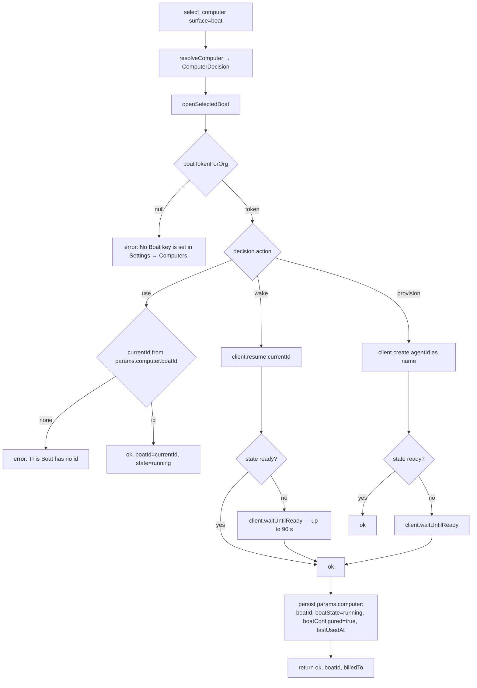

# Boat — the Managed boat.dev Desktop

"Boat" is Sayabot's name for a Linux desktop hosted by the [boat.dev](https://boat.dev) service and attached to an agent as one of its computer surfaces. The module header states the concept exactly (`boat.ts:1-4`): *"boat.dev is a Linux desktop the agent can see and click. The agent process stays on the Mac or the Cloud home."* The Boat is therefore a **managed, remote desktop the agent's tools drive over a REST API** — not a container the orchestrator runs, and not a different model. Four files implement it: a typed API client, the decision applier that turns a `select_computer` decision into create/wake calls, the shell layer that builds commands and screen captures on the desktop, and the credential resolver that picks between the org's own Boat key and a Cloud-included relay token.

Source files: `apps/orchestrator/src/computers/boat.ts`, `apps/orchestrator/src/computers/apply-boat.ts`, `apps/orchestrator/src/computers/boat-shell.ts`, `apps/orchestrator/src/computers/open-boat.ts`

---

## 🛶 What Boat actually is

| Property | Value |
| :--- | :--- |
| Provider | boat.dev cloud desktops, REST API at `https://boat.dev/api/v1` (override: `SAYABOT_BOAT_API`) |
| Unit of placement | a "sandbox" — `{ id, name, state }` (`boat.ts:11-15`) |
| Ready states | `idle`, `ready`, `running` (`BOAT_READY_STATES`, `boat.ts:9`); `archived` sandboxes are resumed, provisioning states are not ready |
| Auth | Bearer token per request (`boat.ts:34-39`) |
| Files | live in `/home/user` and `/tmp` on the Boat — **not** `/home/bot`, which is the local-VM home (`packages/core/src/computers.ts:58`) |
| Sleep | stops after 10 idle minutes; files persist and the desktop wakes with them (`BOAT_IDLE_MS`, `packages/core/src/computers.ts:217`) |
| Billing source | `own` (the org's key) or `included` (the Cloud plan relay token) — returned as `billedTo` on every call |

Because the agent process keeps running on the Mac or Cloud home, every Boat interaction is a thin remote-procedure call: shell commands, screen frames, and file writes are POSTed to boat.dev, and results come back in the response. The surface never takes the Mac's screen — `macScreenAllowed` returns false for `boat` (`packages/core/src/computers.ts:44-48`).

What the agent itself is told about the surface comes from `desktopGuidance` (`packages/core/src/computers.ts:51-61`), quoted here because it is the behavioural contract the tools implement:

> "A Boat sleeps after 10 idle minutes and wakes with its files. Those files live in /home/user and /tmp, not /home/bot. computer_screenshot sees that desktop and computer_click presses it. computer_shell with background true keeps it awake for up to two hours."

The desktop's own lifecycle states, as the client models them (`boat.ts:8-9`, `boat.ts:74-86`):

| State | Meaning | Client behaviour |
| :--- | :--- | :--- |
| `idle` / `ready` / `running` | Can take a command (`BOAT_READY_STATES`) | `waitUntilReady` returns immediately |
| `archived` | Boat stopped itself; files intact | `waitUntilReady` calls `resume()` and keeps polling |
| other (provisioning states) | Being created | Polled every `pauseMs` (2 s) until the 90 s budget expires |

Environment-wise the integration uses three variables, resolved per call rather than at startup:

| Env var | Role |
| :--- | :--- |
| `SAYABOT_BOAT_API` | API base override, else `https://boat.dev/api/v1` |
| `SAYABOT_BOAT_TOKEN` | Cloud plan relay token, used only when the org has no own key |
| `MESH_KEK` | Decrypts the org's sealed Boat key from `org_computer_settings` |

## 🔌 `BoatClient` (`boat.ts`)

A small REST wrapper. Constructor options: `{ token, api?, fetch? }` — `api` defaults to `BOAT_API_DEFAULT = "https://boat.dev/api/v1"` with trailing slashes stripped, and `fetch` is injectable for tests (`boat.ts:17-32`). All requests set `authorization: Bearer <token>` and a JSON content-type when a body is present (`boat.ts:34-39`); non-2xx responses throw `Boat <status> <path>: <first 200 chars of body>` (`boat.ts:41-48`).

Boat v1 answers `{ sandbox: { id, state, ... } }`; the private `sandbox()` helper (`boat.ts:50-55`) accepts a flat body too, requires an `id`, and normalises missing `name`/`state` to empty strings.

| Method | Endpoint | Behaviour |
| :--- | :--- | :--- |
| `create(name)` | `POST /sandboxes` with `{ name, noEnv: true }` (`boat.ts:57-64`) | Provisions a new desktop. `noEnv: true` means the desktop does not inherit provider environment. |
| `get(id)` | `GET /sandboxes/:id` (`boat.ts:66-68`) | Current sandbox record including `state`. |
| `waitUntilReady(id, { budgetMs = 90_000, pauseMs = 2_000 })` | polling loop of `get` (`boat.ts:74-86`) | Returns as soon as the state is in `BOAT_READY_STATES`; an `archived` sandbox triggers `resume(id)` mid-loop; the poll pause shrinks near the deadline; on timeout throws `` `The Boat is ${state}` `` (or "did not become ready"). |
| `resume(id)` | `POST /sandboxes/:id/resume` (`boat.ts:88-94`) | Wakes an archived desktop. |
| `stop(id)` | `POST /sandboxes/:id/stop` (`boat.ts:96-98`) | Puts the desktop to sleep (used by the idle sleep scan, not by decision apply). |
| `command(id, command, detached = false)` | `POST /sandboxes/:id/commands` with `{ command, detached }` (`boat.ts:100-107`) | Foreground commands wait and return `{ exitCode, output }`; `detached` returns at once with a `pid` and no exit code. `output` falls back to `stdout` when the API uses that field. |
| `artifact(id, filePath)` | `GET /sandboxes/:id/artifacts?path=…` (`boat.ts:109-118`) | Returns `{ contentType, base64 }` of a file from the desktop, capped at 8 MB; empty bodies and non-2xx become `null`. The doc comment is explicit: *"Bytes stay on this request and are not a shell command"* — file reads never pass through the shell. |

## 🔑 Credentials — `boatTokenForOrg` (`open-boat.ts:11-30`)

```typescript
return boatCredential(own, process.env.SAYABOT_BOAT_TOKEN)
```

Resolution order (from `boatCredential`, `packages/core/src/computers.ts:91-100`): the **person's own Boat key wins**; the Cloud relay token (`SAYABOT_BOAT_TOKEN`) is used only when they have none; neither → `null`, and every caller then fails with `"No Boat key is set in Settings → Computers."`

The org key is stored sealed in `org_computer_settings` (`boatCiphertext`/`boatIv`/`boatTag`, `packages/db/src/schema/computer-settings.ts:8-21`) as AES-256-GCM envelope ciphertext and decrypted with `MESH_KEK` here (`open-boat.ts:22-28`); a decryption failure degrades to `own = null` rather than throwing. `SAYABOT_BOAT_TOKEN` is the Cloud plan's shared relay token, labelled `source: "included"`; callers surface that as `billedTo` so the UI can show whose key paid for the call.

## 🚀 Opening a Boat — the decision lifecycle

`openSelectedBoat` (`open-boat.ts:36-68`) is the apply callback behind `select_computer` (documented in [../tools/tool-computer.md](../tools/tool-computer.md)); `applyBoatDecision` (`apply-boat.ts`) is the state machine it drives:



Details worth noting:

- **`applyBoatDecision` never stops a Boat** (`apply-boat.ts:4` — *"Does not stop it"*). `use` just re-attaches to the already-running desktop; any other action falls through to `"This Boat is already running"`. A `decision.surface` other than `"boat"` is refused with `"Not a Boat"`.
- **Provisioning names the sandbox after the agent id** (`open-boat.ts:53` passes `input.agentId` as `name`), and both `wake` and `provision` tolerate the created/resumed sandbox already being in a ready state, skipping the poll.
- **Persistence** (`open-boat.ts:56-66`): on success the agent row's `params` JSON is rewritten with `computer: { ...computer, boatId, boatState: "running", boatConfigured: true, lastUsedAt: <now> }`. This is what `availabilityFromParams` reads on the next turn, and what the sleep scan inspects (see below). `rememberSelectedDesktop` (`packages/core/src/computers.ts:188-214`) additionally makes the wake visible to the very next tool call within the same turn.

The persisted placement state after a successful open therefore looks like:

```json
{
  "computer": {
    "boatId": "box-9f2…",
    "boatState": "running",
    "boatConfigured": true,
    "lastUsedAt": "2026-11-15T09:12:44.120Z",
    "backgroundStartedAt": "2026-11-15T09:14:02.003Z"
  }
}
```

`backgroundStartedAt` appears only after a detached command (`boatActivity`, `boat-shell.ts:112-122`), and `watching` is set elsewhere (screen-viewing sessions) — all three optional fields feed the sleep decision in [./vps-and-client.md](./vps-and-client.md).
- All boat.dev errors are caught and returned as `{ ok: false, error }` strings, never thrown into the tool loop.

## 🐚 Shell access — `boat-shell.ts`

Every command that reaches the desktop is built by a pure function that treats untrusted text as data: paths are single-quoted with a `'\''` escape helper (`shellQuote`, `boat-shell.ts:8-10`), numbers are validated as integers so they cannot alter the command, and file content travels as base64. Each builder returns `null` (or an `{ error }`) for invalid input, which the computer tools surface as a failure instead of a malformed command.

| Builder | Command produced | Guards |
| :--- | :--- | :--- |
| `boatReadCommand(path, startLine?, endLine?)` (`boat-shell.ts:13-19`) | `sed -n FROM,TOp '<path>'` | absolute path, no `\n`/`\0`, window ≤ 1999 lines; `endLine` defaults to `startLine ? startLine : from + 1999` |
| `boatCatCommand(path)` (`boat-shell.ts:52-55`) | `cat '<path>'` | absolute path, no `\n`/`\0` |
| `boatListCommand(path = "/home/bot", depth = 1)` (`boat-shell.ts:44-49`) | `ls -1 '<path>'` or `find '<path>' -mindepth 1 -maxdepth N` | depth integer in [1, 3] |
| `boatWriteCommand(path, content)` (`boat-shell.ts:81-85`) | `printf %s '<base64>' \| base64 -d > '<path>'` | content base64-encoded, so *"the file text is not a shell command"*; no `\0` allowed |
| `boatClickCommand(x, y, button = "left", count = 1)` (`boat-shell.ts:35-41`) | `xdotool mousemove --sync X Y click --repeat N --delay 100 CODE` | coordinates integers in [0, 32767]; button mapped `left→1, middle→2, right→3`; repeat 1–3 |
| `panelShotCommand()` (`boat-shell.ts:21-32`) | exports `DISPLAY=${DISPLAY:-:0}`, removes the old frame, then `scrot -o -p -q 85` → `import -window root` → `ffmpeg x11grab` fallbacks into `/tmp/sayabot-screen.jpg`, echoing `captured` only if the file exists | pointer included (`-draw_mouse 1`); the frame is fetched later via `artifact()`, never through the shell |

On top of the builders:

- `planBoatEdit(path, content, { oldString, newString, replaceAll?, expectedHash? })` (`boat-shell.ts:61-78`) — plans an exact edit *before* touching the Boat: content capped at 5 MB; an `expectedHash` that does not match the current file refuses the write ("The file changed since it was read."); a missing match refuses; a repeated match refuses unless `replaceAll`; the produced write command plus the SHA-256 of the new content come back so callers can chain hash-guarded edits.
- `numberBoatLines(text, startLine = 1)` (`boat-shell.ts:88-92`) — renders `N | line` so Boat file pages look exactly like local `fs_read` output.
- `boatCommandOk({ exitCode })` (`boat-shell.ts:95-97`) — a finished command with a non-zero exit failed; a detached start has no exit code yet and counts as OK.

### `runBoatShell` (`boat-shell.ts:128-156`)

The single execution path used by `computer_shell` on the Boat surface:

1. Reads `params.computer.boatId`; without one it returns `{ ok: false, error: "Call select_computer with boat first." }` — the desktop is never guessed.
2. `boatTokenForOrg(orgId)`; without a key: `"No Boat key is set in Settings → Computers."`
3. `new BoatClient({ token, api: process.env.SAYABOT_BOAT_API || undefined }).command(boatId, command, detached)`.
4. **Keep-awake bookkeeping** — `rememberBoatUse`/`boatActivity` (`boat-shell.ts:103-122`) stamp `lastUsedAt = now` onto `params.computer`, and when `detached` is true also `backgroundStartedAt = now`. The updated `params` are persisted on the agent row (`boat-shell.ts:148-155`). These are exactly the fields `boatShouldSleep` consumes: a foreground command refreshes the 10-minute idle window, and a background start holds the desktop awake for up to two hours (`BOAT_BACKGROUND_MAX_MS`, `packages/core/src/computers.ts:221`).
5. Returns `{ ok: boatCommandOk(result), ...result, background: detached, billedTo: cred.source }`.

### `captureBoatScreen` (`boat-shell.ts:159-182`)

Runs `panelShotCommand()` foreground (a sleeping Boat is *not* woken — *"the caller only uses a desktop that is already running"*), requires the `captured` marker in the output, then fetches `/tmp/sayabot-screen.jpg` through `BoatClient.artifact` and returns `{ ok: true, mimeType, image: <base64> }`. Missing frame or credentials degrade to `{ ok: false, error: "The Boat frame could not be read." }`.

## 😴 Sleep integration (summary)

The Boat lifecycle on the orchestrator side ends with the idle sleep scan: `sleepIdleBoats` in [./vps-and-client.md](./vps-and-client.md) stops Boats whose `lastUsedAt` is older than 10 minutes (unless a routine runs within ±30 minutes, a background command is inside its 2-hour window, or someone is `watching`), and marks the agent's `params.computer.boatState` as `"sleeping"` — files stay on Boat and `applyBoatDecision(action: "wake")` resumes them. A VPS is never passed to that scan.

## 🧪 Tests

- `apps/orchestrator/src/computers/boat.test.ts` — `BoatClient` end-to-end against a stub `fetch`: create → resume → command flow, nested `{ sandbox: { … } }` response handling, artifact bytes fetched without a shell command, and `waitUntilReady` polling through provisioning plus auto-resume of an archived desktop (`boat.test.ts:32-110`).
- `apps/orchestrator/src/computers/apply-boat.test.ts` — `applyBoatDecision` resumes a sleeping Boat and creates one that does not exist yet (`apply-boat.test.ts:30-50`).
- `apps/orchestrator/src/computers/boat-shell.test.ts` — quoting/line-window behaviour of `boatReadCommand`, `planBoatEdit` refusal cases (missing match, ambiguous repeat) and success hashing, plus `runBoatShell` marking a background command and sending it detached (`boat-shell.test.ts:13-79`).

Related docs: [../tools/tool-computer.md](../tools/tool-computer.md) · [./vps-and-client.md](./vps-and-client.md) · [../tools/approvals.md](../tools/approvals.md) · [../../core/engine-and-computers.md](../../core/engine-and-computers.md) · [../../tools-and-sandboxes.md](../../../tools-and-sandboxes.md)
