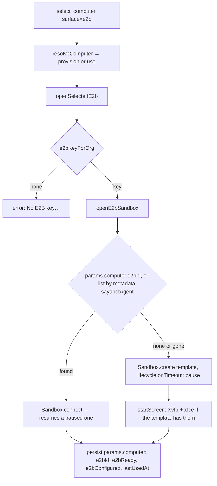

# E2B — a Cloud Sandbox per Bot

E2B ([e2b.dev](https://e2b.dev)) is the third cloud desktop a bot can work on, beside a Boat and the person's own VPS. The agent process keeps running on the Mac or the Cloud home; its shell, files, screenshots and clicks go to one persistent E2B sandbox that belongs to that bot. E2B pauses the sandbox after the idle timeout (memory and disk kept) and connecting resumes it, so Sayabot has no sleep scan for E2B. This is separate from the computerd `e2b` backend (a whole computerd host on E2B, `apps/computerd/src/backends/e2b.ts`) and from `code_sandbox`'s throwaway E2B runs.

Source files: `apps/orchestrator/src/computers/e2b.ts`, `apps/orchestrator/src/tools/builtins/computer.ts`, `apps/orchestrator/src/tools/index.ts`

---

## Setup and credentials

- The admin pastes an E2B key (`e2b_…`) in Settings → AI providers → Computers and browser. It is sealed into `org_computer_settings.e2b_ciphertext/iv/tag` with `MESH_KEK` and only `e2b_last4` is shown again ([../../database/schema-computers-devices-desktop.md](../../database/schema-computers-devices-desktop.md)).
- `e2bKeyForOrg(orgId)` decrypts it; through `boatCredential(own, process.env.E2B_API_KEY)` the workspace's own key wins and the server's `E2B_API_KEY` is the fallback (`source: "included"`). Neither → _"No E2B key is set in Settings → AI providers."_
- `buildTools` marks `available.e2bConfigured` when either key exists. A person picks it per bot under Works on → Cloud desktop → E2B (`params.worksOn = "e2b"`), which also turns on the bot's `computer` capability.

| Env var                | Role                                                                                |
| :--------------------- | :---------------------------------------------------------------------------------- |
| `E2B_API_KEY`          | Server-wide fallback key, used only when the workspace has none                     |
| `SAYABOT_E2B_TEMPLATE` | Template for new sandboxes; default `desktop` (E2B's public template with a screen) |
| `MESH_KEK`             | Opens the sealed workspace key                                                      |

## Lifecycle

- Sandboxes are tagged `metadata: { sayabotApp: "orchestrator", sayabotAgent: <agentId>, sayabotOrg: <orgId> }`, so a bot finds its own sandbox again even if the stored id is lost.
- `timeoutMs` is `E2B_IDLE_MS` (10 minutes). Every connect pushes it out again; a background command raises it to two hours with `setTimeout`.
- A killed or expired sandbox makes `connect` fail; `openE2bSandbox` then creates a new one.
- Changing or removing the workspace key clears `e2bId`/`e2bReady` on every bot in the workspace (`forgetReadyDesktops` in the web action), since sandboxes belong to the old key's team.

## Running commands — `runE2bShell`

`runE2bShell({ orgId, agentId, params, command, timeoutMs?, background? })` never throws and returns `{ ok, output, stdout, exitCode, background? }`:

- Without `params.computer.e2bId` → _"Call select_computer with e2b first."_
- Foreground: `sbx.commands.run(command, { timeoutMs })` (default 60 s). The SDK throws `CommandExitError` on a non-zero exit; its `exitCode`/`stdout`/`stderr` are read the same way, so a failing command is `ok: false` with its stderr, not an exception.
- `stdout` is capped at 2 MiB (file reads use it); `output` joins stdout and stderr.
- `background: true` starts the command with `{ background: true }` and returns at once with its pid.

The computer tools route `e2b` through `readyServer()` in `computer.ts`, the same path as the VPS: `fs_read`, `computer_read_file`, `fs_edit` (read with `boatCatCommand`, plan with `planBoatEdit`, write back), `fs_write`/`computer_write_file` (`boatWriteCommand`, base64), and `computer_list` (default `/home/user`). `computer_shell` calls `runE2bShell` directly so `background` works. Local-VM-only tools (`fs_patch`, `fs_glob`, `fs_grep`, code intelligence) answer with a message pointing to the tools that work on E2B.

## Screen

`captureE2bScreen` runs `panelShotCommand()` (scrot → ImageMagick → ffmpeg fallbacks into `/tmp/sayabot-screen.jpg`) and reads the bytes back with `sbx.files.read(path, { format: "bytes" })` — never through the shell. A template without a display gives _"The E2B screen could not be read. Its template may have no display."_ `computer_click` runs `boatClickCommand` (xdotool) in the sandbox.

## Limits

- Traffic from the sandbox goes straight to the internet, not through Sayabot egress, so `$SECRET{…}` placeholders are not substituted inside it.
- E2B bills sandbox time to the key; a paused sandbox keeps its disk.

## Tests

- `apps/orchestrator/src/computers/e2b.test.ts` — resumes a bot's paused sandbox instead of creating one, creates one tagged with the bot, `openSelectedE2b` persists the id and reports a missing key, `runE2bShell` returns stdout/exit code, turns a failing command into `ok: false`, starts background commands, and asks for `select_computer` first.
- `apps/orchestrator/src/tools/builtins/select-computer.test.ts` — a bot pinned to `e2b` provisions and shares the sandbox id with the next tool.
- `packages/core/src/computers.test.ts` — `e2b` placement rules (key required, Auto never picks it, home `/home/user`).

Related docs: [./boat.md](./boat.md) · [./vps-and-client.md](./vps-and-client.md) · [../tools/tool-computer.md](../tools/tool-computer.md) · [../../core/engine-and-computers.md](../../core/engine-and-computers.md) · [../../web/pages/settings-ui.md](../../web/pages/settings-ui.md)
