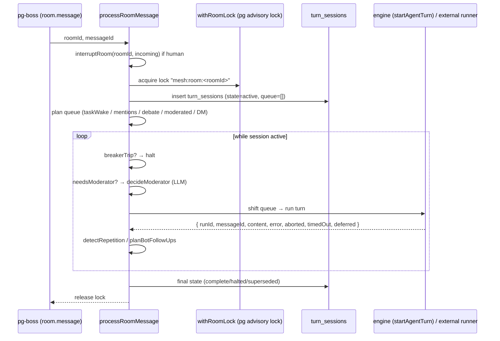

# Turn Coordinator

The coordinator turns one inbound room message into a deterministic sequence of bot turns. It runs inside a pg-boss worker, serializes per-room with a PostgreSQL advisory lock, plans turn order (mentions / debate / moderated / DM), enforces per-room and per-task budget breakers, dispatches each turn to the engine (`startAgentTurn`) or the external runner (`runExternalTurn`), and halts the session on aborts, errors, repetition, or budget exhaustion.

Source files: `apps/orchestrator/src/coordinator/index.ts`, `apps/orchestrator/src/coordinator/interrupt.ts`, `apps/orchestrator/src/active-runs.ts`, `apps/orchestrator/src/jobs/index.ts` (queue entry)

---

## 📥 Message Entry & Job Queue (`src/jobs/index.ts`)

Room messages enter the coordinator through a pg-boss queue backed by the same PostgreSQL database:

| Queue             | Constant             | Options                                                                         | Worker                                                      |
| :---------------- | :------------------- | :------------------------------------------------------------------------------ | :---------------------------------------------------------- |
| `room.message`    | `ROOM_MESSAGE_QUEUE` | `retryLimit: 0`, `expireInSeconds: 1800`, `deleteAfterSeconds: 86400`           | `processRoomMessage(roomId, messageId, { enqueueWebhook })` |
| `webhook.deliver` | `WEBHOOK_QUEUE`      | `retryLimit: 5`, `retryDelay: 10`, `retryBackoff: true`, `expireInSeconds: 120` | `deliverWebhook(data, retryCount + 1)`                      |
| `task.wake`       | `TASK_WAKE_QUEUE`    | `retryLimit: 2`, `expireInSeconds: 60`                                          | `handleTaskWake(data)` (`src/collab/task-wake.ts`)          |
| `run.resume`      | `RUN_RESUME_QUEUE`   | `retryLimit: 3`, `retryDelay: 5`, `expireInSeconds: 300`                        | dynamically imports `resumeRun` from `../engine/resume`     |

Worker configuration: all four use `batchSize: 1`, `localConcurrency: 4`, polling every 1–2 seconds. The pg-boss client is created with `application_name: "sayabot-orchestrator"` and a pool cap of `min(DATABASE_POOL_MAX ?? 3, 3)`.

Enqueue helpers: `enqueueRoomMessage(roomId, messageId)` (throws if the queue is not started), `enqueueWebhook(data)`, `enqueueTaskWake(data)` (falls back to direct `handleTaskWake` invocation when pg-boss is unavailable, and deduplicates with `singletonKey: "<taskId>:<agentId>"` + `singletonSeconds: 30`), and `enqueueRunResume(runId, reason)`.

`stopJobs()` shuts down gracefully with a 10-second timeout; it is called from the boot sequence in `src/index.ts`.

---

## 🔁 `processRoomMessage` — the turn loop (`src/coordinator/index.ts`)



### Entry and interruption

```typescript
export async function processRoomMessage(
  roomId: string,
  messageId: string,
  deps: CoordinatorDeps,
): Promise<void>
```

- `CoordinatorDeps` is `{ enqueueWebhook: (data: WebhookJobData) => Promise<void> }` — the only dependency injected by the caller (`src/coordinator/index.ts:50-52`).
- **Human messages interrupt first**: if the incoming message's `senderType` is `"human"`, `interruptRoom(roomId, incoming)` runs _before_ the lock is acquired (`src/coordinator/index.ts:342-343`). A bot waking a teammate does not interrupt — it queues behind the running session.
- Everything else runs inside `withRoomLock(roomId, ...)` (`src/db.ts`), so only one coordinator loop per room executes across all orchestrator instances.

### Trigger classification (inside the lock)

1. Reload room (`loadRoom`) and trigger message (`loadMessage`); bail silently if either is gone or the message belongs to another room.
2. Three valid trigger kinds (`src/coordinator/index.ts:352-361`):
   - `senderType === "human"`.
   - **Agent-triggered**: `senderType === "agent"` and `trigger.metadata?.agentTrigger === true` and the room is not a `dm` (flag set by `collab/postAgentMessage` when an agent mentions teammates outside its own turn — e.g. MCP/webhook bots).
   - **Task-wake-triggered**: `senderType === "system"` with `metadata.taskWake = { taskId, agentIds, reason }`.
3. A `turn_sessions` row is inserted: `{ roomId, threadRootId, triggerMessageId, taskId, botTurnsUsed: 0, state: "active", queue: [] }`.
4. `loadRoomAgents(roomId)` builds `agentRefs` (`{ id, handle, kind }`). Empty room → session completes immediately.

### Queue planning

Priority order (`src/coordinator/index.ts:394-418`):

| Condition                          | Planner                                                                | Result                         |
| :--------------------------------- | :--------------------------------------------------------------------- | :----------------------------- |
| Task wake                          | filter `taskWakeMeta.agentIds` to room members                         | turns with `role: "responder"` |
| Agent-triggered                    | `planMentionsTurn({ text, roomAgents, excludeAgentIds: [senderId] })`  | mentioned teammates            |
| DM room with `room.agentDmAgentId` | single turn for the DM agent                                           | `role: "responder"`            |
| `room.turnMode === "mentions"`     | `planMentionsTurn({ text, roomAgents })`                               | mentioned agents               |
| `room.turnMode === "debate"`       | `planDebateTurns({ roomAgents, debateOrder: room.debateOrder, text })` | full debate order              |
| otherwise (moderated default)      | `planModeratedMentions({ text, roomAgents })`                          | explicit mentions only         |

`explicitModeratedMentions` is true when agent-triggered or when moderated planning produced a non-empty queue; this suppresses the LLM moderator while explicit mentions remain.

All planners come from `@sayabot/core`. The initial queue is persisted with `setSession(session.id, { botTurnsUsed, queue, state: "active" })` and broadcast as a `turn.state` realtime event.

### Main loop (`while (true)`)

Each iteration, in order:

1. **Session state check** — re-reads `turn_sessions.state`; anything other than `active` (e.g. `superseded` set by an interrupt) breaks the loop.
2. **Completion** — empty queue with no moderator needed → `state = "complete"`.
3. **Budget breakers** — `breakerTrip(room, botTurnsUsed, session.taskId)` (below). On trip: if the session is task-bound and the code is `turn_cap`, the task is updated to `status: "stuck"` with `unblockNeeds: "human_answer"` and detail `Budget used up (N turns). Approve more?`; then `halt(...)` posts a system message and ends the session.
4. **Moderator decision** — when the queue is empty and `room.turnMode === "moderated"` and `!explicitModeratedMentions`, `decideModerator(...)` runs (below). Failure → system message "The lead agent couldn't pick who answers: …" with reason `moderator_error` and session `halted`. Decision `"human"` (constant `HUMAN_TURN` from `@sayabot/core`) → session completes. The lead may pick one agent or, for a message that needs several, up to three in order (`validateLeadPlan` in `@sayabot/core`). For the picked agents other than the lead itself, `postLeadHandoff(...)` posts one complete system message `@<lead> asked @a, @b and @c to take this: <reason>` (names from `handoffNames`; reason whitespace-collapsed, ≤200 chars, redacted). It carries `mentions` for every handed-to agent and metadata `{ reason: "lead_handoff", leadAgentId, chosenAgentIds }`. Because the mentions are on the message, invited (MCP) agents find the request in `get_inbox`, and each external agent also gets a `mesh_agent_inbox` notification that wakes a waiting client. The queue becomes one responder turn per picked agent carrying the lead's reason; `leadQueued` remembers which turns the lead planned. When that queue drains, the lead is asked again and usually returns `"human"`.
5. **Dispatch** — pops the next turn, resolves the `AgentRow`:
   - `agentRow.kind === "external"` → `buildWebhookPayload(...)` + `runExternalTurn({ room, agent, sessionId, threadRootId, trigger, role, step, payload, enqueueWebhook })` (`src/runner/external.ts`).
   - otherwise → `startAgentTurn({ room, agent, sessionId, threadRootId, trigger, role, step, taskId })` from `src/engine/index.ts`.
   - A thrown error is redacted and halts the session with reason `agent_error`.
6. **Result handling** (after `botTurnsUsed += 1` and another state check):
   - `result.aborted` → halt with `"Generation stopped. Human input is required to continue."` (reason `stopped`).
   - `result.error` → halt with the redacted error (reason `agent_error`).
   - `result.deferred` → **`botTurnsUsed -= 1`** (pull-based bots do not consume the room's bot-turn budget). If the agent's app isn't open (`agentAppOnline(agent.lastSeenAt)` is false: no call in the last 15 minutes), `postAppOfflineNotice(...)` (`index.ts:180`) posts `@<handle>'s app isn't open right now. It will see this and reply when its owner opens it.` with metadata `{ reason: "agent_app_offline", quietAgentId, quietAgentHandle }`. When the lead planned this turn (`leadQueued`) and nothing else is queued, the session completes instead of asking the lead again; the app replies in its own time. Otherwise `continue`.
   - `result.timedOut` → `postQuietBotNotice(...)` posts `@<handle> didn't answer within 60 seconds, so the turn moved on.` with metadata `{ reason: "agent_quiet", quietAgentId, quietAgentHandle }` and continues to the next turn.
   - Success path: reload the posted message, set `lastTrigger = message`, run `detectRepetition(result.content, recent)` over the last 4 complete agent replies in the thread (`recentBotReplies`, excluding the new message). Repetition → halt with `REPETITION_HALT_MESSAGE` and the detector's reason. In `mentions` mode, `planBotFollowUps({ text, roomAgents, senderAgentId })` appends cross-agent follow-up turns to the queue and re-broadcasts `turn.state`.
7. **Finalize** — `setSession(session.id, { state, queue: [] })` and a final `turn.state` broadcast with `activeAgentId: null`.

### Budget breakers (`breakerTrip`)

`breakerTrip` (`src/coordinator/index.ts:154-187`) computes:

- **RPM**: count of `agent_runs` rows for the room in the last 60 seconds.
- **Daily spend**: `sum(usage_events.cost_usd)` for the room since UTC midnight.
- **Effective turn cap**: `room.turnCap`, but for task-bound sessions the task's `tasks.budgetTurns` (default `12` when absent).

These feed `checkPreTurnBreakers({ botTurnsUsed, turnCap, rpmUsed, rpmLimit, spentUsd, dailyBudgetUsd })` from `@sayabot/core`, which returns a trip (`{ message, reason, code }`) or null.

### Lead agent (`decideModerator`)

The UI calls a moderated room's moderator its **lead agent** ([room settings](../../web/pages/room-settings-ui.md)).

- Requires `room.moderatorAgentId` to exist, belong to the org, and be `kind === "llm"` (an agent made in Sayabot; otherwise an error message halts the session). The lead can run on any model choice, including a Claude Code / Codex app via the CLI language model.
- Loads the last 30 conversation messages. The system prompt is `buildSystemPrompt({ room, agent, role: "moderator" })` plus `LEAD_AGENT_INSTRUCTIONS`: route each request to the agent whose job fits it best, choose itself if it fits best, list extra agents in `also` only when one message clearly needs several (at most three in all), prefer agents that answer now or whose app is open, return `"human"` when the request is answered or people must decide, never more than two turns in a row from one agent. The prompt is `renderTranscript(conversation)` plus `leadAgentListPrompt(roomAgentRows, lead.id)` from `src/runner/context.ts`. Each line of that list is `- <id>: @<handle> (<name>)[ (you, the lead)] [<where>]: <job>`, where `<job>` is `agentJobSummary` (bio, else instructions, ≤200 chars) and `<where>` is `answers now`, or for invited apps `answers within a minute` (webhook), `open now, answers in its own time`, or `not open right now, answers when its owner opens it` (from `agents.last_seen_at`).
- Calls `generateObject` (`ai` package) with schema `z.object({ next: z.string(), also: z.array(z.string()), reason: z.string() })`, `temperature: 0`, and a 60-second `AbortSignal.timeout`.
- The schema is `{ next, also: string[], reason }`, and the plan is validated by `validateLeadPlan(next, also, agentRefs)` from `@sayabot/core`.
- Usage is recorded twice: `recordUsageEvent({ ..., kind: "moderator", latencyMs })` and an `agent_runs` row with `role: "moderator"`, `status: "complete"`, token counts, cost, and latency.

### Helper surface

| Function                                                               | Purpose                                                                                                                                                             |
| :--------------------------------------------------------------------- | :------------------------------------------------------------------------------------------------------------------------------------------------------------------ |
| `setSession(sessionId, values)`                                        | Update `turn_sessions` (`botTurnsUsed`, `queue`, `state`) with `updatedAt`.                                                                                         |
| `getSessionState(sessionId)`                                           | Read current `turn_sessions.state`.                                                                                                                                 |
| `broadcastTurn(sessionId, roomId, threadRootId, activeAgentId, queue)` | Broadcast `{ type: "turn.state", sessionId, activeAgentId, queue: [...agentIds], threadRootId }`.                                                                   |
| `postSystemMessage({ roomId, threadRootId, content, reason })`         | Insert a `senderType: "system"` message (redacted, `status: "halted"`), broadcast `message.done` with `status: "halted"`.                                           |
| `halt(sessionId, roomId, threadRootId, message, reason, queue)`        | Mark session `halted`, post the system message, broadcast final turn state.                                                                                         |
| `postQuietBotNotice(...)`                                              | The "didn't answer within 60 seconds" notice (status `complete`, metadata reason `agent_quiet`).                                                                    |
| `recentBotReplies(roomId, threadRootId, excludeMessageId)`             | Last 4 complete agent messages in the thread scope (thread-rooted or top-level).                                                                                    |
| `buildWebhookPayload({ room, trigger, threadRootId })`                 | Builds the `WebhookPayload` (`event: "message.created"`, sender info, `mentions` via `extractHandles`, `context_snapshot` via `toWebhookContext` over 30 messages). |

### DB tables touched

`turn_sessions` (CRUD), `messages` (system inserts, reads), `agent_runs` (moderator rows, RPM count), `usage_events` (daily spend), `tasks` (budgetTurns read, stuck update), `rooms`/`agents`/`room_agents` (via `loadRoom`/`loadRoomAgents`).

### Realtime events emitted

- `turn.state` (`{ sessionId, activeAgentId, queue, threadRootId }`)
- `message.done` (`{ messageId, status }`) for system notices

---

## ⚡ Interrupts (`src/coordinator/interrupt.ts`)

`INTERRUPT_CHANNEL = "mesh_room_interrupt"`. The exported entrypoint:

```typescript
export async function interruptRoom(roomId: string, incoming?: MessageInterruptCheck): Promise<void>
```

Two-phase behavior:

1. **Engine-v2 steering** (`src/coordinator/interrupt.ts:15-22`): if `incoming` is a human message, `handleMidRunInterrupt(roomId, incoming)` (from `src/engine/interrupts.ts`) checks whether the message @-mentions an agent with an _active engine-v2 run_ (`findActiveRunForAgent` on the in-memory run registry). If so, the message content is queued onto that run as a mid-run steering interrupt (`addRunInterrupt`) and the function returns without superseding anything. Any _other_ runs in the room are aborted (`abortRoomRuns(roomId, steeredRunId)`).
2. **Standard supersede**: otherwise all `turn_sessions` rows for the room with `state: "active"` are marked `superseded`, all in-memory runs for the room are aborted via `abortRoomRuns(roomId)` (each `AbortController.abort()`), and `notify("mesh_room_interrupt", { roomId })` tells every orchestrator instance to do the same locally (handled by the control connection in `src/index.ts:30-43`).

`MessageInterruptCheck` is `{ id: string; content: string; senderType: string; mentions?: string[] }`.

---

## 🏃 Active Run Registry (`src/active-runs.ts`)

A process-local `Map<string, ActiveRun>` tracking every in-flight engine run in this orchestrator instance:

```typescript
export interface RunInterrupt {
  messageId: string
  content: string
  senderId?: string
}

export interface ActiveRun {
  runId: string
  roomId: string
  agentId?: string
  engine?: string
  controller: AbortController
  pendingInterrupts: RunInterrupt[]
}
```

| Function                                 | Behaviour                                                                                                                                      |
| :--------------------------------------- | :--------------------------------------------------------------------------------------------------------------------------------------------- |
| `registerRun(runId, roomId, meta?)`      | Creates an `AbortController`, stores the run, returns the controller. `meta` sets `agentId`/`engine` (engine `"v2"` is required for steering). |
| `unregisterRun(runId)`                   | Removes the run from the map.                                                                                                                  |
| `abortRun(runId)`                        | Aborts with `new Error("stopped by request")`; returns false if unknown (e.g. the run lives on another instance).                              |
| `abortRoomRuns(roomId, exceptRunId?)`    | Aborts every room run except `exceptRunId` with `new Error("superseded by a new human message")`; returns the count.                           |
| `addRunInterrupt(runId, interrupt)`      | Queues a `RunInterrupt` for delivery at the run's next step boundary; false if unknown run.                                                    |
| `consumeRunInterrupts(runId)`            | Drains and returns pending interrupts (used by the engine loop).                                                                               |
| `findActiveRunForAgent(roomId, agentId)` | Finds the active run for a specific agent (used by steering).                                                                                  |
| `activeRunIds()`                         | All run ids in this instance (surfaced by `GET /health`).                                                                                      |

Because this registry is per-process, the `mesh_room_interrupt` / `mesh_stop_run` LISTEN channels are what make cross-instance aborts work: the HTTP stop route and `interruptRoom` both `notify()` so every instance aborts its own local runs.

---

## 🧪 Tests

There are no dedicated `.test.ts` files for `coordinator/index.ts`, `coordinator/interrupt.ts`, or `active-runs.ts` in the orchestrator package. The interrupt primitives they depend on are covered by `src/engine/interrupts.test.ts`, and queue-adjacent behaviour is exercised indirectly via `src/engine/run.test.ts` and `src/engine/resume.test.ts`.

---

## Related docs

- [Service overview (withRoomLock, HTTP surface)](./service-overview.md)
- [Engine loop (startAgentTurn)](./engine-loop.md)
- [Interrupts & recovery (handleMidRunInterrupt, resumeRun)](./engine-interrupts-and-recovery.md)
- [LLM runner (startAgentTurn internals)](./runner-llm.md)
- [External runners (runExternalTurn)](./runner-external-and-local.md)
- [Tool system](../tools/tool-system.md)
- [Connector platform](../platform/connector-platform.md)
