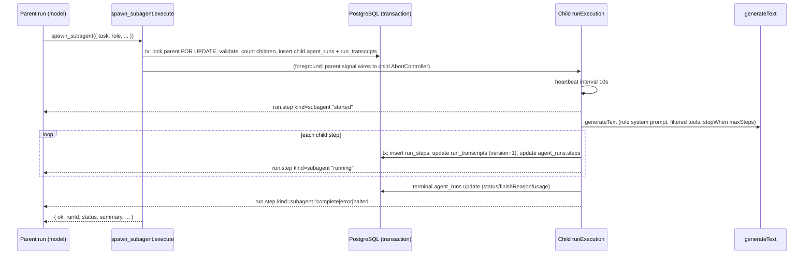
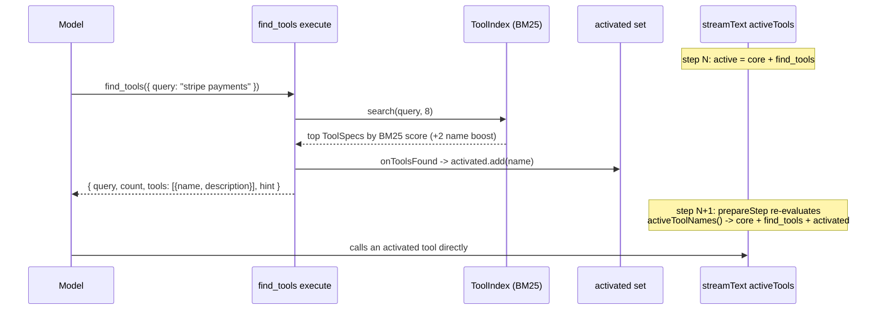

# Engine Subagents & Tool Search

Engine v2 agents can delegate bounded subtasks to child runs and can defer rarely-used tools out of context. `spawn_subagent` runs a researcher/planner/worker/critic child on the same agent with reservation limits, heartbeat, per-step persistence, and optional worktree confinement; `find_tools` activates catalog tools on demand via a pure BM25 index once the tool catalog exceeds 40 specs.

Source files: `apps/orchestrator/src/engine/subagents.ts`, `apps/orchestrator/src/engine/tool-search.ts`

---

## 🧩 `spawn_subagent` (`src/engine/subagents.ts`)

### Limits and constants

| Constant                   | Value    | Meaning                                                                                                  |
| :------------------------- | :------- | :------------------------------------------------------------------------------------------------------- |
| `MAX_CONCURRENT_SUBAGENTS` | `4`      | Active (`running`/`waiting`) children per parent run.                                                    |
| `MAX_TOTAL_SUBAGENTS`      | `12`     | Total children (any status) per parent run.                                                              |
| `SUBAGENT_HEARTBEAT_MS`    | `10_000` | Child `agent_runs.heartbeat_at` update interval (timer `unref`'d; a heartbeat failure aborts the child). |

### Input schema

```typescript
export const spawnSubagentSchema = z
  .object({
    task: z.string().min(1).max(30_000), // self-contained task description
    role: z.enum(["researcher", "planner", "worker", "critic"]).default("researcher"),
    tools: z.enum(["read_only", "same"]).default("read_only"),
    model: z.enum(["cheap", "same"]).default("same"),
    maxSteps: z.number().int().min(1).max(30).default(10),
    workspace: workspaceScopeSchema.optional(), // worker-only worktree scope
    runInBackground: z.boolean().default(false),
  })
  .strict()
  .refine((input) => !input.workspace || input.role === "worker", {
    message: "Only workers may be assigned a worktree scope",
    path: ["workspace"],
  })
```

### Tool registration

`spawnSubagentTool(args: SpawnSubagentToolArgs): ToolSpec` where the args are:

```typescript
export interface SpawnSubagentToolArgs {
  parentRunId: string
  roomId: string
  orgId: string
  agent: AgentRow
  availableToolSpecs?: ToolSpec[]
  getAvailableToolSpecs?: () => ToolSpec[] // resolved at call time, sees later-registered tools
  scrub?: (s: string) => string
}
```

`subagentStatusTool(): ToolSpec` provides the companion `subagent_status` tool (see below).

### Execution flow



1. **Reservation transaction** (READ COMMITTED, so a waiter sees children committed by the previous lock holder): `SELECT … FOR UPDATE` on the parent `agent_runs` row validates that it exists in this room/agent, is not itself a child (`parent.parentRunId` → "Recursive subagent spawning is not allowed"), and is still `running`/`waiting`. Counts `total` and `active` children against both limits, then inserts the child `agent_runs` row (`{ roomId, agentId, step: 0, role: "responder", status: "running", engine: "v2", parentRunId, heartbeatAt, steps: 0 }`) and its `run_transcripts` row (seeded with the task as a user message, redacted).
2. **Abort wiring**: foreground children link the parent's `AbortSignal` to a fresh child `AbortController`; background children manage their own signal (parent abort doesn't reach them).
3. **Model resolution**: `model: "cheap"` → `resolveAgentCheapModel(agent)`; `"same"` → `resolveAgentModel(agent)`. A child-specific run scrubber is layered over the parent's (`modelScrubber(args.scrub(text))`).
4. **Tool filtering**: from the parent's available specs, drop everything in `SUBAGENT_EXCLUDED_TOOLS` (`spawn_subagent`, `update_plan`, `find_tools`, skill tools, `workspace_fork`) or matching `/(?:^|_)skills?(?:_|$)/i`; read-only roles additionally require the tool to be in `READ_ONLY_TOOL_NAMES` **and** `dangerous === false`.

```typescript
export const READ_ONLY_TOOL_NAMES = new Set([
  "fs_read",
  "fs_glob",
  "fs_grep",
  "git_status",
  "git_diff",
  "web_search",
  "canvas_read",
  "recall",
  "code_outline",
  "code_definition",
  "code_references",
  "code_diagnostics",
  "code_rename_preview",
  "workspace_inspect",
])
```

5. **Worktree confinement** (when `workspace` is set, workers only): verifies the scope by executing `workspace_inspect` and matching `{ repo, worktree, baseSha }`; then wraps `fs_read`, `fs_write`, `fs_edit`, `computer_read_file`, `computer_write_file` executes so any `path` argument resolving outside the worktree (or `/tmp`) throws `"Access denied: Subagent is confined to workspace worktree <root>"`. The system prompt is explicit that the path is an instruction, not a sandbox boundary — shared tools are otherwise not path-constrained.
6. **Child loop**: `generateText({ model, system, prompt: task, tools: childTools (via toAuditedTools with child runId), stopWhen: stepCountIs(maxSteps), abortSignal, onStepEnd })`. The child system prompt composes: identity line (foreground vs background), the role prompt from `ROLE_PROMPTS` (researcher / planner / worker / critic — each scoped "Do not …" boundary), no-questions/evidence-only rules, tool-isolation notice, and the worktree clause. Each `onStepEnd` writes `run_steps` + bumps `run_transcripts` (redacted, `version + 1`) + updates `agent_runs.steps`/heartbeat in one transaction, then broadcasts progress.
7. **Terminal states**: `status` is `"complete"` (finishReason `stop` with non-empty summary), `"error"` (finishReason `error` / heartbeat failure), or `"halted"` (abort, or budget/tool-limit endings with `finishReason` mapped to `tool_step_limit`, `incomplete_tool_calls`, `output_token_limit`, `no_output`). A failed terminal write re-raises with the child id for recovery.
8. **Usage**: `recordUsageEvent({ …, kind: "subagent" })` with `tokensFrom(result.totalUsage)`.
9. **Return value** (foreground): `{ ok: status === "complete", runId, status, finishReason, role, readOnly, isolation: "shared_tools", workspace, task, stepsTaken, summary, error }` — all redacted.
10. **Background mode** (`runInBackground: true`): `runExecution()` is fired without awaiting; the tool returns immediately `{ ok: true, runId, status: "running", background: true, …, message: "Subagent <id> is running in the background. Check progress with subagent_status({ runId: \"<id>\" })." }`. Note the description difference: foreground children are "not detached background work".

### `subagent_status`

`subagentStatusTool()` reads the child's `agent_runs` row plus the last message of its transcript and returns `{ ok, runId, status, finishReason, steps, error, completed: status in (complete|error|halted), lastMessage? }`, or `{ ok: false, error: "Subagent run not found" }`.

### DB tables & events

`agent_runs` (child insert/update, parent lock), `run_transcripts` (child transcript), `run_steps` (child steps), `usage_events` (kind `subagent`). Realtime: `run.step` with `kind: "subagent"` and a machine-readable `subagent: { runId, parentRunId, role, status, finishReason, steps, readOnly, isolation, error }` payload on the parent's channel.

### Terminal-status mapping

| Condition                                                | `status`   | `finishReason`                                 |
| :------------------------------------------------------- | :--------- | :--------------------------------------------- |
| `stop` finish with non-empty summary                     | `complete` | `stop`                                         |
| Steps exhausted while the last step still had tool calls | `halted`   | `tool_step_limit`                              |
| `error` finish from the model                            | `error`    | `error` (`"Subagent model reported an error"`) |
| `tool-calls` finish below the step cap                   | `halted`   | `incomplete_tool_calls`                        |
| `length` finish                                          | `halted`   | `output_token_limit`                           |
| `stop` finish but empty summary                          | `halted`   | `no_output`                                    |
| Parent aborted (foreground)                              | `halted`   | `abort`                                        |
| Heartbeat write failure                                  | `error`    | `error` (the DB error text, redacted)          |

### Child system prompt composition

The child's system prompt is assembled in this order (`src/engine/subagents.ts:229-238`):

1. `You are a <role> subagent for @<parent handle>.` + foreground (`The parent awaits your result; you are not a detached background task.`) or background (`You are running as a background task.`) clause.
2. The role prompt from `ROLE_PROMPTS` — researcher ("distinguish facts from inference… Do not implement changes"), planner ("return ordered implementation steps, dependencies, risks and verification criteria… Do not implement the plan"), worker ("Preserve unrelated work, verify your changes when permitted… Do not merge, reset, deploy or expand the task scope"), critic ("Identify concrete defects, regressions, missing tests and unsupported claims with file/line evidence and severity… Do not fix findings").
3. `"Do not ask questions. State assumptions and verification limits. Your final answer must contain concrete evidence, not an unsupported success claim."`
4. `"Never spawn other agents, install or approve skills, merge workspaces or perform unrelated side effects."`
5. Tool-isolation notice: read-only roles get `"You have read-only tools. Do not attempt to modify anything."`; workers with `tools: "same"` get `"You share the parent's tools and permissions. This is NOT an isolated environment. Preserve all unrelated work."`
6. Worktree clause: with a `workspace` scope the exact scope JSON plus "never edit the original repo. This path is an instruction, not a sandbox boundary; shared tools are not path-constrained."; without one, `"No worktree scope was supplied. Do not claim worktree isolation or assume that a separate checkout exists."`

---

## 🔎 `find_tools` & Deferred Tool Loading (`src/engine/tool-search.ts`)

### Constants

- `TOOL_SEARCH_THRESHOLD = 40` — below this many specs every tool is always active.
- `ALWAYS_CORE_TOOLS` — the 33 specs that never leave the active set when partitioning: `fs_read/fs_edit/fs_write/fs_glob/fs_grep`, `computer_shell`, `git_status/git_diff/git_commit/git_push`, `update_plan`, `spawn_subagent`, `remember/recall/forget`, `canvas_create/canvas_read/canvas_write/canvas_patch`, `find_tools`, `load_skill/propose_skill/search_skills`, `code_outline/code_definition/code_references/code_diagnostics`, `workspace_detect/workspace_fork/workspace_inspect`, `verify_workspace`, `subagent_status`, `report_findings`.

### `ToolIndex` — pure BM25 over tool specs

```typescript
export class ToolIndex {
  constructor(tools: ToolSpec[]) // indexes "name description" text
  search(query: string, limit = 8): ToolSpec[]
}
```

Tokenization lowercases and splits on non-`[a-z0-9_]` (tokens ≤ 1 char dropped). Scoring is standard BM25 (`k1 = 1.2`, `b = 0.75`) over per-doc term counts and document frequencies, plus a `+2.0` boost when the doc name contains the raw query. Zero-score docs are dropped; results sorted by score.

### `buildFindToolsSpec({ allSpecs, onToolsFound? }): ToolSpec`

Builds the `find_tools` tool: schema `{ query: string (min 1) }`, `dangerous: false`. Its execute searches the index for 8 matches, calls `onToolsFound(matches)` so the caller can activate them, and returns `{ query, count, tools: [{ name, description }], hint }` — the hint is `"These tools have been activated for you. You can call them in subsequent steps."` or `"No matching tools found in the catalog."`.

### `partitionToolsForSearch(specs)`

```typescript
export function partitionToolsForSearch(specs: ToolSpec[]): {
  exposed: ToolSpec[] // core + find_tools
  all: ToolSpec[] // everything, registered with the model call
  searchTool?: ToolSpec
  activeToolNames: () => string[] | undefined
}
```

- Specs are sorted by name for determinism.
- `specs.length <= 40` → no partitioning; `activeToolNames()` returns `undefined` (everything active).
- Otherwise: `exposed = [...core, searchTool]`, `all = [...exposed, ...nonCore]`, and `activeToolNames()` returns the sorted exposed names **plus** whatever `find_tools` has activated so far (the `activated` set grows on each `find_tools` call).

### Engine wiring

`buildTools` (`src/tools/index.ts`) calls `partitionToolsForSearch` over the assembled specs and hands `activeToolNames` to `runEngineTurn`, which threads it into every `streamText` call (`activeTools` option) and re-evaluates it inside `prepareStep` — so tool token cost only counts active specs (`estimateToolTokens(activeSpecs)`), and a `find_tools` hit grows the active set from the next step onward. Lean turns combine this with `leanToolNames` (lean set + non-core activations; see [engine-loop.md](./engine-loop.md) and [engine-planning.md](./engine-planning.md)).



Activation is one-way within a run (the `activated` set never shrinks), resets on the next turn, and applies to the whole catalog (`all`), not just `exposed` — the model call registers every spec so newly activated tools are immediately callable without re-registering anything.

---

## 🧪 Tests

| Test file                        | Covers                                                                                                                          |
| :------------------------------- | :------------------------------------------------------------------------------------------------------------------------------ |
| `src/engine/subagents.test.ts`   | 425 lines: reservation limits, role filtering, read-only enforcement, worktree confinement, terminal statuses, background mode. |
| `src/engine/tool-search.test.ts` | `ToolIndex` BM25 scoring/ranking, `partitionToolsForSearch` threshold and activation dynamics.                                  |
| `src/tools/index.test.ts`        | Wiring of `find_tools` / `spawn_subagent` into `buildTools`.                                                                    |

---

## Related docs

- [Engine loop (activeTools + prepareStep integration)](./engine-loop.md)
- [Planning (skill tools referenced by SUBAGENT_EXCLUDED_TOOLS)](./engine-planning.md)
- [Tool system (ToolSpec, toAuditedTools, workspace_fork)](../tools/tool-system.md)
- [Coordinator (subagent steps surface as run.step events)](./coordinator.md)
