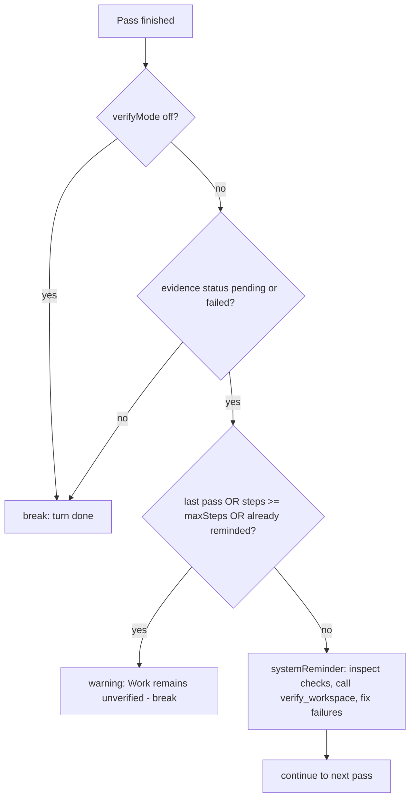
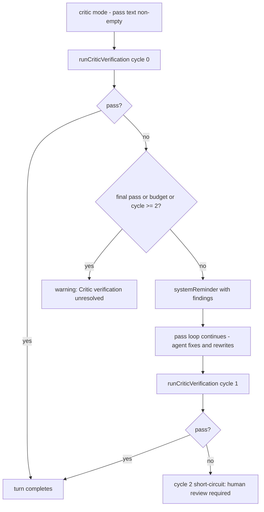

# Engine Verification

Engine v2 treats verification as evidence, not prose. The `verify` module defines the three verify modes (`off` / `self` / `critic`), the self-verification checklist prompt appended to the volatile tail, and the independent critic reviewer that re-checks finished work with read-only tools. Execution evidence itself — mutations detected on `fs_edit`/`fs_write`/shell, `verify_workspace` exit codes — is tracked by `RunEvidence` (documented in [engine-loop.md](./engine-loop.md)); this page covers the verify pass logic and the `verify_workspace` / `workspace_detect` / `report_findings` tools that feed it.

Source files: `apps/orchestrator/src/engine/verify.ts`, `apps/orchestrator/src/engine/evidence.ts` (evidence state), `apps/orchestrator/src/tools/builtins/verification.ts` (verify_workspace tool)

---

## 🎛️ Verify Modes (`src/engine/verify.ts`)

```typescript
export type VerifyMode = "off" | "self" | "critic"

export function getVerifyMode(params: Record<string, unknown> | null | undefined): VerifyMode
```

Reads `params.verify`; only the exact strings `"off"`, `"self"`, `"critic"` are honoured — anything else (including missing params) defaults to **`"self"`**. The mode is resolved once per turn in `runEngineTurn` (`getVerifyMode(params)` after `leanParams`) and drives three behaviours:

1. **Closing instructions**: when `verifyMode !== "off"` and the session has a task brief or a `verify_workspace` tool, `buildSelfVerificationPrompt()` is appended to the context's volatile tail.
2. **The verification gate** after each pass (see below).
3. **The critic pass** when `mode === "critic"`.

---

## ✅ Self-Verification Prompt

```typescript
export function buildSelfVerificationPrompt(taskBrief?: string): string
```

Produces the checklist appended after the trigger in the volatile tail (with `Task requirements:\n<brief>` inserted when a brief exists):

```
Verification checklist before concluding:
1. Re-read the initial prompt and task requirements.
2. For each requirement, verify and provide concrete evidence that it is completely met.
3. If files, code, or canvas artifacts were modified, confirm that tests or linters were run and passed without regressions.
4. If any item is incomplete or broken, fix it now.
5. Once fully verified, output your clear final conclusion.
```

---

## 🚧 The Verification Gate (in `runEngineTurn`)

The gate only applies when there is something to verify. The closing instructions condition in `buildEngineContext` is `verifyMode !== "off" && (taskBrief || "verify_workspace" in tools)` — a pure Q&A turn with no task brief and no workspace tools never gets the checklist or the gate. After each pass's stream finishes (and after late-steering handling), the engine consults `verification()` — the `RunEvidence.snapshot()` closure (see [engine-loop.md](./engine-loop.md)):



- The reminder text: `"<reason> Inspect the project's checks, call verify_workspace, fix any failures and report only what the execution evidence supports. If checks are unavailable, say so explicitly."` — where `<reason>` is the snapshot's reason (`"Run verify_workspace after the latest file edit or shell operation. Prose is not execution evidence."` or the failed-checks variant).
- Surfacing-but-not-failing is deliberate: the agent may honestly report that checks are unavailable or that failures pre-date its change (`src/engine/run.ts:786-796`).
- Post-loop, if verification is still `pending`/`failed` and no warning was recorded, one final `Work remains unverified: <reason>` warning is added to the message metadata.

Evidence status transitions (from `RunEvidence`): mutating tools (`fs_edit`, `fs_write`, `computer_write_file`, or `computer_shell` where `shellMayMutate`) bump the mutation revision and make the evidence `pending`; a `verify_workspace` call whose checks all exit 0 — with no writes in flight and no mutation during the checks — marks the current revision `passed`; any failed/incomplete verify marks it `failed`.

### Where verification surfaces at the end of a turn

The final message's `metadata.harness` block (built in `runEngineTurn`'s `finalize`) carries the full picture for the UI and for debugging:

```typescript
harness: redactValue({
  cache: cacheMetrics.snapshot(),
  verification: verification(),   // VerificationEvidence: { status, mutationRevision, checks, reason? }
  compactions,                    // number of compaction events this run
  peakEstimatedInputTokens,
}, runScrubber)
```

Alongside it, verification-related warnings accumulate in `metadata.warnings`:

- `Work remains unverified: <snapshot reason>` — the gate gave up (final pass, step budget, or already reminded), or the post-loop sweep found pending/failed evidence that never got a warning.
- `Critic feedback: <findings>` — a critic revision round was issued (work continued).
- `Critic verification unresolved: <findings>` — the critic rejected the work and no revision budget remained.

Each `verify_workspace` run also lands in `run_steps` as an ordinary tool step (kind `tool`, `inputRef: "verify_workspace"`), so a run trace (`GET /internal/runs/:runId/trace`) shows the exact commands and their outputs; critic rounds appear as dedicated `kind: "verify"` steps with `inputRef: "critic_verification"`.

---

## 🧐 Critic Verification (`runCriticVerification`)

```typescript
export interface CriticReviewArgs {
  agent: AgentRow
  orgId: string
  roomId: string
  taskBrief: string
  proposedOutput: string
  availableToolSpecs?: ToolSpec[]
  cycle: number
  signal?: AbortSignal
  scrub?: (value: string) => string
}

export interface CriticReviewResult {
  pass: boolean
  reasons: string[]
  feedback?: string
}
```

Flow (`src/engine/verify.ts:57-123`):

1. **Cycle cap**: `cycle >= 2` short-circuits with `{ pass: false, reasons: ["Verification remains unresolved after the revision limit (2). Human review is required."] }` — the engine enforces the same cap via `criticCycle >= 2`.
2. **Model**: `resolveAgentCheapModel(agent)` — the critic runs on the agent's cheap model, not the primary one.
3. **Tools**: only specs in `READ_ONLY_TOOL_NAMES` (from `subagents.ts`: `fs_read`, `fs_glob`, `fs_grep`, `git_status`, `git_diff`, `web_search`, `canvas_read`, `recall`, `code_*`, `workspace_inspect`) converted with `toAuditedTools({ runId: null, messageId: null, scrub })` — the critic inspects but never mutates.
4. **Call**: `generateText` with the impartial-critic system prompt ("verify whether the work actually satisfies what was asked … Be constructive … Format your answer as JSON"), a prompt of `Task Requirements:` + brief + `Proposed Output/Work from Agent:` + proposed output, `stopWhen: stepCountIs(6)`, `maxOutputTokens: 2048`, and the run's abort signal. The engine passes `proposedOutput` as the full reply text plus `Execution evidence: <JSON of verification()>`.
5. **Usage**: `recordUsageEvent({ …, kind: "verify" })` with `tokensFrom(result.totalUsage)`.
6. **Parsing**: the reply is fenced-code-stripped, `JSON.parse`d, and validated against `criticResponseSchema` (`{ pass: boolean, reasons: string[], feedback?: string }`).
7. **Failure handling**: any error (model, parse, validation) returns `{ pass: false, reasons: ["Critic could not verify the work: <message>"] }` — never throws into the engine loop.

### Engine integration (`src/engine/run.ts:798-872`)

When `verifyMode === "critic"` and the pass produced text:

- Broadcasts `run.status: "thinking"` and a `run.step` (`kind: "tool"`, label `Running critic verification against task requirements`).
- The review is persisted as a `run_steps` row (`kind: "verify"`, `inputRef: "critic_verification"`, output `{ pass, feedback, reasons, cycle }` redacted) and recorded to Langfuse.
- **Fail** → warnings get `Critic feedback: <findings>` (or `Critic verification unresolved: <findings>` on the final pass / exhausted budget / cycle 2) and, when revisions remain, a `systemReminder`: `"An independent reviewer checked your work against the task requirements and found problems:\n\n<findings>\n\nFix these now with your tools, then write a short final reply stating what you changed."` — then the pass loop continues (a "Revising after critic feedback" `run.step` is broadcast).
- **Pass** → the turn finishes normally.

---

## 🧪 Verify Modes Compared

| Aspect | `off` | `self` (default) | `critic` |
| :--- | :--- | :--- | :--- |
| Closing checklist in volatile tail | no | yes (when task brief or `verify_workspace` present) | yes |
| Evidence gate after each pass | skipped | reminder → revise, or warn-and-finish | reminder → revise, or warn-and-finish |
| Independent reviewer model call | no | no | yes (`resolveAgentCheapModel`, ≤ 6 steps, ≤ 2 cycles) |
| Extra `usage_events` kind | — | — | `verify` |
| Unresolved outcome | — | `Work remains unverified: <reason>` warning in metadata | `Critic verification unresolved: <findings>` warning (after 2 cycles / budget) |

The mode lives at `params.verify` on the agent (settable per agent; the room-model override can replace `effort`/model but not `verify`). Because `getVerifyMode` defaults to `"self"`, agents are verification-gated out of the box.



---

## 🛠️ `verify_workspace` & Friends (`src/tools/builtins/verification.ts`)

`verificationTools({ agentId, orgId, profile })` returns three tools backed by the agent's computer (`getComputerClient()`; `profile` is `"standard" | "browser"`).

### `verify_workspace`

- Schema: `{ cwd: string (1..2000), checks: Array<{ kind: "test"|"lint"|"typecheck"|"build", command: string (1..4000) }> (1..6), timeoutSeconds: int 1..300 default 120 }`.
- **Dangerous dynamically**: `dangerous: (input) => input.checks.some((check) => isDestructiveCommand(check.command))` — check commands that look destructive trigger the human approval gate (`@sayabot/core`'s `isDestructiveCommand`).
- Execute: `client.ensure(agentId, orgId, profile)` wakes/allocates the computer, then runs each check via `client.exec(agentId, { cmd, cwd, timeoutMs })` sequentially, aborting between checks on the run signal and **stopping at the first non-zero exit**. Outputs are bounded with `foldOutput` (`stdout ≤ 6000`, `stderr ≤ 4000` chars) and a `truncated` flag.
- Returns `{ passed: ranAll && every exitCode === 0, checks }` — the shape `RunEvidence.wrap` consumes to set evidence status.
- The description hammers the contract: "Run explicit test, lint, typecheck or build commands and record their real exit codes as verification evidence. Use after your last edit, not a prose claim … This proves only those commands ran, not that all requirements are met."

### `workspace_detect`

- Schema `{ cwd }`, `dangerous: false`. Lists the directory (depth 1) without executing project code, detects manifests (`package.json`, `pyproject.toml`, `pytest.ini`, `requirements.txt`, `Cargo.toml`, `go.mod`, `pom.xml`, `build.gradle`, `Makefile`, `Dockerfile`, `compose.yaml`, `pnpm-workspace.yaml`, `tsconfig.json`), reads `package.json` (≤ 100 KB; truncated → error) for scripts (≤ 60) / `packageManager` / `workspaces`, infers the package manager from lockfiles (`pnpm-lock.yaml` → pnpm, `yarn.lock` → yarn, `bun.lock(b)` → bun, `package-lock.json` → npm), and reports Python virtual environments (`.venv`/`venv`). Returned scripts are flagged as untrusted repository data.

### `report_findings`

- Schema `reportFindingsSchema`: `{ level: "low"|"medium"|"high"|"max" (default "medium"), findings: Array<{ file, line?, summary ≤ 500, shortSummary ≤ 80?, failureScenario 1..2000, category: correctness|security|performance|test_coverage|simplification (default correctness), verdict: CONFIRMED|PLAUSIBLE (default CONFIRMED), outcome?: fixed|skipped|no_change_needed }> (max 50) }`.
- `dangerous: false`; execute just echoes back a structured record (`{ ok: true, count, level, findings, summary }`) — a machine-checkable contract for defect/audit reporting rather than vague prose.

---

## 🧪 Tests

| Test file | Covers |
| :--- | :--- |
| `src/engine/verify.test.ts` | `getVerifyMode` defaults, critic result parsing/failure paths. |
| `src/engine/evidence.test.ts` | `RunEvidence` status transitions, `shellMayMutate` allow/deny. |
| `src/engine/harness.test.ts` | End-to-end: verify reminders, critic revise loop, evidence surfaced in message metadata. |
| `src/tools/builtins/sandbox.test.ts` | Adjacent computer-tool coverage including check execution paths. |

---

## Related docs

- [Engine loop (pass loop, evidence wiring, closing instructions)](./engine-loop.md)
- [Subagents (READ_ONLY_TOOL_NAMES shared with the critic)](./engine-subagents-and-tool-search.md)
- [Loop control (systemReminder mechanics)](./engine-interrupts-and-recovery.md)
- [Tool system (dangerous flags, approval gates)](../tools/tool-system.md)
