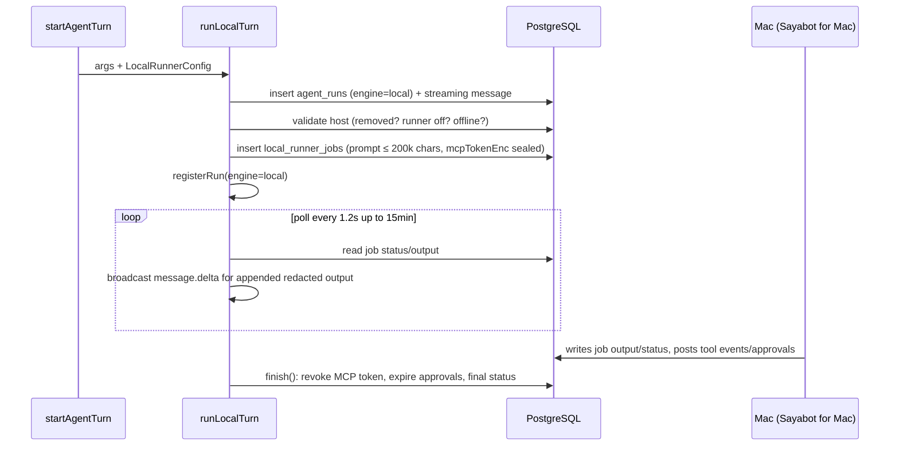

# External & Local Runners

Not every agent turn runs on the server's Engine v2. External bots (`kind: "external"`) receive a webhook and reply asynchronously; CLI runners (Claude Code, Codex, Cursor) execute turns through apps signed in on the machine the orchestrator runs on; and the local (Mac) runner hands the turn to the owner's own computer via Sayabot for Mac, streaming output back through a queued job. This page covers all three paths plus the shared CLI plumbing (`cli-agent.ts` app detection/command building/JSONL parsing, `cli-mcp.ts` one-run MCP tokens, `cli-model.ts` the AI SDK adapter).

Source files: `apps/orchestrator/src/runner/external.ts`, `apps/orchestrator/src/runner/cli.ts`, `apps/orchestrator/src/runner/cli-agent.ts`, `apps/orchestrator/src/runner/cli-mcp.ts`, `apps/orchestrator/src/runner/cli-model.ts`, `apps/orchestrator/src/runner/local.ts`

---

## 📮 External Bots (`src/runner/external.ts`)

```typescript
export interface ExternalTurnArgs {
  room: RoomRow
  agent: AgentRow
  sessionId: string
  threadRootId: string | null
  trigger: MessageRow
  role: TurnRole
  step: number
  payload: WebhookJobData["payload"]
  enqueueWebhook: (data: WebhookJobData) => Promise<void>
}

export interface ExternalTurnResult {
  runId: string
  messageId: string | null
  content: string
  timedOut: boolean
  aborted: boolean
  error: string | null
  deferred?: boolean  // pull-based (MCP) bot: picks the turn up from get_inbox
}
```

`runExternalTurn(args)` flow (`src/runner/external.ts:44-160`):

1. Inserts an `agent_runs` row (`status: "running"`, no engine field).
2. **No `agent.webhookUrl`** → the bot is MCP-connected and runs in its owner's own client: the run is closed immediately as `complete` with error `"deferred to the bot's MCP inbox"` and the result carries `deferred: true`. The coordinator treats this as "pull-based bots don't consume the room's bot-turn budget" (`botTurnsUsed -= 1`).
3. Webhook bots: `registerRun(run.id, room.id)` (no engine → v1-style abort semantics), then — **the reply waiter is registered before dispatch so a fast bot cannot race it** — `waitForBotReply({ roomId, agentId, threadRootId })` followed by `enqueueWebhook({ orgId, roomId, agentId, messageId: trigger.id, sessionId, payload })`. Dispatch failure closes the run as `error` (`"webhook dispatch failed"`, redacted detail) and returns.
4. `Promise.race([replyPromise, abortPromise(controller.signal)])`:
   - **Aborted** (room interrupt / stop) → run `halted`, `aborted: true`.
   - **No reply within 60 s** → run `error` `"external agent did not reply within 60 seconds"`, `timedOut: true` (the coordinator posts the "didn't answer within 60 seconds" quiet-bot notice and moves on).
   - **Reply** → the reply message row is linked to the run (`messages.runId = run.id`), the run is `complete` with `messageId` + `latencyMs`, and `content` is the reply's text.

The reply itself arrives through `POST /v1/rooms/:roomId/messages[/stream]` (bot API) and `notifyBotReply` — see [service-overview.md](./service-overview.md). The webhook delivery mechanics (retries, HMAC) live in `src/jobs/webhook.ts`.

DB tables touched: `agent_runs`, `messages` (runId link, content read). Events: none emitted directly (the bot's own message streaming broadcasts deltas).

---

## 🖥️ CLI Runners — Claude Code / Codex / Cursor on this machine

### App detection & sign-in checks (`src/runner/cli-agent.ts`)

```typescript
export type CliApp = "claude-code" | "codex" | "cursor"
export interface CliRunnerConfig {
  app: CliApp
  model: string | null   // null = the app's own default
  effort?: EffortLevel   // --effort / model_reasoning_effort
}
```

- **Binaries**: `claude`, `codex`, `cursor-agent` (Cursor's CLI is `cursor-agent`; plain `cursor` is the editor). `findCliBinary(app, env)` honours overrides `SAYABOT_CLAUDE_PATH` / `SAYABOT_CODEX_PATH` / `SAYABOT_CURSOR_PATH`, else searches `PATH` plus a wide list of install dirs (`/opt/homebrew/bin`, `/usr/local/bin`, `~/.local/bin`, `~/.claude/local`, `~/.bun/bin`, `~/.npm-global/bin`, `~/.volta/bin`, newest `~/.nvm/versions/node/*` first) for an executable.
- **Sign-in detection** — `cliSignedIn(app)` only checks that a saved sign-in *exists*; credentials are never read into the process: Codex → `~/.codex/auth.json` (`CODEX_HOME` respected); Cursor → `CURSOR_API_KEY` env, macOS Keychain `cursor-access-token` (queried with `security find-generic-password` **without** `-w`, so the secret is never printed), or `"authInfo"` in `~/.cursor/cli-config.json`; Claude Code → `.credentials.json` in `CLAUDE_CONFIG_DIR`/`~/.claude`, Keychain `Claude Code-credentials` (account = `USER`/`userInfo().username`), or `"oauthAccount"` in `~/.claude.json`.
- **`cliRunnerAllowed(env)`** — the local-CLI fallback is only for a person's own computer: on by default outside production, forced with `SAYABOT_LOCAL_CLI=1`, disabled with `SAYABOT_LOCAL_CLI=0` (legacy alias `SAYABOT_LOCAL_DETECTION`).
- **`cliRunnerConfig(params)`** — parses the explicit `params.runner = { where: "server", app, model }` (model validated against `^[\w./:@~-]{1,120}$`), with `params.effort` clamped via `clampEffort(..., ENGINE_EFFORT_LEVELS[app])`.
- **`cheapCliModel(config, custom?)`** — the app's fast model for background jobs: `params.cheapModel` wins, Claude Code defaults to `claude-haiku-5-5`, everything else keeps its default; the agent's effort is dropped.
- **`cliAgentFolder(handle)`** — the run's cwd: `~/Sayabot/agents/<sanitized handle>` (alphanumerics/dashes, ≤ 40 chars, fallback `"agent"`); `"test"` for one-shot probes.

### Environment hygiene (`cliEnvironment`)

Builds the child env by stripping: session markers that would make a nested CLI think it's inside another session (`CLAUDECODE`, `CLAUDE_CODE_ENTRYPOINT`, `CLAUDE_CODE_SESSION_ID`, `CLAUDE_CODE_SSE_PORT`, `CLAUDE_CODE_EXECPATH`, `CLAUDE_EFFORT`, `CLAUDE_PID`, and any `CLAUDE_CODE_SESSION_*` / `CLAUDE_CODE_HOST_*` / `CLAUDE_BG_*` prefix); API keys so the app uses its own saved sign-in (`ANTHROPIC_API_KEY`, `ANTHROPIC_AUTH_TOKEN`, `ANTHROPIC_BASE_URL`, `OPENAI_API_KEY`, `OPENAI_BASE_URL`); and **server secrets that must never reach a model-driven process** (`MESH_KEK|SAYABOT_KEK|DATABASE_URL|SUPABASE_SERVICE_ROLE_KEY|ORCHESTRATOR_INTERNAL_SECRET|VAPID_PRIVATE_KEY|E2B_API_KEY|CLOUDFLARE_API_TOKEN|BRAVE_SEARCH_API_KEY|DEV_OPENAI_COMPAT_API_KEY|SAYA_AI_API_KEY|CLOUDFLARE_TUNNEL_TOKEN`). `PATH` is prepended with the binary's own directory (nvm CLIs need their `node`), `NO_COLOR=1`, and the grant's extra vars are merged last.

### Command building (`cliCommand`)

Non-interactive modes with **default (non-bypassed) permissions** — print mode refuses anything that would need approval, Codex keeps its read-only sandbox, Cursor gets no `--force` (Golden Rule 4):

| App | Invocation |
| :--- | :--- |
| **Codex** | `codex exec --json --skip-git-repo-check --ephemeral --sandbox read-only [-c mcp_servers.sayabot.* …] [--model M] [-c model_reasoning_effort="E"] -` with `system\n\nprompt` on stdin. MCP config: url, `bearer_token_env_var`, `disabled_tools`, and `default_tools_approval_mode="approve"` (exec mode has nobody to approve with). |
| **Cursor** | `cursor-agent -p --output-format stream-json [--model M] "<system\n\nprompt sliced to last 200,000 chars>"` on the command line, no stdin. |
| **Claude Code** | `claude -p --output-format stream-json --verbose --include-partial-messages --permission-mode default --no-session-persistence --tools Read,Glob,Grep,WebSearch,WebFetch --strict-mcp-config [--mcp-config <file> --allowedTools mcp__sayabot --disallowedTools mcp__sayabot__post_message,…] --setting-sources project,local --disable-slash-commands --exclude-dynamic-system-prompt-sections [--model M] [--effort E] --system-prompt <system ≤ 60,000 chars>` with the prompt on stdin. Runs "lean": Sayabot's system prompt replaces the coding-agent one, only read/search tools, none of the person's own MCP servers/plugins/skills — cutting ~25k input tokens a turn to ~4k while keeping the Keychain sign-in (no `--bare`). |

### JSONL event parsing (`parseCliLine`)

```typescript
export type CliEvent =
  | { kind: "delta"; text: string }
  | { kind: "message"; text: string }
  | { kind: "done"; text: string | null; error: string | null; model: string | null;
      usage: { inputTokens: number; outputTokens: number; cachedInputTokens: number } | null }
```

- **Codex**: `item.completed` + `agent_message` → `message`; `turn.completed` → usage; `turn.failed`/`error` → error (`Reconnecting...` retries are ignored — only the last word counts).
- **Claude Code & Cursor** (shared `stream-json` shape): `stream_event` → `content_block_delta`/`text_delta` → `delta`; `assistant` messages → `message`; `result` → `done` with text, error (`is_error` or `subtype !== "success"`), model (first key of `modelUsage`), and usage where `inputTokens = input_tokens + cache_creation_input_tokens`, `cachedInputTokens = cache_read_input_tokens`.
- **`cliFailureHint(app, stderr, code)`** — plain-language failures: sign-in problems (`login|sign in|auth|unauthori|401|invalid_grant|expired`) → ``"<App> isn't signed in on this computer. Run `<claude|codex|cursor-agent login>` in a terminal once and sign in."``; otherwise the last 3 stderr lines (≤ 500 chars) or the exit code.

### One-run MCP grant (`src/runner/cli-mcp.ts`)

"Room tools the app must not call during its own turn": `MCP_BLOCKED_TOOLS = ["post_message", "wait_for_activity", "use_secret"]` (its reply is posted for it; a long poll would stall the room; secrets never reach the app).

- **`grantCliMcp({ app, agentId, roomId })`** — Cursor returns `null` (it reads MCP servers only from its own config). Mints `sayabot_at_<32 random bytes base64url>`, stores it as an `oauth_tokens` row (`kind: "access"`, `tokenHash = hashAgentApiKey(token)`, `clientId: "sayabot-local-cli"`, this agent only, `roomIds: [roomId]`, `scopes: CLI_RUN_SCOPES = ["room:read","room:write","tasks:read","tasks:write","canvas:read","canvas:write"]` — everything except `secrets:use`, `expiresAt` +20 min). Claude Code gets an MCP config file written `0600` into a temp dir (`claudeMcpConfig(url, token)` → `{ mcpServers: { sayabot: { type: "http", url, headers: { Authorization: Bearer } } } }`); Codex gets `SAYABOT_MCP_TOKEN` in the env. `release()` revokes the token and deletes the temp dir; the URL is `SAYABOT_MCP_URL` or `http://127.0.0.1:$PORT/v1/mcp`.
- **`mintMacMcpToken({ agentId, roomId })`** — the same grant for Mac runs (`clientId: "sayabot-mac-runner"`, TTL 30 min because "a Mac run can wait on approvals"); the raw token travels to the Mac sealed in the job (`sealSecret(token, MESH_KEK)`), revocable via `revokeMcpToken(tokenId)`.

### `runCliProcess` (`src/runner/cli.ts:81-195`)

Spawns the app once and reads its JSONL events:

- Guards: `cliRunnerAllowed()` (else `"<App> on this computer is turned off here (SAYABOT_LOCAL_CLI=0)."`), `findCliBinary` (else `"<App> isn't installed on the computer running Sayabot."`); `mkdirSync(folder, { recursive: true })`.
- Optional `room` arg → `grantCliMcp` (failure logged, run continues without room tools) and the system prompt gains `ROOM_TOOLS_NOTE`: "You are running inside Sayabot through the sayabot MCP tools. Your final reply is posted to this room for you… Use the sayabot tools for the room's tasks, canvas, votes, owner facts and to ask the humans for decisions (request_human_decision) before anything high-stakes."
- stdout is split into JSONL lines → `parseCliLine` → accumulates `streamed` (deltas), `lastMessage` (joined messages), `finalText`/`resultError`/`usage`/`usedModel` (done); stderr is kept to its last 4,000 chars; `visible()` = streamed or lastMessage.
- Kill paths: abort signal → `SIGTERM`; deadline → `MAX_RUNTIME_MS = 14 * 60_000` default.
- Outcome: exit 0 with no error and text → `ok: true`; aborted → `{ ok: false, aborted: true, text: visible() }`; otherwise `error` from the event or `cliFailureHint` (auth-looking errors get the hint treatment).

Consumers: `runCliOnce(config, system, prompt, timeoutMs = 60_000)` — one-shot probe for the agent Test button (`POST /internal/agents/:agentId/test`); `createCliLanguageModel` (below); `runCliTurn` (below); and the agent resolution ladders in [runner-llm.md](./runner-llm.md).

### `runCliTurn` (`src/runner/cli.ts:219-387`)

A server-CLI room turn, on the person's own subscription:

1. v1-style context: `loadConversation` + `renderTranscript` + canvas/tasks/task-brief, `buildSystemPrompt` + `buildUserPrompt`.
2. Inserts `agent_runs` with `engine: "cli"` and the streaming message (metadata `{ agentName, agentHandle, role, runsOn: config.app }`).
3. `registerRun(run.id, room.id, { agentId, engine: "cli" })` — CLI runs are *not* steerable (only `engine: "v2"` is).
4. `runCliProcess({ folder: cliAgentFolder(agent.handle), signal, room: { agentId, roomId }, onEvent })`. Streaming is append-only: only an extension of what the room already has is broadcast (`latest.startsWith(sentText)`), redacted, every 40 ms; content persists every 1 s; a non-extension update is only persisted, never streamed. `ttftMs` is captured at the first delta/message.
5. Finalize: message `status` = `halted`/`complete`/`error` with redacted content and `{ error?, stopped? }` metadata; `recordUsageEvent({ provider: config.app, model, tokens: usage ? { ...usage, cacheWriteTokens: 0 } : null, kind: "llm", billing: "subscription", ttftMs, latencyMs })` — "Subscription runs cost nothing per token here, but the tokens still show on Usage"; `agent_runs` final row; `message.done` broadcast.

### CLI as an AI SDK model (`src/runner/cli-model.ts`)

`createCliLanguageModel(config, folderName = "background"): LanguageModelV4` lets every background `generateText`/`generateObject` caller (moderator, memory, verify, subagents) run through the signed-in app with no key:

- `flattenPrompt(prompt)` — system messages join into the system prompt; other turns render `ROLE:\ntext` (labels only when the prompt has > 2 messages); tool calls/results render as `[called <tool>]` / `[<tool> result] <json ≤ 4000>`.
- `doGenerate`: JSON response formats append "Answer with only one JSON value, no prose and no code fences" + the schema; fenced JSON is unwrapped from the reply; tools are reported as an `unsupported` warning ("Local apps answer in text only here") so callers get plain text. Timeout 5 min, folder `cliAgentFolder(folderName)`.
- Usage maps to `LanguageModelV4Usage` with cache read = `cachedInputTokens`, total input = input + cached.
- `doStream` delegates to `doGenerate` and replays the full text as one `text-delta` between `text-start`/`text-end`.

---

## 🍎 Local Mac Runner (`src/runner/local.ts`)

An agent can answer through an app signed in on its **owner's own computer** (Sayabot for Mac), on their subscription. The turn becomes a `local_runner_jobs` row; the desktop app runs it and streams output back, which the server relays into the room message.

### Config & planning

```typescript
// MAC_CLI_APP_IDS comes from packages/core/src/mac-apps.ts (Claude Code, Codex, Copilot, Command Code,
// Cursor, Gemini CLI, OpenCode, Mistral Vibe, Grok, Kimi, Kiro, Droid, Devin, Cline, Qwen, Hermes, OMP, pi, DeepSeek Harness)
export const MAC_RUNNER_APPS: readonly string[] = [...MAC_CLI_APP_IDS, "ollama", "lmstudio"]

export interface LocalRunnerConfig {
  hostId: string
  app: MacRunnerApp
  model?: string | null
  effort?: string | null
}
```

- **`localRunnerConfig(params)`** — parses `params.runner = { hostId, app, model }`: `hostId` must be a UUID; unknown apps fall back to `"claude-code"`; model must match `^[\w.:/@+[\]-]{1,160}$` (it reaches the Mac's command line); `effort` clamped per app. This is the *explicit* "pin this bot to my Mac" runner.
- **`defaultMacRunner(agent)`** — the fallback for agents with **no key, no computer, and no explicit runner** when Sayabot for Mac has a default turned on: requires the org to have exactly one member (the owner — nobody else's messages run on their Mac), then scans the owner's non-revoked `desktop_hosts` (newest `lastSeenAt` first, ≤ 5) for one with `settings.runnerEnabled`, `settings.localDefault.app` in `RUNNER_APPS` (`MAC_CLI_APP_IDS`: signed-in CLI apps only — a local model needs a model picked for it), and `hostOnline(lastSeenAt)`.
- **`whenMacOff(params)`** — `params.whenMacOff` ∈ `"auto" | "server" | "wait" | "fail"` (default `"auto"`): what a pinned bot does when its Mac can't take the turn.
- **`macPlan(agent, config): "local" | "wait" | "server"`** — the host must be un-revoked, owned by `agent.ownerUserId`, and `runnerEnabled`; if it's also online → `"local"`. Otherwise: `"fail"` → `"local"` (the turn fails downstream with a clear note); `"auto"`/`"server"` → `"server"` when `serverCanAnswer(agent without runner)`; else `"wait"` when the host is at least still configured, else `"local"`.

`startAgentTurn` applies this: `localRunnerConfig` present → `macPlan` → `"wait"` runs `runLocalTurn(args, local, { wait: true })`, `"server"` strips the runner param and continues server-side (see [engine-loop.md](./engine-loop.md)).

### `runLocalTurn(args, config, { wait? })`



Details:

- **Setup**: v1-style prompts (`buildSystemPrompt`/`buildUserPrompt`); `agent_runs` with `engine: "local"`; message metadata `{ agentName, agentHandle, role, runsOn: app, where: "mac", model? }`.
- **Host validation** (each failure finishes the message with a friendly `errorKind`): removed host → `"mac_removed"` ("The computer this bot ran on was removed…"); runner disabled → `"runner_off"` (`"Run agents on this computer" is off for <host>…`); offline without waiting → `"mac_offline"`. **Waiting mode** (`options.wait && !hostOnline`): the message first shows `_Waiting for <host>. Open Sayabot for Mac there and I'll answer._`.
- **Room tools on the Mac**: `claude-code` and `codex` (in `MAC_MCP_APPS`) get a `mintMacMcpToken` grant; the sealed token (`sealSecret(token, MESH_KEK)`) rides in `local_runner_jobs.mcp_token_enc` until the Mac claims it. Other apps get no room tools; the ACP apps still report their steps and ask for approvals (`apps/desktop/src/acp.ts`).
- **Job row**: `{ hostId, agentId, roomId, messageId: trigger.id, replyMessageId: message.id, runId, app, model, effort, prompt (system + ROOM_TOOLS_NOTE + MAC_NOTE + prompt, ≤ 200,000 chars), status: "queued", mcpTokenEnc, mcpTokenId }`. `MAC_NOTE` tells the app it's on the owner's Mac in its own folder, that risky steps ask the owner first, and not to retry refused steps.
- **Poll loop**: every `POLL_MS = 1_200` ms, with **no time limit on a running job** (it uses the owner's Mac and subscription, so it costs the server only this poll): abort → job `cancelled`, finish `halted`; appended redacted output streams as `message.delta` (non-append changes only persist); `done` → `complete`; `failed` → `error`; queued past `START_GRACE_MS = 60_000` (not waiting) → cancelled with `"mac_offline"` (`<host> didn't pick this up…`); still queued after `MAX_WAIT_MS = 15 * 60_000` while waiting for an offline Mac → cancelled, `"mac_offline"`. While running, the host's heartbeat (`desktop_hosts.last_seen_at`, sent every 2.5 s) is checked every `HOST_CHECK_MS = 20_000`; if `hostOnline()` has been false for `MAC_GONE_MS = 2 min` the job is cancelled with "Lost contact with <host> mid-run…". Mac approvals wait `MAC_APPROVAL_TIMEOUT_MS = 30 min` (5 min for server tools); the card's countdown uses `MAC_APPROVAL_WINDOW_MS` from `lib/tool-summary.ts`.
- **`finish()`** always: `revokeMcpToken(mcpTokenId)`, `expireMacApprovals(roomId, jobId)` (pending `_mac` approval cards → `rejected` with `"The run ended before anyone answered"` + `tool.approval_resolved` broadcasts), final redacted message/`agent_runs` status, `message.done` broadcast, and a `TurnResult`.

While the job runs, the Mac's tool activity and approval requests arrive via `recordMacToolEvents` / `requestMacApproval` from `src/runner/local-events.ts` (tool names are normalised by `cleanToolName`, which replaces characters outside `[\w.:-]` with `_` rather than refusing the step; a step card with an unusable name or key is skipped without dropping the rest of the batch) (see [runner-llm.md](./runner-llm.md)) through the internal routes `/internal/local-jobs/:jobId/events|approval`.

DB tables touched: `agent_runs`, `messages`, `local_runner_jobs`, `desktop_hosts`, `org_members`, `tool_calls` (approval expiry), `oauth_tokens` (via mint/revoke). Realtime: `message.delta`, `message.done`, `tool.approval_resolved`.

---

## 🧪 Tests

| Test file | Covers |
| :--- | :--- |
| `src/runner/cli-agent.test.ts` | Runner config parsing, cheap models, command building, `parseCliLine` for all three apps, failure hints, env stripping. |
| `src/runner/cli-model.test.ts` | `createCliLanguageModel` prompt flattening, JSON mode, usage mapping. |
| `src/runner/default-mac.test.ts` | `defaultMacRunner` single-owner/host eligibility rules. |
| `src/runner/mac-plan.test.ts` | `macPlan`/`whenMacOff` routing and `localRunnerConfig` parsing. |
| `src/runner/stream-agent.test.ts`, `src/runner/room-model.test.ts`, `src/runner/local-events.test.ts` | Shared plumbing (see [runner-llm.md](./runner-llm.md)). |

`runner/external.ts`, `runner/cli.ts`, and `runner/cli-mcp.ts` have no dedicated test files; they are covered indirectly through route-level and engine tests.

---

## Related docs

- [Engine loop (startAgentTurn dispatch order)](./engine-loop.md)
- [LLM runner (resolveAgentModel / cheap-model ladders that pick these runners)](./runner-llm.md)
- [Coordinator (deferred/timed-out external turn handling)](./coordinator.md)
- [Service overview (bot API streaming ingest for external replies)](./service-overview.md)
- [Tool system (approval cards and dangerous tools)](../tools/tool-system.md)
- [Connector platform (MCP server, OAuth tokens)](../platform/connector-platform.md)
