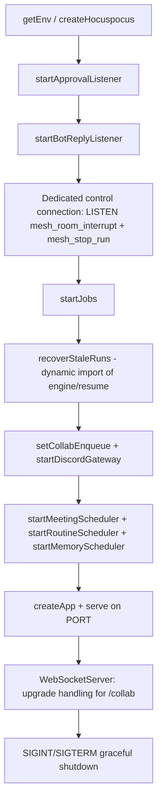

# Orchestrator Service Overview

The orchestrator (`@sayabot/orchestrator`) is the Hono-based execution engine of Sayabot: it boots the HTTP/SSE server, the Yjs collaboration websocket, background schedulers, and PostgreSQL listeners, then executes every agent turn through the coordinator and engine pipeline. This page maps the service entrypoint, the complete HTTP surface, environment configuration, database client (including the per-room advisory lock), and the two authorization helpers.

Source files: `apps/orchestrator/src/index.ts`, `apps/orchestrator/src/http.ts`, `apps/orchestrator/src/env.ts`, `apps/orchestrator/src/db.ts`, `apps/orchestrator/src/authz.ts`, `apps/orchestrator/src/internal-auth.ts`

---

## 🚀 Boot Sequence (`src/index.ts`)

The entrypoint is a top-level-await ESM module. Order of operations:



1. **`getEnv()`** validates and caches the environment (see below); **`createHocuspocus()`** (`src/canvas/server.ts`) builds the Yjs collaboration backend.
2. **`startApprovalListener()`** and **`startBotReplyListener()`** register PostgreSQL `LISTEN` clients (`src/tools/approvals.ts`, `src/bot-reply.ts`). Both are wrapped in `.catch(...)` — if LISTEN is unavailable the code falls back to polling and only logs the error (`src/index.ts:22-27`).
3. **Control connection** (`src/index.ts:29-46`): a dedicated client is checked out of the pool permanently and `LISTEN`s on two channels:
   - `mesh_room_interrupt` → `abortRoomRuns(payload.roomId)` (`src/active-runs.ts`)
   - `mesh_stop_run` → `abortRun(payload.runId)`
   Malformed payloads are silently ignored; connection errors are logged.
4. **`startJobs()`** initializes the room message job queue (`src/jobs/index.ts`).
5. **Stale run recovery**: `recoverStaleRuns()` is dynamically imported from `./engine/resume` and rescues runs orphaned by a restart, logging `[recovery] rescued N stale runs` (`src/index.ts:49-54`).
6. **Collab + schedulers**: `setCollabEnqueue(enqueueRoomMessage)` lets the collaboration layer enqueue room messages; then `startDiscordGateway()`, `startMeetingScheduler()`, `startRoutineScheduler()`, and `startMemoryScheduler()` start.
7. **HTTP server**: `createApp()` from `src/http.ts` is served via `@hono/node-server` on `env.PORT`; logs `orchestrator listening on :PORT` and `canvas sync at ws://localhost:PORT/collab`.
8. **Websocket upgrade** (`src/index.ts:70-100`): a `WebSocketServer` (`maxPayload: 2 MB`, `noServer: true`) handles upgrades only for pathname `/collab` (anything else gets the socket destroyed). Each connection is handed to `hocuspocus.handleConnection` with a synthetic `Request` built by `toFetchRequest()`; `pong` events call `connection.touch()`.
9. **Graceful shutdown**: on `SIGINT`/`SIGTERM` a guard-flagged `shutdown()` stops the meeting scheduler and job queue, destroys hocuspocus, releases the control connection, closes the websocket server and HTTP server, and ends the DB pool (`src/index.ts:102-119`).

---

## 🌐 HTTP Surface (`src/http.ts`)

`createApp()` assembles a single Hono app. Global middleware:

| Middleware | Path | Behaviour |
| :--- | :--- | :--- |
| `bodyLimit` | `/v1/*` | Max request body 2,000,000 bytes (`src/http.ts:108`) |
| `bodyLimit` | `/internal/*` | Max request body 200,000 bytes (`src/http.ts:109`) |
| internal auth | `/internal/*` | Rejects with 401 unless `isInternalRequest(...)` passes (`src/http.ts:115-120`) |
| `app.onError` | all | Logs `[http] unhandled error`, returns `{"error":"internal error"}` with 500 (`src/http.ts:403-406`) |

### Route inventory

| Method & Path | Handler | Auth | Purpose |
| :--- | :--- | :--- | :--- |
| `GET /health` | inline (`src/http.ts:111`) | none | Returns `{ ok, service: "sayabot-orchestrator", activeRuns }` (count from `activeRunIds()`). |
| `POST /internal/room-message` | inline (`src/http.ts:122`) | internal | Validates `{ roomId, messageId }` (both UUIDs), loads the message via `loadMessage()`, requires it to be a human message in that room, calls `interruptRoom(roomId)` then `enqueueRoomMessage(...)`; returns 202 `{ queued: true }`. |
| `POST /internal/inbound` | inline (`src/http.ts:139`) | internal | Connector webhook ingress for `telegram` / `whatsapp` only. Parses raw payload with `eventsFromPayload()`, accepts up to 10 events via `acceptInbound()`. Raw body capped at 100,000 chars. |
| `POST /internal/runs/:runId/stop` | inline (`src/http.ts:160`) | internal | `abortRun(runId)` locally + `notify("mesh_stop_run", { runId })` so every orchestrator instance aborts the run. |
| `POST /internal/routines/:id/run` | inline (`src/http.ts:167`) | internal (re-checked inline → 403) | Triggers `runRoutineNow(routineId)` immediately; 400 with the routine's error on failure. |
| `POST /internal/tasks/mutate` | inline (`src/http.ts:179`) | internal | Validates the full `taskMutateSchema` (status/title/assignees/dueAt/unblockNeeds/blockedBy/outcome/metadata) and applies it through `applyTaskMutation()`. |
| `POST /internal/agents/:agentId/test` | inline (`src/http.ts:194`) | internal | Agent connectivity test. Rejects external agents. If `agentCliRunner()` returns a CLI runner, runs `runCliOnce()` with the prompt "Reply with the single word: ok"; otherwise resolves the model via `resolveAgentModel()` and calls `generateText` with `maxOutputTokens: 200` and a 25 s timeout. Responses are scrubbed with `redactSecrets()` and truncated (300 chars text / 500 chars error). |
| `POST /internal/tools/test-web-search` | inline (`src/http.ts:236`) | internal | Tests search providers; falls back to stored credentials from `resolveToolCredential({ orgId, tool: "web_search" })` when no key is passed, then runs `executeWebSearch` with `count: 3`. |
| `POST /internal/tools/test-document-ocr` | inline (`src/http.ts:273`) | internal | Tests OCR providers (docling/marker/tesseract skip credential lookup); calls `executeDocumentExtract` with `fallbackToVision: true`. |
| `POST /internal/canvases/:canvasId/restore` | inline (`src/http.ts:312`) | internal + room auth | Loads the canvas, validates a `{ userId, snapshot ≤ 1,000,000 chars }` body, checks `canUserReadRoom(userId, canvas.roomId)` (403 otherwise), then `restoreCanvasSnapshot()`. |
| `POST /v1/tools/:toolCallId/approve` | inline (`src/http.ts:331`) | internal | Approval-gate resolution: updates `tool_calls` to `approved`/`rejected` with `resolvedAt` (only from `pending_approval`), `notify("tool_call_resolved", ...)`, and calls `resolveApprovalWaiter(toolCallId, status)`. |
| `GET /internal/runs/:runId/trace` | inline (`src/http.ts:362`) | internal | Debug trace: returns the `agent_runs` row, ordered `run_steps`, and `run_transcripts.plan`. |
| `POST /v1/rooms/:roomId/messages` | `botRoutes` (`src/bot/routes.ts:72`) | agent API key | Bot-API message post. Authenticates via `authenticateAgentKey`, requires room membership (`isAgentInRoom`), resolves threads (`thread_id` / `reply_to`), and posts through `postAgentMessage` (201). |
| `POST /v1/rooms/:roomId/messages/stream` | `botRoutes` (`src/bot/routes.ts:106`) | agent API key | Streaming ingest for external bot runs. Requires `application/x-ndjson` or `text/event-stream` content type (415 otherwise). Inserts a `streaming` message row, parses deltas with `BotStreamParser`, redacts secrets, broadcasts `message.delta` (sequenced) and `message.done` realtime events, persists the accumulated content at most once per second, then `notifyBotReply`. Ends 400 if the stream failed or produced no content. |
| `GET /v1/mcp` and `GET /v1/mcp/:token` | `mcpRoutes` (`src/mcp/server.ts:866-867`) | none / token | Renders MCP server instructions. |
| `POST /v1/mcp` and `POST /v1/mcp/:token` | `mcpRoutes` (`src/mcp/server.ts:870-871`) | token-optional | Serves the MCP (Model Context Protocol) endpoint. `DELETE /v1/mcp*` responds 405 with `Allow: GET, POST`. |
| `POST /internal/egress/identity` | `internalRoutes` (`src/internal/routes.ts:35`) | internal | Egress identity registration (computerd proxy credentials). |
| `POST /internal/egress/resolve` | `internalRoutes` (`src/internal/routes.ts:78`) | internal | Resolves an egress caller IP/credential to an agent. |
| `POST /internal/egress/approval` | `internalRoutes` (`src/internal/routes.ts:159`) | internal | Egress-side approval escalation. |
| `POST /internal/egress/violation` | `internalRoutes` (`src/internal/routes.ts:234`) | internal | Reports SSRF policy violations. |
| `POST /internal/egress/usage` | `internalRoutes` (`src/internal/routes.ts:289`) | internal | Egress usage accounting. |
| `GET /internal/egress/stream` | `internalRoutes` (`src/internal/routes.ts:299`) | internal | SSE stream of egress events to the dashboard. |
| `POST /internal/computer/state` | `internalRoutes` (`src/internal/routes.ts:355`) | internal | Computerd reports computer lifecycle state. |
| `GET /internal/computer/:agentId/grants-env` | `internalRoutes` (`src/internal/routes.ts:393`) | internal | Returns agent connector grant environment for computerd. |
| `POST /internal/tasks/wake` | `internalRoutes` (`src/internal/routes.ts:428`) | internal | Wakes a room/task waiting on a human decision. |
| `POST /internal/local-jobs/:jobId/events` | `localJobRoutes` (`src/internal/local-jobs.ts:41`) | internal | Ingests events from local (desktop) job runners. |
| `POST /internal/local-jobs/:jobId/approval` | `localJobRoutes` (`src/internal/local-jobs.ts:57`) | internal | Approval callbacks from local job runners. |

`src/http.ts` also exports `getDbForHealth()` as a convenience accessor used by external health probes.

---

## ⚙️ Environment Variables (`src/env.ts`)

Configuration is a single Zod schema validated once by `getEnv()` and cached (`resetEnvCache()` clears it — used by tests). `getEnv()` performs aliasing before validation:

- `MESH_KEK` and `SAYABOT_KEK` are **set to the same value** — `SAYABOT_KEK` takes precedence over `MESH_KEK` (`process.env.SAYABOT_KEK || process.env.MESH_KEK`), and both schema fields are overwritten with it (`src/env.ts:47-56`).
- `SUPABASE_URL` falls back to `NEXT_PUBLIC_SUPABASE_URL`.
- `MESH_ALLOW_PRIVATE_WEBHOOKS` falls back to `SAYABOT_ALLOW_PRIVATE_WEBHOOKS` (and vice versa is not applied).

Validation failures throw with one line per issue: `Invalid orchestrator environment:\n<path>: <message>`.

| Variable | Type / Default | Notes |
| :--- | :--- | :--- |
| `DATABASE_URL` | string, required | PostgreSQL connection string for `createDb`. |
| `MESH_KEK` | string, required (min 1) | Master envelope-encryption key (see aliasing above). |
| `SAYABOT_KEK` | optional | Aliased to the same raw value as `MESH_KEK`. |
| `SUPABASE_URL` | URL, required | Falls back to `NEXT_PUBLIC_SUPABASE_URL`. |
| `SUPABASE_SERVICE_ROLE_KEY` | string, required (min 1) | Service-role key for Supabase Auth verification. |
| `ORCHESTRATOR_INTERNAL_SECRET` | string, required (min 16) | Shared secret for `/internal/*` routes. |
| `PORT` | number, default `4000` | HTTP listen port (`z.coerce.number()`). |
| `COMPUTERD_URL` | default `http://localhost:4100` | computerd daemon base URL. |
| `EGRESS_URL` | default `http://localhost:8081` | Egress control API. |
| `EGRESS_PROXY_URL` | default `http://localhost:8080` | Egress forward proxy. |
| `COMPUTE_ENABLED` | optional, `"true"` → true | Enables computer/sandbox backends. |
| `E2B_API_KEY` | optional | E2B cloud sandbox backend key. |
| `BRAVE_SEARCH_API_KEY` | optional | Brave search provider key. |
| `MESH_ALLOW_PRIVATE_WEBHOOKS` | optional, `"true"` → true | Aliased with `SAYABOT_ALLOW_PRIVATE_WEBHOOKS`. |
| `SAYABOT_ALLOW_PRIVATE_WEBHOOKS` | optional, `"true"` → true | Allows webhook URLs on private networks. |
| `DEV_OPENAI_COMPAT_BASE_URL` | optional | Local OpenAI-compatible dev endpoint. |
| `DEV_OPENAI_COMPAT_API_KEY` | optional | Key for the dev endpoint. |
| `DEV_OPENAI_COMPAT_MODEL` | optional | Model id for the dev endpoint. |
| `CLOUDFLARE_ACCOUNT_ID` | optional | Cloudflare Workers AI account. |
| `CLOUDFLARE_API_TOKEN` | optional | Cloudflare API token. |
| `CLOUDFLARE_AI_GATEWAY_ID` | optional | AI Gateway routing id. |
| `CLOUDFLARE_BROWSER_RENDERING_ENDPOINT` | optional | Browser Rendering REST endpoint. |
| `CLOUDFLARE_R2_BUCKET` | optional | R2 bucket for artifacts. |
| `NEXT_PUBLIC_VAPID_PUBLIC_KEY` | optional | Web-push VAPID public key. |
| `VAPID_PRIVATE_KEY` | optional | Web-push VAPID private key. |
| `VAPID_SUBJECT` | optional | Web-push `mailto:`/`https:` subject. |

Note: boolean-style variables use `.transform((v) => v === "true")`, so any value other than the exact string `true` is false.

---

## 🗄️ Database Client & Advisory Lock (`src/db.ts`)

`db.ts` lazily creates a singleton via `createDb(getEnv().DATABASE_URL)` from `@sayabot/db` and exposes:

- `getDb(): Db` — the Drizzle client.
- `getPool(): DbPool` — the underlying `pg` pool.
- `closeDb(): Promise<void>` — `pool.end()` and clears the singleton (no-op if never created).
- `notify(channel, payload)` — `pg_notify` with JSON-serialized payload (`src/db.ts:44-46`); used for `mesh_room_interrupt`, `mesh_stop_run`, `tool_call_resolved`, etc.

### `withRoomLock` — per-room turn serialization

```typescript
// src/db.ts:29-42
export async function withRoomLock<T>(roomId: string, fn: () => Promise<T>): Promise<T> {
  const client = await getPool().connect()
  const key = `mesh:room:${roomId}`
  try {
    await client.query("select pg_advisory_lock(hashtext($1)::bigint)", [key])
    return await fn()
  } finally {
    try {
      await client.query("select pg_advisory_unlock(hashtext($1)::bigint)", [key])
    } finally {
      client.release()
    }
  }
}
```

Key properties:

- **Session-scoped advisory lock** keyed on `hashtext("mesh:room:<roomId>")::bigint`. A dedicated client is checked out of the pool for the duration because session locks live on a single physical connection — pooled `.query()` calls could land on different connections and fail to unlock.
- The `finally` block guarantees unlock *and* client release even if `fn()` throws (the unlock itself is nested in its own `finally` so the client is always released).
- The coordinator wraps the whole turn execution in this lock — see [coordinator.md](./coordinator.md).

---

## 🔐 Authorization Helpers (`src/authz.ts`)

Two small DB-backed checks used by HTTP routes and collab code:

- **`canUserReadRoom(userId, roomId): Promise<boolean>`** (`src/authz.ts:5-25`) — grants access if a `room_members` row exists for the user, **or** the room's `kind` is `"public"` and the user is an `org_members` row of the room's `orgId`. Used by the canvas restore route and canvas/collab services.
- **`isAgentInRoom(agentId, roomId): Promise<boolean>`** (`src/authz.ts:27-34`) — membership check against `room_agents`; used by the bot API routes to gate posting to rooms.

Tables touched: `room_members`, `rooms`, `org_members`, `room_agents` (read-only).

---

## 🎫 Internal Authentication (`src/internal-auth.ts`)

```typescript
// src/internal-auth.ts:4-12
export function isInternalRequest(authorization: string | undefined, secretHeader?: string): boolean
```

- Accepts the secret from either the `x-internal-secret` header or an `Authorization: Bearer <secret>` header (header form wins).
- Compares against `getEnv().ORCHESTRATOR_INTERNAL_SECRET` using `timingSafeEqual` with a length pre-check (lengths must match; mismatched lengths return false without calling `timingSafeEqual`).
- Gates every `/internal/*` route, the `/v1/tools/:toolCallId/approve` approval endpoint, and the run trace route.

---

## 🧪 Tests

There are no dedicated `*.test.ts` files for `index.ts`, `http.ts`, `env.ts`, `db.ts`, `authz.ts`, or `internal-auth.ts` at the top level; adjacent `env.ts` cache-reset support (`resetEnvCache`) exists for test harnesses. Behaviour of the internal-auth primitive is exercised indirectly through route-level tests of downstream modules (e.g. `src/mcp/server.test.ts`).

---

## Related docs

- [Coordinator — turn queueing & serialization](./coordinator.md)
- [Engine loop](./engine-loop.md)
- [Interrupts & recovery](./engine-interrupts-and-recovery.md)
- [Tool system](../tools/tool-system.md)
- [Connector platform](../platform/connector-platform.md)
