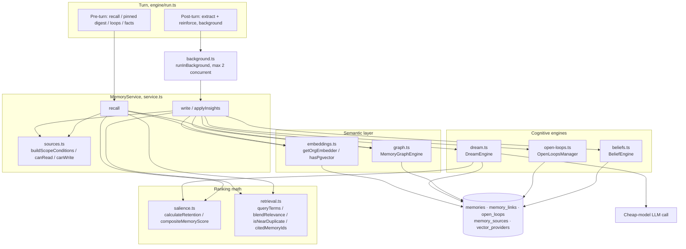

# Memory Modules — the Cognitive Pipeline Internals

`apps/orchestrator/src/memory/modules/` holds the nine engines and helper sets that `MemoryService` composes into the cognitive memory layer: access control, ranking math, retrieval blending, embeddings, the knowledge graph, open loops, beliefs, the dream consolidator, and the background queue that keeps all of it off the turn's critical path. Each module is deliberately narrow — the pure math modules (retrieval, salience) have no I/O so the ranking rules are unit-testable in isolation, and the engine classes (`BeliefEngine`, `OpenLoopsManager`, `MemoryGraphEngine`, `DreamEngine`) take a `Db` handle and trust `MemoryService` to have checked access.

Source files: `apps/orchestrator/src/memory/modules/background.ts`, `beliefs.ts`, `dream.ts`, `embeddings.ts`, `graph.ts`, `open-loops.ts`, `retrieval.ts`, `salience.ts`, `sources.ts`

---

## 🗺️ How the modules connect



Two flows to keep in mind while reading: the **write/extraction flow** (`DreamEngine` parses a transcript into insights → `applyInsights` dedupes via `retrieval.isNearDuplicate` → writes via `sources`-checked scope conditions → `graph.syncLinks` + `embeddings.scheduleEmbedding` fire async through `background.ts`), and the **read/recall flow** (three SQL candidate passes → `retrieval.blendRelevance` → `salience.calculateRetention` + `compositeMemoryScore` → optional `graph.getLinksForMemories` decoration → optional `reinforce`).

---

## 🧵 `background.ts` — the off-turn work queue

A small in-process queue for memory work that must not hold the room lock or delay the reply: post-turn extraction, embedding, mirror sync, citation reinforcement. Constants: `MAX_CONCURRENT = 2`, `MAX_PENDING = 200` (`background.ts:12-13`).

- `runInBackground(label, task)` (`background.ts:24-32`) enqueues and pumps; when the backlog is full it **drops the new job** with a `[memory] background queue full` warning and returns `false` — memory is best-effort, the turn itself already succeeded.
- `pump()` (`background.ts:34-54`) runs up to two jobs concurrently, redacting every failure message, and resolves idle waiters when both the queue and the running set are empty.
- `drainBackground()` (`background.ts:57-60`) resolves once every queued and running job has settled — the hook for tests and graceful shutdown. Jobs still queued when the process exits are lost; the scheduled backfill re-embeds anything that missed its vector.

The engine wraps all four async memory jobs with it (`memory.extract`, `memory.reinforce`, `memory.mirror` in `engine/run.ts`; `memory.embed` from `MemoryService.scheduleEmbedding`, `service.ts:677-680`).

## 🧮 `retrieval.ts` — pure recall math

No I/O; every ranking rule here is directly unit-tested.

- `STOP_WORDS` (`retrieval.ts:8-76`) — a ~70-word English stop set; Postgres applies its own on top.
- `queryTerms(text, max = 24)` (`retrieval.ts:82-90`) — lowercased, de-duplicated content words of 2+ chars, split on non-letter/non-digit boundaries, which also makes tokens safe to splice into `to_tsquery`.
- `buildOrTsQuery(terms)` (`retrieval.ts:97-100`) — OR-joins terms as `a | b | c`. The comment explains the design: `websearch_to_tsquery` ANDs every word, so a long trigger message would match almost nothing; OR plus `ts_rank` ranks partial overlap instead.
- `keywordRelevance` (`retrieval.ts:106-124`) — bidirectional overlap: max of (query coverage over title+body) and (0.9 × title-term coverage), so a short memory title fully contained in a long request is a strong match.
- `cosineSimilarity` (`retrieval.ts:126-140`) — plain dot-product cosine; returns 0 on length mismatch or zero norm.
- `vectorRelevance(similarity, floor)` (`retrieval.ts:146-149`) — remaps raw cosine onto [0,1] above the model's `simFloor`; the span is `max(0.05, 0.9 − floor)`.
- `ftsRelevance(rank, maxRank)` (`retrieval.ts:152-155`) — normalised ts_rank mapped into [0.3, 0.8].
- `blendRelevance` (`retrieval.ts:160-169`) — **strongest signal wins**, plus `0.1` per extra signal scoring ≥ 0.3 (the agreement bonus).
- `jaccard` / `normalizeTitle` / `isNearDuplicate` (`retrieval.ts:171-204`) — duplicate detection used by `applyInsights`: exact normalised-title match, or optional vector similarity ≥ 0.92, or title Jaccard ≥ 0.7, or full-text Jaccard ≥ 0.6.
- `citedMemoryIds(text, allowed)` (`retrieval.ts:207-217`) — parses `[#<uuid>]` citations out of the agent's reply, keeping only ids the agent actually saw in recall (this is what prevents citation spoofing across rooms).

## ⚖️ `salience.ts` — Ebbinghaus retention and the composite score

- `calculateRetention(params)` (`salience.ts:22-37`) — R(t) with spaced reinforcement, clamped to [0.05, 1.0]:

```
deltaDays     = (now − (lastUsedAt ?? createdAt)) / day
lambda        = ln(2) / max(1, decayHalfLifeDays)
decay         = e^(−lambda · deltaDays)
reinforcement = 1 + log2(1 + useCount) · 0.15
score         = decay · reinforcement
```

Recalling a memory bumps `lastUsedAt`/`useCount`, so each genuine use multiplies remaining retention by ~1.15×log₂(1+n) — the spaced-repetition effect. Default half-life is 30 days; daily episodes use 14 (`service.ts:1078`).

- `compositeMemoryScore(params)` (`salience.ts:55-94`) — withdrawn memories get a hard zero; otherwise `baseScore = relevance·0.4 + retention·0.2 + emotionalSalience·0.2 + confidence·0.2`, plus a `0.35` pinned boost, all multiplied by the epistemic weight (verified 1.2, belief 1.0, hypothesis 0.8, superseded 0.2). Result clamped at 0 and rounded to 4 decimals. `keywordMatchRatio` is a deprecated alias for `relevance`.

## 🛂 `sources.ts` — scope visibility and access control

The single source of truth for who sees what, enforced both in SQL and in JS.

- `formatSourceId` / `parseSourceId` (`sources.ts:10-21`) — the `"agent:uuid" | "room:uuid" | "org:uuid"` ids used by the `memory_sources` registry table.
- `getOrCreateSource` (`sources.ts:26-73`) — idempotent insert-on-conflict registration of a named source (with `federated` and `config`), falling back to a re-select if a concurrent insert won.
- `MemoryAccessContext` (`sources.ts:76-80`) — `{ orgId, agentId?, roomId? }`: who is asking.
- `buildScopeConditions(input)` (`sources.ts:95-132`) — the SQL filter for every memory query. Visibility rules (from the doc comment at `sources.ts:82-94`):
  - `org` memories are visible org-wide;
  - `room` memories only inside that room, shared by every agent there;
  - `agent` memories are private to one agent, but a row with `room_id` set is bound to that room too (what the agent learned there) — it never surfaces in another room whose members may differ;
  - an explicit scope without its matching id matches **nothing** (`sql`false``), not every room or agent;
  - a broad recall (no scope) unions org + this room + this agent's (room-bound-or-wide) rows.
- `canReadMemory` (`sources.ts:146-156`) — the JS twin used by `loadAccessible`, lineage traversal and link filtering.
- `canWriteMemory` (`sources.ts:163-169`) — read visibility plus: org-wide memories are writable only by the agent that created them (`memoryCreatedByAgentId === requestingAgentId`), so one bot cannot retract the workspace's shared knowledge.

## 🔣 `embeddings.ts` — per-org embedding providers

Implements semantic recall on top of org-configured providers (`vector_providers`, `kind = 'embedding'`), with keys sealed under the KEK and decrypted only here, in-process (`embeddings.ts:144-181`).

- `Embedder` interface (`embeddings.ts:15-23`) — `provider`, `model`, `modelKey` (`${provider}:${model}`, stored on each row so a provider switch never mixes vectors), `simFloor` (cosine at or below which vectors carry no topical signal), and `embed(texts, purpose)` where purpose is `"document"` or `"query"`.
- `DEFAULTS` (`embeddings.ts:32-36`) — `openai: text-embedding-3-small` (floor 0.2), `voyage: voyage-3` (floor 0.3), `google_gemini: text-embedding-004` (floor 0.45). Anything else → `createEmbedder` returns null, i.e. keyword/FTS-only recall.
- `createEmbedder` (`embeddings.ts:48-132`) — batches 32 texts per call with a 10 s timeout and a 2000-char input cap; Voyage sends `input_type`, Gemini uses `batchEmbedContents` with `RETRIEVAL_QUERY`/`RETRIEVAL_DOCUMENT` task types and the key in the `x-goog-api-key` header (never the URL); OpenAI-compatible endpoints are allowed only via `safeOpenAiEndpoint` (`embeddings.ts:135-138`), which insists on `https://…/embeddings`. Responses are re-sorted by `index` and mismatched/empty vectors throw.
- `getOrgEmbedder(db, orgId)` (`embeddings.ts:144-181`) — loads the org's active embedding row, decrypts the key with `MESH_KEK`, and caches the result (including the null case) for 60 s. `clearEmbedderCache()` resets it.
- `hasPgvector(db)` (`embeddings.ts:191-203`) — checks `pg_extension` for `vector`, cached for 10 minutes; `markPgvectorUnavailable()` demotes to in-process cosine after a failed SQL-side vector query, `resetPgvectorState()` clears it; `toVectorLiteral` (`embeddings.ts:214-216`) renders `[0.1,0.2,…]`, coercing non-finite values to 0.
- `embeddingText(title, body)` (`embeddings.ts:44-46`) — `` `${title}\n${body}` `` truncated to 2000 chars, the canonical document text.

## 🕸️ `graph.ts` — `MemoryGraphEngine`

Manages concept wikilinks and relational walks. All reads filter through `buildScopeConditions`/`canReadMemory`.

- `slugify` / `extractWikilinks` (`graph.ts:9-24`) — `[[slug]]` extraction from a memory body, slugified with lowercase/`-` normalisation; `WIKILINK_REGEX` accepts `[a-zA-Z0-9_\-\s]+`.
- `syncLinks` (`graph.ts:54-105`) — re-indexes a memory's declared links on every write: explicit `MemoryLinkInput` entries (skipping `supersedes`, which is belief history, not a body link) plus body wikilinks as `relates_to` edges with weight `0.8` (explicit links default weight `1.0`). It deletes all previous non-`supersedes` links first, so a rewrite clears dropped links even when the new body has none.
- `graphWalk` (`graph.ts:113-239`) — breadth-first from a readable root, `maxDepth` clamped to [1, 2] and `limit` defaulting to 15. Each level: edges touching the current level in either direction; `targetSlug` edges resolve to memories whose title slugifies to that slug (via a SQL twin of `slugify`, `graph.ts:27`) **plus co-citations** (other memories linking the same slug); neighbour memories are filtered through visibility before becoming nodes.
- `getLinksForMemories` (`graph.ts:245-298`) — outgoing links for a recall result set; links pointing at a memory the caller cannot read are dropped so recall never reveals another agent's or room's memory ids.

## 🔁 `open-loops.ts` — `OpenLoopsManager`

Commitment tracking over the `open_loops` table.

- `createOpenLoop` (`open-loops.ts:36-52`) — inserts with `status "open"`, description redacted and clamped to 2048 chars, optional `dueAt` and `sourceRef`.
- `updateOpenLoop` (`open-loops.ts:57-86`) — partial update of status/blocker/resolution/dueAt, guarded by `id + orgId + agentId`: **loops belong to one agent; only that agent may change them**. Redaction applied to blocker and resolution text; setting a field to an empty string clears it to null.
- `resolveOpenLoop` (`open-loops.ts:91-104`) — sugar for `updateOpenLoop` with `status: "resolved"`.
- `getActiveLoops` (`open-loops.ts:109-135`) — statuses `open | in_progress | blocked`, newest first, limit 20. `roomId` filters to the room; `roomless: true` instead filters to `roomId IS NULL` — the flag the mirror uses so only room-independent loops reach the computer files.
- `formatOpenLoopsMarkdown` (`open-loops.ts:140-159`) — the `# Active Open Loops` rendering used in prompts and the mirror: `- **[STATUS]** description (Due: YYYY-MM-DD)` plus an indented `**Blocker**` line, or a "No pending commitments" placeholder.

## 🧠 `beliefs.ts` — `BeliefEngine`

The epistemic lifecycle: `hypothesis → belief → verified → superseded | withdrawn`. Its constructor takes a `Db`; access control lives in `MemoryService`, which pre-checks every id via `loadAccessible` before delegating (`service.ts:796-813`).

- `assertBelief` (`beliefs.ts:64-104`) — inserts a belief with defaults: `kind "decision"`, `confidence` derived from status (`verified 1.0`, `hypothesis 0.6`, else `0.85`), `pinned false`, `decayHalfLifeDays 30`; title/body redacted and clamped (200/4096). When `supersedesMemoryId` is given it chains `supersedeBelief` after the insert.
- `withdrawBelief` (`beliefs.ts:110-122`) — sets `epistemicStatus "withdrawn"` with a redacted ≤500-char `withdrawalReason`; the row stays as an audit trail and scores as zero.
- `supersedeBelief` (`beliefs.ts:127-154`) — marks the old row `superseded` with `supersededBy = newMemoryId` and inserts a `memory_links` edge `newMemory → supersedes → oldMemory` (weight 1.0). Same-id input returns false.
- `detectContradictions` (`beliefs.ts:160-214`) — heuristic, not semantic: over the 100 most recent _visible_ active memories, a candidate contradicts when ≥ `min(2, titleTokens.length)` title keywords (len > 3) appear in its title+body, or a shared tag plus ≥ 1 keyword. Max 10 candidates with explanatory `reason` strings.
- `getBeliefLineage` (`beliefs.ts:220-266`) — walks `supersedes` edges backward up to 10 hops with a `seen` cycle guard, stopping at the first unreadable memory.

## 💭 `dream.ts` — `DreamEngine` (the "sleep cycle")

Two responsibilities: per-turn extraction and scheduled consolidation.

### Extraction: `extractCognitiveInsights` (`dream.ts:129-166`)

A single cheap-model call (resolved per-agent via `resolveAgentCheapModel`, usage recorded with `kind: "memory"`) over a transcript that must already be redacted and is truncated to 6000 chars; under 50 chars it returns empty without calling the model. The system prompt (`dream.ts:66-84`) demands JSON of shape `{ beliefs, openLoops, resolvedLoops, episode }` and enforces the pipeline's editorial rules:

- at most 3 beliefs and 2 open loops; empty arrays when nothing durable happened (greetings and status chatter are ignored);
- capture both what the human stated (preferences, decisions, constraints) and what the agent concluded;
- titles are short noun phrases naming the topic (e.g. "Deploy target") so a later restatement updates the same memory;
- `shared: true` only for project knowledge the whole room should rely on — personal details stay private;
- `resolvedLoops` must reference ids from the ACTIVE LOOPS block;
- never copy credentials, tokens, keys or passwords into any field.

Parsing is forgiving: `parseInsightJson` (`dream.ts:87-96`) slices from the first `{` to the last `}` to tolerate code fences, and `normalizeInsights` (`dream.ts:98-115`) validates every item individually, dropping invalid ones, capping counts, and — a deliberate epistemic rule — **downgrading any model-claimed `verified` to `belief`** because a transcript is the agent's own account and can support but never verify a claim (`dream.ts:14-18`). Resolved-loop ids are accepted only if they were in the active-loops set shown to the model, so hallucinated or foreign ids cannot resolve someone else's commitment.

### Consolidation: `dreamConsolidate` (`dream.ts:174-247`)

Run by the scheduler every 6 hours (see [./scheduler-and-mirror.md](./scheduler-and-mirror.md)):

1. **Episode pruning** — unpinned episodes with `calculateRetention < 0.15` **and** age > 14 days are deleted (both conditions, so a fresh-but-ignored episode survives its first fortnight).
2. **Overdue loops** — `open`/`in_progress` loops past `dueAt` become `blocked` with reason `"Overdue loop auto-flagged during dream consolidation"`.
3. **Withdrawn purge** — withdrawn memories with `updatedAt` older than 60 days are deleted.

`DreamConsolidationResult` reports `prunedEpisodes`, `withdrawnCleaned`, `staleLoopsFlagged`.

---

## 🧪 Tests

There are no per-module test files under `modules/`; the whole pipeline is covered from `apps/orchestrator/src/memory/memory.test.ts`, whose describe blocks map onto the modules:

| Module                              | Coverage in `memory.test.ts`                                                                                                                                   |
| :---------------------------------- | :------------------------------------------------------------------------------------------------------------------------------------------------------------- |
| `salience.ts`                       | `describe("retention & composite score")` — half-life decay, use reinforcement, epistemic weighting, withdrawn zero (`:141-185`)                               |
| `sources.ts`                        | `describe("access control")` — scope isolation, room-bound private memories, org write ownership, empty-match for scope-without-id (`:186-244`)                |
| `retrieval.ts`                      | `describe("retrieval helpers")` — tokenization, title containment, vector floors, blend bonus, near-duplicates, citations (`:245-308`)                         |
| `dream.ts`                          | `describe("extraction parsing")` — fenced JSON, verified→belief downgrade, cap enforcement, unknown loop ids (`:309-346`)                                      |
| `beliefs.ts`                        | `describe("belief engine")` — redaction + supersedes link, visible-only contradictions, lineage stopping at unreadable rows (`:347-392`)                       |
| `open-loops.ts`                     | `describe("open loops")` — owner-scoped updates, markdown formatting, roomless listing (`:393-429`)                                                            |
| `graph.ts`                          | `describe("knowledge graph")` — wikilink slugification, supersedes preserved on rewrite, invisible root, level-wide BFS (`:430-493`)                           |
| `service.ts` recall/`applyInsights` | ranking + reinforcement split, exclusion defaults, private-vs-shared insight placement, restatement merging, loop dedup/resolution (`:581-753`)                |
| `embeddings.ts`                     | `describe("embedding providers")` — OpenAI index ordering, Gemini header auth, Voyage `input_type`, redacted HTTP errors, unknown provider → null (`:754-803`) |
| `background.ts`                     | `describe("background queue")` — runs tasks and survives failures (`:804-818`)                                                                                 |

Related docs: [./overview.md](./overview.md) · [./tools.md](./tools.md) · [./scheduler-and-mirror.md](./scheduler-and-mirror.md) · [../../database/schema-memory.md](../../database/schema-memory.md) · [../../core/redact-and-breakers.md](../../core/redact-and-breakers.md)
