# Memory Overview — the Cognitive Memory Service

The orchestrator's memory layer gives agents durable, scoped, human-like memory: facts and decisions that survive across turns, an epistemic lifecycle (hypothesis → belief → verified → superseded/withdrawn), open-loop commitment tracking, a relational knowledge graph, and hybrid recall that blends Postgres full-text search, optional embeddings, and keyword overlap with Ebbinghaus-style retention decay. `MemoryService` is a process-wide singleton accessed through `getMemoryService()`; all persistence lives in the `memories` table (plus `memory_links`, `open_loops`, `memory_sources`, `vector_providers` and the `owner_facts` fact store). Every read and write is filtered through the calling agent's access context, so ids an agent cannot see behave as "not found".

Source files: `apps/orchestrator/src/memory/index.ts`, `apps/orchestrator/src/memory/service.ts`, `apps/orchestrator/src/memory/types.ts`

---

## 🧠 What the service exports (`memory/index.ts`)

`index.ts` is a pure re-export barrel (`memory/index.ts:1-10`): `./modules/beliefs`, `./modules/dream`, `./modules/graph`, `./modules/open-loops`, `./modules/salience`, `./modules/sources`, `./modules/retrieval`, plus `./service`, `./tools` and `./types`. Consumers such as the engine import `getMemoryService` and `runInBackground` from here or directly from `./memory/service`.

`memory/types.ts` derives every memory enum type from the Drizzle pg enums in `packages/db/src/schema/enums.ts:105-144` rather than redefining them:

| Type              | Values                                                                                     |
| :---------------- | :----------------------------------------------------------------------------------------- |
| `MemoryScope`     | `agent` \| `room` \| `org`                                                                 |
| `MemoryKind`      | `fact` \| `preference` \| `decision` \| `procedure` \| `episode`                           |
| `MemorySource`    | `agent` \| `human` \| `compaction` \| `consolidation` \| `import`                          |
| `EpistemicStatus` | `hypothesis` \| `belief` \| `verified` \| `withdrawn` \| `superseded`                      |
| `OpenLoopStatus`  | `open` \| `in_progress` \| `blocked` \| `resolved` \| `dropped`                            |
| `MemoryLinkType`  | `relates_to` \| `depends_on` \| `caused_by` \| `contradicts` \| `supersedes` \| `supports` |

It also defines the write/recall contracts used across the layer:

- `CognitiveWriteInput` (`memory/types.ts:24-46`) — org, scope, agent/room binding, kind, title, body, tags, source, confidence, pinned, perspective, emotional salience, epistemic status, evidence refs, `targetAgentId`, `decayHalfLifeDays`, `links[]`, and creator ids.
- `CognitiveRecallInput` / `ScoredMemoryItem` / `MemoryLinkView` / `OpenLoopItem` — the view shapes returned to tools and prompts.
- `service.ts:52` aliases `export type WriteMemoryInput = CognitiveWriteInput`, and `service.ts:53` re-exports `MemoryAccessContext` from `./modules/sources`.

## 🗄️ Storage model

Five tables back the layer (schema in `packages/db/src/schema/memory.ts`; full column reference in [../../database/schema-memory.md](../../database/schema-memory.md)):

| Table              | Role                                                                                                                                                                                                                                                                                                                                                                                                                                         |
| :----------------- | :------------------------------------------------------------------------------------------------------------------------------------------------------------------------------------------------------------------------------------------------------------------------------------------------------------------------------------------------------------------------------------------------------------------------------------------- |
| `memories`         | One row per memory: scope/agent/room binding, kind, title, body, tags, source, confidence, pinned, epistemic status, `supersededBy`, `withdrawalReason`, `decayHalfLifeDays`, `lastUsedAt`, `useCount`, `perspective`, `emotionalSalience`, `evidenceRefs`, and the embedding triple (`embedding real[]`, `embeddingModel`, `embeddedAt`). A generated `tsv` tsvector column (`packages/db/sql/0011_memory.sql:39`) powers full-text recall. |
| `memory_links`     | Knowledge-graph edges: `sourceMemoryId` → `targetMemoryId` or `targetSlug`, with `relationship` and `weight`.                                                                                                                                                                                                                                                                                                                                |
| `open_loops`       | Commitments/promises per agent (optionally per room) with `status`, `dueAt`, `blockerReason`, `resolution`.                                                                                                                                                                                                                                                                                                                                  |
| `memory_sources`   | Registered source ids of the form `"agent:uuid" / "room:uuid" / "org:uuid"` with `federated` and `config` flags.                                                                                                                                                                                                                                                                                                                             |
| `vector_providers` | Per-org embedding/vector-DB provider config; the API key is sealed with the KEK (`ciphertext`/`iv`/`tag`).                                                                                                                                                                                                                                                                                                                                   |

Embeddings are stored as plain `real[]` so the column works without the pgvector extension; recall casts to `::vector` only when `pg_extension` reports `vector` installed (`modules/embeddings.ts:191-203`). The `embeddingModel` column stores `${provider}:${model}` so switching providers never mixes vector generations.

## 🔒 Memory scopes and visibility

Three scopes exist, and visibility is enforced twice: once in SQL via `buildScopeConditions` and once in JS via `canReadMemory` / `canWriteMemory` (`modules/sources.ts:95-169`):

| Scope   | Stored on                         | Visible to                                                                                                                                                                                                                                                                                   |
| :------ | :-------------------------------- | :------------------------------------------------------------------------------------------------------------------------------------------------------------------------------------------------------------------------------------------------------------------------------------------- |
| `agent` | `agent_id` (+ optional `room_id`) | Only that agent. A row with `room_id` set is bound to that room ("what the agent learned there") and never surfaces in another room; `room_id` null is agent-wide.                                                                                                                           |
| `room`  | `room_id`                         | Every agent in that room, and nobody else.                                                                                                                                                                                                                                                   |
| `org`   | neither                           | The whole workspace. Writable only by the agent that created it (`canWriteMemory`, `modules/sources.ts:163-169`) — one bot cannot retract the workspace's shared knowledge, and `MemoryService.write` never lets an agent overwrite an org memory written by a human (`service.ts:256-262`). |

An explicit scope without its matching id matches nothing rather than every room/agent (`modules/sources.ts:114-124`).

## ✍️ Write path (`MemoryService.write`, `service.ts:222-342`)

1. **Redact and clamp** — title is sliced to 200 chars, body to 4096, both passed through `redactSecrets` (`service.ts:224-225`).
2. **Bind ids by scope** — `agentId` is kept only for `agent` scope (required), `roomId` only for non-`org` scope (`service.ts:226-230`).
3. **Same-title upsert** — a case-insensitive title match within the same scope bucket updates the existing row in place; only caller-provided fields change, so re-remembering never silently unpins or clears tags (`service.ts:232-300`). Re-asserting a `withdrawn`/`superseded` memory revives it and clears the withdrawal/supersession markers (`service.ts:283-287`).
4. **Embedding invalidation** — if the body changed, `embedding`, `embeddingModel` and `embeddedAt` are nulled and re-scheduled (`service.ts:288-292`, `service.ts:340`).
5. **Graph sync** — `graph.syncLinks` indexes explicit links and `[[wikilink]]` slugs from the body (best-effort, errors swallowed, `service.ts:331-338`).

Insert defaults (`service.ts:302-326`): `source "agent"`, `confidence 1.0`, `pinned false`, `perspective "first_person"`, `emotionalSalience 0.5`, `epistemicStatus "belief"`, `decayHalfLifeDays 30`.

## 🔎 Recall path (hybrid, `MemoryService.recall`, `service.ts:357-561`)

Candidates are merged by id from three SQL passes, each limited to `max(30, limit * 4)` rows (the recent pass widens to 100 when cosine runs in-process):

1. **Full-text** — `tsv @@ to_tsquery('english', …)` with an OR-joined query and `ts_rank(..., 32)` ordering (`service.ts:398-412`). OR rather than AND so a long trigger message still matches partial overlap.
2. **Vector** — when the org has an active embedding provider, the query is embedded and nearest neighbours are fetched with `<=>` in SQL when pgvector is installed, otherwise cosine is computed in-process over the other candidates (`service.ts:415-454`, `service.ts:468-486`). A pgvector failure demotes to in-process cosine via `markPgvectorUnavailable()`.
3. **Recent** — most recently updated memories, so non-English text and fresh notes match by keyword (`service.ts:456-464`).

Each candidate gets a blended relevance (max of FTS/vector/keyword signals plus a small agreement bonus — `modules/retrieval.ts:160-169`), then the composite cognitive score (`modules/salience.ts:55-94`): 40% relevance, 20% retention, 20% emotional salience, 20% confidence, +0.35 pinned boost, all times the epistemic multiplier (verified 1.2, belief 1.0, hypothesis 0.8, superseded 0.2, withdrawn hard zero). Results are sorted by score, cut to `limit` (default 8), optionally decorated with graph links, and — only when `reinforce: true` — counted as a use (`lastUsedAt` + `useCount` bump, `service.ts:563-572`).

Default filters: only `ACTIVE_STATUSES = ["verified", "belief", "hypothesis"]` unless an `epistemicFilter` is given, non-expired rows, optional `excludePinned` and `minSalience` (`service.ts:56-57`, `service.ts:367-381`).

Two sibling loaders serve the pre-turn prompt rather than tool calls:

- `getPinnedDigest` (`service.ts:577-594`) — up to 20 pinned active memories for the visible scopes, ordered by id, destined for the cached System prefix.
- `relevantOwnerFacts` (`service.ts:600-656`) — rows from the `ownerFacts` table visible in the room (`factsVisibleInRoom` from `@sayabot/core`), ranked by keyword overlap against the query, or returned whole when `showAllUpTo` covers them.

Each recalled item comes back as a `RecalledMemoryItem` (`service.ts:80-95`) — the shape both the engine prompt and the `recall` tool map onto:

```json
{
  "id": "3f1c…",
  "scope": "agent",
  "kind": "decision",
  "title": "Deploy target",
  "body": "…",
  "pinned": false,
  "confidence": 0.85,
  "score": 0.6112,
  "relevance": 0.7354,
  "retention": 0.9283,
  "emotionalSalience": 0.5,
  "epistemicStatus": "belief",
  "perspective": "first_person",
  "links": [
    {
      "id": "…",
      "targetMemoryId": "…",
      "targetSlug": null,
      "relationship": "relates_to",
      "weight": 1
    }
  ]
}
```

The layer's operative defaults and constants in one place:

| Constant / default       | Value                                                                                                                                                         | Where                              |
| :----------------------- | :------------------------------------------------------------------------------------------------------------------------------------------------------------ | :--------------------------------- |
| Recall `limit`           | 8 (tools cap at 20)                                                                                                                                           | `service.ts:359`, `tools.ts:134`   |
| Candidate pool           | `max(30, limit * 4)` per pass; recent pass 100 during in-process cosine                                                                                       | `service.ts:386`, `service.ts:457` |
| Active statuses          | `["verified", "belief", "hypothesis"]`                                                                                                                        | `service.ts:56-57`                 |
| Title / body caps        | 200 / 4096 chars, redacted                                                                                                                                    | `service.ts:224-225`               |
| Insert defaults          | `source "agent"`, `confidence 1.0`, `pinned false`, `perspective "first_person"`, `emotionalSalience 0.5`, `epistemicStatus "belief"`, `decayHalfLifeDays 30` | `service.ts:302-326`               |
| Duplicate-loop threshold | Jaccard ≥ 0.6                                                                                                                                                 | `service.ts:975`                   |
| Transcript minimum       | 50 chars before extraction                                                                                                                                    | `service.ts:857`                   |
| Diary half-life          | `decayHalfLifeDays 14` on daily episodes                                                                                                                      | `service.ts:1078`                  |

## ⚙️ How memory work is triggered

There are three trigger paths. The capability gate for all of them is `AgentCapabilities.memory` (`packages/core/src/capabilities.ts:14`, default `true`), checked as `agentCaps.memory` in the engine.

```mermaid
flowchart LR
    subgraph inline[Inline, pre-turn, engine/run.ts:374-441]
        A[Turn starts] --> B[getPinnedDigest<br/>20 pinned → cached prefix]
        A --> C[recall query limit 8<br/>excludePinned, minRelevance 0.2<br/>reinforce false]
        A --> D[getActiveLoops limit 5]
        A --> E[relevantOwnerFacts limit 8<br/>showAllUpTo 12]
        B & C & D & E --> F[buildEngineContext]
    end
    subgraph background[Background queue, never blocks the turn]
        G[Turn finished ok] --> H[runInBackground memory.extract<br/>extractMemoriesFromTranscript]
        G --> I[runInBackground memory.reinforce<br/>cited &#91;#id&#93; memories]
        A --> J[runInBackground memory.mirror<br/>syncMemoryMirror when caps.computer]
        H & I & J --> K[(memories / open_loops<br/>+ computer files)]
    end
    subgraph scheduled[Scheduled, memory/scheduler.ts]
        L[Every 6 h] --> M[consolidate per org<br/>prune + backfill embeddings]
    end
```



### Inline pre-turn path (`apps/orchestrator/src/engine/run.ts:367-445`)

Before the first model call, when `agentCaps.memory` is set, the engine runs four loads concurrently through a `settle()` helper so each source fails independently without dropping the others (`run.ts:379-380`): pinned digest, `recall` with the trigger text plus task brief as query (limit 8, `excludePinned: true`, `minRelevance: 0.2`, `reinforce: false` — automatic pre-turn recall must not self-reinforce), active open loops (limit 5) and owner facts. Recalled memory ids are kept in `recalledMemoryIds` so `[#<uuid>]` citations in the final reply can be matched later. Every failure here is best-effort: a memory failure never fails the turn.

### Background post-turn path (`run.ts:307-332`)

After the reply is sent and the room lock released, if the turn finished successfully (`!aborted && !error`) and there is redacted reply text, the engine enqueues two jobs on the bounded in-process queue (`modules/background.ts`, max 2 concurrent, max 200 pending):

- `memory.extract` → `MemoryService.extractMemoriesFromTranscript` (`service.ts:848-883`). The transcript is built by `buildExtractionTranscript` (`run.ts:928`) from the trigger sender/text, agent name and redacted reply, redacted again on entry, and skipped under 50 chars. It fetches the agent's 10 most recent active loops, calls the DreamEngine extractor (a cheap-model LLM call — see [./modules.md](./modules.md)), then `applyInsights` merges the results: beliefs become agent-private memories bound to the room (or room-scope when the extractor flagged `shared`), restatements merge into existing memories, duplicate loops are skipped via a 0.6 Jaccard threshold, completed loops are resolved, and a one-line episode is appended to the agent's "Daily Episode" diary entry (`service.ts:894-1000`, `service.ts:1045-1081`).
- `memory.reinforce` → `MemoryService.reinforce` for the memory ids the agent actually cited as `[#id]` (`citedMemoryIds`, `modules/retrieval.ts:207-217`), slowing their decay.

Extraction returns the count of beliefs saved/merged plus loops saved/resolved; any error yields 0 and is swallowed.

### Scheduled consolidation and the computer mirror

The 6-hour maintenance cycle and the `/home/bot/.saaya/memory/` Markdown mirror are covered in [./scheduler-and-mirror.md](./scheduler-and-mirror.md).

## 🧩 Engine accessor surface

`MemoryService` exposes the engines as lazily-constructed getters (`service.ts:180-194`): `beliefs` → `BeliefEngine`, `openLoops` → `OpenLoopsManager`, `graph` → `MemoryGraphEngine`, `dream` → `DreamEngine`. Belief, loop, graph and dream methods are thin access-checked wrappers over those engines (`service.ts:725-838`), so every id-taking operation funnels through `loadAccessible(id, access, "read" | "write")` (`service.ts:199-212`), which returns `null` for memories outside the caller's visibility.

Other notable methods:

- `assertBelief` (`service.ts:770-789`) — belief insert plus `scheduleEmbedding` on the new row.
- `consolidate(orgId)` (`service.ts:1087-1106`) — `dreamConsolidate` (prune decayed episodes, flag overdue loops, purge 60-day-old withdrawn rows) followed by `embedMemories(orgId, { limit: 100 })` backfill.
- `forget(id, access)` (`service.ts:1177-1185`) — hard delete after a write-access check; the default agent-facing path is withdrawal, not deletion (see [./tools.md](./tools.md)).
- `getActiveVectorConfig` (`service.ts:661-673`) — the org's active `vector_db` and `embedding` provider rows.

## 🛡️ Secrets posture

Every user-visible text field — memory title/body, loop description/blocker/resolution, withdrawal reason, transcript, model errors — passes through `redactSecrets` from `@sayabot/core` before storage or logging (`service.ts:224-225`, `modules/beliefs.ts:78-79,115`, `modules/open-loops.ts:43,65-70`, `dream.ts` prompt rules line 83). The embedding API key is decrypted from `vector_providers` only in-process (`modules/embeddings.ts:162-165`) and never logged; provider HTTP error bodies are redacted and truncated to 200 chars before surfacing.

## 🧪 Tests

All unit coverage for this layer lives in `apps/orchestrator/src/memory/memory.test.ts` (826 lines: retention/scoring, access control, retrieval helpers, extraction parsing, belief engine, open loops, knowledge graph, service write/recall/applyInsights, embedding providers, background queue, the six tools) and `apps/orchestrator/src/memory/mirror.test.ts` (mirror file mapping, hashing and skip-when-unchanged). There are no per-module test files under `modules/`.

Related docs: [./tools.md](./tools.md) · [./scheduler-and-mirror.md](./scheduler-and-mirror.md) · [./modules.md](./modules.md) · [../engine/engine-loop.md](../engine/engine-loop.md) · [../tools/tool-computer.md](../tools/tool-computer.md) · [../../architecture/turn-lifecycle.md](../../architecture/turn-lifecycle.md) · [../../database/schema-memory.md](../../database/schema-memory.md)
