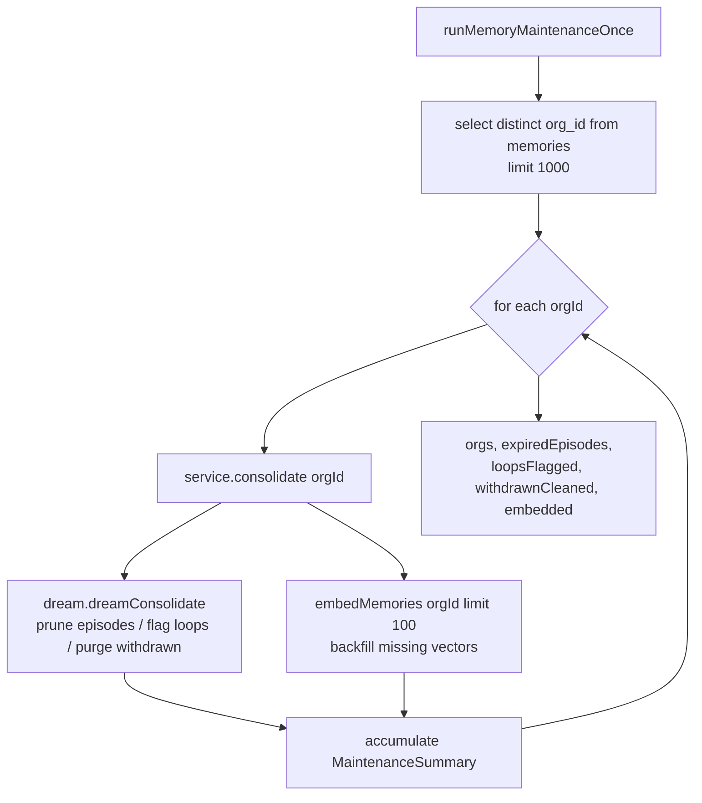

# Memory Scheduler & the Computer Memory Mirror

Two pieces of memory infrastructure run outside the turn: a 6-hourly maintenance scheduler that prunes decayed memories, flags overdue commitments and backfills embeddings for every org, and a mirror writer that publishes the agent's room-independent memory as Markdown files onto its persistent computer at `/home/bot/.saaya/memory/`. The scheduler is started once per orchestrator process at boot; the mirror is enqueued after each turn for agents that also have a computer capability.

Source files: `apps/orchestrator/src/memory/scheduler.ts`, `apps/orchestrator/src/memory/mirror.ts`, `apps/orchestrator/src/memory/service.ts` (`consolidate`, `generateMemoryMirror`)

---

## ⏰ Maintenance scheduler (`memory/scheduler.ts`)

The "dream cycle" timer. Constants (`scheduler.ts:13-16`):

| Constant | Value | Meaning |
| :--- | :--- | :--- |
| `SCAN_MS` | `6 * 60 * 60 * 1000` | Run every 6 hours |
| `FIRST_RUN_DELAY_MS` | `5 * 60 * 1000` | First run 5 minutes after boot |
| `LOCK_KEY` | `"mesh:memory:consolidate"` | Advisory-lock key so only one orchestrator instance works at a time |
| `MAX_ORGS_PER_RUN` | `1000` | Upper bound on orgs scanned per pass |

### Lifecycle

- `startMemoryScheduler()` (`scheduler.ts:83-95`) is called once at process start (`apps/orchestrator/src/index.ts:59`). It is idempotent — a no-op if `interval` or `firstRun` is already set — schedules the first run on a 5-minute `setTimeout`, then repeats on a 6-hour `setInterval`. Both handles are `.unref()`-ed so they never keep the process alive.
- `stopMemoryScheduler()` (`scheduler.ts:97-102`) clears both handles and nulls them.
- `guardedRun()` (`scheduler.ts:60-81`) takes a dedicated client from `getPool().connect()` and tries `pg_try_advisory_lock(hashtext($1))` on the lock key — the same session-advisory-lock pattern as the routine scheduler. If the lock is not free it returns immediately; otherwise it runs one pass and always unlocks in a `finally`, releasing the client in an outer `finally`. A non-blocking `pg_try_advisory_lock` is used here rather than the room coordinator's blocking `pg_advisory_lock` because skipping a tick is preferable to queueing.
- A pass logs only when it actually did something: `[memory] maintenance: N orgs, X episodes pruned, Y loops flagged, Z withdrawn purged, W embedded` (`scheduler.ts:70-74`).

### One pass: `runMemoryMaintenanceOnce()` (`scheduler.ts:29-58`)



`selectDistinct({ orgId: memories.orgId })` yields every org that has at least one memory; per-org failures are logged with `redactSecrets` and skipped so one bad org never aborts the pass. The returned `MaintenanceSummary` interface (`scheduler.ts:21-27`) aggregates `orgs`, `expiredEpisodes`, `loopsFlagged`, `withdrawnCleaned` and `embedded`.

### What `consolidate(orgId)` actually does (`service.ts:1087-1106`)

It wraps `DreamEngine.dreamConsolidate` (pruning rules detailed in [./modules.md](./modules.md)) plus the embedding backfill:

1. **Decayed episode pruning** — unpinned `kind = "episode"` memories with Ebbinghaus retention below `0.15` and older than 14 days are deleted (`modules/dream.ts:177-212`).
2. **Overdue loop flagging** — `open`/`in_progress` loops past `dueAt` become `blocked` with blocker reason `"Overdue loop auto-flagged during dream consolidation"` (`modules/dream.ts:214-228`).
3. **Withdrawn purge** — memories with `epistemicStatus = "withdrawn"` untouched for 60 days are deleted (`modules/dream.ts:230-240`).
4. **Embedding backfill** — `embedMemories(orgId, { limit: 100 })` embeds rows whose `embeddingModel` differs from the org's current provider key (or is null), excluding withdrawn memories (`service.ts:686-723`).

`consolidate` maps the dream result names onto its own vocabulary: `prunedEpisodes` → `expiredEpisodes`, `staleLoopsFlagged` → `loopsUpdated`.

### Failure semantics

The scheduler is designed so that nothing memory-related can take the orchestrator down:

- **Per-org isolation** — each org's `consolidate` call sits in its own `try/catch`; the failure is logged with `redactSecrets` and the pass continues (`scheduler.ts:44-56`).
- **Embedding backfill is its own try/catch** inside `consolidate` — an unavailable embedding provider logs `[memory] embedding backfill failed` and the pruning results still count (`service.ts:1095-1099`).
- **Unscheduled progress is recovered, not lost** — pruning and loop flagging are idempotent, and embeddings missed because the queue dropped them are re-embedded by the backfill's `embeddingModel` diff query, which finds every row whose vector is missing or from a stale model.
- **Idle ticks are silent** — when a pass does nothing (fresh deploy, all orgs clean), no log line is emitted, so the log only carries real maintenance events.

## 🪞 The computer mirror (`memory/mirror.ts`)

Each agent's persistent computer (the local VM managed by computerd — see [../computers/vps-and-client.md](../computers/vps-and-client.md)) carries a read-only Markdown mirror of the agent's room-independent memory under a single root:

```typescript
const ROOT = "/home/bot/.saaya/memory"   // mirror.ts:5
```

The rationale comes from `MemoryService.generateMemoryMirror` (`service.ts:1115-1172`): the computer is shared by every room the agent works in, so the mirror holds only what is visible from every room — the agent's agent-wide memories (scope `agent` with `roomId` null), org-wide memories, and open loops not tied to a room. Room-bound memories reach the agent through the `recall` tool instead, and the mirror text says so explicitly in its header.

### Building the mirror content

`generateMemoryMirror` selects up to 200 active (non-withdrawn/superseded) memories via `buildScopeConditions({ orgId, agentId, roomId: null })`, excluding `kind = "episode"`, ordered by `pinned DESC, updatedAt DESC` (`service.ts:1119-1131`). From those rows it renders three artifacts:

| Artifact | Contents |
| :--- | :--- |
| `memoryMd` | `# Agent Memory` header explaining the mirror, then `## Pinned` (or `_None._`) and `## Beliefs & Decisions` (first 50 unpinned rows). Each line: `- **Title** (private\|workspace, kind, epistemicStatus): body` (`service.ts:1132-1151`). |
| `topics` | A tag index: for each memory the first 6 tags become topic keys, capped at 40 topics; each topic file is `# Topic: <tag>` followed by `- **Title**: body` lines (`service.ts:1153-1159`). |
| `openLoopsMd` | `OpenLoopsManager.formatOpenLoopsMarkdown` over `getActiveLoops({ roomless: true })` — only loops with `roomId IS NULL` (`service.ts:1161-1169`, `modules/open-loops.ts:140-159`). |

### File layout (`mirrorFiles`, `mirror.ts:12-27`)

| Path | Content |
| :--- | :--- |
| `/home/bot/.saaya/memory/MEMORY.md` | `memoryMd` |
| `/home/bot/.saaya/memory/OPEN_LOOPS.md` | `openLoopsMd` |
| `/home/bot/.saaya/memory/topics/<tag>.md` | One file per tag; tags are sanitized to `[a-zA-Z0-9_-]`, truncated to 64 chars, with `""`/unsafe tags falling back to `untagged`, and multiple memories with the same tag concatenate with a newline. |

The rendered files look like this, directly from the format strings in `service.ts:1132-1151` and `modules/open-loops.ts:140-159`:

```markdown
# Agent Memory

Generated by the Sayabot memory layer from your agent-wide and workspace memories.
Room-specific memories are not mirrored here; use the recall tool inside a room.

## Pinned

- **Deploy target** (workspace, decision, belief): Production deploys go to Fly.io, previews to Cloudflare Pages.

## Beliefs & Decisions

- **Report format preference** (private, preference, belief): Weekly reports are Markdown, one table per section.
```

```markdown
# Active Open Loops

The following commitments, tasks, and follow-ups are currently pending resolution:

- **[IN_PROGRESS]** Draft the migration plan for `0027` (Due: 2026-11-20)
  - **Blocker**: Waiting on the schema review
```

With no pending loops, `OPEN_LOOPS.md` is the placeholder `"# Active Open Loops\n\nNo pending commitments or unresolved loops."` (`modules/open-loops.ts:142`), and the mirror still writes it so a previously non-empty file does not go stale on the computer.

### Change detection and the write (`syncMemoryMirror`, `mirror.ts:45-67`)

1. Generate the mirror and expand it into the file map.
2. `hashFiles` (`mirror.ts:29-38`) computes a SHA-256 over each path and its content, iterating paths in sorted order with `\0` separators, so the hash is independent of key insertion order.
3. The hash is compared against an in-memory `lastMirrorHash` map keyed by agent id (`mirror.ts:8`). Unchanged content costs zero computer calls — this matters because the mirror is synced on every turn for computer-capable agents.
4. On a change, the stale folders are wiped first — `rm -rf ${ROOT}/topics ${ROOT}/rooms && mkdir -p ${ROOT}/topics` via `client.exec` with a 15 s timeout (`mirror.ts:58-61`). Clearing `topics/` means tags that no longer exist do not linger, and clearing `rooms/` removes mirrors written by older versions of the code.
5. Each file is written with `client.writeFile(agentId, { path, content, allowOverwriteLarge: true })` (`mirror.ts:62-64`).
6. The new hash is cached and the function returns `"written"`, or `"unchanged"` when nothing differed.

`MirrorClient` (`mirror.ts:10`) is a `Pick<ComputerClient, "writeFile" | "exec">`, so tests (and future callers) only need to stub those two methods. `resetMirrorCache()` (`mirror.ts:69-71`) clears the per-process hash map — used by tests, and the natural hook after an external process edits the computer's files.

### Trigger point

The mirror sync is enqueued by the engine, not by this module: after the pre-turn memory loads succeed, if `agentCaps.memory && agentCaps.computer`, `run.ts:437-441` calls

```typescript
runInBackground("memory.mirror", () =>
  syncMemoryMirror({ orgId: room.orgId, agentId: agent.id, client: new ComputerClient() }),
)
```

so a slow or sleeping computer never delays the turn; the bounded background queue (`modules/background.ts`) simply drops the job under pressure and the next turn retries it. A sleeping computer being woken by `writeFile` is not special-cased here — computerd's wake-and-retry handles that (see [../../tools-and-sandboxes.md](../../../tools-and-sandboxes.md)).

For quick orientation, every periodic or deferred memory job in the orchestrator and where it starts:

| Job | Trigger | Guard | Failure mode |
| :--- | :--- | :--- | :--- |
| `memory.extract` | Turn finished ok, `caps.memory` | background queue (2 concurrent / 200 backlog) | dropped under pressure; error → 0 insights |
| `memory.reinforce` | Turn finished with `[#id]` citations | background queue | dropped; citations re-read next turn |
| `memory.mirror` | Pre-turn loads ok, `caps.memory && caps.computer` | background queue + content hash | skipped when unchanged; retried next turn |
| `memory.embed` | Write path (`scheduleEmbedding`) | background queue | backfilled by the 6-hour cycle |
| dream consolidation | `startMemoryScheduler` timer, 6 h | `pg_try_advisory_lock("mesh:memory:consolidate")` | per-org try/catch, logged |
| Boat sleep scan | routine-scheduler scan pass | scheduler advisory lock + `boatShouldSleep` | logged `"boat sleep scan skipped"`, never throws |

Log lines to watch: `[memory] maintenance: …` (scheduler output), `[memory] <label> failed:` (background job failures, redacted), `[memory] background queue full, dropping <label>` (backlog pressure), `[memory] maintenance scheduler online` (boot), and `[computers] boat sleep scan skipped` (sleep pass failure).

## 🧪 Tests

- `apps/orchestrator/src/memory/mirror.test.ts` — covers safe topic file naming, order-independent hashing, and the skip-when-unchanged/write-once/never-rewrite behaviour with a stub `MirrorClient`.
- `apps/orchestrator/src/memory/memory.test.ts` — the `describe("background queue")` block exercises `runInBackground`/`drainBackground`, which both the scheduler-adjacent jobs and the mirror depend on; consolidation pruning itself is covered indirectly through the service tests.

Related docs: [./overview.md](./overview.md) · [./modules.md](./modules.md) · [../computers/vps-and-client.md](../computers/vps-and-client.md) · [../engine/engine-loop.md](../engine/engine-loop.md) · [../../tools-and-sandboxes.md](../../../tools-and-sandboxes.md)
