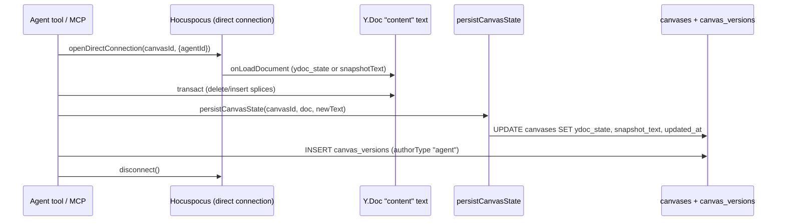

# Canvas Server (Collaborative Yjs Backend) & Canvas Tools

The canvas is the room's shared live document: humans edit it in the web app over a websocket, agents edit it through the `canvas_read` / `canvas_write` / `canvas_patch` tools, and both meet in the same Yjs document store. The backend is a [Hocuspocus](https://tiptap.dev/hocuspocus) server (Yjs CRDT provider) that authenticates users with their Supabase JWT, loads and stores document state in the `canvases` table, and sweeps away connections whose users have lost room access. Every agent mutation is persisted both as binary Yjs state (`ydoc_state` bytea) and plain text (`snapshot_text`), plus an append-only `canvas_versions` history.

Source files: `apps/orchestrator/src/canvas/server.ts`, `apps/orchestrator/src/canvas/tools.ts`

---

## 🗄️ Storage (`packages/db/src/schema/canvas.ts`)

| Table | Columns | Purpose |
| :--- | :--- | :--- |
| `canvases` | `id`, `room_id` (cascade), `kind` (`canvas_kind_enum`, default `"markdown"`), `title`, `language`, `ydoc_state` (bytea), `snapshot_text` (default `""`), `created_by`, `updated_at` | One row per canvas document; `ydoc_state` holds the full CRDT update, `snapshot_text` the plain-text projection. |
| `canvas_versions` | `canvas_id` (cascade), `author_type` (`"agent"` \| `"human"`), `author_id`, `snapshot_text`, `created_at` | Restore-point history, indexed `(canvas_id, created_at)`. |

## ⚡ Hocuspocus Server (`src/canvas/server.ts`)

`createHocuspocus()` (`server.ts:64-107`) builds a process-wide singleton (typed `Hocuspocus<CollabContext>`, context = `{ userId?, canvasId?, roomId?, agentId? }`):

```typescript
export interface CollabContext {
  userId?: string | null
  canvasId?: string
  roomId?: string
  agentId?: string
}

instance = new Hocuspocus<CollabContext>({
  debounce: 2_000,      // batch saves
  maxDebounce: 10_000,  // save at least every 10 s while edits flow
  quiet: true,
  async onAuthenticate({ token, documentName }) { ... },
  async onLoadDocument({ document, documentName }) { ... },
  async onStoreDocument({ document, documentName }) { ... },
})
```

The document name **is** the canvas UUID. Authentication uses a Supabase admin client (`SUPABASE_URL` + `SUPABASE_SERVICE_ROLE_KEY`, `persistSession: false`, `autoRefreshToken: false`) to verify the client's JWT in `onAuthenticate` (`server.ts:75-83`):

```typescript
async onAuthenticate({ token, documentName }) {
  if (!token) throw new Error("Missing Supabase token")
  const { data, error } = await supabase.auth.getUser(token)
  if (error || !data.user) throw new Error("Invalid Supabase token")
  const canvas = await loadCanvas(documentName)
  if (!canvas) throw new Error("Canvas not found")
  if (!(await canUserReadRoom(data.user.id, canvas.roomId))) throw new Error("Forbidden")
  return { userId: data.user.id, canvasId: canvas.id, roomId: canvas.roomId }
}
```

`loadCanvas(canvasId)` (`server.ts:54-62`) UUID-guards the id (`UUID_RE`, `server.ts:17`) and returns the `canvases` row or `null`; both the websocket path and every agent/MCP tool start here.

**Loading** (`onLoadDocument`, `server.ts:84-93`): if `canvases.ydoc_state` is non-empty, `Y.applyUpdate` restores the full CRDT (preserving comments/attributes/marks); otherwise the legacy `snapshotText` is inserted at position 0 of the `content` text type:

```typescript
async onLoadDocument({ document, documentName }) {
  const canvas = await loadCanvas(documentName)
  if (!canvas) throw new Error("Canvas not found")
  if (canvas.ydocState && canvas.ydocState.length > 0) {
    Y.applyUpdate(document, new Uint8Array(canvas.ydocState))
  } else if (canvas.snapshotText) {
    document.getText("content").insert(0, canvas.snapshotText)
  }
  return document
}
```

**Saving** (`onStoreDocument` → `persistCanvasState`, `server.ts:114-125`): writes `Buffer.from(Y.encodeStateAsUpdate(document))` plus `snapshotText = document.getText("content").toString()` and `updatedAt` on every debounced store. Any code path that transacts (agent tools, MCP `canvas_patch`, restores) also calls `persistCanvasState` directly so nothing is lost before the debounce fires:

```typescript
export async function persistCanvasState(canvasId: string, document: Y.Doc, text?: string): Promise<string> {
  const snapshotText = text ?? document.getText("content").toString()
  await getDb().update(canvases).set({
    ydocState: Buffer.from(Y.encodeStateAsUpdate(document)),
    snapshotText,
    updatedAt: new Date(),
  }).where(eq(canvases.id, canvasId))
  return snapshotText
}
```

### Access sweep

Authentication is only checked at socket setup, so a 30-second interval (`ACCESS_SWEEP_MS = 30_000`, unref'ed) runs `revokeStaleCanvasConnections(server)` (`server.ts:30-52`): for every live connection with a `userId`/`roomId` context it re-evaluates `canUserReadRoom` — **deduplicating per `(userId, roomId)`** via a promise map — and closes forbidden connections with WebSocket close code `4403 "Forbidden"`. A failed authz lookup is treated as *still allowed* (`catch(() => true)`): a database blip must not throw everyone off the canvas. It returns the number of revoked connections.

### Process wiring (`src/index.ts`)

- `createHocuspocus()` at boot (`index.ts:20`); `destroyHocuspocus()` (`server.ts:127-134`) on shutdown — clears the sweep interval, `flushPendingStores()`, closes all connections.
- The HTTP server's `upgrade` event (`index.ts:73-91`) accepts **only** path `/collab` (nginx proxies WSS there — see `deploy/nginx/`), hands the socket to a `WebSocketServer({ noServer: true, maxPayload: 2 MB })`, and bridges it to `hocuspocus.handleConnection(ws, request)`, forwarding `message`/`close`/`pong` events.
- Startup logs `canvas sync at ws://localhost:<port>/collab`.

`getHocuspocus()` (`server.ts:109-112`) throws `"Canvas server is not initialised"` if accessed before boot — agent tools and MCP use it for *direct connections*.

## 🛠️ Agent Canvas Tools (`src/canvas/tools.ts`)

All three tools are built per agent turn in `src/tools/index.ts:333-335` (`canvasReadTool`/`canvasWriteTool`/`canvasPatchTool({ roomId, agentId })`) and registered when the agent has the `canvas` capability (see [tool-system.md](../tools/tool-system.md)). All are `dangerous: false` — canvas edits stay inside the room's own document.

Every tool first calls `requireCanvas(canvasId, roomId)` (`tools.ts:13-17`): the canvas must exist **and belong to the calling agent's room** (`"Canvas not found in this room"`). Mutations open a `directConnection` on the Hocuspocus instance with context `{ agentId }`, transact against `doc.getText("content")`, disconnect in a `finally`, and record a `canvas_versions` row with `authorType: "agent"` via `recordVersion` (`tools.ts:19-23`).

| Tool | Schema | Behavior |
| :--- | :--- | :--- |
| `canvas_read` | `{ canvasId: uuid }` | Plain DB read — returns `canvasId`, `title`, `kind`, `language`, `content = snapshotText`. No Yjs connection needed. |
| `canvas_write` | `{ canvasId: uuid, content ≤ 200 000 }` | Full replace inside one Yjs transaction (`delete(0, length)` + `insert(0, content)`), then persist + version. Returns `ok`, `characters`, and a 400-char `preview`. The description steers agents to prefer `canvas_patch` for small changes "so concurrent human edits survive". |
| `canvas_patch` | `{ canvasId: uuid, edits: { search, replace }[] (1–50) }` | Computes `planCanvasPatch(currentText, edits)` from `@sayabot/core` — each `search` must match exactly once — and applies the returned `splices` in order (later searches see earlier replacements). Concurrent human keystrokes elsewhere in the doc are preserved because only the matched ranges are touched. Returns `ok`, `edits`, `characters`. |

### `restoreCanvasSnapshot` (human restore path)

`restoreCanvasSnapshot({ canvasId, roomId, userId, snapshot })` (`tools.ts:124-154`) is the same full-replace flow but with context `{ userId }` and `authorType: "human"`. It backs the web app's version restore, exposed at `POST /internal/canvases/:canvasId/restore` (`src/http.ts:312-332`), which validates the body with `restoreSchema` and checks `canUserReadRoom(userId, canvas.roomId)` before executing:

```typescript
const result = await restoreCanvasSnapshot({
  canvasId, roomId: canvas.roomId, userId: parsed.data.userId, snapshot: parsed.data.snapshot,
})
return c.json(result)   // { characters }
```

Because restore replaces the whole document, the *previous* text remains recoverable from the `canvas_versions` history — restores are versioned just like agent writes, making restores themselves restorable.



## 🔁 Consistency guarantees

- **Single writer geometry**: all agent edits flow through the same in-process Hocuspocus instance that serves human websockets, so CRDT merging — not locking — reconciles concurrent edits. (Turn-level room serialization is a separate concern; see [coordinator.md](../engine/coordinator.md).)
- **Dual durability**: binary `ydoc_state` preserves CRDT history across restarts; `snapshot_text` powers cheap reads (`canvas_read`, inbox previews, version history) without instantiating a `Y.Doc`.
- **Version trail**: every agent `canvas_write`/`canvas_patch` and every human restore appends to `canvas_versions`, making restores themselves restorable.

## 🧪 Tests

There are no dedicated `.test.ts` files under `src/canvas/`; the patch planner is covered in `packages/core` (`planCanvasPatch`), and the tools are exercised indirectly through the orchestrator tool-registration tests.

---

Related docs:
- [Canvas tools reference](../tools/tool-system.md) — how `canvas_read`/`canvas_write`/`canvas_patch` are registered and gated by capabilities
- [MCP server](./mcp-server.md) — the `canvas_read`/`canvas_patch` MCP tools that reuse the same connection path
- [Coordinator](../engine/coordinator.md) — turn serialization that orders tool calls per room
- [Orchestrator service overview](../engine/service-overview.md) — boot order and websocket attachment
