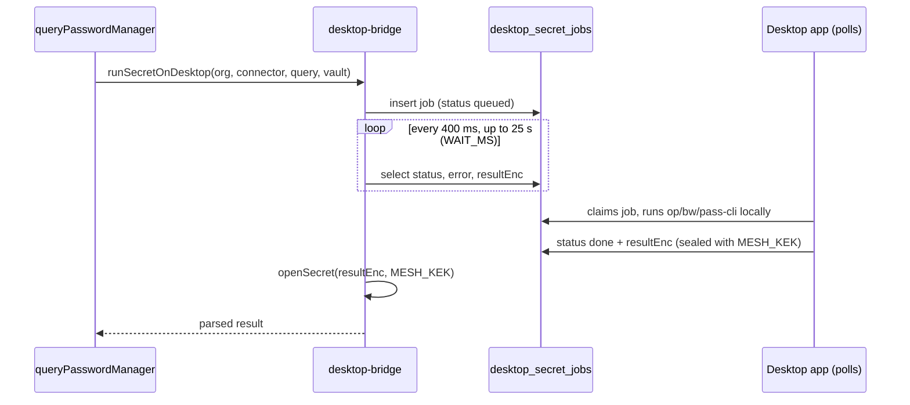

# Content & Knowledge Connectors (GitHub, Google Drive, Password Vaults, Desktop Bridge)

These connectors give agents read access to the workspace's knowledge and credentials: code and issues from GitHub, documents from Google Drive, and items from the password managers (1Password, Bitwarden, Proton Pass). The GitHub and Drive clients return plain `ConnectorDoc`s; the password managers are different in kind — they resolve secrets through three execution modes (1Password Connect API, Bitwarden Secrets Manager API, or a local CLI), falling back to the **desktop bridge**, which queues the work onto the owner's own computer via the Sayabot desktop app so vault secrets never leave the machine they live on.

Source files: `apps/orchestrator/src/connectors/github.ts`, `apps/orchestrator/src/connectors/google-drive.ts`, `apps/orchestrator/src/connectors/passwords.ts`, `apps/orchestrator/src/connectors/desktop-bridge.ts`

---

## 🐙 GitHub (`src/connectors/github.ts`)

`GitHubConnector` talks to `api.github.com` with `Authorization: Bearer <token>`, `Accept: application/vnd.github.v3+json`, and the `Sayabot-Workspace-Connector/1.0` user agent. Constructed by `ConnectorService` per call with the decrypted workspace token. All requests go through `fetchWithRetry`.

| Method | Behavior |
| :--- | :--- |
| `searchCode(options)` | `GET /search/code` with `per_page` clamped 1–20 (default 10). Appends `repo:<owner/name>` qualifiers for `allowedRepos`. Returns docs whose `content` is a stub line (`[GitHub Code File: <path> in <repo>]`) — the search API returns fragments, not file bodies. |
| `getFileContent(owner, repo, path, ref = "main")` | `GET /repos/:owner/:repo/contents/:path?ref=:ref` (leading slashes stripped from `path`). Decodes base64 bodies and returns up to **100 000 chars** of text in `content`. |
| `getIssueOrPullRequest(owner, repo, issueNumber)` | Fetches the issue and its comments **in parallel** (`Promise.all`); a `pull_request` key on the payload switches the label to "Pull Request". Renders a Markdown discussion: title/state header, author/created line, body, then `**@login** (timestamp): comment` per comment. Comment fetch failure degrades to zero comments; issue fetch failure throws. |

All three return `ConnectorDoc`s with `metadata.repo/path/issueNumber/labels` as appropriate. Repo allowlisting is enforced by `ConnectorService` *before* these clients are invoked (see [connector-platform.md](./connector-platform.md#️-service-actions)).

Mutating GitHub operations (issues, PRs, pushes) are not part of this connector — they live in the separate `github_issue`/git tooling documented in [tool-github.md](../tools/tool-github.md).

## 📁 Google Drive (`src/connectors/google-drive.ts`)

`GoogleDriveConnector` uses `www.googleapis.com/drive/v3` with `Authorization: Bearer <accessToken>` and `supportsAllDrives`/`includeItemsFromAllDrives`/`corpora: allDrives` so shared-drive files are covered.

**`searchFiles(options)`** (`google-drive.ts:22-81`): builds a Drive query

```
trashed = false and (name contains '<terms>' or fullText contains '<terms>')
```

(single quotes escaped) and, when the grant has `allowedFolders`, ANDs in `('<id>' in parents or ...)`. `pageSize` clamps 1–25 (default 8). Results carry `metadata.mimeType`, `lastModified`, and `author` from the first owner. Note the search doc's `content` is again a stub — the agent must `read_file` for real text:

```typescript
let q = `trashed = false and (name contains '${searchTerms}' or fullText contains '${searchTerms}')`
if (options.allowedFolders && options.allowedFolders.length > 0) {
  const folderClauses = options.allowedFolders.map((f) => `'${f}' in parents`).join(" or ")
  q += ` and (${folderClauses})`
}
```

The request passes `supportsAllDrives: "true"`, `includeItemsFromAllDrives: "true"`, `corpora: "allDrives"` so shared-drive items are included; error bodies are surfaced truncated to 150 chars.

**`readFile(fileId)`** (`google-drive.ts:87-174`) is a two-step export pipeline:

1. `GET /files/:id?fields=...` for metadata.
2. Content by MIME type:

| MIME | Export |
| :--- | :--- |
| `application/vnd.google-apps.document` | `export?mimeType=text/plain` |
| `application/vnd.google-apps.spreadsheet` | `export?mimeType=text/csv` |
| `application/vnd.google-apps.presentation` | `export?mimeType=text/plain` |
| anything else | `alt=media` raw download (text, Markdown, JSON…) |

A failed export/download degrades to a `[Could not export …]` placeholder instead of throwing. Content is capped at 100 000 chars "for safe context window".

## 🔑 Password Managers (`src/connectors/passwords.ts`)

Sources: `PasswordSource = "onepassword" | "bitwarden" | "protonpass"`. `ConnectorService.queryPassword` (service.ts:371-395) decrypts the connector, merges the grant's `allowedVaults` into the `PasswordConfig`, and calls the single dispatcher:

```typescript
export async function queryPasswordManager(args: {
  source, action: "search" | "read", query, vault?,
  token, config: PasswordConfig, orgId, connectorId, signal?
}): Promise<unknown>
```

`PasswordConfig` (stored on the connector's `config` jsonb): `authMode?: "api" | "computer"`, `connectUrl?` (1Password Connect base URL), `hostId?` (preferred desktop host), `region?: "us" | "eu"` (Bitwarden), `allowedVaults?`.

### Injection-safe input guards

Because one execution mode shells out to CLIs, queries are hardened first:

- `assertSecretQuery(query)` (`passwords.ts:16-21`): trims, requires 1–200 chars, rejects a leading `-` (which would become a CLI flag) and any `\r\n\0`.
- `assertVaultName(vault)` (`passwords.ts:23-29`): same rule set, ≤80 chars.

### Mode selection

`const mode = config.authMode ?? (config.connectUrl ? "api" : "computer")` (`passwords.ts:163`) — an explicit `authMode` wins; otherwise the presence of a 1Password `connectUrl` selects API mode, and everything else drives the local CLI. The dispatch in `queryPasswordManager` (`passwords.ts:148-222`) reads as:

```typescript
const vault = assertVaultName(args.vault)
if (args.config.allowedVaults?.length && vault && !args.config.allowedVaults.includes(vault)) {
  throw new Error(`Vault "${vault}" is outside this agent's allowed vaults`)
}
const mode = args.config.authMode ?? (args.config.connectUrl ? "api" : "computer")
// → 1Password Connect API (when source === "onepassword" && mode === "api" && connectUrl)
// → Bitwarden Secrets API (when source === "bitwarden" && mode === "api")
// → otherwise: local CLI via passwordArgv/runCli, with the desktop bridge as fallback
```

Note the vault check runs **before** mode selection and applies in all modes, so an explicit `--vault` outside the grant is rejected before any I/O happens.

**API mode — 1Password Connect** (`passwords.ts:165-181`): `httpJson` against `<connectUrl>/v1/...` with the Connect token as Bearer. Search lists `/v1/vaults`, then walks the first **8 vaults** collecting `/v1/vaults/:id/items`; read requires an explicit vault and fetches `/v1/vaults/:vaultId/items/:itemId`. `httpJson` (`passwords.ts:91-103`) enforces `https:` and calls **`assertSafeEgressHost`** from `@sayabot/core/server` — the same egress safety layer used elsewhere — before fetching.

**API mode — Bitwarden Secrets Manager** (`passwords.ts:183-191`): host is `api.bitwarden.eu` when `region === "eu"` else `api.bitwarden.com`; `GET /public/secrets` for search, `/public/secrets/:id` for read.

**CLI mode** (`passwordArgv`, `passwords.ts:31-51`): builds argv for the local binaries — `op item list|get --format json --reveal` (1Password), `bw list items|get item` (Bitwarden), `pass-cli item list|view` (Proton Pass) — then runs them via `runCli` (`passwords.ts:105-139`) with a scrubbed environment (`PATH`, `HOME` plus only `OP_SERVICE_ACCOUNT_TOKEN` or `BW_SESSION` when the decrypted token is not the literal `"desktop"`). stdout is capped at 200 000 chars, stderr kept to the last 1 000, `SIGTERM` on `AbortSignal`, and non-JSON output degrades to `{ text }`.

**Desktop fallback** (`passwords.ts:199-221`): if the CLI binary is missing (`ENOENT`) — or the connector is in `computer` mode — the same query is re-issued through `runSecretOnDesktop`. When both the CLI and the desktop fail, the *original* CLI error is the one thrown (desktop errors are only surfaced when the CLI was missing).

### Result shaping

- `summarizeItems(value)` (`passwords.ts:53-66`): search results → at most **40** `{ id, title }` pairs (tolerates both array payloads and `{ data: [] }` envelopes), filtered client-side by the query needle in `finish()`.
- `summarizeItem(value)` (`passwords.ts:69-89`): one item, dropping attachments/bulk fields but **keeping values** — up to 30 `fields` (label/value clipped to 2 000), `login.username/password/uris`, `value`, `notes`/`note` (2 000). A read is the point of the tool, so secrets come through; the tool layer marks every `<source>_read` as `dangerous: true` so a human approves it (see ../tools/tool-connectors.md).

## 🖥️ Desktop Bridge (`src/connectors/desktop-bridge.ts`)

The bridge turns a password read (or an MCP call against a local-only app) into a **job row that the person's own computer picks up** through the Sayabot desktop app. Data model (`packages/db/src/schema/desktop.ts`):

| Table | Role |
| :--- | :--- |
| `desktop_hosts` | One row per paired computer: `userId`, `orgId`, `tokenHash`, `permissions`, `lastSeenAt`, `revokedAt`. The app heartbeats every 2.5 s. |
| `desktop_secret_jobs` | Password jobs: `source`, `action`, `query`, `vault`, `status` (`queued`→`done`/`failed`), and `resultEnc` — the result sealed with `MESH_KEK`. The vault token is never stored on the row. |
| `desktop_mcp_calls` | Same pattern for local MCP: `serverId`, `appId`, `method`, `params`, plaintext `result` (no secrets involved). |

**Host selection** — `hostForOrg(orgId, preferred?)` (`desktop-bridge.ts:42-59`): uses the connector's `hostId` when given (must belong to the org and not be revoked), otherwise the org's most recently seen non-revoked host. **Liveness** — `desktopOnline(orgId, preferred?, now)` (`desktop-bridge.ts:29-39`): a host is online if `lastSeenAt` is within `DESKTOP_OFFLINE_AFTER_MS = 60_000` (`desktop-bridge.ts:22`); a minute of silence means the lid is shut or the app quit. The engine uses this to skip desktop-only tools instead of stalling a turn on a sleeping laptop.

**Job flow** — `runSecretOnDesktop(args)` (`desktop-bridge.ts:73-118`):



- The poll loop `waitFor` (`desktop-bridge.ts:61-71`) throws `"The computer couldn't finish that"` on `failed`, and after 25 s throws the human-facing `"Open the Sayabot app on your computer and try again. It didn't answer in time."`
- On any error/timeout the queued job is marked `failed`/`"timed out"` so the desktop app doesn't pick up stale work.
- `runMcpOnDesktop(args)` (`desktop-bridge.ts:120-162`) is the identical pattern for `desktop_mcp_calls` (used by local MCP apps like desktop-claude; see [mcp-server.md](./mcp-server.md)) with the same 25 s wait; results are plaintext `jsonb` there.

## 🧪 Tests

| Test file | Covers |
| :--- | :--- |
| `apps/orchestrator/src/connectors/passwords.test.ts` | Argv construction, query/vault guards, summarizers, mode dispatch with mocked `runCli`. |
| `apps/orchestrator/src/connectors/desktop-online.test.ts` | `desktopOnline`/`hostForOrg` liveness and host selection. |

---

Related docs:
- [Connector platform](./connector-platform.md) — the `ConnectorService` layer that decrypts tokens and enforces grants above these clients
- [Connector tools](../tools/tool-connectors.md) — `gdrive_*`, `github_*`, `1password_*`/`bitwarden_*`/`protonpass_*` tool surface
- [Secrets broker](../tools/secrets-broker.md) — the placeholder-based alternative for secret *use* rather than secret *reading*
- [GitHub tools](../tools/tool-github.md) — mutating GitHub operations
