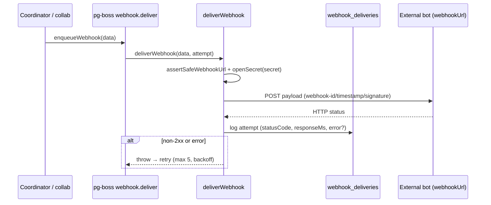

# Internal API & Job Queue

The orchestrator talks to its infrastructure siblings — the **egress proxy** (SSRF-safe outbound fetch), **computerd** (sandbox daemon), and the **desktop/web app** — over a private `/internal/*` HTTP surface, and runs its background work on an embedded **pg-boss** queue backed by the same Postgres. This page documents the internal routes (secret-broker resolution and approval gateway for egress, computer state grants, Mac local-job callbacks), the four pg-boss queues, and the signed webhook delivery pipeline that reaches external bots.

Source files: `apps/orchestrator/src/internal/routes.ts`, `apps/orchestrator/src/internal/local-jobs.ts`, `apps/orchestrator/src/jobs/index.ts`, `apps/orchestrator/src/jobs/webhook.ts`, `apps/orchestrator/src/internal-auth.ts`

---

## 🔒 Internal Authentication (`src/internal-auth.ts`)

```typescript
export function isInternalRequest(authorization: string | undefined, secretHeader?: string): boolean
```

Every `/internal/*` request must present `ORCHESTRATOR_INTERNAL_SECRET`, either as `Authorization: Bearer <secret>` or the `x-internal-secret` header. Comparison is length-checked + `timingSafeEqual` (constant time). In `src/http.ts` the secret check is applied as middleware over all of `/internal/*` (`http.ts:115-121`), with a body limit of 200 KB for internal routes (vs 2 MB for `/v1/*`). Some in-file routes (`/internal/room-message`, `/internal/inbound`, `/internal/runs/:runId/stop`) inherit the middleware; a few (`/internal/canvases/:canvasId/restore`, `/v1/tools/:toolCallId/approve`, `/internal/routines/:id/run`) re-check explicitly. Only the web app and egress/computerd hold the secret.

## 🕸️ Internal Routes (`src/internal/routes.ts`)

### Secret broker for egress (`/internal/egress/*`)

These four endpoints are what make `$SECRET{...}` placeholders work **without the model ever seeing a secret** (Rule 1; the agent-facing side is [secrets-broker.md](../tools/secrets-broker.md)):

| Endpoint | Purpose |
| :--- | :--- |
| `POST /internal/egress/identity` | Maps an egress request to an agent. Body: `{ proxySecret }` (hashed with `hashAgentApiKey` and matched against `agent_computers.proxy_secret_hash` — the microVM credential computerd derives) or `{ containerIp }` (matched against a `running` agent_computers row — the Docker path). Returns `{ ok, agentId, orgId }`; 401 `"invalid computer identity"` otherwise. |
| `POST /internal/egress/resolve` | The placeholder broker. Body: `{ agentId, placeholder }`. Finds the agent's `agent_secret_grants` row (by `placeholder` string or grant id after stripping a `saaya_ph_` prefix) that is **not revoked and not expired**, joined to `vault_secrets`. Touches `lastUsedAt` on both rows asynchronously, then opens the sealed secret — `openSecret(grant.sealed, MESH_KEK)` — and returns `{ grantId, secretPlaintext, hostAllowlist, inject, methods, requiresApproval }`. 404 when no valid grant exists. |
| `POST /internal/egress/approval` | Human gate for egress requests whose grant sets `requiresApproval`. Body: `{ agentId, grantId, url, method?, headers?, bodyPreview?, timeoutMs? (1 s–300 s) }`. Picks the agent's first room, inserts a `tool_calls` row (`toolName: "use_secret"`, `status: "pending_approval"`), broadcasts `tool.approval_requested` to the room, and **blocks** on `waitForApproval(toolCall.id, timeoutMs ?? 60_000)` (see [approvals.md](../tools/approvals.md)). Responds `{ status: "approved" | "rejected" | …, toolCallId }`; no room → `{ status: "rejected", reason: "no active room for agent" }`. |
| `POST /internal/egress/violation` | Egress rejected a request (bad host, blocked IP…). Records an `audit_logs` row (`action: "egress.violation"`, target = host, metadata with reason/details) and broadcasts a `room.notice` (level `warn`) to every room the agent is in. |
| `POST /internal/egress/usage` | Accepts `{ agentId, bytesTransferred, swapsCount }` and currently returns `{ ok: true }` — usage accounting from the proxy is validated but not persisted here yet. |
| `GET /internal/egress/stream` | SSE channel for credential invalidation. Registers a dedicated pool client with `LISTEN vault_changed` and forwards each notification as an SSE `vault_changed` event so egress can drop cached plaintext; heartbeats `ping` every 15 s after an initial `connected`. |

The resolve response is the exact contract egress needs to complete the agent's request (`routes.ts:137-144`):

```jsonc
{
  "grantId": "9af1…",
  "secretPlaintext": "sk-live-…",       // only ever inside the egress ⇄ orchestrator hop
  "hostAllowlist": ["api.stripe.com"],
  "inject": "header",                    // where the secret goes on the proxied request
  "methods": ["GET", "POST"],            // HTTP methods the grant permits
  "requiresApproval": false
}
```

The grant lookup matches two placeholder forms (`routes.ts:105-115`): the literal placeholder string or the grant UUID behind a `saaya_ph_` prefix, both restricted to `agentId`, with `revoked_at IS NULL` and (when set) `expires_at > now` — so revocation and expiry take effect on the next request without any cache invalidation. `lastUsedAt` updates on both `agent_secret_grants` and `vault_secrets` are fire-and-forget (`void Promise.all([...]).catch(() => {})`) and never delay the proxy path.

The approval gateway is the one place egress traffic passes a **human** before it leaves: the inserted `tool_calls` row is the same record the UI's approval inbox renders, so a request the proxy pauses looks identical to an in-turn dangerous tool call.

### Computer grants (`/internal/computer/*`)

| Endpoint | Purpose |
| :--- | :--- |
| `POST /internal/computer/state` | computerd reports lifecycle: `{ agentId, status: "none"|"starting"|"running"|"stopped"|"error", containerId?, containerIp?, error?, proxySecretHash? (SHA-256 hex) }`. Updates `agent_computers` (including `lastActiveAt`) and broadcasts `computer.state` to every room the agent is in. |
| `GET /internal/computer/:agentId/grants-env` | Returns the non-revoked, non-expired secret grants as an env map: `{ env: { ENV_NAME: placeholder } }`. computerd writes these placeholder variables into the sandbox environment; the real values are only ever resolvable through the egress proxy. |

### Task wake trigger

`POST /internal/tasks/wake` with `{ taskId, agentId, reason }` (reason ∈ `assigned | unblocked | synthesize | budget_extended`) validates and calls `enqueueTaskWake` → `{ queued: true }`. Lets the web app force a task wake (e.g. after a budget extension) without touching the queue itself.

## 💻 Mac Local-Job Callbacks (`src/internal/local-jobs.ts`)

`localJobRoutes` handles two callbacks from the Sayabot desktop app while it hosts a **local agent run** (an agent running on that Mac — see [runner-external-and-local.md](../engine/runner-external-and-local.md) and the `local_runner_jobs` table). Both take `:jobId` from the path and a `hostId` UUID in the body; `runner/local-events.ts` re-checks the host token, so these routes trust the `/internal/*` gate plus that check. The module docstring states the trust chain directly (`local-jobs.ts:10-13`): "Sayabot for Mac → web (host token checked there) → here: tool activity and approval requests for an agent running on that Mac. Behind the /internal/* secret check in http.ts."

| Route | Body | Behavior |
| :--- | :--- | :--- |
| `POST /internal/local-jobs/:jobId/events` | `{ hostId, events: [{ type: "started", key, toolName, args } \| { type: "finished", key, ok, result? ≤ 20 000 }] (max 50) }` | `recordMacToolEvents` persists the Mac's tool activity as tool cards on the run; returns `{ ids }`. |
| `POST /internal/local-jobs/:jobId/approval` | `{ hostId, key, toolName, args }` | `requestMacApproval` creates the human approval request for a dangerous local tool; responds with the request record. |

The event discriminated union (`local-jobs.ts:17-25`) mirrors how the server-side engine reports tool lifecycle, so the web UI can render a Mac-hosted run identically to a server run. Errors surface as `LocalJobError` (message + status) or a generic 500.

## 📦 Job Queue (`src/jobs/index.ts`)

pg-boss is instantiated against `DATABASE_URL` with `application_name: "sayabot-orchestrator"` and a pool cap of `min(DATABASE_POOL_MAX or 3, 3)` — deliberately small so queue polling doesn't starve request handling. `startJobs()` (called at boot, `src/index.ts`) creates four queues and one worker each (batch size 1, `localConcurrency: 4`):

| Queue | Payload | Worker | Queue options |
| :--- | :--- | :--- | :--- |
| `room.message` | `{ roomId, messageId }` | `processRoomMessage(roomId, messageId, { enqueueWebhook })` — the turn coordinator entry (see [coordinator.md](../engine/coordinator.md)) | `retryLimit: 0`, expire 1 800 s, delete after 1 day |
| `webhook.deliver` | `WebhookJobData` | `deliverWebhook(data, retryCount + 1)` (below) | `retryLimit: 5`, `retryDelay: 10`, `retryBackoff: true`, expire 120 s, delete after 7 days |
| `task.wake` | `TaskWakeData` | `handleTaskWake(data)` (see [collab-tasks.md](./collab-tasks.md)) | `retryLimit: 2`, expire 60 s, delete after 1 day |
| `run.resume` | `{ runId, reason? }` | dynamic-imports `resumeRun` from `src/engine/resume.ts` | `retryLimit: 3`, `retryDelay: 5`, expire 300 s |

Enqueue helpers throw `"job queue is not started"` before `startJobs()` completes. `enqueueTaskWake` has a **fallback**: with no queue running it invokes `handleTaskWake` directly (logged on failure) — which is why task wakes survive even in degraded boots:

```typescript
export async function enqueueTaskWake(data: TaskWakeData): Promise<void> {
  if (!boss) {
    try { await handleTaskWake(data) } catch (e) { console.error("[task.wake] direct invoke error", e) }
    return
  }
  await boss.send(TASK_WAKE_QUEUE, data, {
    retryLimit: 2,
    singletonKey: `${data.taskId}:${data.agentId}`,
    singletonSeconds: 30,
  })
}
```

The `singletonKey: "<taskId>:<agentId>"` + `singletonSeconds: 30` dedups bursts — the task-service transaction code can emit several wakes for the same pair within seconds (assignment + status change). `stopJobs()` shuts down gracefully with a 10 s timeout.

## 🪝 Webhook Deliveries (`src/jobs/webhook.ts`)

`WebhookJobData = { orgId, roomId, agentId, messageId, sessionId, payload }` — the payload is a `WebhookPayload` from `@sayabot/core` (room message / task assignment / etc.). `deliverWebhook(data, attempt)` (`webhook.ts:46-111`) is one signed attempt:

1. **Preconditions** — the agent must have `webhookUrl` and `webhookSecretEnc`; missing/unreadable (KEK) secret is logged and **dropped** (no retry — it can never succeed).
2. **SSRF gate** — `assertSafeWebhookUrl(agent.webhookUrl, MESH_ALLOW_PRIVATE_WEBHOOKS)` (see [ssrf-and-realtime.md](./ssrf-and-realtime.md)); a blocked target is logged and dropped.
3. **Signature** — standard SVIX-style headers (from `signWebhook` in `@sayabot/core/server`): `webhook-id: msg_<uuid>`, `webhook-timestamp` (unix seconds), `webhook-signature` (HMAC over `${id}.${timestamp}.${body}` with the decrypted per-agent secret). Bots verify with `verifyWebhook`; the package also enforces `WEBHOOK_TOLERANCE_SECONDS`.
4. **POST** — `content-type: application/json`, `user-agent: sayabot-webhook/1.0`, `AbortSignal.timeout(15_000)`, and `redirect: "error"` so a redirect cannot silently re-target the secret-signed request:

```typescript
const body = JSON.stringify(data.payload)
const webhookId = `msg_${randomUUID()}`
const timestamp = Math.floor(Date.now() / 1000)
const signature = signWebhook({ secret, id: webhookId, timestamp, body })
const response = await fetch(url, {
  method: "POST",
  headers: {
    "content-type": "application/json",
    "user-agent": "sayabot-webhook/1.0",
    "webhook-id": webhookId,
    "webhook-timestamp": String(timestamp),
    "webhook-signature": signature,
  },
  body,
  signal: AbortSignal.timeout(15_000),
  redirect: "error",
})
```

5. **Logging** — every attempt (success, HTTP error, or exception with the message run through `redactSecrets`) is written to the `webhook_deliveries` table (`attempt`, `statusCode`, `responseMs`, `error`). Non-2xx **throws**, which pg-boss turns into up to 5 retries with backoff.



## 🧪 Tests

There is no `.test.ts` under `src/jobs/` or `src/internal/`; the signature primitives are covered by `packages/core/src/server/webhook.test.ts`, and the approval wait is exercised by `apps/orchestrator/src/tools/audited.test.ts` and `apps/orchestrator/src/runner/local-events.test.ts`.

---

Related docs:
- [Secrets broker](../tools/secrets-broker.md) — the agent-facing placeholder model these routes resolve
- [Approvals](../tools/approvals.md) — `waitForApproval` and the approval lifecycle
- [SSRF & realtime](./ssrf-and-realtime.md) — `assertSafeWebhookUrl` internals
- [Collab & task board](./collab-tasks.md) — the wake handler on `task.wake`
- [Coordinator](../engine/coordinator.md) — the `room.message` worker that starts turns
