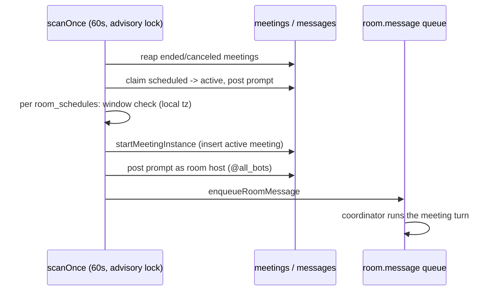

# Scheduler: Meetings

The meeting scheduler turns each room's daily rhythm into live meeting instances: per-room `room_schedules` define morning/evening meeting windows and (optionally) a check-in cadence, and a 60-second in-process scan starts a meeting — and posts a wake-up prompt as the room's host — when local time enters a window that hasn't fired today. The same scan ends expired meetings, starts explicitly `scheduled` meetings, and fires "wait for time" follow-up tasks. Like the routine scheduler, distributed safety is one `pg_try_advisory_lock` per tick rather than a leader-election service.

Source files: `apps/orchestrator/src/scheduler/meetings.ts`

---

## 🗄️ Storage (`packages/db/src/schema/meetings.ts`)

| Table | Key columns | Purpose |
| :--- | :--- | :--- |
| `room_schedules` | `room_id` (PK, cascade), `timezone` (default `"UTC"`), `morning_start/end_minutes` (default 540–570 = 09:00–09:30), `evening_start/end_minutes` (default 1020–1050 = 17:00–17:30), `checkins_enabled` (default false), `checkin_interval_minutes` (default 60), `checkin_start/end_minutes` (540–1050 = 09:00–17:30), `checkin_duration_minutes` (default 10), `checkin_mode` (`"stream"` \| `"digest"`, default `"stream"` — consumed by check-in classification, see [collab-tasks.md](./collab-tasks.md)), `digest_at`, `last_checkin_at` | One per-room daily rhythm, all times as minutes-since-midnight in the room's timezone. |
| `meetings` | `org_id`, `room_id`, `kind` (`meeting_kind_enum`, default `"meeting"`), `title`, `agenda`, `starts_at`, `ends_at`, `status` (`meeting_status_enum`, default `"scheduled"`), `created_by`, `prompt_message_id`, `summary`, `metadata` (jsonb — carries `slot`, `localDate`, `automated`) | One row per meeting instance; indexed on `(room_id, starts_at)`, `(org_id, starts_at)`, `(status, starts_at)`. |

Meeting `status` lifecycle: `scheduled` → `active` (when `postMeetingPrompt` runs) → `ended`; a `scheduled` row whose window expires before starting is reaped to `canceled`. Recurring meetings are **not** pre-materialized as `scheduled` rows — they are derived from `room_schedules` windows at scan time and inserted directly as `active` instances by `startMeetingInstance`.

## ⏱️ Loop & Lock (`src/scheduler/meetings.ts:423-450`)

`startMeetingScheduler()` is called at boot (`src/index.ts`) alongside the routine scheduler: one immediate run, then every `SCAN_MS = 60_000` on an unref'ed interval; `stopMeetingScheduler()` on shutdown. `guardedScan()` takes a dedicated pool client and `pg_try_advisory_lock(hashtext("mesh:meeting-scheduler"))` (`SCHEDULER_LOCK`, `meetings.ts:18`) — losing instances skip the tick; the lock and client are always released in `finally`.

## 🔁 `scanOnce()` — the four duties

| # | Duty | Tables touched | Claim mechanism |
| :--- | :--- | :--- | :--- |
| 1 | Reap expired meetings | `meetings` | Bulk status `UPDATE` (no claim needed) |
| 2 | Start explicitly scheduled meetings | `meetings`, `messages` | `UPDATE … WHERE status = "scheduled" RETURNING` |
| 3 | Recurring windows + check-ins | `meetings`, `room_schedules`, `messages` | `UPDATE room_schedules SET lastCheckinAt` (check-ins); slot idempotency via `metadata.slot` + `metadata.localDate` lookup |
| 4 | Due "wait for time" follow-ups | `tasks`, `messages` | `UPDATE tasks … WHERE status = "open" AND unblockNeeds = "time" RETURNING` |

### 1. Reap expired meetings (`meetings.ts:227-234`)

- `active` meetings past `ends_at` → `status: "ended"`.
- `scheduled` meetings past `ends_at` (never started, window gone) → `status: "canceled"`.

### 2. Start explicitly scheduled meetings (`meetings.ts:236-266`)

Rows with `status: "scheduled"`, `starts_at <= now < ends_at` (≤20) are claimed by `UPDATE … SET status = "active", startsAt = now WHERE id = … AND status = "scheduled"` (the `returning` row is the claim), then `postMeetingPrompt` runs for the meeting's room.

### 3. Recurring windows & check-ins (`meetings.ts:268-351`)

All `room_schedules` joined to their rooms are evaluated (`room.kind === "dm"` skipped, rooms without agents skipped). Local time is computed with `minutesInTimeZone(now, timezone)` from `@sayabot/core`, falling back to UTC on a bad timezone; `localDateKey` builds a `YYYY-MM-DD` key in that timezone via `Intl.DateTimeFormat("en-CA")` (`meetings.ts:30-39`):

```typescript
function localDateKey(date: Date, timeZone: string): string {
  const parts = new Intl.DateTimeFormat("en-CA", {
    timeZone, year: "numeric", month: "2-digit", day: "2-digit",
  }).formatToParts(date)
  const value = (type: string) => parts.find((part) => part.type === type)?.value ?? "00"
  return `${value("year")}-${value("month")}-${value("day")}`
}
```

The slot table driving the loop (`meetings.ts:286-299`) maps schedule columns to instance metadata:

```typescript
const slots = [
  { slot: "morning", title: "Morning meeting", start: schedule.morningStartMinutes, end: schedule.morningEndMinutes },
  { slot: "evening", title: "Evening meeting", start: schedule.eveningStartMinutes, end: schedule.eveningEndMinutes },
]
```

**Morning/evening meetings**: for each slot, the scheduler starts an instance when all of these hold:

- `isWithinWindow(local, start, end)` — local minutes are inside the window;
- `recurringAlreadyStarted(roomId, slot, localDate)` is false — the last 20 meetings of the room contain none with the same `metadata.slot` + `metadata.localDate` (the once-a-day idempotency guard, resilient to restarts);
- `activeMeetingExists(roomId)` is false — nothing is live right now.

The instance ends when the window ends: `endsAt = now + max(1, slot.end - local) minutes` (15-minute fallback). Metadata: `{ slot, localDate, automated: true }`.

**Check-ins**: when `checkinsEnabled` and `isWithinWindow(local, checkinStartMinutes, checkinEndMinutes)`, a check-in is started at the configured cadence by *claiming the schedule row itself* — `UPDATE room_schedules SET lastCheckinAt = now WHERE roomId = … AND checkinsEnabled = true AND (lastCheckinAt IS NULL OR lastCheckinAt <= now - checkinIntervalMinutes)` — which both throttles and makes concurrent instances race-safe. The meeting runs for `checkinDurationMinutes` with title "Check-in" and agenda "What moved since the last check-in? What is blocked?".

The check-in mode (`room_schedules.checkinMode`) set here is what the collab layer later consults when agents `report_checkin` (see [collab-tasks.md](./collab-tasks.md)): `digest` suppresses no-change room posts entirely, `stream` posts them collapsed. The scheduler itself only reads `lastCheckinAt`; `digestAt` is reserved for digest delivery timing.

### 4. Due "wait for time" follow-ups (`meetings.ts:353-420`)

Tasks with `status = "open"`, `unblockNeeds = "time"`, and `dueAt <= now` (≤10) are claimed by an atomic conditional update:

```typescript
const [claimed] = await db.update(tasks).set({
  status: "in_progress", unblockNeeds: null, unblockDetail: null,
  statusChangedAt: now, updatedAt: now,
}).where(and(
  eq(tasks.id, task.id), eq(tasks.status, "open"), eq(tasks.unblockNeeds, "time"),
)).returning({ id: tasks.id })
if (!claimed) continue
```

and announced with a `system` message:

```
@<assignee|all_bots> ⏰ Scheduled follow-up timer reached: **<title>**

<description || "Time to proceed with the planned next steps.">
```

`metadata: { automated: true, scheduledRoutine: true, taskId }`, then `enqueueRoomMessage(roomId, msg.id)` starts the turn. This is how a task parked with `unblock_needs: "time"` (see [collab-tasks.md](./collab-tasks.md)) resumes itself.

## 📢 `postMeetingPrompt` (`meetings.ts:95-152`)

`startMeetingInstance({ room, kind, title, agenda, endsAt, metadata, hasAgents })` (`meetings.ts:154-187`) is the shared insertion point for all three creators (scheduled rows, recurring slots, check-ins): it inserts the `meetings` row (`status: "active"`, `startsAt: now`) and immediately delegates to `postMeetingPrompt`.

The prompt is composed differently for empty and populated rooms:

- **No agents in the room**: a `system` message — `"Meeting started: <title>. No agents are in this room yet."` — with `metadata: { meetingId, automated: true }`; no turn is queued. The host lookup is skipped entirely in this case.
- **Agents present**: the prompt posts **as the room host** (`senderType: "human"`, `senderId = room.createdBy ?? orgOwner(orgId)` via the first `org_members` row with `role = "owner"`; the scheduler logs an error and aborts when no host exists). Content assembly:

  1. Lead line — `Wake up: the meeting "<title>" is live.` when the meeting carries `wake` metadata, else `"Check-in: <title>."` or `"Meeting started: <title>."`
  2. `Agenda: <agenda>` when non-empty.
  3. **Evening rollup** — when the title contains "evening", `loadEveningRollup(roomId)` (`meetings.ts:50-93`) counts in parallel: room agents, `task_events` today, tasks `stuck` for over 72 hours ("aged-stuck"), and open `request`s; rendered as `"Evening rollup: N agents, N state changes, N aged-stuck, N open questions."`
  4. **Open board** — `loadTaskContext(roomId)` (`src/runner/context.ts`) renders the task board, followed by the fixed instruction to update held tasks, name who can unstick stuck ones, and claim unowned work.
  5. The wake-all tail: `@all_bots Agents: report what you have done, what you are doing next, and anything you need from the humans.`

A fully assembled example for an evening meeting:

```
Wake up: the meeting "Evening meeting" is live.

Agenda: Share progress, blockers and what happens next.

Evening rollup: 3 agents, 14 state changes, 1 aged-stuck, 2 open questions.

Open board:
MESH-12 [in_progress] @atlas Draft migration plan
MESH-15 [open] Review i18n strings

Update the tasks you hold with update_task. If something is stuck, say who can unstick it. Claim unowned work that fits you with claim_task.

@all_bots Agents: report what you have done, what you are doing next, and anything you need from the humans.
```

The message's `mentions: ["all_bots"]` plus `enqueueRoomMessage(roomId, messageId)` means every bot in the room is woken into a coordinated turn; `meetings.prompt_message_id` is back-filled with the message id. Because the message is posted as the host (`senderType: "human"`), room UIs show it as coming from the person, exactly like `formatInvitationMessage` in the MCP setup flow — the meeting speaks with the owner's voice.



## 🧪 Tests

There is no dedicated `meetings.test.ts`; the time-window helpers the scheduler relies on (`isWithinWindow`, `minutesInTimeZone`) are covered by `packages/core` unit tests, and the check-in *content* path this scheduler feeds is covered by `apps/orchestrator/src/collab/classify-checkin.test.ts`.

---

Related docs:
- [Scheduler: Routines](./scheduler-routines.md) — the sibling cron scheduler sharing the same lock discipline
- [Collab & task board](./collab-tasks.md) — check-in modes (`stream`/`digest`) and task state machine
- [Coordinator](../engine/coordinator.md) — the turn pipeline `enqueueRoomMessage` feeds
- [Orchestrator service overview](../engine/service-overview.md) — boot order of the schedulers
