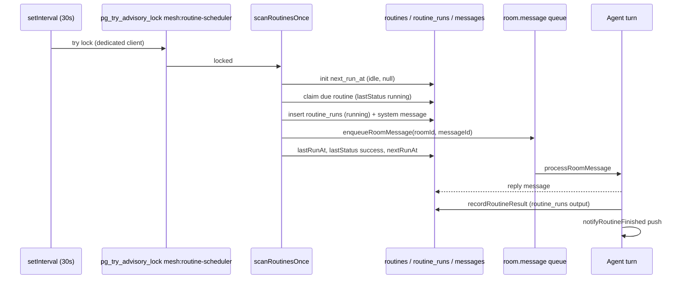

# Scheduler: Routines (Distributed Cron)

Routines are the cron layer of Sayabot: a `routines` row binds an agent, a room, a cron expression (with timezone), and a prompt; a lightweight in-process scheduler scans the table every 30 seconds, claims due routines with an atomic `UPDATE`, and starts each as a normal room turn — so distributed cron execution costs no extra machinery beyond one Postgres advisory lock to elect the scanning instance. Result delivery closes the loop: when the triggered agent turn finishes, `recordRoutineResult` stores what the agent actually said and pushes a notification to the routine's creator; optional `metadata.deliverTo` routes the reply to a Telegram/Discord/WhatsApp chat.

Source files: `apps/orchestrator/src/scheduler/routines.ts`, `apps/orchestrator/src/scheduler/routine-results.ts`

---

## 🗄️ Storage (`packages/db/src/schema/routines.ts`)

| Table          | Key columns                                                                                                                                                                                                                                                                                                                                                        | Purpose                                                                     |
| :------------- | :----------------------------------------------------------------------------------------------------------------------------------------------------------------------------------------------------------------------------------------------------------------------------------------------------------------------------------------------------------------- | :-------------------------------------------------------------------------- |
| `routines`     | `org_id`, `room_id` (nullable), `agent_id`, `name`, `schedule_expr` (cron string), `schedule_kind` (default `"cron"`), `timezone` (default `"UTC"`), `prompt`, `enabled`, `next_run_at`, `last_run_at`, `last_status` (enum, default `"idle"`), `last_error`, `run_count`, `metadata` (jsonb — includes `deliverTo`), `created_by_user_id` / `created_by_agent_id` | Indexed for the scan: `(enabled, next_run_at)` via `routines_next_run_idx`. |
| `routine_runs` | `routine_id`, `org_id`, `status` (default `"running"`), `started_at`, `finished_at`, `output` (≤20 000 chars), `error`                                                                                                                                                                                                                                             | One row per execution; the audit trail surfaced in the UI.                  |

## 🖥️ Scheduler Loop (`src/scheduler/routines.ts`)

`startRoutineScheduler()` (`routines.ts:253-262`) is called once at boot (`src/index.ts`); it runs one scan immediately, then every `SCAN_MS = 30_000` on an unref'ed interval. `stopRoutineScheduler()` clears it on shutdown.

### Distributed election

Every scan is wrapped in `guardedScan()` (`routines.ts:234-251`): it takes a dedicated client from the pool and tries a **session-level advisory lock**:

```typescript
async function guardedScan(): Promise<void> {
  const pool = getPool()
  const client = await pool.connect()
  try {
    const { rows } = await client.query("select pg_try_advisory_lock(hashtext($1)) as locked", [
      ROUTINES_LOCK,
    ])
    if (!rows[0]?.locked) return
    try {
      await scanRoutinesOnce()
    } finally {
      await client.query("select pg_advisory_unlock(hashtext($1))", [ROUTINES_LOCK])
    }
  } finally {
    client.release()
  }
}
```

with `ROUTINES_LOCK = "mesh:routine-scheduler"` (`routines.ts:8`). `pg_try_advisory_lock` (not the blocking variant) means non-leader instances simply skip the tick; the lock is released and the client returned in `finally`. This is the same connection-scoped advisory-lock discipline as `withRoomLock` (see [service-overview.md](../engine/service-overview.md)) — lock, work, unlock, release, never on pooled queries.

Note the two-layer protection: the advisory lock elects one _scanner_ per fleet, and the per-routine `UPDATE … WHERE enabled = true … RETURNING` claim then makes the actual execution idempotent even if two instances somehow ran the same tick (e.g. during a lock handover).

### `scanRoutinesOnce()` (`routines.ts:178-232`)

1. **Initialize**: enabled routines still in `lastStatus = "idle"` with a null `next_run_at` (≤20) get `next_run_at = getNextCronRun(scheduleExpr, now, timezone)` from `@sayabot/core` — only when the expression passes `isValidCron`. The update re-checks `lastStatus = "idle"` and `next_run_at IS NULL` so concurrent initializations can't double-write.
2. **Claim**: due routines (`enabled = true`, `next_run_at <= now`, ≤10 per tick) are claimed by `UPDATE routines SET lastStatus = 'running' WHERE id = … AND enabled = true` — the `returning()` row is the claim ticket; losers of a race get zero rows and `continue`.
3. **Execute**: `runRoutineNow(routine.id)` is fired without awaiting (`void … .catch(log)`) so one slow run never delays the scan.
4. **Side duty**: the tick also calls `sleepIdleBoats(now)` from `src/computers/sleep.ts` — the same heartbeat that schedules routines idles down unused sandbox computers.

### `runRoutineNow(routineId)` (`routines.ts:42-176`)

The single execution path, also reachable manually via `POST /internal/routines/:id/run` (see [internal-api-and-jobs.md](./internal-api-and-jobs.md)):

1. Load the routine and its agent; fall back to the org's first room when `roomId` is null ("No room available to execute routine" if the org has none).
2. Insert a `routine_runs` row (`status: "running"`).
3. Insert the trigger message:

```typescript
const content = `[Routine: ${routine.name}]\n\n@${agent.handle} ${routine.prompt}`
```

as `senderType: "system"` with `mentions: [agent.handle]` and metadata `{ routineId, routineRunId, routineName, automated: true, kind: "routine", inbound?: delivery }` — the `inbound` key is the same shape `deliverInboundReply` reads (see [connector-platform.md](./connector-platform.md#-inbound-chat-intake-srcconnectorsinboundts)), so the agent's reply is delivered to the external chat exactly like an inbound message answer.

4. `enqueueRoomMessage(targetRoomId, msg.id)` — the routine becomes an ordinary coordinated turn (room lock, agent loop).
5. Advance the schedule:

```typescript
const nextRun = isValidCron(routine.scheduleExpr)
  ? getNextCronRun(routine.scheduleExpr, now, routine.timezone)
  : null

await db
  .update(routines)
  .set({
    lastRunAt: now,
    lastStatus: "success",
    lastError: null,
    runCount: routine.runCount + 1,
    nextRunAt: nextRun,
    updatedAt: now,
  })
  .where(eq(routines.id, routine.id))
```

An invalid cron expression yields `nextRunAt: null`, meaning "won't re-fire until fixed" — a broken schedule degrades to a one-shot instead of erroring every tick. The `routine_runs` row is marked `success` with a placeholder output ("Sent to @agent. Waiting for the reply…") — replaced later by `recordRoutineResult`.

6. On throw: `lastStatus: "failed"`, `lastError`, and the run row marked `failed`. The function returns `{ success, runId? }` / `{ success: false, error }` for the manual-trigger endpoint.



## 📬 Result Delivery (`src/scheduler/routine-results.ts`)

`readRoutineTrigger(metadata)` (`routine-results.ts:15-26`) recognizes routine trigger messages (`kind: "routine"` with `routineId`/`routineRunId`) — the mirror of `readInbound` for connector messages:

```typescript
export interface RoutineTrigger {
  routineId: string
  routineRunId: string
  routineName: string
}
```

`recordRoutineResult({ metadata, roomId, agentId, reply, error })` (`routine-results.ts:33-74`) is called by the reply paths when the triggered turn ends (`src/engine/run.ts:296`, `src/runner/llm.ts:378`); the comment at `routine-results.ts:31` notes "`reply` and `error` must already be redacted" — the callers pass `redactSecrets`-processed text. It:

1. Updates the `routine_runs` row: `status = failed` when there is an error **or no reply** (with `"The agent finished without a reply"` as the implicit error), else `success` with `output = reply.slice(0, MAX_OUTPUT = 20_000)`.
2. On failure, flips the routine's `lastStatus`/`lastError` too — so the UI reflects reality even though `runRoutineNow` already stamped `success` when _queuing_.
3. Fires `notifyRoutineFinished({ roomId, agentId, routineName, ownerUserId: routine.createdByUserId, summary, failed })` (from `src/push.ts`) to alert the routine's creator — see [push-usage-plans.md](./push-usage-plans.md).

A message without the routine marker (any normal human or agent message) short-circuits at `readRoutineTrigger` returning `null`, so the result hook is free to run on every turn end.

## 📤 External chat delivery (`resolveRoutineDelivery`, `routines.ts:21-40`)

Routine metadata is user-editable, so `deliverTo: { connectorId, chatId }` is honored only under a strict belt of checks: the connector must be a UUID belonging to the same org, `status = "active"`, source in `MESSAGING_SOURCES = { telegram, discord, whatsapp }`, `config.inbound.enabled`, and — when the connector lists `allowedChats` — the chat must be on the list. The resolved target becomes the message's `metadata.inbound`, and `deliverInboundReply` handles the actual send after the turn. Covered by `routine-delivery.test.ts`.

## 🧪 Tests

| Test file                                                  | Covers                                                                                                     |
| :--------------------------------------------------------- | :--------------------------------------------------------------------------------------------------------- |
| `apps/orchestrator/src/scheduler/routine-delivery.test.ts` | `resolveRoutineDelivery` acceptance/rejection rules (source, org, active, inbound enabled, allowed chats). |

---

Related docs:

- [Meeting scheduler](./scheduler-meetings.md) — the sibling interval scheduler on the same boot path
- [Connector platform](./connector-platform.md) — `deliverInboundReply`, which external delivery rides on
- [Internal API & jobs](./internal-api-and-jobs.md) — the `POST /internal/routines/:id/run` trigger
- [Push, usage & plans](./push-usage-plans.md) — `notifyRoutineFinished`
- [Cron tool reference](../tools/tool-cronjob.md) — the agent-facing `cronjob` tool that creates routines
