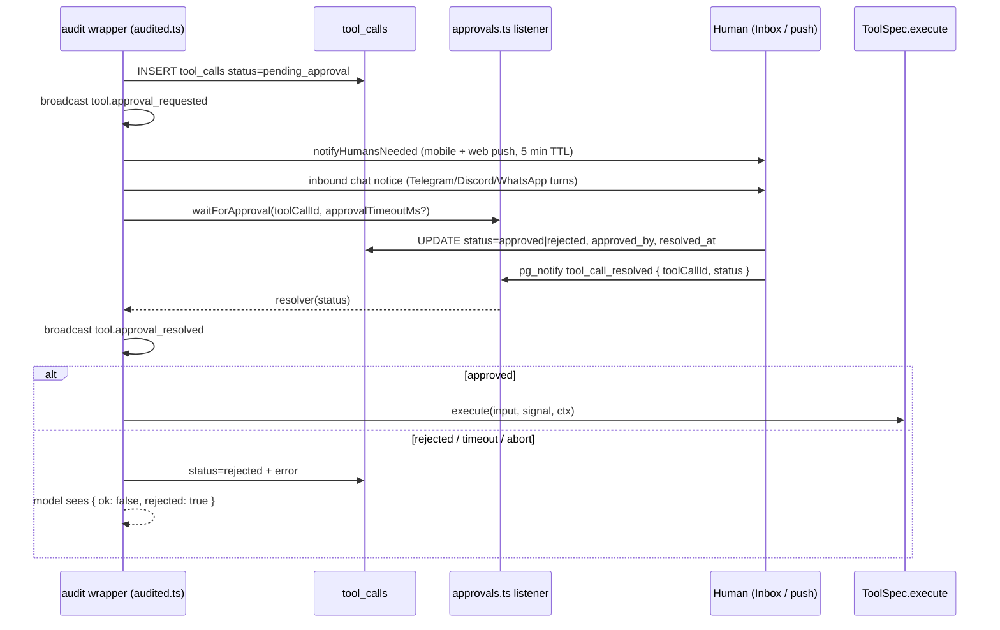

# Human Approval Gate

When a tool call evaluates as **dangerous**, the audit wrapper parks the call in the `tool_calls` table with status `pending_approval`, alerts every human who can decide, and blocks the turn until a room/org admin approves it, rejects it, or the 5-minute timeout expires (which counts as a rejection). The waiting machinery lives in `tools/approvals.ts` — a PostgreSQL `LISTEN/NOTIFY` fast path with a poll fallback; the decision surfaces are the web app (Inbox + push-notification buttons) and an internal orchestrator HTTP route.

Source files: `apps/orchestrator/src/tools/approvals.ts`, `apps/orchestrator/src/tools/audited.ts` (dangerous branch), `apps/orchestrator/src/http.ts:328-358`, `apps/orchestrator/src/push.ts:152-186`, `apps/web/src/app/api/v1/[...path]/route.ts:30-135`, `packages/db/src/schema/tools.ts:49-72`

---

## 🔒 Lifecycle overview



## 📊 Status model (`packages/db/src/schema/enums.ts:45-52`)

A `tool_calls` row moves through `tool_call_status`:

| Status             | Set by                                                                    | Meaning                                    |
| :----------------- | :------------------------------------------------------------------------ | :----------------------------------------- |
| `pending_approval` | audit wrapper at insert (`audited.ts:103`)                                | dangerous call waiting for a human         |
| `approved`         | web proxy route / internal route                                          | human allowed the call; execution proceeds |
| `rejected`         | web proxy route, internal route, timeout, orchestrator restart, run abort | call will not execute                      |
| `running`          | audit wrapper at insert for safe calls (`audited.ts:103`)                 | non-dangerous call in flight               |
| `done` / `error`   | audit wrapper after execution (`audited.ts:191-217`)                      | terminal states with `result` / `error`    |

Note `approved` is transient bookkeeping: the wrapper races `waitForApproval` and proceeds immediately when it resolves `approved`; the row is then overwritten with `done` or `error`.

## ⏳ `waitForApproval` (`src/tools/approvals.ts:74-105`)

```typescript
export async function waitForApproval(
  toolCallId: string,
  timeoutMs = APPROVAL_TIMEOUT_MS,
): Promise<ApprovalStatus>
```

- **Immediate re-check first**: reads the row and returns `approved`/`rejected` if the decision already landed (`approvals.ts:78-79`).
- Registers an in-memory resolver in a `Map<string, Resolver>` (`approvals.ts:13`).
- **Timeout counts as rejection**: `setTimeout(() => finish("rejected"), timeoutMs)` with `APPROVAL_TIMEOUT_MS = 5 * 60_000` (`approvals.ts:7`). The wrapper can pass `runtime.approvalTimeoutMs` to override (`audited.ts:145`).
- **Poll fallback**: every `POLL_MS = 2_000` the row is re-read, covering a dropped listener connection (`approvals.ts:96-103`, interval `.unref()`-ed).

## 📡 LISTEN/NOTIFY plumbing (`src/tools/approvals.ts:16-58`)

- `startApprovalListener()` grabs a **dedicated pool client** (session-scoped, like the room locks) and issues `LISTEN tool_call_resolved` (`approvals.ts:6, 31-49`).
- Notifications carry `{ toolCallId, status }`; well-formed ones call `resolveApprovalWaiter` (`approvals.ts:33-43`). A connection error releases the client and clears the slot so a later call can re-listen (`approvals.ts:44-48`).
- **Restart hygiene**: on boot, any `pending_approval` row older than 5 minutes is flipped to `rejected` with error `"Approval expired before the orchestrator restarted"` (`approvals.ts:19-30`) — approvals never survive an orchestrator restart as zombies.
- `resolveApprovalWaiter(toolCallId, status)` is idempotent-safe: it resolves and removes the waiter if one exists, otherwise it is a no-op (`approvals.ts:53-58`). The wrapper also calls it defensively after the race settles (`audited.ts:151`).
- Producers use `notify(channel, payload)` → `select pg_notify(...)` (`apps/orchestrator/src/db.ts:44-46`).

## 🚨 Notification fan-out

`notifyHumansNeeded({ roomId, agentId, kind: "approval", detail: toolName, refId: toolCallId })` (`push.ts:152-186`) fans out to **room approvers** — room members with role `admin` plus org members with role `owner`/`admin` (`push.ts:26-44`):

| Channel              | Details                                                                                                                                                                                                                                            |
| :------------------- | :------------------------------------------------------------------------------------------------------------------------------------------------------------------------------------------------------------------------------------------------- |
| Mobile push (APNs)   | Title `"${agent} needs your approval"`, body `"Wants to use ${tool with underscores → spaces}. It expires in 5 minutes."`, category `approval`, thread = room (`push.ts:168-176`)                                                                  |
| Web push (VAPID)     | Payload carries `kind: "approval"` and `toolCallId`, `tag: mesh-approval-<toolCallId>`, URL `/<org-slug>/inbox`, TTL 300 s (`push.ts:177-186`, `push.ts:7`)                                                                                        |
| Notification buttons | The service worker renders **Allow / Don't allow** action buttons on approval pushes (`apps/web/src/sw.ts:79-83`)                                                                                                                                  |
| Inbound chat echo    | If the triggering message came from Telegram/Discord/WhatsApp (`runtime.triggerMetadata`), the original chat is told approval is waiting and expires in 5 minutes (`audited.ts:132-142`, `deliverInboundReply` in `src/connectors/inbound.ts:178`) |

Delivery is best effort — push failures are logged and never hold up the run; the Inbox item remains the source of truth (`push.ts:150-152`).

## ✅ Decision paths

### 1. Web app proxy (Inbox, notification buttons, room UI)

`POST /api/v1/tools/:toolCallId/approve` (`apps/web/src/app/api/v1/[...path]/route.ts:30-135`):

1. Authenticates the user; body `{ approved: boolean }`.
2. Loads the tool call and rejects anything not in `pending_approval` (400).
3. Authorization: room admins and org owners/admins may decide. Calls on `this_computer` (Mac) tool calls are decidable by the Mac's owner (`macApprovalBlock` / `readMacMarker`, `route.ts:98-113`).
4. Updates the row: `status = approved|rejected`, `approved_by = user.id`, `resolved_at = now()`, guarded by `.eq("status", "pending_approval")` (`route.ts:116-123`).
5. Fires the `notify_tool_resolution` RPC, which issues the `pg_notify` that the orchestrator listener receives (`route.ts:127-131`).

The push-notification "Allow" button posts to the same endpoint with the signed-in session cookie (`sw.ts:96-105`).

### 2. Orchestrator internal route

`POST /v1/tools/:toolCallId/approve` (`apps/orchestrator/src/http.ts:328-358`), guarded by the internal-secret auth check. It updates `tool_calls` (only when still `pending_approval`), calls `notify("tool_call_resolved", { toolCallId, status })`, and — because it runs in the same process — also resolves the waiter directly via `resolveApprovalWaiter(toolCallId, status)` (`http.ts:357`).

### 3. Implicit rejections

| Trigger                                | Behavior                                                                                                                                                          |
| :------------------------------------- | :---------------------------------------------------------------------------------------------------------------------------------------------------------------- |
| 5-minute timeout                       | `waitForApproval` resolves `rejected`; row gets error `"Approval expired or was rejected"` (`audited.ts:157-165`)                                                 |
| Run stopped (user abort) while waiting | Race resolves `rejected`; error `"Run stopped while awaiting approval"`; model sees `"The run was stopped before approval."` (`audited.ts:146-150, 163, 175-177`) |
| Orchestrator restart                   | Stale `pending_approval` rows expired on boot (see above)                                                                                                         |

## 🔁 After the decision (`src/tools/audited.ts:151-180`)

```typescript
resolveApprovalWaiter(row.id, "rejected") // clean up any stray waiter
await broadcast(roomId, { type: "tool.approval_resolved", toolCallId, status: decision })
if (decision === "rejected") {
  // UPDATE tool_calls SET status='rejected', resolvedAt, error
  // broadcast tool.finished { status: "rejected", durationMs }
  return { ok: false, rejected: true, error: "A room admin rejected this tool call." }
}
// approved → throwIfAborted → spec.execute(...)
```

On the approved path the wrapper re-checks the abort signal before executing (`audited.ts:183`), then continues through the normal result/error persistence described in [./tool-system.md](./tool-system.md).

## 🧪 Example

```typescript
// apps/orchestrator/src/tools/audited.test.ts:40-42 (mocked) shows the seam:
vi.mock("./approvals", () => ({
  waitForApproval: vi.fn().mockResolvedValue("approved"),
  resolveApprovalWaiter: vi.fn(),
}))
// A dangerous tool therefore blocks until the waiter resolves; tests can force
// "approved" (executes) or "rejected" (returns { ok: false, rejected: true }).
```

Which tools hit this gate is defined per spec — see the inventory table in [./tool-system.md](./tool-system.md) (`git_commit`, `git_push`, `use_secret`, all connector send tools, password-manager reads, `install_skill`, `publish_skill`, destructive `computer_shell` commands, destructive `verify_workspace` checks, and any MCP tool flagged destructive).

Related docs: [./tool-system.md](./tool-system.md) · [./secrets-broker.md](./secrets-broker.md) · [../../architecture/realtime-and-events.md](../../architecture/realtime-and-events.md) · [../../database/schema-engine-tools-ops.md](../../database/schema-engine-tools-ops.md) · [../engine/service-overview.md](../engine/service-overview.md)
