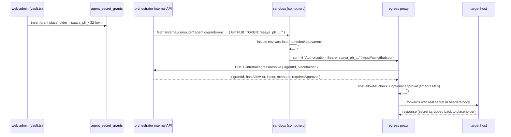

# Secret Broker

The Secret Broker is Sayabot's zero-plaintext-credential path for agents, with two halves. **Tool side**: agents reference secrets by **grant name** — `agent_secret_grants.envName` (canonical names like `GITHUB_TOKEN`, `DATABASE_URL`) — and the orchestrator resolves and injects the credential **at request time**, server-side, inside `use_secret` and the tool-credential resolvers. **Sandbox side**: grants are injected into the computer's environment as opaque `saaya_ph_…` placeholder tokens and swapped for real credentials in flight by the egress proxy. The model never receives, and `tool_calls` never stores, a live secret.

Source files: `apps/orchestrator/src/tools/builtins/use-secret.ts`, `apps/orchestrator/src/tools/secrets.ts`, `packages/db/src/schema/vault.ts:16-72`, `apps/orchestrator/src/internal/routes.ts:71-232`, `apps/egress/src/index.ts`, `apps/egress/src/swapper.ts`, `packages/core/src/hosts.ts:62-73`

---

## 🗄️ Data model (`packages/db/src/schema/vault.ts`)

| Table | Purpose |
| :--- | :--- |
| `vault_secrets` (`vault.ts:22-39`) | One sealed credential per row: `sealed` (sealed envelope text), `kind` (enum), `last4`, `lastUsedAt`, `rotatedAt`. Sealed/unsealed with `sealSecret`/`openSecret` from `@sayabot/llm`. |
| `agent_secret_grants` (`vault.ts:41-72`) | Per-agent authorization to use one secret: `agentId`, `secretId`, `envName` (unique per agent), `placeholder` (unique text token), `allowedHosts` (host pattern array, required), `inject` (`GrantInjectSpec`), `methods` (optional allowlist), `requiresApproval`, `expiresAt`, `revokedAt`, `lastUsedAt`. |
| `org_tool_configs` (`packages/db/src/schema/agents.ts:92-112`) | Org-wide per-tool credentials: `tool` (e.g. `web_search`, `github_bridge`, `postgres_inspector`, `document_extract`, `terminal_sandbox`), `configEnc` (sealed JSON), unique per `(orgId, tool)`. |

`GrantInjectSpec` (`vault.ts:16-20`) controls where the secret lands in the outbound request:

```typescript
export interface GrantInjectSpec {
  mode: "header" | "basic" | "query" | "body"
  template?: string   // header mode: "Authorization: Bearer {secret}"
  param?: string      // query mode: parameter name (default "api_key")
}
```

### Grant lifecycle columns (`vault.ts:41-72`)

| Column | Effect |
| :--- | :--- |
| `envName` (unique per agent) | The reference the agent passes to `use_secret`; also the canonical lookup key (`GITHUB_TOKEN`, `DATABASE_URL`) for tool credentials |
| `placeholder` (globally unique) | The stored token form of the reference; lookup index `agent_secret_grants_placeholder_idx` |
| `allowedHosts` (required array) | Host patterns the grant may reach; empty means the grant can never be used |
| `methods` (optional array) | HTTP-method allowlist; `null`/empty allows all methods |
| `requiresApproval` (default `false`) | Per-grant flag; `use_secret` itself is already `dangerous: true`, so every call waits regardless — this column records admin intent for stricter grants |
| `expiresAt` / `revokedAt` | Checked on every resolution; either hit makes the grant invisible to the agent |
| `lastUsedAt` (grant + secret) | Stamped by `use_secret` after each successful request (`use-secret.ts:161-169`) |

Uniqueness is enforced with `agent_secret_grants_agent_env_idx` on `(agentId, envName)` (`vault.ts:67`).

## 🧰 `use_secret` — the brokered request tool (`src/tools/builtins/use-secret.ts:23-203`)

Registered only when the agent has the `secrets` capability (`src/tools/index.ts:381`) and always `dangerous: true` — every use passes the human approval gate ([./approvals.md](./approvals.md)).

### Schema

| Parameter | Type | Constraints | Description |
| :--- | :--- | :--- | :--- |
| `envName` | string | 1–64 chars | Grant name to use (e.g. `GITHUB_TOKEN`) |
| `request.method` | enum | `GET, POST, PUT, PATCH, DELETE` | HTTP method |
| `request.url` | string (url) | — | Target HTTPS URL |
| `request.headers` | record<string,string> | optional | Extra headers for the request |
| `request.body` | string \| record | optional | Body; `{secret}` placeholder inside it is replaced by the credential |

Tool description (verbatim, `use-secret.ts:26-28`): *"Execute an authenticated HTTPS request using an approved Secret Broker grant. The real credential is injected safely on your behalf and never visible to the model."*

### Execution pipeline

1. **Grant lookup** (`use-secret.ts:34-57`): join `agent_secret_grants` ⋈ `vault_secrets` on `agentId + envName`, excluding revoked (`revokedAt` null) and expired (`expiresAt` null or in the future). No match → error `"Secret grant \"<envName>\" was not found or has expired/been revoked."`
2. **URL validation** (`use-secret.ts:59-66`): only `https:` is permitted; then `assertSafeEgressHost(hostname)` from `@sayabot/core/server` blocks localhost/`.local`/`.internal`/`.onion` suffixes and any RFC-1918/loopback/link-local address, including DNS-resolved ones.
3. **Host allowlist** (`use-secret.ts:68-76`): the request host must match one of `grant.allowedHosts` patterns via `matchesHostPattern` (`packages/core/src/hosts.ts:62-73`) — exact match, or `*.example.com` subdomain match.
4. **Method allowlist** (`use-secret.ts:79-86`): if `grant.methods` is non-empty, the requested method must be in it (case-insensitive).
5. **Decrypt + extract** (`use-secret.ts:89-103`): `openSecret(sealed, MESH_KEK)`; the plaintext is parsed as JSON when possible and the credential picked as `token ?? password ?? apiKey`, falling back to the raw string.
6. **Injection by mode** (`use-secret.ts:106-144`):
   - `header` — split `inject.template` (default `"Authorization: Bearer {secret}"`) at the first colon and replace `{secret}`; no colon → `Authorization: Bearer <secret>`.
   - `basic` — `Authorization: Basic base64(user:pass)`; object secrets use their `username`/`password` fields, otherwise `:<secret>`.
   - `query` — set `searchParams` param `inject.param` (default `api_key`) to the secret.
   - `body` — replace `{secret}` inside the JSON-stringified or string body; sets `content-type: application/json` if absent.
7. **Fetch** with the run's abort signal (`use-secret.ts:154-159`), then stamp `lastUsedAt` on both the grant and the secret rows (`use-secret.ts:161-169`).
8. **Response scrubbing** (`use-secret.ts:171-199`): the body and selected headers are passed through `createRunScrubber([secretString])` so the credential can never echo back; response headers are filtered to a safe allowlist (`content-type`, `content-length`, `date`, `etag`, `x-ratelimit-remaining`, `x-ratelimit-reset`, `x-request-id`); body truncated at 200,000 chars. Returns `{ status, headers, body, truncated }`.

Even if the upstream API echoes the token into its response body or headers, the scrubber removes it before the result reaches the model or `tool_calls` (the audit layer redacts again on top — see [./tool-system.md](./tool-system.md)).

### Example call

```json
{
  "envName": "GITHUB_TOKEN",
  "request": {
    "method": "GET",
    "url": "https://api.github.com/user",
    "headers": { "accept": "application/vnd.github+json" }
  }
}
```

The grant would be configured with `allowedHosts: ["api.github.com"]`, `methods: ["GET"]`, `inject: { mode: "header" }` — the agent never sees the token.

## 🔧 Tool-credential resolvers (`src/tools/secrets.ts`)

`resolveToolCredential(args: { agentId?, orgId, tool })` (`secrets.ts:36-104`) is the shared credential path for org tools. Two tiers, in order:

1. **Agent grant tier** (`secrets.ts:45-100`): only for tools with a canonical env mapping — `github_bridge → GITHUB_TOKEN`, `postgres_inspector → DATABASE_URL` (anything else falls straight through). An unrevoked, unexpired `agent_secret_grants` row for that env name is opened with `openSecret`, parsed as JSON when possible, and the relevant field extracted (`token`/`password`/`apiKey` for GitHub; `connectionString`/`url` for Postgres). Decrypt/parse failures fall through to tier 2.
2. **Org config tier** (`loadOrgToolConfig`, `secrets.ts:17-34`): the `org_tool_configs` row for `(orgId, tool, enabled)`; `configEnc` is opened with `MESH_KEK` and parsed into `OrgToolConfig`:

```typescript
export interface OrgToolConfig {
  token?: string
  connectionString?: string
  apiKey?: string
  provider?: string
  baseUrl?: string
  fallbackToVision?: boolean
  tableMode?: string
}
```

Consumers per tool: `github_bridge` (`builtins/github.ts:59`), `postgres_inspector` (`builtins/postgres.ts:19`), `web_search` and `web_fetch` (`builtins/web-search.ts:606`, `builtins/web-fetch.ts:254`), `document_extract` (`builtins/document.ts:430`), `terminal_sandbox` (`builtins/sandbox.ts:381`, `builtins/sandbox.ts:430`).

## 🔐 Where credentials are *not* needed

Other secret-bearing paths stay inside the orchestrator by design:

- **Connectors** decrypt their OAuth/API tokens per call in `ConnectorService.getDecryptedConnector` (`apps/orchestrator/src/connectors/service.ts:37-68`) and only expose search results to the model — see [./tool-connectors.md](./tool-connectors.md).
- **MCP server headers** are opened from `mcp_servers.headers_enc` in `loadMcpConfigs` (`src/tools/index.ts:85-95`) and handed straight to the MCP client.
- **Password-manager reads** (`onepassword_read` etc.) return the password only through a `dangerous: true` approval gate, keeping it auditable rather than ambient.

## ⚠️ Guarantees and limits

| Guarantee | Mechanism |
| :--- | :--- |
| Plaintext never enters a prompt or `tool_calls` | injection happens inside `use_secret`'s `execute`; audit layer redacts args/results (`audited.ts:40-65`) |
| Responses cannot leak the secret back | `createRunScrubber([secretString])` over body + headers (`use-secret.ts:172-190`) |
| No arbitrary egress | HTTPS-only + `assertSafeEgressHost` + `allowedHosts` pattern match (`use-secret.ts:60-76`) |
| Least privilege per agent | per-agent grant with host, method, and inject-mode constraints; revocation/expiry checked on every call |
| Human oversight | `use_secret` is `dangerous: true` → `pending_approval` flow (5-minute window) |

## 🔄 In-flight placeholder swap (sandbox → egress → internet)

The Secret Broker has a second path for **sandbox commands** (curl, git, SDKs): grants appear as environment variables whose values are opaque placeholder tokens, and the egress proxy swaps them for real credentials in flight — so a plaintext secret never enters the computer or the model context.



| Step | Where | Detail |
| :--- | :--- | :--- |
| Token minting | `apps/web/src/lib/actions/vault.ts:201` | `` placeholder = `saaya_ph_${randomBytes(16).toString("hex")}` `` stored in `agent_secret_grants.placeholder` (unique) |
| Env injection | `GET /internal/computer/:agentId/grants-env` (`apps/orchestrator/src/internal/routes.ts:393-416`) | Returns `{ [envName]: placeholder }` for unrevoked, unexpired grants; computerd writes them into the sandbox environment |
| Agent usage | prompt guidance (`apps/orchestrator/src/runner/context.ts:345`) | *"Granted secrets appear in your environment as placeholders (e.g. `$GITHUB_TOKEN="saaya_ph_..."`). You can use them directly in commands (curl, git, SDKs); the Secret Broker automatically swaps real credentials in flight for allowlisted hosts."* |
| Detection | `apps/egress/src/index.ts:17` | `PLACEHOLDER_RE = /saaya_ph_[A-Za-z0-9_-]{32,}/g` scanned over request headers and body; the same pattern family exists for redaction in `packages/core/src/redact.ts:18` |
| Resolution | `POST /internal/egress/resolve` (`internal/routes.ts:75-146`) | Matches the placeholder string or the grant id (`placeholder.replace(/^saaya_ph_/, "")`); returns the **decrypted** `secretPlaintext`, `hostAllowlist`, `inject`, `methods`, `requiresApproval` to egress only (internal-secret authenticated) |
| Host enforcement | `apps/egress/src/index.ts:198-203` | `isHostAllowed` via `matchesHostPattern`; violations reported to `POST /internal/egress/violation` and answered with `403 "saaya: secret is not allowed for <host>"` |
| Per-request approval | `apps/egress/src/index.ts:205-212` + `POST /internal/egress/approval` (`internal/routes.ts:160-232`) | Grants with `requiresApproval: true` create a `tool_calls` row (`toolName: "use_secret"`, `pending_approval`) in one of the agent's rooms, broadcast `tool.approval_requested`, and block on `waitForApproval(toolCallId, timeoutMs ?? 60_000)`; non-approval → `403 "saaya: human approval rejected or timed out"` |
| Swap + forward | `apps/egress/src/index.ts:215-240` | `replaceAll(placeholder → secretPlaintext)` in headers and body, then the request is forwarded over https/http |
| Response scrubbing | `apps/egress/src/index.ts:197, 245+` | `secretsToPlaceholder` maps each secret back to its placeholder, so upstream echoes are scrubbed before reaching the sandbox |
| Cache invalidation | `apps/egress/src/index.ts:65-90` + `swapper.ts:19-28` | 30 s grant cache, 60 s identity cache; `vault_changed` SSE stream, `POST /flush`, and `POST /identity/forget` (computerd calls it whenever a computer starts/stops so a reused container IP is never attributed to its previous owner) |

Identity for the swap comes from either the container IP (`resolveAgentIdentity`) or the per-agent proxy credential in `Proxy-Authorization` (`proxySecretFrom`, `swapper.ts:30-38`) — the credential is added by computerd on the host side of a smolvm egress socket and never enters the VM, so it cannot be forged by the sandbox (`swapper.ts:40-44`).

Note on the `$SECRET{NAME}` notation used in product docs and `apps/computerd/src/backends/e2b.ts:61` (which notes e2b sandboxes do **not** substitute placeholders): the implemented token format is `saaya_ph_…`, referenced in the sandbox as the env var `$GITHUB_TOKEN` etc. Orchestator-side tools (`use_secret`, `resolveToolCredential`) use the grant's `envName` directly instead of placeholder strings.

Related docs: [./tool-system.md](./tool-system.md) · [./approvals.md](./approvals.md) · [./tool-connectors.md](./tool-connectors.md) · [./tool-web.md](./tool-web.md) · [./tool-computer.md](./tool-computer.md) · [../../llm/crypto.md](../../llm/crypto.md) · [../../database/schema-connectors-and-vault.md](../../database/schema-connectors-and-vault.md)
