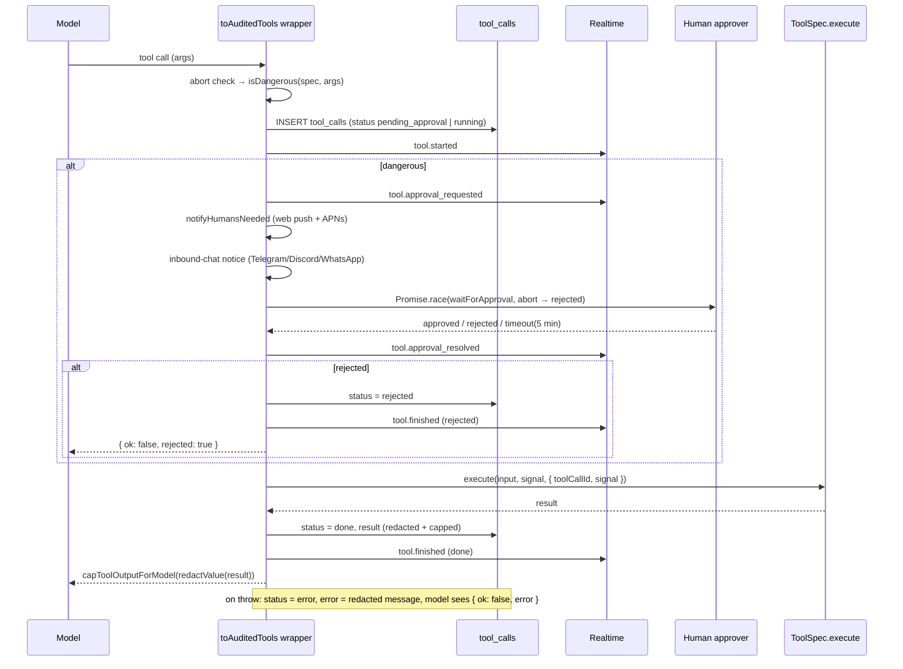

# Tool System

Every capability a Sayabot agent can act with is a **tool spec** assembled per turn by `buildTools()`, then wrapped by a single auditing pipeline (`toAuditedTools`) that persists each call to the `tool_calls` table, redacts secrets, enforces the human approval gate for dangerous calls, and bounds what the model ever sees. This page documents the registry (`buildTools`), the `ToolSpec` contract, the audit wrapper, and the complete inventory of built-in tools with their capability gates.

Source files: `apps/orchestrator/src/tools/index.ts`, `apps/orchestrator/src/tools/audited.ts`, `packages/core/src/capabilities.ts`, `apps/orchestrator/src/engine/evidence.ts`

---

## 🧩 `ToolSpec` — the tool contract (`src/tools/audited.ts:30-36`)

Every tool in Sayabot — built-in or MCP — is described by one interface:

```typescript
export interface ToolSpec {
  name: string
  description: string
  schema: z.ZodType
  dangerous: boolean | ((args: Record<string, unknown>) => boolean)
  execute: (args: any, signal?: AbortSignal, ctx?: ToolContext) => Promise<unknown>
}
```

- `dangerous` may be a static boolean **or** a predicate evaluated against the parsed call arguments (e.g. `github_bridge` is dangerous only for `action === "commit_file"`, `apps/orchestrator/src/tools/builtins/github.ts:57`).
- `execute` receives a `ToolContext` (`audited.ts:25-28`) carrying the `toolCallId` of the persisted audit row plus the run's `AbortSignal`, so long-running tools can stop mid-flight and report "Run stopped before tool execution".
- Specs are pure factories: `cronjobTool({ orgId, agentId, roomId })`, `githubTool(orgId, agentId?)` etc. return a `ToolSpec` bound to one turn's context.

## 🧱 `buildTools()` — the registry (`src/tools/index.ts:223-486`)

```typescript
export async function buildTools(args: BuildToolsArgs): Promise<BuiltTools>
// BuildToolsArgs = { roomId, orgId, agent: typeof agents.$inferSelect, runtime: ToolRuntime }
// BuiltTools    = { tools, specs, activeToolNames, warnings, verification, close }
```

Assembly order:

1. **Capabilities** are parsed with `parseCapabilities(agent.capabilities)` (`packages/core/src/capabilities.ts:64`), which fills every missing field from `DEFAULT_CAPABILITIES` (everything `true` except `computer` and `secrets`).
2. **Engine version**: `isV2` is `true` unless `agent.params.engine` is set to something other than `"v2"` (`index.ts:226`). V2 gates `update_plan`, skills, subagents, verification and workspace tools.
3. **Specs array** is built in the order below, gated per capability.
4. **MCP specs** (`caps.mcp`, `index.ts:423-471`): `mcp_servers` rows for the org/room are loaded (`loadMcpConfigs`, `index.ts:65-147`), headers/env decrypted with `openSecret(row.headersEnc, MESH_KEK)`, OAuth state restored via `mcpOAuthProvider`. An MCP tool whose name collides with a built-in is **skipped** with a warning (`index.ts:432-435`). MCP danger is `meta.dangerous || meta.annotations?.destructiveHint === true` — server hints may _add_ an approval gate, never remove one (`index.ts:445`). Desktop apps are probed with `desktopOnline()` first and skipped when the host is offline (`index.ts:452-465`).
5. **Wrap-up**: all specs are sorted by name, each wrapped by `RunEvidence.wrap` (`index.ts:473`), optionally partitioned by `partitionToolsForSearch` (V2), and finally converted to an AI SDK `ToolSet` via `toAuditedTools(registered, args.runtime)` (`index.ts:476`).

`warnings` collects non-fatal problems (unreadable MCP headers, offline desktop apps, failed MCP connections); `verification()` returns the run's `VerificationEvidence`; `close()` disconnects MCP clients.

## 🎛️ Capability gates

| Capability (`packages/core/src/capabilities.ts:3-18`) | Default | Tools gated                                                                                                                                                                                                                     |
| :---------------------------------------------------- | :-----: | :------------------------------------------------------------------------------------------------------------------------------------------------------------------------------------------------------------------------------ |
| _(none — always present)_                             |    —    | `select_computer` (`index.ts:289`)                                                                                                                                                                                              |
| `connectors`                                          | `true`  | `gdrive_*`, `slack_*`, `github_*`, `discord_*`, `telegram_*`, `whatsapp_*`, `*password*_search/_read` — and only for sources with an **active** grant in `agent_connector_grants` ⋈ `workspace_connectors` (`index.ts:232-260`) |
| `canvas`                                              | `true`  | `canvas_read`, `canvas_write`, `canvas_patch` (`index.ts:331-337`)                                                                                                                                                              |
| `sandbox`                                             | `true`  | `code_sandbox`, `terminal_exec` — only when `!caps.computer` (`index.ts:338-343`); enabling `computer` **replaces** the sandbox tools                                                                                           |
| `webSearch`                                           | `true`  | `web_search`, `web_fetch` (`index.ts:344-349`)                                                                                                                                                                                  |
| `document`                                            | `true`  | `document_extract` — included unless explicitly `false` (`index.ts:350-352`)                                                                                                                                                    |
| `github`                                              | `true`  | `github_bridge` (`index.ts:353`)                                                                                                                                                                                                |
| `postgres`                                            | `true`  | `postgres_inspector` (`index.ts:354`)                                                                                                                                                                                           |
| `tasks`                                               | `true`  | `list_tasks`, `create_task`, `schedule_followup`, `claim_task`, `report_checkin`, `update_task`, `request_human_decision`, `start_vote`, `cast_vote`, `plan_task`, `assign_task` (`index.ts:355-362`)                           |
| `computer`                                            | `false` | the 17 standard computer tools; profile `browser` adds the 10 browser tools (`index.ts:363-374`)                                                                                                                                |
| `computer` + engine V2                                |    —    | `verify_workspace`, `workspace_detect`, `report_findings`, `workspace_fork`, `workspace_inspect` (`index.ts:375-380`)                                                                                                           |
| `secrets`                                             | `false` | `use_secret` (`index.ts:381`)                                                                                                                                                                                                   |
| `voice`                                               | `true`  | `send_voice_note` (`index.ts:382`)                                                                                                                                                                                              |
| `memory`                                              | `true`  | `remember`, `recall`, `open_loop`, `reflect`, `graph_walk`, `forget` (`index.ts:382-388`)                                                                                                                                       |
| `cron`                                                | `true`  | `cronjob` (`index.ts:389-397`)                                                                                                                                                                                                  |
| engine V2 + `runId`                                   |    —    | `update_plan`, `load_skill`, `search_skills`, `inspect_skill`, `install_skill`, `propose_skill`, `publish_skill` (`index.ts:398-403`)                                                                                           |
| engine V2 + `subagents` + `runId`                     |    —    | `spawn_subagent`, `subagent_status` (`index.ts:404-418`)                                                                                                                                                                        |
| `mcp`                                                 | `true`  | every enabled MCP server's tools, plus desktop-app tools (≤ 80 tools per app, `index.ts:175`)                                                                                                                                   |

Computer placement parameters (`availabilityFromParams`, `worksOnFromParams`) plus org-level `org_computer_settings` (Boat ciphertext, VPS auto-start, SSH alias) refine whether computer tools actually resolve to a VM, Boat, VPS or `this_computer` (`index.ts:262-286`).

## 🔍 Auditing wrapper — `toAuditedTools()` (`src/tools/audited.ts:84-223`)

Every executed tool call — no exceptions, built-in or MCP — flows through this wrapper:



**Execution mode.** Before recording a call, the wrapper asks `roomReviewsEveryStep(runtime.roomId)` (`audited.ts`), which reads `rooms.execution_mode`. In a `review_all` room every tool, including `safe` ones, takes the `pending_approval` path above; in `ask_risky` (the default), `auto` and `turbo` only `dangerous` calls do: auto/turbo loosen the owner's own Mac runs (see the desktop runner), never server tools marked dangerous. The mode is read per call, so a switch from the composer applies mid-run, and a failed lookup falls back to the default: it can only add approval gates, never remove one. Mac runs' native Claude Code tools are governed by Claude Code's own permission mode, which always allows reads.

Key mechanics:

- **Persist before execute**: the row is inserted _before_ running the tool, so a crashed tool still leaves an auditable record with status `running`. Non-UUID `runId`/`messageId` (e.g. subagent pseudo-ids) are sanitized to `null` via `toSafeUuid` (`audited.ts:71-77`).
- **Secret redaction** (`redactValue`, `audited.ts:40-53`): args and results are walked recursively (depth cap 8), each string passed through the runtime `scrub` function and `redactSecrets()` from `@sayabot/core` before storage and before the model sees it. Errors get the same treatment (`audited.ts:204-217`).
- **Storage cap**: `forStorage` keeps results under `STORED_RESULT_LIMIT` = 120,000 JSON characters; larger results become `{ truncated: true, preview: <first 10k chars> }` (`audited.ts:38, 55-65`).
- **Model-side cap**: what the model receives is further bounded by `capToolOutputForModel` (default `MODEL_OUTPUT_CHAR_LIMIT` = 40,000 chars) which keeps head+tail of long strings and preserves diagnostic lines (`apps/orchestrator/src/engine/loop-control.ts:170-243`).
- **Failures become tool results**: a throwing tool never kills the agent stream; it becomes `{ ok: false, error: "<redacted>" }` (`audited.ts:204-218`).
- **Abort discipline**: an already-aborted call returns `{ ok: false, error: "Run stopped before tool execution" }` without executing (`audited.ts:92`); an abort during the approval wait resolves the race as `rejected` (`audited.ts:144-151`).

Realtime events broadcast per call (topic `room:<roomId>` via Supabase broadcast, `src/realtime.ts:8`): `tool.started`, `tool.approval_requested`, `tool.approval_resolved`, `tool.finished` (with `durationMs`), and `tool.output` (streamed shell chunks, emitted by `computer_shell` itself).

## ✍️ Verification evidence wrapper (`src/engine/evidence.ts`)

Before auditing, every spec is wrapped by `RunEvidence.wrap` (`evidence.ts:75-108`), which tracks whether the workspace was mutated since the last verified check:

- Mutating calls: `fs_edit`, `fs_write`, `computer_write_file`, plus `computer_shell` when `shellMayMutate(command)` is true (`evidence.ts:3-38` — a chained-segment allowlist of read-only commands; anything else counts as a possible write).
- `verify_workspace` results are recorded as check evidence; the run-level snapshot (`evidence.snapshot()`) reports `not_required | pending | passed | failed` and pushes the engine to demand real command execution rather than prose claims.

## 📚 Complete tool inventory

Danger column: `safe` = never blocks, `dynamic` = approval only for certain args, `dangerous` = always requires approval.

| Tool name                                                                                                         | Gate                           | Danger                                        | Purpose                                                                                                  |
| :---------------------------------------------------------------------------------------------------------------- | :----------------------------- | :-------------------------------------------- | :------------------------------------------------------------------------------------------------------- |
| `select_computer`                                                                                                 | always                         | safe                                          | Move the turn onto `this_computer`, `local_vm`, `boat`, or `vps`; wakes/provisions via `apply` callback. |
| `computer_shell`                                                                                                  | `computer`                     | dynamic (`isDestructiveCommand`)              | Run a command on the bot's desktop (local VM, Boat, or VPS) with streamed output.                        |
| `computer_screenshot`                                                                                             | `computer`                     | safe                                          | Capture the Boat desktop screen.                                                                         |
| `computer_click`                                                                                                  | `computer`                     | safe                                          | Click a pixel point on the Boat desktop.                                                                 |
| `computer_list`                                                                                                   | `computer`                     | safe                                          | List directory contents (Boat / VPS / local VM).                                                         |
| `computer_read_file`                                                                                              | `computer`                     | safe                                          | Raw UTF-8 page read; compatibility alias of `fs_read` without line-number prefixes.                      |
| `computer_write_file`                                                                                             | `computer`                     | safe                                          | Write a file in `/home/bot` (alias of `fs_write`, 1 MB limit).                                           |
| `computer_publish`                                                                                                | `computer`                     | safe                                          | Publish a container file into the room canvas.                                                           |
| `fs_read`                                                                                                         | `computer`                     | safe                                          | Numbered-line UTF-8 file page with SHA-256 hash.                                                         |
| `fs_edit`                                                                                                         | `computer`                     | safe                                          | Hash-guarded atomic literal replacement.                                                                 |
| `fs_patch`                                                                                                        | `computer`                     | safe                                          | Apply a `*** Begin Patch` multi-file patch atomically.                                                   |
| `fs_write`                                                                                                        | `computer`                     | safe                                          | Create or overwrite a file up to 2 MB.                                                                   |
| `fs_glob`                                                                                                         | `computer`                     | safe                                          | Filename glob search, newest first.                                                                      |
| `fs_grep`                                                                                                         | `computer`                     | safe                                          | Ripgrep search with line numbers.                                                                        |
| `code_outline` / `code_definition` / `code_references` / `code_diagnostics` / `code_rename_preview`               | `computer`                     | safe                                          | TypeScript compiler-language-service code intelligence.                                                  |
| `git_status` / `git_diff`                                                                                         | `computer`                     | safe                                          | Working-tree status / diff.                                                                              |
| `git_commit`                                                                                                      | `computer`                     | dangerous                                     | Commit changes (`git commit -a -m`).                                                                     |
| `git_push`                                                                                                        | `computer`                     | dangerous                                     | Push commits to the remote through the Secret Broker proxy.                                              |
| `browser_open` / `browser_snapshot` / `browser_click` / `browser_type` / `browser_extract` / `browser_screenshot` | `computer` (profile `browser`) | safe                                          | CDP headless-Chromium automation.                                                                        |
| `browser_exec` / `browser_cdp` / `browser_dialog` / `browser_vault`                                               | `computer` (profile `browser`) | safe                                          | Scripted page code, raw CDP commands, dialog handling, vault autofill.                                   |
| `code_sandbox`                                                                                                    | `sandbox` (and `!computer`)    | dynamic (`local`, `ssh`, destructive)         | Ephemeral Python/JS/Bash execution across 6 backends; human approval for host/ssh/destructive commands.  |
| `terminal_exec`                                                                                                   | `sandbox` (and `!computer`)    | dynamic (`local`, `ssh`, destructive)         | Shell command in the configured terminal backend; human approval for host/ssh/destructive commands.      |
| `web_search`                                                                                                      | `webSearch`                    | safe                                          | Multi-provider web search with DuckDuckGo fallback.                                                      |
| `web_fetch`                                                                                                       | `webSearch`                    | safe                                          | SSRF-hardened page fetch → Markdown/text.                                                                |
| `document_extract`                                                                                                | `document !== false`           | safe                                          | PDF/document/table extraction via Docling/Marker/Mistral/Vision.                                         |
| `github_bridge`                                                                                                   | `github`                       | dynamic (`commit_file`)                       | Read file / list issues / commit file via the GitHub REST API.                                           |
| `postgres_inspector`                                                                                              | `postgres`                     | safe                                          | Read-only single SELECT/WITH query (100 rows, 10 s).                                                     |
| `gdrive_search`, `gdrive_read_file`                                                                               | `connectors` + grant           | safe                                          | Google Drive search/read scoped to allowed folders.                                                      |
| `slack_search`, `slack_read_thread`                                                                               | `connectors` + grant           | safe                                          | Slack message search / thread read within allowed channels.                                              |
| `slack_send_message`                                                                                              | `connectors` + grant           | dangerous                                     | Post to Slack (approval required).                                                                       |
| `github_search_code`, `github_get_file`, `github_get_issue_or_pr`                                                 | `connectors` + grant           | safe                                          | GitHub code search, file read, issue/PR fetch within allowed repos.                                      |
| `discord_list_channels`, `discord_read_messages`                                                                  | `connectors` + grant           | safe                                          | Discord channel listing / message read.                                                                  |
| `discord_send_message`                                                                                            | `connectors` + grant           | dangerous                                     | Post to Discord.                                                                                         |
| `telegram_read_messages`                                                                                          | `connectors` + grant           | safe                                          | Read last-24 h Telegram messages.                                                                        |
| `telegram_send_message`                                                                                           | `connectors` + grant           | dangerous                                     | Send a Telegram message.                                                                                 |
| `whatsapp_send_message`, `whatsapp_send_template`                                                                 | `connectors` + grant           | dangerous                                     | WhatsApp text / approved template.                                                                       |
| `onepassword_search` / `bitwarden_search` / `protonpass_search`                                                   | `connectors` + grant           | safe                                          | Password-manager item search (titles + ids only).                                                        |
| `onepassword_read` / `bitwarden_read` / `protonpass_read`                                                         | `connectors` + grant           | dangerous                                     | Read one item including its password.                                                                    |
| `list_tasks`, `create_task`, `claim_task`, `update_task`, `assign_task`, `plan_task`                              | `tasks`                        | safe                                          | Room task-board CRUD with atomic claim and subtask planning.                                             |
| `schedule_followup`                                                                                               | `tasks`                        | safe                                          | Self-scheduled follow-up task that wakes the agent later.                                                |
| `report_checkin`                                                                                                  | `tasks`                        | safe                                          | Check-in report classified against real task events (digest/stream).                                     |
| `request_human_decision`                                                                                          | `tasks`                        | safe                                          | Decision card in the human Inbox with tap-able options.                                                  |
| `start_vote`, `cast_vote`                                                                                         | `tasks`                        | safe                                          | Agent-to-agent votes.                                                                                    |
| `verify_workspace`                                                                                                | `computer` + V2                | dynamic (`isDestructiveCommand` on any check) | Run test/lint/typecheck/build commands as verification evidence.                                         |
| `workspace_detect`                                                                                                | `computer` + V2                | safe                                          | Detect package manager, manifests and scripts without executing project code.                            |
| `report_findings`                                                                                                 | `computer` + V2                | safe                                          | Structured file-anchored findings report.                                                                |
| `workspace_fork`, `workspace_inspect`                                                                             | `computer` + V2                | safe                                          | Detached git-worktree fork + verified base diff.                                                         |
| `use_secret`                                                                                                      | `secrets`                      | dangerous                                     | Secret-Broker authenticated HTTPS request; credential injected server-side.                              |
| `cronjob`                                                                                                         | `cron`                         | safe                                          | Create/list/update/pause/resume/run/remove scheduled routines.                                           |
| `remember`, `recall`, `open_loop`, `reflect`, `graph_walk`, `forget`                                              | `memory`                       | `forget` dynamic (`hard_delete`)              | Memory scopes (personal/room/org).                                                                       |
| `canvas_read`, `canvas_write`, `canvas_patch`                                                                     | `canvas`                       | safe                                          | Shared room canvas snapshot / overwrite / diff patch.                                                    |
| `update_plan`                                                                                                     | V2 + `runId`                   | safe                                          | Publish the structured execution plan.                                                                   |
| `load_skill`, `search_skills`, `inspect_skill`, `propose_skill`                                                   | V2 + `runId`                   | safe                                          | Skill lookup / proposal.                                                                                 |
| `install_skill`, `publish_skill`                                                                                  | V2 + `runId`                   | dangerous                                     | Install or publish a skill (approval required).                                                          |
| `spawn_subagent`, `subagent_status`                                                                               | V2 + `subagents` + `runId`     | safe                                          | Parallel subagent delegation and status polling.                                                         |
| _(MCP tools)_                                                                                                     | `mcp`                          | `meta.dangerous` ∨ `destructiveHint`          | Tools from enabled MCP servers; built-in names take precedence.                                          |

### Example calls (from `src/tools/index.test.ts`)

```typescript
// Default capabilities: canvas, tasks, sandbox, webSearch, github, postgres, cron (index.test.ts:87-96)
const result = await buildTools({ roomId: "room-1", orgId: "org-1", agent: baseAgent, runtime })
expect(Object.keys(result.tools)).toContain("code_sandbox") // sandbox capability
expect(Object.keys(result.tools)).not.toContain("computer_shell") // computer off by default

// With computer: { profile: "standard" }, code_sandbox disappears and computer tools appear
// (index.test.ts:136-175); profile "browser" adds browser_open…browser_screenshot (index.test.ts:178-209)
```

## ⚠️ Design invariants

1. **One audit path.** Nothing executes outside `toAuditedTools`; even MCP and desktop-app tools get rows in `tool_calls`.
2. **Danger is data, not convention.** The wrapper consults `isDangerous(spec, args)` (`audited.ts:67-69`) at call time, so per-argument danger (dry-run flags, `commit_file`) is enforced centrally.
3. **The model never sees raw secrets.** Every stored and returned string passes `redactValue`; the response-header allowlist in `use_secret` and the scrubber wiring show the same principle end to end.
4. **Warnings over failures.** Registry problems (offline desktop app, unreadable MCP headers, failing server) degrade the tool set instead of failing the turn.

Related docs: [./approvals.md](./approvals.md) · [./secrets-broker.md](./secrets-broker.md) · [./tool-computer.md](./tool-computer.md) · [./tool-connectors.md](./tool-connectors.md) · [./tool-verification.md](./tool-verification.md) · [../engine/service-overview.md](../engine/service-overview.md) · [../engine/engine-subagents-and-tool-search.md](../engine/engine-subagents-and-tool-search.md) · [../../database/schema-engine-tools-ops.md](../../database/schema-engine-tools-ops.md)
