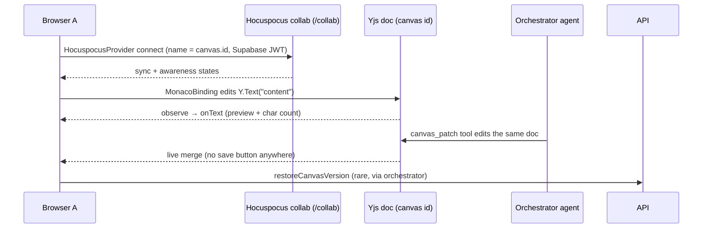

# Canvas UI

The canvas is the room's shared live document: multiple humans and agents edit the same Yjs document simultaneously through a Hocuspocus websocket provider, rendered in a Monaco editor with named remote cursors. The `RoomSidePanel`'s Canvas tab hosts a tab strip of a room's canvases, per-canvas version history with restore, creation/deletion, and for markdown/HTML/SVG kinds a live preview pane under the editor. Content is never "saved" from the browser — the collab backend persists the CRDT document; the web app only observes it.

Source files: `apps/web/src/components/room/canvas-editor.tsx`, `apps/web/src/components/room/canvas-panel.tsx`, `apps/web/src/components/room/canvas-versions.tsx`, `apps/web/src/components/room/create-canvas-form.tsx`, `apps/web/src/components/room/side-panel.tsx`, `apps/web/src/lib/canvas-presence.ts`, `apps/web/src/lib/actions/canvas.ts`

---

## 🧩 Where the Canvas Lives

The end-to-end collaboration path looks like this:



`RoomSidePanel` (`side-panel.tsx`) is the room's workspace pane, with four tabs: `screen | activity | canvas | routines`. The same right-hand slot is taken by the bot settings sidebar (`agent-config-panel.tsx`) while a bot is being configured; its Canvas control returns here. The Screen tab only exists when the room has agents; the Activity tab carries a badge with the count of `pending_approval` tool calls; if the requested tab is missing the panel falls back to `activity` (`shown = tabs.some(...) ? tab : "activity"`, `side-panel.tsx:362`). `RoomWorkspace` passes the already-built `<CanvasPanel>` element as the `canvas: ReactNode` prop, and the stored tab (`sayabot:panel:<roomId>` in localStorage) decides which tab shows. See [Room chat UI](./room-chat-ui.md) for how the settings sidebar opens.

The other tabs, for context:

- **Screen** (`ScreenTab`, `side-panel.tsx:56`) — per-agent "works on" chooser with a tab strip when several agents are in the room. It renders the shared `WorksOnPicker` ([Agents UI](./agents-ui.md)): Auto / Cloud desktop (with a Boat · Self-hosted VPS · E2B switch, stored as `boat`, `vps` or `e2b`) / Private desktop (`local_vm`) / This computer (`this_computer`) / Off (`off`); `PLACES` now only maps each value to the preview icon. Saved through `setAgentWorksOnAction` (`src/lib/actions/agents.ts`) with optimistic local state and rollback + danger toast on failure. Choosing "This computer" without `params.computer.thisComputer` shows a warning card whose **Allow** button saves `thisComputer: true` and points at System Settings → Privacy & Security for Screen Recording / Accessibility; "Not now" reverts to `auto`. The pane itself shows a "watch live" placeholder with an "Open live view" link to `/<org>/agents/<agentId>`.
- **Activity** (`ActivityTab`) — pending approvals first ("1 step is waiting for you" / "N steps are waiting for you"), then the latest 40 resolved calls (newest first) via `ToolCallsList`; empty state explains "Every step a bot takes shows up here… Anything risky waits for your OK first."
- **Routines** (`RoutinesTab`) — the routines posting into this room (loaded by the room page server component): enabled dot, name, "Last run failed" badge when `last_status === "error"`, schedule + agent + "next <weekday, time>" line; empty state suggests asking in chat ("every weekday at 9, send me the news in my field"); an "Open routines" button links to `/<org>/cron`.

## 📑 Canvas Panel (`canvas-panel.tsx`)

`CanvasPanel` owns the canvas list and editor mounting:

- **Tab strip** — one button per canvas (title + `kind` suffix), `aria-pressed` selection, a connection indicator dot with label (`synced` green / `syncing` warn / `offline`+`denied` red; `connectionLabel` at `canvas-panel.tsx:31`), a Versions button, an admin-only Delete (via `ConfirmButton` — "This also deletes its version history."), and a New toggle.
- **Selection** — honours `?canvas=<id>` (`initialCanvasId`) when it exists in the list, falls back to the first canvas; after creation `pendingSelection` keeps the new id until the refreshed canvas list contains it (`canvas-panel.tsx:73`), so a select-effect doesn't yank selection back to canvas[0] mid-refresh. Text state resets to `snapshotText` and connection to `connecting` on every canvas switch (`selected?.id, selected?.snapshotText` effect).
- **Deletion** — `deleteCanvasAction({ orgSlug, roomId, canvasId })`, danger toast on failure, "Canvas deleted" + deselect + `router.refresh()` on success.
- **Editor vs preview layout** — `kind === "code"` gets the full-height editor; `markdown`, `html`, `svg` get a vertical `react-resizable-panels` split: editor 62% (min 160px) over preview 38% (min 120px). Markdown previews through the room's shared `Markdown` renderer (so callouts, KaTeX math and Mermaid diagrams work identically to chat); HTML/SVG render into a sandboxed `<iframe sandbox="allow-scripts" srcDoc={text}>` with a white background. An "N chars" counter tracks the shared text live; an empty markdown canvas shows "Empty canvas. Write in the editor; the preview follows the shared document."
- **Loading** — `CanvasEditor` is `next/dynamic` with `ssr: false` ("Monaco and its Yjs binding touch `window` as soon as they load, so they can only run in the browser. Loading them separately also keeps them out of the room's first download", `canvas-panel.tsx:19`).

## ✍️ Collaborative Editor (`canvas-editor.tsx`)

`CanvasEditor` is where the Yjs/Monaco collaboration is wired:

```typescript
// apps/web/src/components/room/canvas-editor.tsx:52
const doc = new Y.Doc()
const provider = new HocuspocusProvider({
  url: process.env.NEXT_PUBLIC_COLLAB_URL ?? "ws://localhost:4000/collab",
  name: canvas.id, // the provider document name is the canvas id
  document: doc,
  token: async () => {
    const { data } = await supabase.auth.getSession()
    return data.session?.access_token ?? "" // Supabase JWT, checked server-side
  },
  onAuthenticationFailed: () => setConnection("denied"),
  onSynced: () => setConnection("synced"),
  onStatus: ({ status }) =>
    setConnection(
      status === "connected"
        ? "connected"
        : status === "connecting"
          ? "connecting"
          : "disconnected",
    ),
  onClose: () => setConnection("disconnected"),
})
provider.setAwarenessField("user", { id: userId, name: userName, color: colorForUser(userId) })
```

Details that matter:

- **Binding** — on Monaco mount, `new MonacoBinding(doc.getText("content"), model, new Set([editor]), provider.awareness)` (`canvas-editor.tsx:166`) performs two-way CRDT sync on the shared `content` Y.Text. Separately, `ytext.observe(emit)` streams `ytext.toString()` up to `CanvasPanel` via `onText` for the preview and char count.
- **Language mapping** (`languageFor`, `canvas-editor.tsx:21`) — `markdown → "markdown"`, `html → "html"`, `svg → "xml"`, `code → canvas.language || "typescript"`.
- **Theme** — a custom `mesh-dark` Monaco theme defined in `beforeMount` (base `vs-dark`; warm palette: editor background `#0b0e0c`, cursor `#ff7a45`, selection `#3a2418`, comments italic `#6b756d`). Editor options: no minimap, IBM Plex Mono 13px / 21px line height, `wordWrap: "on"` for markdown/html/svg only, folding on, `cursorBlinking: "solid"`, 2-space tabs, `renderWhitespace: "selection"`, `fixedOverflowWidgets: true`, 10px scrollbars.
- **Remote presence** — awareness `change` events rebuild `CanvasPeer[]` via `peersFromAwareness` and inject a generated `<style>` element with `remoteCursorCss`; an "also editing" `<AvatarStack>` (max 4, deduped by user id) sits top-right.
- **Connection state machine** — `connecting → connected → synced` on a healthy join; `denied` (auth failed: signed out or lost room access) blocks the editor with a full-screen "could not open this canvas" card and a Reload button; `disconnected` shows a persistent "editing offline, changes sync when reconnected" badge (edits continue locally in the Y.Doc); `connecting`/`connected` show a transient "syncing canvas…" badge. The state is also exposed on the root element as `data-canvas-connection`.
- **Lifecycle** — on canvas/user change the provider, doc, and `MonacoBinding` are destroyed and recreated (`bindingRef.current?.destroy()`, `provider.destroy()`, `doc.destroy()`); awareness styles are added/removed with the session effect.

### Presence helpers (`lib/canvas-presence.ts`)

| Export                                     | Behaviour                                                                                                                                                                                                                                                                                                                                                                                                                              |
| :----------------------------------------- | :------------------------------------------------------------------------------------------------------------------------------------------------------------------------------------------------------------------------------------------------------------------------------------------------------------------------------------------------------------------------------------------------------------------------------------- |
| `colorForUser(userId)`                     | Stable color from an 8-color palette (`#ff7a45`, `#7dd3c0`, `#b79cf5`, `#ffd08a`, `#7fb2ff`, `#f08fb0`, `#a6d86f`, `#f5b26b`) via a 31-based hash of the user id.                                                                                                                                                                                                                                                                      |
| `peersFromAwareness(states, selfClientId)` | Filters out self and non-integer client ids; treats awareness as **untrusted** — requires a string `user.name`, accepts only `/^#[0-9a-f]{6}$/i` colors, truncates names to 60 chars, falls back to `"someone"`.                                                                                                                                                                                                                       |
| `remoteCursorCss(peers)`                   | "y-monaco only adds per-client class names; the colours and labels have to come from us" (`canvas-presence.ts:42`): generates per-peer rules for `yRemoteSelection-<id>` (background `${color}40`), `yRemoteSelectionHead-<id>` (2px caret border) and its `::after` name label (colored chip, `#0b0e0c` text). Names are sanitized to `\p{L}\p{M}\p{N} ._'-` (max 32 chars) and quoted into CSS `content`, making the injection safe. |

## 🕘 Version History (`canvas-versions.tsx`)

A `Versions` button opens a modal `<dialog>` that fetches the latest 30 `canvas_versions` rows for the canvas (browser Supabase client, ordered `created_at` desc). Each row shows author type (`agent`/`human`), full timestamp, snapshot size in chars, a preview `<details>` (first 4,000 chars via `truncate`), and a Restore button behind `ConfirmButton` ("The current text is replaced for everyone."). Restore calls `restoreCanvasVersion({ orgSlug, roomId, versionId })` — see below — and reports "Restored the version from <time>". The empty state explains versions appear "after an agent writes or patches this canvas, or after a restore".

## ➕ Creation (`create-canvas-form.tsx`)

A `useActionState` form over the `createCanvas` server action: title (1–60 chars) and kind select — Notes (markdown) / Code / Web page (HTML) / Drawing (SVG) — with an optional `language` field (placeholder "typescript") shown only for `code`. On success the action returns `data.canvasId`; a `useEffect` calls `onCreated(canvasId)` (which selects the new canvas, closes the form) and refreshes the router so the list includes it.

## ⚙️ Canvas Server Actions (`lib/actions/canvas.ts`)

| Action                                                 | Auth                           | Behaviour                                                                                                                                                                                                                                                                                                                                                                                                                                                                          |
| :----------------------------------------------------- | :----------------------------- | :--------------------------------------------------------------------------------------------------------------------------------------------------------------------------------------------------------------------------------------------------------------------------------------------------------------------------------------------------------------------------------------------------------------------------------------------------------------------------------- |
| `createCanvas(prev, formData)`                         | session user + `getRoomAccess` | Inserts into `canvases` (`kind` zod-enum `markdown                                                                                                                                                                                                                                                                                                                                                                                                                                 | code | svg | html`, `language`only persisted for`code`, `snapshot_text: ""`, `created_by`), audits `canvas.created`with`{ roomId, title, kind }`, `revalidateOrg`. Returns `{ canvasId }`. |
| `restoreCanvasVersion({ orgSlug, roomId, versionId })` | session user + `getRoomAccess` | Reads the `canvas_versions` row with the browser-level client (so RLS applies), verifies the canvas belongs to the room, then calls `restoreCanvasInOrchestrator(canvasId, userId, version.snapshot_text)` (`src/lib/orchestrator.ts`) — restoration goes **through the orchestrator** so the new text is applied to the live Yjs doc and recorded as a version; failure returns "The orchestrator could not restore the canvas. Is it running?" Audits `canvas.version_restored`. |
| `deleteCanvasAction({ orgSlug, roomId, canvasId })`    | `adminRoomAccess` (admin-only) | Verifies the canvas belongs to the room, deletes the row (version history cascades per schema), audits `canvas.deleted` with `{ roomId, title }`, revalidates.                                                                                                                                                                                                                                                                                                                     |

All three audit through the `audit()` helper from `src/lib/actions/shared.ts`, keeping a complete `canvas.created` / `canvas.version_restored` / `canvas.deleted` trail in the database. The realtime hook in the room also subscribes to `postgres_changes` on `canvases` (see the room chat page) — canvas list changes trigger a debounced `router.refresh()` while content edits flow through the collab socket instead.

---

## Related docs

- [Room chat UI](./room-chat-ui.md) — the panel hosting this tab, the shared realtime hook, and the Markdown renderer reused for previews
- [Agents UI](./agents-ui.md) — the "works on" settings saved from the Screen tab
- [Cron UI](./cron-ui.md) — the Routines tab's full-page sibling
- ../../architecture/system-overview.md — the collab (Hocuspocus) service this connects to
- ../../architecture/realtime-and-events.md — awareness vs broadcast channels
- ../../database/schema-rooms-messages-canvas.md — `canvases`, `canvas_versions` tables
- Canvas actions (`createCanvas`, `restoreCanvasVersion`, `deleteCanvasAction`) are catalogued in `docs/reference/web/actions/`.
