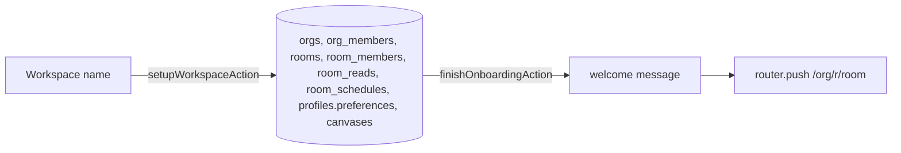

# Onboarding & Workspace Creation

Onboarding asks a new account for one thing: a workspace name. Submitting creates the workspace and a private room named General, then opens that room. API keys, model choice, and the first bot are not part of this screen — those happen later in the app. Progress is stored in `profiles.preferences.onboarding`, so a tab closed after the workspace exists and before the room opens resumes by finishing and redirecting, instead of creating a second workspace. A separate `/new-workspace` page is the path for people who already finished onboarding and want another workspace.

Source files: `apps/web/src/app/onboarding/page.tsx`, `apps/web/src/components/onboarding/wizard.tsx`, `apps/web/src/app/new-workspace/page.tsx`, `apps/web/src/lib/actions/onboarding.ts`

---

## 🚪 Entry Points (`/onboarding` page)

`src/app/onboarding/page.tsx` is a server component that assembles everything the form needs:

1. `requireUser("/onboarding")` — must be signed in (the middleware also treats this path as non-public).
2. `listUserOrgs(user.id)` + reads `profiles.preferences.onboarding` (`{ orgSlug, roomId }`) directly from the `profiles` table.
3. **Resume logic**: if a saved onboarding exists and the org slug is still among the user's orgs, it is passed as `initialWorkspace`. The wizard then calls `finishOnboardingAction` and opens the room (`wizard.tsx:35`). If the user has orgs but nothing in progress, redirect to the first org (`/${orgs[0].slug}`).
4. `getProfile(current)` derives `userName` — the placeholder `"member"` (every guest account starts with it) maps to an empty first name, so the greeting is plain "This is the name your team sees."

Props handed to `OnboardingWizard`: `userName`, `initialWorkspace`.

## 🧙 The form (`src/components/onboarding/wizard.tsx`)

`OnboardingWizard` is a single centered form. The only field is workspace name (`wizard.tsx:132`): default `"${userName}'s workspace"` or `"My workspace"`, 2–60 characters, placeholder "Acme design team". The submit button stays disabled until the trimmed name is in that range (`nameOk`, `wizard.tsx:90`). Label while pending is "Creating…".

`createWorkspace()` (`wizard.tsx:57`) sends `workspaceName`, a fixed `roomName` of `"General"`, and the browser time zone from `Intl.DateTimeFormat().resolvedOptions().timeZone` (UTC when that is missing, `browserTimeZone`, `wizard.tsx:12`). It calls `setupWorkspaceAction`, then `finishOnboardingAction`, and `router.push`es the returned path. A retry after the workspace exists skips creation and only finishes. A malformed result surfaces "The workspace was created but could not be opened. Reload to continue."

When `initialWorkspace` is set, the form is not shown. The page says "Opening your workspace…" and finishes in an effect. If that fails, the error is shown with an "Open workspace" button that goes to `/<slug>/r/<roomId>`.

---

## ⚙️ Server Actions (`src/lib/actions/onboarding.ts`)

### `setupWorkspaceAction`

Creates the whole workspace graph in one operation (using the Supabase **admin** client, bypassing RLS) at `onboarding.ts:32`:

1. Guards: signed-in user, workspace name 2–60 chars, room name 1–60, valid `Intl` time zone, and **no existing org membership** (`"You already have a workspace"`).
2. Generates a unique slug via `uniqueOrgSlug(workspaceName)` (`src/lib/actions/shared.ts`).
3. Inserts, in order: `orgs` → `org_members` (role `owner`) → `rooms` (`kind: "private"`, `turn_mode: "mentions"`, `turn_cap: 3`, timezone, `created_by`) → `room_members` (role `admin`) → `room_reads` upsert → `room_schedules` upsert (timezone only; meeting defaults land later) → updates `profiles.preferences` with `timezone` and the `onboarding: { orgSlug, roomId }` resume pointer → inserts a starter **canvas** (`kind: "markdown"`, title "Room notes", `snapshot_text: "# <room>\n\n"`) → writes an audit row `workspace.onboarding_created` with `{ roomName, timezone }`.
4. On any failure after the org insert, the org is deleted (`orgs.delete().eq("id", org.id)`) and the error returned.

Returns `ok("Workspace ready", { orgSlug, orgId, roomId })`.

### `saveRoomScheduleAction`

Used by room settings (`src/components/rooms/room-schedule-form.tsx`), not by the name form: validates `adminRoomAccess` and rejects `kind === "dm"` rooms ("Direct chats do not run meetings or check-ins"). Parses times with `parseTimeToMinutes` from `@sayabot/core` — defaults 09:00–09:30 morning, 17:00–17:30 evening, check-in window 09:00–17:30 every 60 min for 10 min — and enforces: end-after-start for both meetings, check-in interval 15–480, duration 5–60 (zod coerce), `checkinMode` `stream`|`digest`, `checkinsEnabled` from the checkbox. Then upserts the full `room_schedules` row (with `updated_at`), mirrors the timezone onto `rooms`, audits `room.schedule_changed` with the formatted windows, and `revalidatePath("/<org>", "layout")`.

### `finishOnboardingAction`

Marks onboarding complete and seeds the room (`onboarding.ts:202`):

1. `adminRoomAccess` check, then removes `preferences.onboarding` (the resume pointer).
2. If a message with `metadata.onboarding === true` already exists in the room, it is idempotent — returns the room path immediately.
3. If the room has agents (`room_agents`), inserts a human message `@all_bots Welcome to <room>. Introduce yourself in one sentence and say what you can help with.` with `mentions: ["all_bots"]` and `metadata: { onboarding: true }`, then `queueRoomMessage(roomId, messageId)` (`src/lib/orchestrator.ts`) so the orchestrator runs an agent turn. Without agents it inserts a plain system message "Welcome to <room>."
4. Upserts `room_reads` so the room starts read.

Returns `ok("Room ready", { path: "/<org>/r/<room>", queued })`.

---

## 🏢 `/new-workspace`

`src/app/new-workspace/page.tsx` is the lightweight path for existing users (linked from the profile page's workspace list). It only requires a signed-in user and renders an `ActionForm` (`src/components/ui/action-form.tsx`) bound to `createOrg` from `src/lib/actions/orgs.ts` with a single `name` field (2–60 chars, "You can rename it later."). Unlike onboarding it creates only the workspace — rooms, schedules, canvases, and agents are set up afterwards in the app. Note it does **not** refuse users who already have workspaces; multiple workspaces per account are allowed here, while `setupWorkspaceAction` intentionally stays one-per-account for the guided flow.

---

## Related docs

- [Auth flows](./auth-flows.md) — signup lands here with `next=/onboarding`
- [Room chat UI](./room-chat-ui.md) — the room the form opens at the end
- [Cron UI](./cron-ui.md) — where the room schedule is edited later
- ../../database/schema-rooms-messages-canvas.md — `rooms`, `room_schedules`, `canvases` rows written here
- ../../database/schema-identity-and-invites.md — `orgs`, `org_members`, `profiles.preferences`
- ../../architecture/turn-lifecycle.md — what `queueRoomMessage` kicks off
- Action signatures are catalogued in `docs/reference/web/actions/`.
