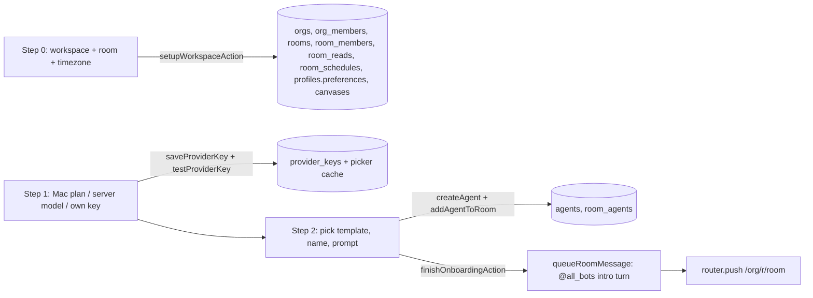

# Onboarding & Workspace Creation

Onboarding is a three-step wizard that takes a brand-new account from zero to a live room with a replying agent: name the workspace and first chat, connect a model, and create the first bot. The wizard is resumable — progress is stored in the user's `profiles.preferences.onboarding` — so closing the tab mid-flow and returning to `/onboarding` picks up at the saved step instead of duplicating work. A separate `/new-workspace` page offers the minimal path for users who already completed onboarding and want an additional workspace.

Source files: `apps/web/src/app/onboarding/page.tsx`, `apps/web/src/components/onboarding/wizard.tsx`, `apps/web/src/app/new-workspace/page.tsx`, `apps/web/src/lib/actions/onboarding.ts`

---

## 🚪 Entry Points (`/onboarding` page)

`src/app/onboarding/page.tsx` is a server component that assembles everything the wizard needs:

1. `requireUser("/onboarding")` — must be signed in (the middleware also treats this path as non-public).
2. `listUserOrgs(user.id)` + reads `profiles.preferences.onboarding` (`{ orgSlug, roomId }`) directly from the `profiles` table.
3. **Resume logic**: if a saved onboarding exists and the org slug is still among the user's orgs, it is passed as `initialWorkspace` and the wizard starts at step 1 (`useState(initialWorkspace ? 1 : 0)`). If the user has orgs but nothing in progress, redirect to the first org (`/${orgs[0].slug}`).
4. `getProfile(current)` derives `userName` — the placeholder `"member"` (every guest account starts with it) maps to an empty first name, so the sidebar says plain "Welcome".
5. `macDefaultApp(user.id)` (`src/lib/desktop-hosts.ts`) detects a signed-in Sayabot-for-Mac install for this user — enabling the "no key needed" model option.
6. `devModelConfigured()` (`src/lib/env.ts`) reports whether this server has its own model configured — enabling "Use Sayabot's model".
7. Time zones come from `Intl.supportedValuesOf("timeZone")` when available (UTC forced first), falling back to a 15-zone list (`FALLBACK_ZONES` at `onboarding/page.tsx:11`: UTC, the Americas, Europe, Dubai, Kolkata, Singapore, Tokyo, Sydney).

Props handed to `OnboardingWizard`: `userName`, `macApp` (`{ hostName, appName } | null`), `defaultTimeZone: "UTC"`, `timeZones`, `hasServerModel`, `initialWorkspace`.

## 🧙 The Wizard (`src/components/onboarding/wizard.tsx`)

The three steps map onto server actions like this:

`OnboardingWizard` is a client component with a left rail (`StepRail` showing the three titles — "Name your workspace", "Choose how your bots think", "Create your first bot" — with done ✓ / current / upcoming markers) and a right pane with per-step forms. Heading focus moves to the step title for accessibility; a "step N of 3" counter appears both in the rail and on mobile. Each "Continue" calls server actions directly through `startTransition`; `status` messages ("Saving your key…", "Testing it with the model…") show inline while pending.

### Step 0 — Name your workspace

| Field | Default | Notes |
| :--- | :--- | :--- |
| Workspace name | `"${userName}'s workspace"` or `"My workspace"` | maxLength 60; disabled once created |
| First chat | `"General"` | "where you talk with your bots" |
| Time zone | `"UTC"`, then browser-local | `
`-collapsed select; auto-selects `Intl.DateTimeFormat().resolvedOptions().timeZone` until the user touches the control (`timezoneTouched` ref, `wizard.tsx:127`); the current value is always appended as an option if missing |

`createWorkspace()` (`wizard.tsx:154`) builds a `FormData` and calls `setupWorkspaceAction`; on success it stores `{ slug, roomId }` and advances to step 1. If a workspace already exists (resume) it jumps straight to step 1; a malformed result surfaces "The workspace was created but could not be opened. Reload to continue."

### Step 1 — Choose how your bots think

A radio group (`ChoiceCard` components, `wizard.tsx:620`) with three mutually exclusive options, checked in this priority:

| Option | When shown | What it sets |
| :--- | :--- | :--- |
| **Use `<appName>` on `<hostName>`** (badge "no key needed") | `macApp` is non-null | `useMac = true` — bots run on the Mac's Claude Code / Codex using the user's existing subscription. Auto-selected the moment a Mac appears (the `macFound` effect flips `useMac`/`useServerModel`, `wizard.tsx:134`). |
| **Use Sayabot's model** (badge "ready now") | `hasServerModel` | `useServerModel = true` — no key; switchable later. The Mac card takes precedence when both exist. |
| **Use my own API key** | always | Both flags false; reveals the key form. |

When no Mac app is detected yet, the first card is replaced by a dashed promo card ("Use Claude Code or Codex on your Mac") with a "Get Sayabot for Mac" link to `/download` and an "I've installed it, check again" button that calls `router.refresh()` to re-run the server check.

The key form: provider select (`PROVIDER_LABELS` from `src/lib/format.ts`), model input with a `MODEL_SUGGESTIONS[provider]` datalist from `src/lib/model-options.ts` (model resets to `defaultModel(provider)` on provider change), password-type API key field, and a base-URL field shown only for the `openai-compatible` provider (placeholder `http://localhost:11434/v1`).

`connectModel()` (`wizard.tsx:181`) is the key path: it calls `saveProviderKey` (`src/lib/actions/keys.ts`) with org, provider, label (`"<Provider> key"`), key and base URL; then `testProviderKey(slug, keyId, model)` which makes a real call against the provider. A key that fails the test is **immediately deleted** via `deleteProviderKey` ("A key that does not work should not linger and get picked by mistake", `wizard.tsx:208`) and the error is surfaced as "That did not work: …". Success sets `connectedKeyId`, clears the raw key from state, and advances; a connected state shows a success alert ("Connected to <Provider> using <model>.").

### Step 2 — Create your first bot

Three `TEMPLATES` (`wizard.tsx:22`):

| Template | Seeds |
| :--- | :--- |
| Team assistant | "You are a helpful teammate. Answer clearly and briefly. Ask a question when the request is unclear." |
| Reviewer | "You review plans and drafts. Point out risks, gaps and unclear decisions, and suggest a concrete fix for each one." |
| Writer | "You turn rough notes into clear writing. Keep the author's meaning, use plain language, and keep it short." |

Each seeds a display name and system prompt (both editable). The live mention handle is derived with `handleFromName(agentName)` (`src/lib/agent-handle.ts`) and shown as a hint ("mention it as @assistant"). A help note explains: "Your room also runs two short stand-ups each weekday, at 9:00 and 17:00 in your time zone. Agents in the room reply to them using your API credits. You can change the times in room settings."

`createFirstAgent()` (`wizard.tsx:218`) chains three actions:

1. `createAgent` (from `src/lib/actions/agents.ts`) with `kind: "llm"`, display name, handle, system prompt, `params: "{}"`, and — when a key was connected — `providerKeyId` + `model`. The created id is cached in `createdAgentId` so a retry cannot make duplicates (name/prompt fields disable after creation).
2. `addAgentToRoom` (from `src/lib/actions/rooms.ts`) linking the agent to the onboarding room; an "already in this room" error is tolerated.
3. `finish()` calls `finishOnboardingAction(slug, roomId)` and `router.push`es to the returned `path`.

"Skip for now" (visible from step 1 on) runs `finish()` without creating anything.

`canContinue` gating (`wizard.tsx:271`): step 0 needs names; step 1 needs a connected key, server model, Mac option, or a pasted key ≥ 8 chars plus a model; step 2 needs a non-empty name/handle. The primary button label mirrors the state: "Continue" / "Connect and continue" / "Create agent and open room", with `status` text while pending. Back is hidden on step 0 and on step 1 when resuming a pre-created workspace.

---

## ⚙️ Server Actions (`src/lib/actions/onboarding.ts`)

### `setupWorkspaceAction`

Creates the whole workspace graph in one operation (using the Supabase **admin** client, bypassing RLS) at `onboarding.ts:32`:

1. Guards: signed-in user, workspace name 2–60 chars, room name 1–60, valid `Intl` time zone, and **no existing org membership** (`"You already have a workspace"`).
2. Generates a unique slug via `uniqueOrgSlug(workspaceName)` (`src/lib/actions/shared.ts`).
3. Inserts, in order: `orgs` → `org_members` (role `owner`) → `rooms` (`kind: "private"`, `turn_mode: "mentions"`, `turn_cap: 3`, timezone, `created_by`) → `room_members` (role `admin`) → `room_reads` upsert → `room_schedules` upsert (timezone only; meeting defaults land later) → updates `profiles.preferences` with `timezone` and the `onboarding: { orgSlug, roomId }` resume pointer → inserts a starter **canvas** (`kind: "markdown"`, title "Room notes", `snapshot_text: "# <room>\n\n"`) → writes an audit row `workspace.onboarding_created` with `{ roomName, timezone }`.
4. On any failure after the org insert, the org is deleted (`orgs.delete().eq("id", org.id)`) and the error returned.

Returns `ok("Workspace ready", { orgSlug, orgId, roomId })`.

### `saveRoomScheduleAction`

Used by the wizard's context and room settings: validates `adminRoomAccess` and rejects `kind === "dm"` rooms ("Direct chats do not run meetings or check-ins"). Parses times with `parseTimeToMinutes` from `@sayabot/core` — defaults 09:00–09:30 morning, 17:00–17:30 evening, check-in window 09:00–17:30 every 60 min for 10 min — and enforces: end-after-start for both meetings, check-in interval 15–480, duration 5–60 (zod coerce), `checkinMode` `stream`|`digest`, `checkinsEnabled` from the checkbox. Then upserts the full `room_schedules` row (with `updated_at`), mirrors the timezone onto `rooms`, audits `room.schedule_changed` with the formatted windows, and `revalidatePath("/<org>", "layout")`.

### `finishOnboardingAction`

Marks onboarding complete and seeds the room (`onboarding.ts:202`):

1. `adminRoomAccess` check, then removes `preferences.onboarding` (the resume pointer).
2. If a message with `metadata.onboarding === true` already exists in the room, it is idempotent — returns the room path immediately.
3. If the room has agents (`room_agents`), inserts a human message `@all_bots Welcome to <room>. Introduce yourself in one sentence and say what you can help with.` with `mentions: ["all_bots"]` and `metadata: { onboarding: true }`, then `queueRoomMessage(roomId, messageId)` (`src/lib/orchestrator.ts`) so the orchestrator runs an agent turn. Without agents it inserts a plain system message "Welcome to <room>."
4. Upserts `room_reads` so the room starts read.

Returns `ok("Room ready", { path: "/<org>/r/<room>", queued })`.

---

## 🏢 `/new-workspace`

`src/app/new-workspace/page.tsx` is the lightweight path for existing users (linked from the profile page's workspace list). It only requires a signed-in user and renders an `ActionForm` (`src/components/ui/action-form.tsx`) bound to `createOrg` from `src/lib/actions/orgs.ts` with a single `name` field (2–60 chars, "You can rename it later."). Unlike onboarding it creates only the workspace — rooms, schedules, canvases, and agents are set up afterwards in the app. Note it does **not** refuse users who already have workspaces; multiple workspaces per account are allowed here, while `setupWorkspaceAction` intentionally stays one-per-account for the guided flow.

---

## Related docs

- [Auth flows](./auth-flows.md) — signup lands here with `next=/onboarding`
- [Room chat UI](./room-chat-ui.md) — the room the wizard opens at the end
- [Agents UI](./agents-ui.md) — `createAgent` and `addAgentToRoom` in full
- [Model system](./model-system.md) — `saveProviderKey` / `testProviderKey` and the catalog behind `MODEL_SUGGESTIONS`
- [Cron UI](./cron-ui.md) — where the stand-up schedule created by `saveRoomScheduleAction` is edited later
- ../../database/schema-rooms-messages-canvas.md — `rooms`, `room_schedules`, `canvases` rows written here
- ../../database/schema-identity-and-invites.md — `orgs`, `org_members`, `profiles.preferences`
- ../../architecture/turn-lifecycle.md — what `queueRoomMessage` kicks off
- Action signatures are catalogued in `docs/reference/web/actions/`.
