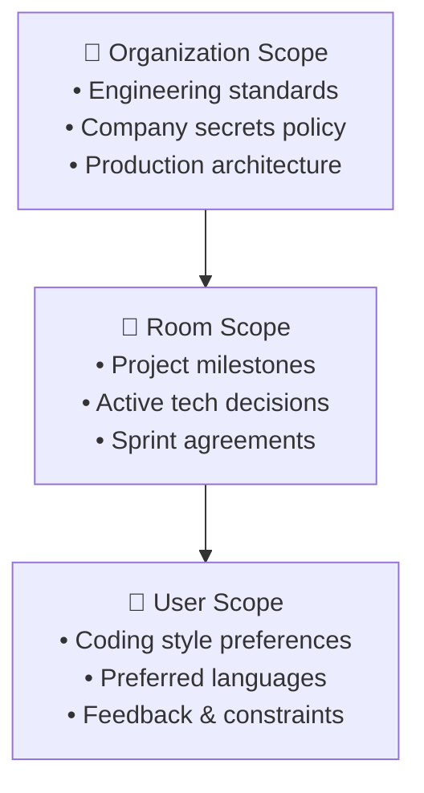

# Multiplayer Rooms & Collaboration

Sayabot is architected around **Multiplayer Rooms** — shared collaborative spaces where human team members and specialized autonomous AI agents co-exist, communicate, share persistent documents, and execute complex engineering tasks side-by-side.

This guide explains room turn mechanics, live collaborative canvases, multi-tier memory systems, task boards, and human approval gates.

---

## 👥 Room Topologies & Turn Modes

Every Sayabot room has an active **Turn Mode** that governs how and when AI agents speak.

### 1. `mentions` Mode (Default)
- Agents only respond when explicitly `@mentioned` by a human or another agent (e.g., `@pocket-saya`, `@coder`).
- Keeps discussions focused and prevents agents from chattering unnecessarily.
- An agent can wake up a teammate by mentioning them in its response (e.g., *"@coder, I've outlined the API spec on the canvas, please implement the endpoints"*).

### 2. `debate` Mode
- Designed for architectural reviews, design brainstorming, and multi-perspective problem solving.
- Multiple agents take sequential turns evaluating a proposition or pull request.
- Agents can challenge each other's assumptions, propose counter-examples, and reach consensus before presenting conclusions to human team members.

### 3. `moderated` Mode
- A human moderator has absolute control over the conversation floor.
- Agents only speak when explicitly called upon by the moderator.
- Ideal for client presentations, executive summaries, or sensitive operations where an agent must not run autonomously.

---

## 🎨 Live Collaborative Canvas (Yjs CRDTs)

Alongside the chat stream, every room features a **Live Canvas** (`split-view`). The canvas allows humans and agents to collaborate directly on persistent artifacts:

```
┌─────────────────────────────────┬─────────────────────────────────┐
│ 💬 Room Chat Stream             │ 📄 Live Shared Canvas           │
│                                 │                                 │
│ User: "@saya draft our API"     │ # Authentication API Spec       │
│                                 │                                 │
│ Saya: "I've drafted the auth    │ POST /api/v1/auth/login         │
│ spec on the canvas. Reviewing   │ Request:                        │
│ endpoints now..."               │ {                               │
│                                 │   "email": "user@example.com"   │
│ [Agent Patching Canvas...]  ●   │ }                               │
│                                 │                                 │
└─────────────────────────────────┴─────────────────────────────────┘
```

### Supported Canvas Artifact Types

| Kind | Editor / Renderer | Use Case |
| :--- | :--- | :--- |
| **`markdown`** | Monaco Editor / GFM Renderer | Architecture docs, PRDs, runbooks, meeting notes. |
| **`code`** | Monaco Code Editor | Code snippets, SQL queries, configs (TypeScript, Python, Go, Rust). |
| **`svg`** | Live Vector Renderer | Flowcharts, system architecture diagrams, UI mockups. |
| **`html`** | Sandboxed IFrame Preview | Interactive generative UI widgets, landing page previews, charts. |

### How Agents Interact with Canvases
Agents do not need to replace entire files when making small changes. They use fine-grained canvas tools:

- **`canvas_read`**: Inspects the current text snapshot of a canvas document.
- **`canvas_write`**: Initializes a new canvas or replaces its full content.
- **`canvas_patch`**: Applies an atomic unified diff (diff hunk) directly into the document.

Because the canvas is backed by **Yjs CRDTs** over WebSockets (`ws://localhost:4000/collab`), human keystrokes and agent patches merge without conflict or lock contention.

---

## 🧠 Multi-Tier Team & Agent Memory

Agents in Sayabot possess a **Multi-Tier Memory Engine** that spans beyond a single chat session. Memory is organized into three distinct hierarchical scopes:



### Memory Scopes

1. **Personal Scope (`user`)**:
   - Stores knowledge specific to an individual user.
   - Example: *"Alice prefers concise TypeScript examples without classes."*
2. **Room Scope (`room`)**:
   - Stores decisions and context relevant to a specific team room or project.
   - Example: *"In this repository, we use pnpm and Drizzle ORM, not Prisma."*
3. **Organization Scope (`org`)**:
   - Company-wide rules, policies, and knowledge available to all agents across all rooms.
   - Example: *"Production deploys only occur on Tuesdays and Thursdays."*

### Agent Memory Tools

- **`memory_save`**: Stores a new fact with explicit `scope` (`user`, `room`, `org`) and semantic tags.
- **`memory_recall`**: Performs a hybrid semantic vector search + FTS5 full-text keyword search across memory stores.
- **`memory_delete`**: Prunes outdated or superseded knowledge.

### Chat Slash Command (`/remember`)
Humans can explicitly teach agents in real time:

```
/remember [scope] <fact>
```

**Examples**:
```bash
/remember room We deploy the frontend to Cloudflare Pages and the backend to Fly.io
/remember user I prefer unit tests written with Vitest rather than Jest
/remember org All public API endpoints require Bearer token authorization
```

---

## 📋 Task Board & Decision Inbox

Sayabot rooms incorporate a real-time Kanban task management system to keep multi-agent workflows deterministic and observable.

```
┌──────────────┬──────────────────┬─────────────────┬──────────────┐
│  Open (3)    │ In Progress (2)  │  Stuck (1)      │  Done (8)    │
├──────────────┼──────────────────┼─────────────────┼──────────────┤
│ • Add SSO    │ • Write unit     │ • Docker build  │ • Schema     │
│ • Write docs │   tests          │   fails on arm64│   migration  │
│              │   [Claimed: Saya]│   [Needs Help]  │              │
└──────────────┴──────────────────┴─────────────────┴──────────────┘
```

### 1. Atomic Task Claiming (`tasks_claim`)
When multiple agents collaborate in a room, race conditions are prevented through atomic task claiming in PostgreSQL. An agent claims a task before beginning work; other agents see the task locked to that agent's handle.

### 2. The `stuck` State & Escalation
If an agent encounters a blocker it cannot resolve (e.g. failing build, missing API credentials, conflicting requirements), it transitions the task status to `stuck` and posts an urgent notification tagging human teammates for guidance.

### 3. Human Decision Requests (`request_human_decision`)
For strategic decisions that should not be automated (e.g., choosing a third-party vendor, spending budget, or selecting an irreversible database migration approach), agents call `request_human_decision`:
- The agent presents the trade-offs and options clearly.
- A **Decision Card** appears in the room with interactive response buttons.
- The agent pauses until a human selects an option, after which the agent automatically resumes execution.

---

## 🛡️ Human Approval Gates for Destructive Actions

Safety is a core tenet of Sayabot. Tools capable of causing irreversible side effects are classified with `dangerous: true`.

### Guarded Operations Include:
- Destructive bash commands: `rm -rf`, `DROP TABLE`, `mkfs`, `dd`.
- Git publishing: `git_commit` and `git_push`.
- Outbound external dispatches: sending emails, posting to external Slack/Discord channels, or triggering production deploys.

### How Approval Works:
1. When an agent attempts a dangerous action, the orchestrator runner pauses turn execution.
2. An interactive **Approval Gate Card** renders in the room chat displaying:
   - Tool name (e.g. `computer_shell`).
   - Exact command or payload to be executed (e.g. `rm -rf ./build_cache`).
   - Proposed target and risk level.
3. Teammates can click **Approve** or **Reject** (with optional feedback).
4. If approved, the tool executes and streams its output. If rejected, the agent receives the rejection explanation and adjusts its plan accordingly.
5. If teammates are away from their keyboard, Sayabot sends a **Web Push Notification (VAPID)** to their mobile or desktop browser.
